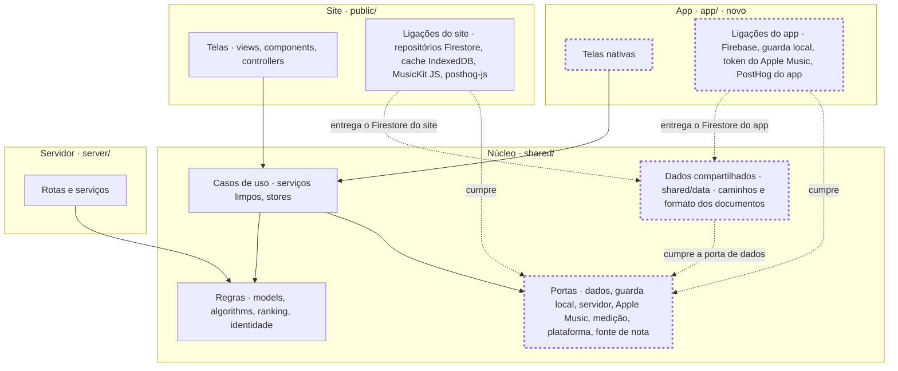
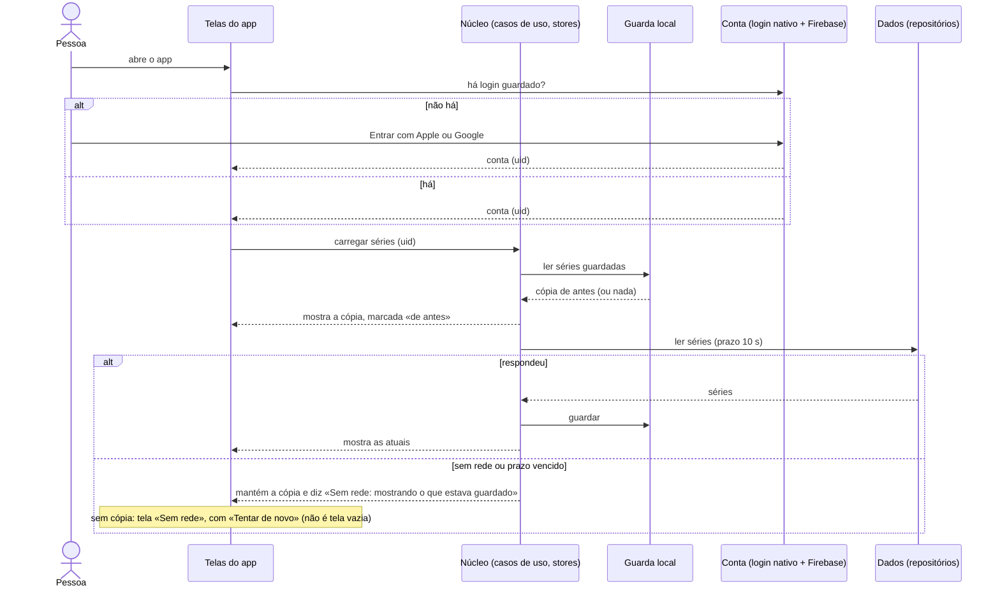
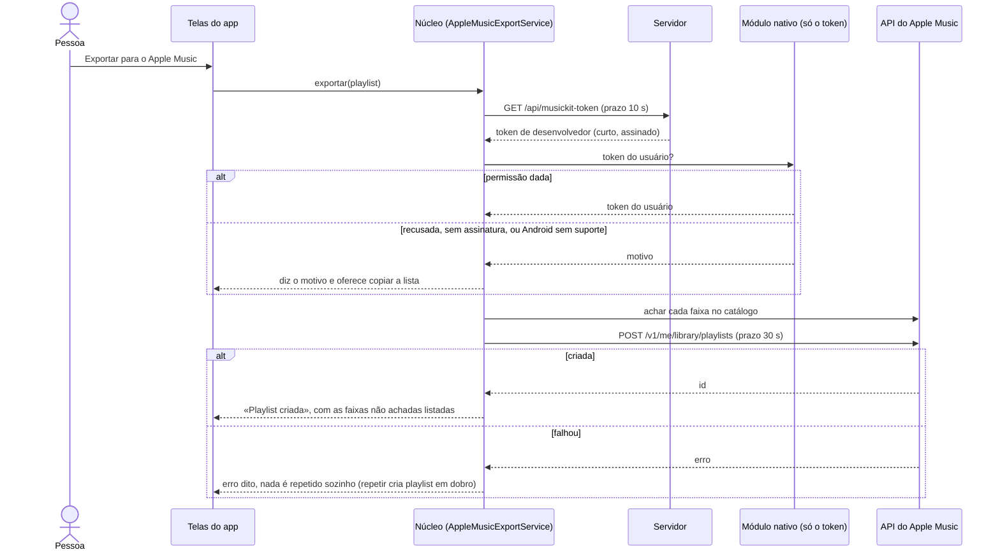
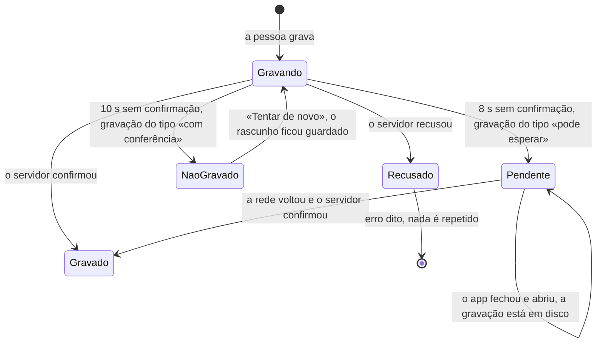
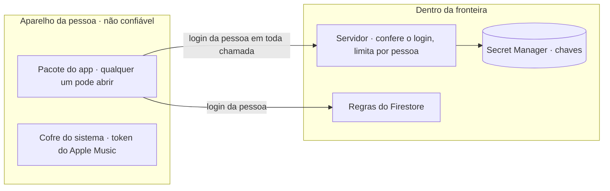
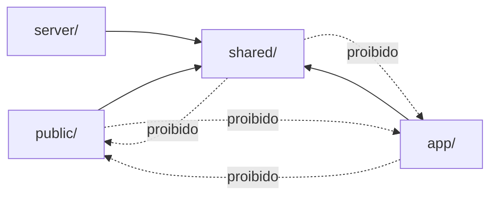
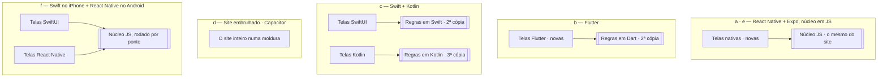

# O Album Blender como app para iPhone e Android — proposta

> **Profundidade:** completa — o risco mais alto é escolher a pilha do app (cara de desfazer: troca a língua, as telas e as ferramentas) apoiado numa promessa não medida («as regras são reaproveitadas»).
> **Página para ler:** https://claude.ai/artifact/35vmLkhuGQhYrBkpzTJzJc (privada, do MJRP; este arquivo é a fonte) · **Crítica:** `reports/audits/2026-11-20-mjrpalbumblender-v0-f78-architecture-critique.md` (bloqueada: 2 P0, 7 P1, 2 P2) · **Estado:** proposta **revista depois da crítica** (2026-11-20 13:35), sem ADR; a resposta a cada achado está na seção 16
> **Seções usadas:** 1 a 13, cada uma diz o risco que reduz; 15 (fatias e spikes) e 16 (resposta à crítica) · **Fora:** 14 (o que vai para o ADR) fica em branco até a aprovação · **Vistas:** contexto e contêineres (onde a mudança fica), dependências (R1, R2, R10), duas sequências (R5 e R3), o estado de uma gravação (R5), fronteira de confiança (R6), opções lado a lado (R1, R8).
> **Quem escreveu não julga:** a seção 15 diz o que o crítico deve atacar primeiro.

## 1. O que muda e por quê

O MJRP quer o Album Blender nas lojas de apps, nas duas plataformas. Palavras dele (2026-11-20):

- «gostaria de considerar Android e ser pública, não deixaria de fora. Seria uma evolução do produto.»
- «Vamos criar a V6.0 para implementação da app e para implementar o posthog no site e na app em reactive native (pq não flutter?)»
- «E pq valeria a pena ter tb uma app nativa em Swift?»

Serve ao requisito [[S-60-use-the-album-blender-as-an-app-from-the-store]] e divide a porta de medição com a F77 ([[S-59-know-how-the-app-is-used]]).

Quem é afetado: o MJRP, que usa um iPhone 15 Pro e hoje é o único usuário; quem vier a instalar o app; o próprio MJRP como único mantenedor, com agentes de IA. O site continua.

**O que a sessão respondeu a ele, e o que esta proposta faz com isso.** A resposta foi: React Native com Expo (TypeScript), porque as regras do app são JavaScript com mais de 3000 testes e viram um núcleo compartilhado; Flutter obrigaria a reescrever em Dart ou levar tudo ao servidor; Swift inteiro só se o iPhone virar o centro. Esta proposta **mediu** essa resposta no código (seção 4.1). Resultado em quatro linhas:

1. **«As regras são JavaScript puro»: verdade para o navegador, não provada para o app.** 116 de 257 arquivos (34% das linhas) não tocam nada do navegador. Mas o app roda em outro motor (Hermes), e a crítica remediu: 2 arquivos quebram nele sem conserto (`crypto.randomUUID`) e alcançam 18 arquivos, todas as receitas e todos os rankings; 61 dos 116 usam recursos que dependem do motor. Dito com honestidade: **cerca de 34% portável depois de um conserto pequeno, cerca de 28% sem tocar em nada, 0% provado num aparelho.**
2. **«Mais de 3000 testes» é mais fraco que o dito:** dos 2.640 casos de teste escritos, **954** exercitam só código que pode ir para o núcleo. O resto testa as telas do site, as ligações e o servidor. É esse o número que vale em toda a proposta.
3. **«Um app reaproveita o site» não vale para as telas:** 46% do código do site é tela (17.562 linhas) e é reescrito em qualquer opção nativa.
4. **Nem para gravar séries e playlists, como está hoje:** `SeriesService` e `PlaylistsService` (820 linhas) estão presos ao Firestore, ao armazenamento do navegador e a um componente de tela. Para o app usar a mesma regra, **o site passa por uma refatoração**, custeada em fatias na seção 4.7. Sem ela, o app nasce com uma segunda cópia.

## 2. Os direcionadores

**Objetivos (palavras do MJRP):** Android e iPhone; público («não deixaria de fora»); «uma evolução do produto», não um produto novo; medir o uso no site e no app.

**Restrições:**

- Uma pessoa só mantém tudo, com agentes de IA.
- O site continua e tem de funcionar a cada passo.
- A constituição (Art. II) diz JavaScript puro, sem TypeScript, e prefere não usar framework de interface «where possible»; `tech-stack.md` lista «framework de UI» em «Decidido não usar». **React Native é um framework de interface.** A escolha pede emenda da constituição, que só o MJRP aprova, e um ADR.
- A pilha só muda por ADR (`tech-stack.md`, Restrições).
- Segredos nunca no código (Art. V): vale em dobro num app, que qualquer pessoa pode abrir e ler.
- O servidor não acessa o Firestore; as regras do Firestore são a única autorização dos dados (`arch.md`).
- O lançamento público depende de três coisas fora do código (estudo de viabilidade): Spotify, preço do Discogs e autorização do BestEverAlbums. Esta proposta constrói o app; publicar é decisão à parte.

**Requisitos de qualidade.** Os números marcados «perguntar» são do MJRP; não foram inventados.

| Requisito de qualidade | Cenário (estímulo → resposta) | Medida |
|---|---|---|
| Uma regra, um lugar | um agente muda uma regra (receita, ranking, identidade) → site, app e servidor passam a usar a mesma, sem segunda edição | zero regras copiadas fora do núcleo (teste de arquitetura) |
| O site não quebra | uma pasta de regras muda de lugar → a suíte do site passa e o site publicado funciona | suíte verde a cada fatia; conferência em produção |
| Sem rede | o MJRP abre o app sem sinal → vê as séries e os álbuns já vistos | perguntar: só ler, ou também editar sem rede? |
| Nada secreto no aparelho | alguém abre o pacote do app → não acha chave de IA, da Apple, do Discogs nem do Spotify | zero segredos no pacote (teste no build) |
| Custo por pessoa | 100 pessoas usam num mês → a conta de IA e servidor fica dentro do teto | perguntar: qual teto por mês? o gasto de hoje não foi medido |
| Carga de quem mantém | sai uma versão nova do iOS, do Android ou do Expo → o app é atualizado em tempo previsível | perguntar: quantas horas por mês ele aceita gastar só mantendo? |
| Passar na loja | a Apple revisa o app → aprova na primeira ou na segunda tentativa | lista da seção 9 cumprida antes do envio |

**O que só o MJRP sabe** está na seção 13, como perguntas.

## 3. Os riscos

Cada risco é um cenário de falha. P = probabilidade, I = impacto.

| # | Risco (o que pode dar errado, por quê) | Tipo | P | I | Custo de desfazer | Seção que o reduz | Estado |
|---|---|---|---|---|---|---|---|
| R1 | **O núcleo é menos reaproveitável do que se disse.** As regras limpas rodam no navegador e no Node, mas o app roda em outro motor (Hermes). Medido pela crítica: `crypto.randomUUID` em `models/Track.js:38` e `transformers/TrackTransformer.js:60` não existe no Hermes e é alcançado por 18 arquivos (todas as receitas e rankings); 61 dos 116 arquivos limpos usam `Intl`, `toLocale*`, `localeCompare`, `normalize`, `\p{…}`, «olhar para trás» ou `URLSearchParams`, que dependem do motor. Um ranking ou uma identidade de álbum pode dar resultado diferente no app | técnico | alta para `crypto` (certa sem conserto); média para o resto | alto | baixo se achado no spike; alto depois | 4.1, 4.3, 11, spike S1 | **aberto**: 0% provado num aparelho. Só a parte «não toca o navegador» está medida |
| R2 | **Duas cópias das regras divergem.** O app copia uma regra «só por agora»; ou, sem a refatoração da seção 4.7, o app escreve a sua própria gravação de séries e playlists e as duas passam a discordar | complexidade | alta sem a costura e sem sensor | alto | médio | 4.3, 4.7, 11 | **reduzido** só se as fatias de refatoração do site (4.7) vierem antes das fatias do app que as usam, e com os sensores da seção 11; senão, aberto |
| R3 | **Apple Music no Android não funciona bem o bastante.** O SDK da Apple para Android existe (1.1.4, maio de 2026), mas tem falhas relatadas no fórum da Apple (login quebrado em versões do app Apple Music, travamentos com itens da biblioteca) e, segundo fonte de terceiros, exige o app Apple Music instalado | técnico | média | médio (exportar é metade do valor) | baixo: fica atrás de uma porta | 4.5, 5.2, spikes S3 e S4 | **aberto** |
| R4 | **A App Store recusa o app.** Por parecer «o site numa moldura» (regra 4.2), por faltar login com a Apple (4.8), apagar a conta (5.1.1(v)) ou rótulo de privacidade | operação | baixa com telas nativas; alta com o site embrulhado | alto | médio | 9, 12 | **reduzido** para a opção recomendada; a lista da seção 9 é a prova |
| R5 | **Gravação perdida ou apagada.** Dois casos. (a) O comum: **um** escritor com sinal ruim: a tela diz «gravado», a gravação ficou na memória e some quando o app fecha. (b) O raro: o celular e o site editam a mesma série e a última gravação a chegar apaga a outra | dados | alta para (a); baixa para (b) | alto (perde trabalho do usuário) | alto depois de publicado (toda tela que grava) | 5.3, 6, 7 | **reduzido pelo desenho**: toda gravação tem prazo e três estados visíveis; o que não tem conflito pode ser gravado sem rede e fica guardado em disco; o que pode apagar trabalho alheio só grava com confirmação do servidor. Falta o teste que corta a rede (seção 11) |
| R6 | **Segredos e chaves no aparelho.** Uma chave vai no pacote do app e é extraída; ou o login guardado no aparelho é lido | segurança | média | alto | alto (chave vazada tem de ser trocada) | 8 | **reduzido** pelo desenho (nada secreto no app) e por teste; a guarda do login depende do S2 |
| R7 | **Custo por pessoa com usuários públicos.** Cada álbum novo chama o servidor e, às vezes, a IA paga. O limite «por pessoa» de hoje vive na memória de cada instância do Cloud Run (`server/lib/rateLimit.js:13`), o deploy não fixa o número de instâncias (`scripts/deploy-server.sh:211`), e criar outra conta é grátis. Não há teto global. O gasto de hoje **não foi medido** | custo | alta | alto | médio | 8, 10 | **aberto**: falta medir (S6), falta o teto do MJRP; o desenho do teto está na seção 8 |
| R8 | **Três alvos para uma pessoa.** Site, iPhone e Android, cada um com atualizações obrigatórias (o Google exige mirar o Android novo todo ano; o Expo lança várias versões por ano). O tempo de manter come o de evoluir | operação | alta | alto | alto | 12, 13 | **aberto**: é a pergunta mais importante ao MJRP |
| R9 | **O desenho de celular da F76 não se traduz.** A F76 é HTML e CSS (Tailwind, folhas, arrastar com SortableJS). Em telas nativas o arrastar, as folhas e as listas longas são outras peças | técnico | média | médio | baixo | 4.6, spike S5, fatia 4 | **aberto** até a rodada de desenho e a fatia do ranking |
| R10 | **Prisão ao fornecedor (Expo e EAS).** O serviço de build muda de preço ou de regra; o plano grátis tem 15 builds por plataforma, fila lenta e 45 minutos de limite | custo | baixa | médio | médio | 4.4, 11 | **reduzido**: o núcleo não importa nada do Expo; o build pode ser feito no Mac dele |
| R11 | **A exportação para o Spotify não pode ser pública.** Em modo de desenvolvimento o Spotify aceita 5 pessoas autorizadas por aplicativo; o acesso ampliado só é pedido por organização com 250 mil usuários ativos por mês | dados | certa | médio | — | 9 | **reduzido** por decisão: fora da primeira versão pública. A popularidade do Spotify nas receitas fica **aberta** |
| R12 | **Regras do Firestore frouxas com gente de fora.** Hoje qualquer pessoa com login (até visitante) grava em `albums/` e em `spotify_enrichment/` (`firestore.rules:45, 52-53`). Com contas públicas, alguém pode estragar o cache de todos | segurança | média | alto | baixo | 8 | **aberto**: o `firestore.rules` é do MJRP |
| R13 | **Apagar a conta não apaga tudo.** As lojas exigem apagar a conta e os dados. O servidor não acessa o Firestore, então hoje só o próprio app poderia apagar, e uma falha no meio deixa dados órfãos | dados | média | alto (recusa na loja, obrigação de privacidade) | médio | 6, 13 | **aberto**: decisão do MJRP (segurança) |
| R14 | **Um app antigo apaga campos novos.** Uma versão do app não se desfaz. O site ganha um campo novo numa série; um app instalado, de antes, regrava a série com o que conhece e apaga o campo. Já aconteceu de o modelo mudar três vezes (`facts`, `appleMusicId`, `owned`) | dados | alta ao longo do tempo | alto | alto (exige versão nova que nem todos instalam) | 6.2, 11 | **reduzido pelo desenho**: regra de convivência, versão do documento, versão mínima do app; falta o teste |
| R15 | **Abuso com a configuração pública do app.** A configuração do Firebase vai no pacote, o projeto aceita login anônimo e não há App Check: qualquer script entra como visitante, grava nos caches de todos e chama a raspagem do BestEverAlbums, cuja autorização decide o produto | segurança | média | alto | médio | 8 | **aberto**: decisão do MJRP (mexe no site) |
| R16 | **O trabalho central fica sem entrada na versão pública.** A receita precisa de nota por faixa: a do BestEverAlbums depende de autorização e a popularidade do Spotify fica fora. Sem as duas, a playlist sai sem critério, ou pela IA a um custo por álbum não contado | dados | média | alto | médio | 4.3, 9 | **aberto**: decisão de produto do MJRP; a porta está desenhada |

## 4. O desenho

### 4.1 O inventário: quanto das regras é portável hoje (medido em 2026-11-20)

**Como foi medido.** Um script leu cada arquivo de `public/js`, `shared` e `server`, tirou os comentários e procurou: DOM (`document.`, `window.`, `navigator.`, eventos), armazenamento do navegador (`localStorage`, `sessionStorage`, `indexedDB`), Firebase, `fetch(`, `MusicKit`, `import.meta.env` e `Worker`. Um arquivo é **limpo** quando nem ele nem nada que ele importa, em cadeia, toca nisso. **Limite da medida:** é busca por texto; não prova que o arquivo roda no motor do app (R1).

| Pasta | Arquivos | Linhas | Tocam direto | Sujos por importar | **Limpos** | Linhas limpas |
|---|---|---|---|---|---|---|
| `public/js/models` | 38 | 4.106 | 0 | 0 | **38** | 4.106 |
| `public/js/algorithms` | 11 | 1.443 | 0 | 0 | **11** | 1.443 |
| `public/js/ranking` | 6 | 452 | 0 | 0 | **6** | 452 |
| `public/js/transformers` | 1 | 170 | 0 | 0 | **1** | 170 |
| `public/js/helpers` | 2 | 125 | 0 | 0 | **2** | 125 |
| `public/js/stores` | 8 | 1.096 | 0 | 0 | **8** | 1.096 |
| `public/js/services` | 51 | 7.467 | 19 | 27 | **24** | 3.285 |
| `public/js/api` | 5 | 614 | 4 | 4 | **1** | 172 |
| `public/js/cache` | 3 | 548 | 1 | 2 | **1** | 99 |
| `public/js/utils` | 16 | 1.132 | 5 | 5 | **11** | 707 |
| `public/js/repositories` | 6 | 1.395 | 4 | 6 | 0 | 0 |
| `public/js/controllers` | 6 | 2.004 | 5 | 6 | 0 | 0 |
| `public/js/views` | 25 | 4.990 | 15 | 22 | 3 | 533 |
| `public/js/components` | 72 | 11.993 | 38 | 63 | 9 | 657 |
| raiz, `workers`, `vendor` | 7 | 709 | 6 | 6 | 1 | 4 |
| **`public/js` inteiro** | **257** | **38.244** | | | **116** | **12.849 (34%)** |
| `shared/` | 3 | 1.358 | 1 | 1 | **2** | 1.289 |
| `server/` | 47 | 4.696 | — | — | — | — |

**Leitura.**

- **Regras puras:** `models`, `algorithms`, `ranking`, `transformers`, `helpers` e `stores` estão 100% limpos: 66 arquivos, 7.392 linhas. Com as duas regras de `shared/` (identidade de álbum e de faixa, 1.289 linhas), o núcleo candidato tem **8.681 linhas**.
- **Serviços:** 24 de 51 são limpos (3.285 linhas). Os maiores já recebem o que precisam de fora: `AlbumLoadService` (527 linhas), `InventoryService` (399), `SavedPlaylistsReader` (240), `AppleMusicExportService` (208). Dos sujos, uma parte são arquivos de ligação (`*Wiring.js`), que o app reescreve. **Os dois maiores não são ligação: são casos de uso presos.** `SeriesService` (262 linhas) cria o `SeriesRepository` por dentro, chama o componente de tela `globalProgress` e usa `StorageService` e `cacheManager`; `PlaylistsService` (558) faz o mesmo com o `PlaylistRepository`; `albums/albumLoading.js` (175) mistura ligação com orquestração (abre um aviso de tela, usa `localStorage`). A primeira versão desta proposta dizia «na maioria, ligações»: estava errado para estes, e a seção 4.7 conserta.
- **Já em `shared/` hoje:** só `albumIdentity.js` (703 linhas), `trackIdentity.js` (586) e `services/AuthService.js` (69, do navegador: usa `signInWithPopup`, que não existe no app).
- **O que não é reaproveitado em nenhuma opção nativa:** `components`, `views` e a raiz: 102 arquivos, **17.562 linhas, 46% do site**.
- **Zona cinzenta:** os `controllers` (2.004 linhas) estão sujos, mas só 15 linhas deles tocam o navegador direto. Dá para extrair a parte de regra; não foi medido quanto.
- **Firebase:** fica atrás de 6 repositórios (1.395 linhas) mais `firebase-init.js`; um teste de arquitetura já proíbe o Firestore fora dali. O site **não liga** a guarda em disco do Firestore; o que funciona sem rede hoje é o cache próprio (`cache/`, IndexedDB).
- **Servidor:** `createServerFetch` já é pura (recebe quem dá o login e o `fetch`). O endereço do servidor vem de `window.__api_base || '/api'`: o app precisa do endereço completo.
- **Apple Music:** `services/musickit/` (3 arquivos, 630 linhas) usa o MusicKit JS do navegador. Mas **todas as chamadas de catálogo e de biblioteca são caminhos da API da Apple** (`/v1/catalog/{loja}/search`, `/v1/me/library/playlists`), passados a `music.api.music(caminho, …)`. Isso decide o desenho da seção 4.5.
- **Spotify:** `SpotifyAuthService` (329 linhas) usa `window`, `localStorage` e `import.meta.env`; fica fora do app na primeira versão (R11).

**Quanto disso roda no app (remedição da crítica, 2026-11-20).** «Limpo» quer dizer «não toca o navegador». Não quer dizer «roda igual no app»:

| O quê | Quanto | Estado |
|---|---|---|
| Não toca o navegador | 116 arquivos, 34% das linhas de `public/js` | medido duas vezes, igual |
| Quebra no motor do app sem conserto | 2 arquivos (`crypto.randomUUID`), alcançados por 18 arquivos e 2.124 linhas: todas as receitas e todos os rankings | certo, pela documentação do Hermes |
| Depende do motor (`Intl`, `toLocale*`, `localeCompare`, `normalize`, `\p{…}`, «olhar para trás», `URLSearchParams`) | 61 dos 116 arquivos, 8.213 linhas | roda pela documentação; a igualdade com o site tem de ser provada |
| **Portável sem tocar em nada** | **cerca de 28%** | pela documentação, não por execução |
| **Portável depois de um conserto de `crypto`** | **cerca de 34%** | idem |
| **Provado num aparelho** | **0%** | nada foi executado no Hermes |
| Reaproveitado pelo app sem refatorar o site | menos que 34%: os casos de uso de séries e playlists ficam fora até a seção 4.7 | medido |

**Os testes.** 241 arquivos, 2.640 casos escritos (a suíte conta 3.064 ao rodar, porque casos em tabela se multiplicam). Destes: **954 casos em 71 arquivos exercitam só código limpo** (models 379, serviços 270, shared 114, stores 66, utils 48, algorithms 45, outros 32); 400 são do servidor; 157 são de arquitetura; o resto, cerca de 1.100, testa telas, ligações e repositórios do site. Todos rodam hoje em ambiente de navegador simulado (`jsdom`), não no motor do app.

### 4.2 Contexto


O que é novo está tracejado: o app, o núcleo com casa própria, o PostHog (F77) e as lojas. O servidor, o Firebase e as fontes de fora ficam como estão.

### 4.3 Contêineres e a regra de dependência



**A regra, em uma frase:** tudo aponta para o núcleo; o núcleo não aponta para ninguém. Ele não importa navegador, React, Expo, Firebase nem `fetch`. O que ele precisa do mundo de fora ele pede por uma **porta** (uma lista de funções), e cada lado (site, app) entrega a sua ligação.

**Onde mora cada regra: núcleo ou servidor.** Um critério só, em ordem:

1. Precisa de segredo (chave de IA, chave da Apple, token do Discogs) ou de raspar um site → **servidor**. Sempre.
2. Tem de funcionar sem rede, ou responde ao toque (gerar a playlist, ordenar, filtrar, somar o inventário) → **núcleo**.
3. É a mesma decisão nos dois lados (é o mesmo álbum? é a mesma faixa?) → **núcleo**, e o servidor o importa, como já faz hoje.
4. Custa dinheiro por chamada, ou precisa de limite por pessoa → **servidor**.
5. Na dúvida → núcleo, porque é mais barato de testar e não custa por chamada.

**Portas novas ou a nomear** (a maioria já existe como «o que o serviço recebe de fora»):

| Porta | O que pede | Ligação no site (existe) | Ligação no app (nova) |
|---|---|---|---|
| Dados da pessoa | ler e gravar séries, playlists, inventário, rankings; cada gravação devolve um estado (seção 5.3) | os repositórios, que passam a morar em `shared/data/` e **recebem as funções do Firestore de fora** (seção 4.7); o site entrega as do Firebase JS | os mesmos repositórios; o app entrega as do Firebase nativo |
| Guarda local | ler e gravar por chave, com validade | `cache/` (IndexedDB), `StorageService` (localStorage) | guarda em disco do aparelho |
| Servidor | chamar `/api/*` com o login | `createServerFetch` + `fetch` | a mesma função, com o endereço completo |
| Apple Music | `request(caminho, parâmetros, opções)` e «quem é o usuário» | MusicKit JS | `fetch` à API da Apple + módulo nativo pequeno que só entrega o token do usuário |
| Medição (F77) | `track(evento, propriedades)` com nomes fixos | `posthog-js` | `posthog-react-native` |
| Conta | entrar, sair, quem está | Firebase Auth com janela (`signInWithPopup`) | login nativo da Apple e do Google, depois credencial no Firebase |
| Plataforma | `newId()`, comparar e normalizar texto: o que depende do motor fica em três funções, num arquivo só (`shared/platform/`) | `crypto.randomUUID`, `localeCompare`, `normalize` do navegador | as do app (com `expo-crypto` para o id), testadas no aparelho |
| Formatação | dinheiro, data e hora viram texto de tela **fora** das regras | `toLocale*` do navegador | `Intl` do app; a saída pode diferir entre iPhone e Android, e isso deixa de afetar regra |
| Fonte de nota por faixa | «que notas existem para este álbum, de onde, com que desfecho» (`models/ratingsOutcome.js` e `models/recipeSources.js` já descrevem os desfechos) | servidor (BestEverAlbums), Spotify, ranking próprio | servidor e ranking próprio; o que entra no lugar das duas fontes ausentes é a decisão 3 |

**A porta de medição da F77, dividida.** Em `shared/usage/` moram: a lista fixa dos nomes de evento, a função `track(evento, propriedades)` que recusa o que não está na lista e o que leva texto da pessoa (F77, REQ-03), e o interruptor (REQ-04). Site e app entregam cada um a sua ligação com o PostHog. Nenhuma tela fala com o PostHog (REQ-01); os mesmos nomes servem aos dois (REQ-05).

### 4.4 O app e a organização do repositório

**Organização proposta** (o site não muda de lugar):

```
shared/        o núcleo. Já existe, já tem o apelido @shared no Vite, o servidor já o importa
  models/ algorithms/ ranking/ ...   chegam aqui pasta a pasta
  ports/       as portas, descritas em JSDoc
  data/        os repositórios (caminhos e formato dos documentos); recebem as funções do Firestore de fora
  platform/    newId, comparar e normalizar texto: o único lugar que pode depender do motor
  usage/       os nomes dos eventos da F77 e a checagem «sem dado pessoal»
public/        o site, onde está
server/        o servidor, onde está (continua recebendo shared/ copiado no build)
app/           o app Expo, com package.json próprio   ← novo
test/          os testes, onde estão; os do núcleo passam a rodar também sem jsdom
```

- **Por que não uma pasta `apps/` e `packages/`:** mover `public/` quebra o `vite.config.js`, os scripts de publicação, os caminhos de 241 arquivos de teste e de 22 testes de arquitetura, sem reduzir nenhum risco listado. A constituição já diz «Shared logic with frontend via `/shared` directory». Fica para depois, se um dia doer.
- **O que muda de lugar, e como o site continua de pé:** uma pasta por vez, na ordem em que o app precisa. Cada mudança é um commit: mover os arquivos, trocar os `import` do site por `@shared/…`, mover os testes, suíte verde, site conferido. Nenhuma pasta é movida «para adiantar».
- **Como o app enxerga o núcleo:** espaços de trabalho do npm (`workspaces`), que o Expo configura sozinho desde o SDK 52. Não foi verificado que um pacote em JavaScript puro (ES Modules) entra limpo no Vite e no empacotador do app ao mesmo tempo: é o spike S1.
- **Linguagem do app:** TypeScript em `app/`, JavaScript com JSDoc no núcleo. É compromisso, com custo: duas convenções no repositório e emenda à constituição. A alternativa (JavaScript em tudo) cumpre a constituição e perde a checagem de tipos nas telas novas. Decisão do MJRP (seção 13).
- **Firebase no app: a recomendação mudou depois da crítica, para o Firebase nativo (React Native Firebase).**

| | Firebase JS (o mesmo do site) | React Native Firebase (nativo) |
|---|---|---|
| Reaproveitar os repositórios | **não existia**: os repositórios importam o Firebase direto e o app não pode importar `public/` | igual: nenhum dos dois reaproveita sem a seção 4.7 |
| Guarda em disco do Firestore | **não tem** no app (cai para memória) | ligada por padrão |
| Gravação pendente quando o app fecha | **perde-se** | fica em disco e é enviada depois |
| Saber que uma gravação ainda não foi confirmada | sim, mas só enquanto o app está aberto | sim, e sobrevive ao fechar |
| Onde o login fica guardado | guarda comum do app; o ajuste já quebrou entre versões (firebase-js-sdk #9316) | cofre do sistema |
| App Check (seção 8) | caminho menos direto | peça nativa |
| Build próprio | não precisa | precisa, **mas o app já precisa** pelo módulo do token do Apple Music e pelo login com a Apple |

  A primeira versão desta proposta escolhia o Firebase JS «porque reaproveita os repositórios» e «porque a primeira versão não grava sem rede». As duas razões caíram: o reaproveitamento não existia e, com o Firebase JS, «só grava com rede» não pode ser garantido. O custo que restava contra o nativo (o build próprio) já está pago. **Recomendação: React Native Firebase.** Aposta a provar: que a interface dele em funções soltas é igual o bastante à do Firebase JS para os repositórios de `shared/data/` servirem aos dois recebendo as funções de fora. **Não verificado.** O spike S2 roda os dois lado a lado e decide com perguntas de sim ou não; se a aposta falhar, o app ganha um conjunto próprio de repositórios finos e a regra de formato (seção 6.2) continua uma só, em `shared/data/`.
- **Build:** build de desenvolvimento (o Expo Go não carrega código nativo próprio). Pode ser feito no Mac do MJRP (`expo run:ios`, Xcode) ou no serviço do Expo (grátis: 15 builds por plataforma, fila lenta; pago: US$ 19 por mês). O núcleo não depende de nenhum dos dois (R10).

### 4.5 Apple Music no app

O site já fala com o Apple Music por **caminhos da API da Apple**. O app faz o mesmo, sem embrulhar o MusicKit inteiro:

- **Catálogo** (buscar artista e álbum, ler faixas): só precisa do token de desenvolvedor, que o servidor já assina (`GET /api/musickit-token`). **Não pede código nativo e funciona igual no iPhone e no Android**, mesmo para quem não assina o Apple Music.
- **Biblioteca** (criar a playlist): precisa também do token do usuário. Esse é o único pedaço nativo: um módulo pequeno em Swift (iPhone) e outro em Kotlin (Android, sobre o SDK de login da Apple) que **só pedem a permissão e devolvem o token**.
- **Se o Android falhar (R3):** o app no Android mostra a playlist e oferece copiar a lista; exportar fica só no iPhone, dito na tela. A porta é a mesma, a ligação do Android responde «não disponível».

Não verificado: a chamada direta a `POST /v1/me/library/playlists` com os dois tokens a partir de um app (a página da Apple não abriu por inteiro); a evidência é o próprio site, que usa esse caminho pelo MusicKit JS. São os spikes S3 e S4.

### 4.6 As telas

O desenho da F76 é o ponto de partida do **conteúdo e da navegação**, não do código: cinco destinos na barra de baixo (Home, Albums, Blend, Playlists, Inventory), folha de baixo para escolhas curtas, folha de tela cheia para ler e editar, medidas de `design-system.md` § Celular (alvo de 44, texto de 12 no mínimo, margem de 16). Essas peças existem como componentes nativos. O que **não** passa: as classes do Tailwind, o CSS de `public/css/mobile/` e o arrastar do SortableJS. A rodada de desenho (`mjrp-designing-ui`) já está nas tarefas da F78 e vem antes das telas. Lembrete: a F76 ainda espera o juízo do MJRP no iPhone (TASK-09); desenhar o app em cima de um desenho não julgado repete o risco.

### 4.7 A costura: o que vai para o núcleo, o que ganha porta, o que é reescrito

Responde ao achado 1 da crítica. Três casas, sem quarta:

- **`shared/` (núcleo):** regras e casos de uso. Não importa Firebase, tela, armazenamento nem `fetch`.
- **`shared/data/`:** os repositórios. Sabem os caminhos e o formato dos documentos; **não importam** `firebase`: recebem `doc`, `getDoc`, `updateDoc`, `runTransaction` e as outras por parâmetro. As regras (`models`, `algorithms`, `ranking`) não podem importar `shared/data/` (sensor, seção 11).
- **Cada lado (`public/`, `app/`):** as ligações (quem entrega o Firestore, a guarda local, o aviso de progresso) e as telas.

**Por caso de uso que o app chama:**

| Fatia do app | Caso de uso | No núcleo hoje? | O que tem de acontecer antes |
|---|---|---|---|
| 2 · listar séries | ler séries (`SeriesService`, `SeriesRepository`, store `albumSeries`) | store sim; serviço e repositório **não** | Ref-A e Ref-B |
| 2 · conta | `UserSessionService` (limpo) | sim | mover |
| 3 · álbuns | `AlbumLoadService` (limpo, 527 linhas) e adaptadores limpos | sim | mover; o app escreve a sua ligação no lugar de `albumLoading.js`; Ref-D tira a orquestração que está na ligação do site |
| 4 · ranking | `OwnRankingService` (limpo), `UserRankingRepository` | serviço sim; repositório **não** | Ref-A |
| 5 · blend e playlists | `PlaylistGenerationService` (limpo), receitas (limpas, com o conserto de `crypto`), `PlaylistsService` (**não**), `PlaylistRepository` (**não**) | em parte | Ref-A e Ref-C |
| 5 · exportar | `AppleMusicExportService`, `exportLedger` (limpos) | sim | mover |
| 6 · inventário | `InventoryService` (limpo, 399), `InventoryRepository` | serviço sim; repositório **não** | Ref-A |
| todas | controllers do site (2.004 linhas) | não | **reescritos por plataforma**: no app, a tela chama o caso de uso direto. O que houver de regra dentro deles sai para o núcleo quando a fatia tocar nele |

**A refatoração do site, em fatias.** Cada uma é publicada sozinha, com a suíte do site verde, e **vale mesmo que o app nunca exista** (tira Firebase e tela de dentro dos serviços, que a ADR-0016 e a 0017 já pedem).

| Fatia | O que muda no site | Tamanho | Testes que já seguram | Antes de |
|---|---|---|---|---|
| Ref-0 | `Track` e `TrackTransformer` pedem o id a `newId()` (porta de plataforma) em vez de `crypto.randomUUID` | 2 arquivos, 2 linhas, mais a porta | os de models e algorithms | spike S1 |
| Ref-A | `BaseRepository` e os 5 repositórios recebem as funções do Firestore de fora e vão para `shared/data/`; os arquivos de ligação do site entregam as do Firebase JS | 6 arquivos, 1.395 linhas tocadas de leve (só os `import` e o construtor) | 36 casos em `test/repositories`, mais `firestoreBehindRepositories` | fatia 2 do app |
| Ref-B | `SeriesService` recebe o repositório, a guarda e o aviso de progresso de fora; sai `globalProgress`, sai `new SeriesRepository` por dentro; vai para o núcleo | 262 linhas, 20 arquivos de teste o citam | os de `test/services` | fatia 2 do app |
| Ref-C | o mesmo em `PlaylistsService` | 558 linhas, 6 arquivos de teste o citam | idem | fatia 5 do app |
| Ref-D | `albums/albumLoading.js` fica só ligação; a orquestração (o aviso de tela, o uso direto de `localStorage`) sai para um caso de uso com porta | 175 linhas | os de carga de álbuns | fatia 3 do app |

O tamanho está em linhas e arquivos porque é o que foi medido. **Não foi estimado em horas**: depende de quanto os testes de hoje dependem das importações diretas, e isso só se vê fazendo a Ref-A.

## 5. Os fluxos

Reduz R5 (sem rede) e R3 (Apple Music).

### 5.1 Entrar e ver as séries pela primeira vez, pronto para abrir sem rede



O que acontece quando a pessoa grava está na seção 5.3.

### 5.2 Exportar uma playlist para o Apple Music, do app



O livro de exportações que já existe (`services/export/exportLedger.js`) continua dizendo o que já foi exportado, para a segunda tentativa não duplicar.

### 5.3 Gravar: prazo, três estados na tela, e o que acontece ao fechar o app

Responde ao P0-1 da crítica. Nenhuma tela diz «gravado» antes de o servidor confirmar.



**Dois tipos de gravação**, pelo que ela pode estragar:

| Tipo | Vale para | Como grava | Sem rede |
|---|---|---|---|
| **Pode esperar** | item do inventário (novo ou editado: cada item é um documento próprio); ranking próprio de um álbum (um documento por álbum) | só os campos que mudaram; fica na fila em disco do Firebase nativo | **funciona**: a tela mostra «A enviar» no item até a confirmação; fechar o app não perde |
| **Com conferência** | série (a lista `albumQueries` é regravada inteira) e playlists | numa transação que relê o documento, confere que ninguém o mudou desde a leitura e preserva o que não conhece (seção 6.2). Uma transação do Firestore só roda com o servidor | **não grava**, e diz: «Não gravado: sem rede», com «Tentar de novo»; o que a pessoa fez fica num rascunho local, como o site já faz com as playlists |

Isto troca o «só grava com rede» da primeira versão. O uso que mais precisa do celular sem sinal, o inventário numa loja de discos e o ranking no avião, passa a funcionar; o que pode apagar trabalho de outro aparelho continua pedindo o servidor, e agora com prazo e com aviso.

## 6. Os dados

Reduz R5 e R13. O app **não cria entidade nova**: usa as de `data-model.md`, nos mesmos caminhos.

| Entidade | Onde mora | Quem escreve | Obrigação | Vida e purga |
|---|---|---|---|---|
| Série, playlist, inventário, ranking próprio | Firestore, sob o `uid` | site e app, pelos repositórios | dado pessoal: sai quando a conta é apagada | hoje não há purga: ver R13 |
| Cópia local no aparelho | guarda local do app | o app | sai ao sair da conta e ao apagar a conta | regravada a cada leitura boa |
| Token do usuário do Apple Music | cofre do sistema no aparelho | o app | nunca vai ao Firestore nem ao servidor | sai ao sair da conta |
| Preço do Discogs | **nenhum lugar no app público** | — | não pode ir ao Firestore (regra em vigor); fora da versão pública | — |
| Eventos de uso | PostHog | site e app, pela porta | sem dado pessoal nem texto da pessoa (F77, REQ-03) | a do PostHog |

### 6.1 Dois escritores

Site e app gravam os mesmos documentos, e o Firestore não funde: vence a última gravação. A resposta está na seção 5.3: inventário e ranking próprio gravam só os campos que mudaram (sem conflito de documento); série e playlists gravam por transação com conferência. Quando a conferência falha (outro aparelho gravou antes), a tela diz «Esta série mudou em outro aparelho» e recarrega, com o rascunho guardado.

### 6.2 Convivência entre versões do app e o site

Responde ao P0-2 da crítica. Uma versão do app fica instalada depois que o site e os dados mudam. Regras, que valem para o site e para o app porque moram em `shared/data/`:

1. **Ninguém regrava um documento inteiro.** Gravar é `update` dos campos que mudaram. Hoje o `BaseRepository` usa `setDoc` sem fusão em um caminho (`:173`); muda na Ref-A.
2. **Lista de objetos: preserva o que não conhece.** Ao regravar `albumQueries`, o escritor parte dos objetos lidos e só troca os campos que ele entende. Um campo desconhecido num objeto volta como veio.
3. **Cada documento leva `schemaVersion`.** Quem lê um número maior do que conhece **abre só para leitura** e diz «Atualize o app para editar». Nunca grava por cima.
4. **O formato só cresce.** Campo novo entra; campo antigo não muda de sentido nem sai enquanto houver versão do app que o lê. Tirar ou renomear: primeiro subir a versão mínima, esperar, depois tirar.
5. **Versão mínima do app.** O servidor diz a versão mínima por plataforma (`GET /api/app-config`, pública, sem segredo). Abaixo dela o app abre numa tela «Atualize para continuar», com o botão da loja. É o único jeito de «desfazer» uma versão ruim.
6. **O mesmo vale para `/api`:** respostas só crescem; a versão anterior do app continua aceitando.

Custo: a regra 5 obriga quem tem versão velha a atualizar. É decisão do MJRP (seção 13).

**Conta de visitante.** O site entra como visitante sozinho, e entrar com Google ou Apple troca de `uid` (os dados do visitante ficam no `uid` antigo). No app, proposta: **sem visitante**; entra com conta ou não entra. Evita levar esse problema para as lojas. É decisão de produto (seção 13).

**Apagar a conta.** Duas formas, nenhuma escolhida:
- pelo app: os repositórios apagam cada coleção da pessoa e depois a conta. Simples; se cair no meio, sobram dados sem dono.
- pelo servidor: uma rota nova apaga tudo com credencial de administrador. Mais segura; muda uma regra do `arch.md` («o servidor não acessa o Firestore») e dá ao servidor uma chave que hoje ele não tem.

## 7. Falhas e prazos

Reduz R3 e R5. Os prazos do servidor são os de hoje; os do app são propostos.

| Chamada ou etapa | Prazo | Retentativa | Se falhar, quem usa vê | Erro distinto de vazio? |
|---|---|---|---|---|
| Entrar (Apple, Google) | o do sistema | não | «Não foi possível entrar», com tentar de novo | sim |
| Ler séries no Firestore | 10 s | uma, ao voltar a rede | a cópia guardada, marcada; sem cópia, tela «Sem rede» | sim |
| Gravar inventário ou ranking próprio («pode esperar») | 8 s até mostrar «A enviar» | o Firebase nativo reenvia sozinho, inclusive depois de fechar o app | «A enviar» no item; depois «Gravado»; se o servidor recusar, erro dito | sim |
| Gravar série ou playlist («com conferência») | 10 s | **não** sozinho; «Tentar de novo» com o rascunho guardado | «Não gravado: sem rede», ou «Esta série mudou em outro aparelho» | sim |
| Ler a versão mínima do app | 5 s | na próxima abertura | nada: sem resposta, o app segue (não trava quem está sem rede) | não se aplica |
| `/api/enrich-album` | o de hoje (o servidor raspa em até 30 s) | as de hoje (`api/client.js`) | o álbum sem nota, com o motivo (`serverResult.js` já distingue) | sim |
| Token de desenvolvedor do Apple Music | 10 s | uma | «Apple Music indisponível agora» | sim |
| Token do usuário | o do sistema | não | o motivo (sem assinatura, recusou, sem suporte) | sim |
| Criar playlist no Apple Music | 30 s | **não** (duplicaria) | erro dito; o livro de exportações evita o dobro | sim |
| Enviar evento de uso | sem esperar | a do PostHog | nada; o app não depende disso | não se aplica |

## 8. Segurança e privacidade

Reduz R6, R12 e R13.



**O que nunca vai no app:** a chave da IA, a chave privada da Apple, o token do Discogs, o segredo do Spotify, qualquer credencial de administrador do Firebase. Todos ficam no servidor, como hoje.

**O que vai no app, e é público por natureza:** a configuração do Firebase, a chave de projeto do PostHog, o endereço do servidor. Não são segredos; a proteção são as regras do Firestore e a porta do servidor.

**Cada superfície:**

| Ação | Quem pode | Como é conferido | Limite |
|---|---|---|---|
| Rotas pagas (`/api/ai/*`, `/api/generate`) | pessoa com conta, não visitante | o servidor confere o login do Firebase (`server/lib/auth/`) | 60 por hora por pessoa (hoje) |
| Rotas custosas (raspagem) | qualquer pessoa com login | idem | 900 por hora por pessoa (hoje) |
| Ler e gravar os próprios dados | o dono | regras do Firestore | — |
| Gravar em `albums/` e `spotify_enrichment/` | **qualquer pessoa com login** | regra frouxa (R12) | nenhum |

- **R12 fica aberto:** antes de abrir contas ao público, essas duas regras têm de fechar ou a gravação tem de passar pelo servidor. O `firestore.rules` é do MJRP, e nenhum pipeline o publica hoje.
- **O servidor aceita chamada sem cabeçalho de origem.** Um app nunca manda esse cabeçalho, então isso já funciona; a proteção é o login em cada chamada.

**O que um app público muda (achados 4 e 5 da crítica).**

- **«Sem visitante no app» não fecha nada.** O projeto Firebase continua aceitando login anônimo, porque o site depende dele, e a configuração que vai no pacote basta para um script entrar como visitante. Com isso ele grava em `albums/` e `spotify_enrichment/` e chama a raspagem.
- **App Check.** É a peça do Firebase para «só o meu app e o meu site chamam»: atestado do aparelho no iPhone (App Attest) e no Android (Play Integrity), e do navegador no site. Proposta: exigir no Firestore e conferir no servidor em toda rota de `/api` que custa. Um teste chama `/api/enrich-album` sem atestado e tem de receber recusa. **Não verificado:** como o servidor confere o atestado sem a biblioteca de administrador do Firebase, e o que o App Check custa no site.
- **O que o visitante pode fazer** é decisão do MJRP (seção 13, decisão 7). Recomendação: App Check nos dois lados; o visitante continua existindo só no site, não grava em cache de todos e tem limite de raspagem menor; no app, conta obrigatória.
- **Onde mora o limite por pessoa.** Hoje, na memória de cada instância. Proposta em dois degraus: (1) já, sem peça nova: fixar o número máximo de instâncias no deploy (`--max-instances`), para o pior caso ser conhecido (instâncias vezes o limite); (2) antes do público: a contagem sai da instância para um lugar compartilhado. Qual lugar depende da decisão 11 (se o servidor ganhar acesso de administrador ao Firestore para apagar contas, a contagem mora lá).
- **Teto global de gasto, que para, não só avisa.** Um número de chamadas pagas por dia para o produto inteiro. Ao bater, o servidor responde com o desfecho «limite do dia» e o app carrega o álbum sem a parte paga, dizendo por quê (`api/serverResult.js` já distingue desfechos). A forma mais barata é uma cota diária na própria chave da IA, no Google Cloud, que corta sem código. **Não verificado** que a API do Gemini aceita essa cota por dia. O valor é a decisão 6.

- **Privacidade nas lojas:** política de privacidade publicada; rótulo de privacidade (Apple) e formulário de segurança de dados (Google); manifestos de privacidade dos SDKs (a Apple lista o Firebase entre os que exigem). O texto e o consentimento (LGPD) são do MJRP; a F77 já tem a pergunta aberta.

## 9. Relação com o que já existe

Reduz R4, R8 e R11.

- **ADRs em vigor (0015 a 0021):** nenhuma é trocada. A 0016 (regra nasce como serviço) e a 0017 (store só guarda estado) são o que tornou o núcleo portável: ficam e passam a valer também no app.
- **Constituição:** pede emenda em três artigos, só para `app/`: Art. II (framework de interface e TypeScript); Art. IV (os testes de ponta a ponta são com Puppeteer, que não dirige um app); Art. V (publicação por CI/CD sem parada: o app sai do Mac do MJRP e passa pela revisão da loja). Sem emenda, a proposta não pode ser construída; a opção que não pede emenda está na seção 12, opção (g).
- **`tech-stack.md`:** ganha as linhas do app depois do ADR; a linha «Decidido não usar: framework de UI» passa a dizer «no site».
- **Arquivos que a mudança toca:** `shared/` (cresce), os `import` do site que apontam para as pastas movidas, `vite.config.js` e `vitest.config.js` (nada, se o apelido `@shared` bastar), `scripts/deploy-server.sh` (já copia `shared/`; conferir que copia as pastas novas), `test/architecture/` (testes novos, seção 11), `package.json` da raiz (`workspaces`); pela seção 4.7: `public/js/services/SeriesService.js`, `PlaylistsService.js`, `services/albums/albumLoading.js`, os 6 arquivos de `public/js/repositories/`, `models/Track.js`, `transformers/TrackTransformer.js`; pela seção 8: `firestore.rules`, `server/lib/rateLimit.js`, `scripts/deploy-server.sh`, a configuração de login e de App Check do projeto Firebase, uma rota nova `GET /api/app-config`; e `docs/specs/constitution.md`, `docs/specs/tech-stack.md`, `.mjrp-project.yml` depois do ADR.
- **Publicação:** o site e o servidor continuam com os scripts de hoje. O app ganha um caminho próprio, do Mac do MJRP até o TestFlight e o teste fechado do Google. Uma versão ruim do app **não se desfaz**: quem instalou fica com ela até atualizar. Por isso o servidor tem de continuar servindo a versão anterior do app: **toda mudança em `/api` e no formato dos documentos do Firestore passa a ser compatível para trás** (antes, site e servidor eram publicados juntos). As regras estão na seção 6.2.

**Dois marcos, separados** (a crítica recomendou e a proposta adota): **A, o app para o MJRP** (TestFlight interno, só ele, com tudo o que o site tem); **B, o app público**, que só começa depois das três respostas de fora (BestEverAlbums, Discogs, Spotify) e da decisão 3.

**O que tem de ser verdade antes de cada envio.**

| Antes de… | Tem de ser verdade |
|---|---|
| TestFlight interno (só o MJRP) · marco A | conta de desenvolvedor da Apple (US$ 99 por ano); o app entra e lista as séries; as regras da seção 6.2 já valem (o app dele grava nos dados dele) |
| TestFlight externo e revisão da Apple | login com a Apple ao lado do Google (regra 4.8); apagar a conta de dentro do app (5.1.1(v)); política de privacidade e rótulo; conta de demonstração para o revisor; telas nativas com valor próprio (4.2); Spotify e preço do Discogs desligados; R12 fechado; App Check e a decisão do visitante (R15); versão mínima do app funcionando; a fonte de nota decidida (R16) |
| Teste fechado do Google | conta do Google (US$ 25, uma vez); mirar o Android 16 (API 36); **12 testadores inscritos por 14 dias seguidos** (regra das contas pessoais novas) |
| Produção nas duas lojas | autorização escrita do BestEverAlbums (ou o plano B do estudo); apagar a conta também por um endereço na web (Google); o limite por pessoa fora da instância e o teto global de gasto (seção 8); decisão do MJRP de publicar |

**Fica fora da primeira versão pública:** exportar para o Spotify; preço do Discogs; editar série e playlist sem rede (inventário e ranking próprio funcionam sem rede); widget, Atalhos e Siri; iPad e tablet; conta de visitante; compra dentro do app; avisos (notificações).

## 10. Custo com número

Reduz R7 e R10. Onde não há número, está dito.

| Item | Volume esperado | Plano necessário | Custo |
|---|---|---|---|
| Programa de desenvolvedor da Apple | 1 conta | — | US$ 99 por ano (conferido) |
| Conta de desenvolvedor do Google | 1 conta | — | US$ 25, uma vez (conferido) |
| Build do app (Expo) | poucas por semana | grátis (15 por plataforma, fila lenta) ou no Mac dele | US$ 0; Starter US$ 19 por mês se a fila atrapalhar |
| PostHog | eventos de 1 a 100 pessoas | não conferido | não conferido (pergunta aberta da F77) |
| IA (Gemini) e servidor por pessoa | não medido | — | **não medido**; teto técnico de hoje: 60 chamadas pagas por hora por pessoa |
| Firestore | leituras por abertura do app | plano atual | não medido |

**Carga de manter, por alvo, sem feature nova** (achado 7 da crítica). São **estimativas do agente, não medidas**; as premissas estão na linha. Servem para o MJRP ter com o que comparar na decisão 7.

| Alvo | O que volta sempre | Estimativa |
|---|---|---|
| Site | o de hoje, mais manter `/api` e os documentos compatíveis para trás (seção 6.2) | o de hoje, mais 1 a 2 horas por mês |
| iPhone | subir o Expo e o React Native (premissa: 3 vezes por ano, 4 a 8 horas cada, com agente); uma revisão da Apple por versão publicada (1 a 2 horas de trabalho, dias de espera); a exigência anual do Xcode novo; rodar o autoteste no aparelho antes de cada versão | 3 a 5 horas por mês |
| Android | mirar o Android novo todo ano (4 a 8 horas); formulários do Google Play; testar em aparelho a cada versão; o SDK da Apple para Android, que tem falhas relatadas | 2 a 4 horas por mês a mais |
| Os três | um incidente por trimestre que pede versão nova do app (premissa) | 2 a 4 horas por trimestre |

Ordem de grandeza: **6 a 11 horas por mês só para manter os três**, contra quase zero hoje. **O que adiar o Android adia:** a loja do Google (12 testadores por 14 dias) e as 2 a 4 horas por mês; **não** adia código (a base é a mesma) e **adia o risco R3**, que por isso tem de ser medido de qualquer jeito antes (spike S4).

**Custo por álbum novo:** sem número até o S6.

**Alerta de orçamento:** um alerta no faturamento do Google Cloud, no valor que o MJRP disser (seção 13). Sem medir o gasto de hoje, qualquer número aqui seria inventado. O alerta avisa; quem para é o teto global da seção 8.

## 11. Complexidade e funções de aptidão

Reduz R1, R2, R6 e R10. São testes no estilo de `test/architecture/`, rodando com a suíte.



| Característica que mantém | Risco que protege | Checagem | Limite | Onde roda |
|---|---|---|---|---|
| O núcleo não conhece o mundo de fora | R1, R10 | `coreStaysPortable.test.js`: nenhum arquivo de `shared/` cita `document`, `window`, `navigator`, `localStorage`, `indexedDB`, `fetch(`, `MusicKit`, `import.meta`, nem importa `firebase`, `react`, `react-native`, `expo*`, `posthog*`. **E, fora de `shared/platform/`, nenhum cita `crypto.`, `Intl.`, `toLocale`, `localeCompare`, `.normalize(`, `URLSearchParams`, `structuredClone`** | zero, sem lista de exceções (o `shared/services/AuthService.js` de hoje sai do núcleo antes) | suíte, pré-commit |
| O núcleo não importa quem o usa | R2 | o mesmo teste: nenhum `import` de `shared/` sai de `shared/` | zero | suíte |
| Site e app não se importam | R2 | `appAndSiteApart.test.js`: nada em `app/` importa `public/`, e o contrário | zero | suíte |
| As regras não conhecem os dados | R2 | o mesmo teste: `shared/models`, `algorithms`, `ranking` não importam `shared/data/` | zero | suíte |
| Nenhuma regra em dobro | R2 | três checagens, porque comparar nomes não pega cópia renomeada (crítica, achado 2): (1) `app/` não tem pasta `models`, `algorithms`, `ranking` nem `repositories`; (2) fora das telas, nenhum arquivo de `app/` passa do limite de complexidade de uma ligação; (3) um detector de trechos copiados compara `app/` e `public/` com `shared/`. **Limite dito:** nenhuma das três pega uma regra reescrita com outras palavras; isso continua sendo da revisão | zero pastas; o limite de hoje; zero trechos acima de 30 linhas | suíte |
| O núcleo roda sem navegador | R1 | os testes do núcleo rodam uma segunda vez em ambiente `node`, sem `jsdom` | 100% passam | suíte |
| O núcleo dá no app o mesmo resultado que no site | R1 | **corpo dourado:** o site (Node) roda as receitas, os rankings e as identidades sobre dados reais de álbuns guardados como amostra, com `newId` fixo, e grava a saída; o app roda o mesmo núcleo sobre a mesma amostra numa tela de autoteste e compara **byte a byte**. Quem roda: um roteiro de automação de tela (Maestro) abre a tela de autoteste no simulador do iPhone e no emulador do Android e lê «N de N iguais»; um comando só, do Mac do MJRP. **Limite dito:** não há CI com aparelho; o comando faz parte do roteiro de publicar o app, que recusa publicar sem ele | 100% iguais nas duas plataformas | antes de cada versão do app |
| Uma gravação nunca aparece como feita antes da hora | R5 | teste do caso de uso de gravação com a porta de dados falsa: sem confirmação, o estado nunca é «gravado»; e um teste contra o emulador do Firestore que corta a rede no meio de uma gravação e confere «A enviar» (pode esperar) e «Não gravado» (com conferência) | zero «gravado» sem confirmação | suíte; o do emulador, antes de cada versão |
| Um escritor antigo não apaga campo novo | R14 | `oldWriterKeepsNewFields.test.js`: para cada entidade, um documento com um campo desconhecido (na raiz e dentro de um objeto de `albumQueries`) passa pelo caminho de gravação de `shared/data/` e o campo sobrevive; e um documento com `schemaVersion` maior é recusado para gravação | zero campos perdidos | suíte |
| Só o app e o site chamam o servidor | R15 | teste do servidor: `/api/enrich-album` sem atestado recebe recusa (quando o App Check estiver ligado) | recusa | suíte do servidor |
| O limite não depende da instância | R7 | teste do deploy: o comando fixa `--max-instances`; teste do servidor: ao bater o teto do dia, a resposta é o desfecho «limite do dia» | fixado; desfecho certo | suíte |
| A medição tem uma porta só | R2 | `usageBehindThePort.test.js`: `posthog` só é importado nas duas ligações | 2 arquivos | suíte |
| Nada secreto no pacote | R6 | `noSecretsInTheApp.test.js`: `app/` e a sua configuração não citam os nomes das chaves do servidor; o build procura padrões de chave no pacote | zero | suíte e build |
| Decisão concentrada continua legível | — | o limite de complexidade que já existe (`complexityLimit.test.js`) passa a cobrir `shared/` e `app/` | o de hoje | suíte |
| O servidor e os dados não quebram o app instalado | R8, R14 | teste de contrato: as respostas de `/api` **e os documentos do Firestore** de cada versão publicada do app ficam guardados como amostra e continuam aceitos | zero quebras | suíte |

**Onde a complexidade vai crescer:** nas ligações do app (cada porta ganha uma segunda ligação) e no núcleo, que passa a ter três usuários e por isso tem de mudar pouco e com cuidado. Não entra ciclo novo: as setas só apontam para `shared/`. **Vigiar (P2 da crítica):** as stores são uma instância por módulo; se o empacotador do app resolver `shared/` por dois caminhos, nascem duas stores sem erro. O S1 confere que há um caminho só.

## 12. As opções

Reduz R1, R4 e R8. Cada opção com o que reaproveita (números da seção 4.1), o que reescreve e o que custa manter.



| Opção | Reaproveita de hoje | Reescreve | Peças nativas | Regras das lojas | Custo de manter, para uma pessoa | Custo de mudar depois | Reversível? |
|---|---|---|---|---|---|---|---|
| **(a) React Native + Expo, núcleo JS** | o núcleo (8.681 linhas de regras, mais até 3.285 de serviços) e 954 casos de teste, **se o S1 passar**; servidor e Firebase inteiros | as telas (o equivalente a 17.562 linhas do site), as ligações de cada porta | token do Apple Music (Swift, Kotlin); login com a Apple | telas nativas atendem a 4.2; login com a Apple e apagar a conta a construir | 2 bases de tela (site, app), 1 de regras; atualizações do Expo várias vezes por ano | médio: as telas se perdem, o núcleo fica | sim, o núcleo sobrevive |
| **(b) Flutter** | servidor e Firebase (o Flutter tem ligações oficiais, com guarda em disco); **nenhuma regra** | as telas **e** as regras: 8.681 a 12.000 linhas e 954 testes passados para Dart; ou levar as regras ao servidor (perde gerar sem rede, custa por chamada); ou rodar o JS dentro do Flutter (`flutter_js`: dois motores diferentes, publicador não verificado) | Apple Music: o plugin `music_kit` foi publicado há cerca de 21 meses | telas próprias atendem a 4.2 | 2 bases de tela **e 2 de regras em línguas diferentes**: toda regra muda duas vezes | alto | parcial |
| **(c) Swift + Kotlin, dois nativos** | servidor e Firebase | telas duas vezes; regras duas vezes, ou por ponte | nenhuma ponte: tudo é nativo; melhor Apple Music | a mais segura na 4.2 | 3 bases de tela, até 3 de regras | muito alto | não |
| **(d) Site embrulhado (Capacitor)** | **tudo**: 100% do site, com o desenho da F76 | quase nada | plugins de login | **o risco da 4.2 é o maior**; há relatos sem solução de login do MusicKit JS dentro de uma moldura de navegador (fórum da Apple e do Ionic) | 1 base | baixo, mas não leva a (a) | sim |
| **(e) (a) + pedaços em Swift** (módulos, depois widget e Atalhos) | igual a (a) | igual a (a); cada pedaço em Swift é pequeno e isolado | os de (a), mais o que for pedido depois | igual a (a) | igual a (a), mais um pouco por pedaço | igual a (a) | sim |
| **(f) Swift inteiro no iPhone, React Native só no Android** | o núcleo, se o Swift o rodar pelo motor de JavaScript do próprio iOS (não medido) | telas duas vezes | Apple Music nativo no iPhone | a melhor no iPhone | 3 bases de tela | alto | parcial |
| **(g) Sem app de loja: o site da F76 na tela de início, ou o site embrulhado só no TestFlight interno** | tudo | nada | nenhuma, ou plugins de login | não passa por revisão pública | 1 base, como hoje | — | sim | 

**Sobre o Flutter, com justiça.** O Flutter é bom no que este projeto precisa de plataforma: Firebase oficial com guarda em disco, telas idênticas nas duas lojas, PostHog oficial. A razão contra não é a qualidade: é que este projeto já tem as regras escritas e testadas em JavaScript, e o site continua. Com Flutter, o risco R2 (duas cópias que divergem) deixa de ser um risco e vira o desenho. Se o site fosse acabar, ou se as regras fossem poucas, o Flutter empataria.

**Sobre Swift, com justiça.** O MJRP usa iPhone e é o único usuário hoje. Para **esse** uso, um app em Swift seria o melhor: Apple Music sem ponte, widget e Siri de graça. O que pesa contra é o que ele disse: Android «não deixaria de fora». Swift inteiro só no iPhone significa uma terceira base de telas. Os pedaços em Swift da opção (e) dão o Apple Music e, depois, o widget, sem a terceira base.

**A opção que não pede emenda da constituição** é a (g): não ter app de loja. O MJRP continua com o site da F76 na tela de início do iPhone. Perde: Android e público (o que ele pediu), exportar pelo app, uso sem rede. Ganha: zero carga nova. Está aqui para ele ver que existe, não como recomendação.

**Sobre a opção (f), que a primeira versão descartou sem medir.** O motor de JavaScript do iOS é o do Safari, mais perto do navegador que o Hermes: o risco R1 seria **menor** num app Swift que rodasse o núcleo por ele. Não muda a recomendação sozinho (ainda seriam três bases de tela), mas merece meio dia de medida antes de fechar a pilha: spike S7.

**Sobre o site embrulhado.** Como produto de loja, não. Como degrau **pessoal** (TestFlight interno, só ele), custaria pouco e não passa por revisão pública; mas não tira nenhum risco do caminho recomendado e o login do Apple Music dentro da moldura tem falhas relatadas. O site da F76 na tela de início do iPhone já dá quase o mesmo hoje.

**Recomendação:** **(e)**, que é (a) com os pedaços em Swift e Kotlin só onde a plataforma exige. Pelo custo de mudança: é a única opção em que as regras continuam num lugar só com o site vivo, e em que errar a escolha das telas não joga fora as regras.

**O que mudaria a recomendação:**

- O spike **S1 falha** (o núcleo não roda igual no motor do app, ou não entra limpo nos dois empacotadores) → (a) perde a sua razão; Flutter e Swift passam a empatar e a pergunta vira «qual plataforma primeiro».
- O MJRP diz que o **Android pode esperar um ano ou mais** → Swift inteiro (com as regras pelo motor de JavaScript do iOS, ou reescritas) passa a ser a melhor.
- O MJRP diz que **o site vai acabar** → a vantagem do núcleo em JavaScript cai, e Flutter empata.
- O **S7 passa e o S1 falha** (o núcleo roda no motor do iOS e não no Hermes) → a opção (f) passa à frente no iPhone.
- O **S3 falha** (não dá para criar playlist no Apple Music de um app sem embrulhar o MusicKit inteiro) → Swift ganha peso no iPhone.
- A carga de manter três alvos (R8) é maior do que ele aceita → fazer só o iPhone primeiro, pelo mesmo caminho (e), e o Android depois, sem reescrever nada.

## 13. As decisões do humano

Produto, dinheiro, segurança e privacidade. Nenhuma foi respondida por ele ainda. **As quatro primeiras custam minutos e podem mudar a pilha: vêm antes de qualquer spike.**

1. **Quantas horas por mês ele aceita gastar só mantendo?** A estimativa da seção 10 é de 6 a 11 horas por mês para os três alvos. Se a resposta for «bem menos», a recomendação muda (só iPhone, ou a opção (g)).
2. **Quanto tempo o site continua?** A recomendação inteira se apoia em «o site fica».
3. **Se o BestEverAlbums disser não, ou não responder, o app público ainda vale?** De onde vem a nota por faixa então: IA paga por álbum (custo por álbum, não medido), só o ranking próprio, ou outra fonte? Sem recomendação: é o que o produto é.
4. **Android junto ou depois, e quem seriam os 12 testadores** que o Google exige por 14 dias? Recomendação: mesma base desde o primeiro dia; loja do Google depois do iPhone; o spike S4 de qualquer jeito.
5. **Separar «o app para mim» do «app público»?** Recomendação: sim. Marco A: TestFlight interno, com tudo o que o site tem. Marco B: público, depois das respostas de fora.
6. **Emendar a constituição** nos artigos II, IV e V, só para `app/`, com ou sem TypeScript? Ou a opção sem emenda (g)? Recomendação: emendar só para `app/`.
7. **App Check e o visitante:** (a) App Check, e visitante só no site, com limite menor e sem gravar em cache de todos; (b) App Check, e acabar com o visitante em todo lugar; (c) nada antes do TestFlight externo, com data marcada. Recomendação: (a).
8. **Teto global de gasto pago por dia**, que para as chamadas quando atingido: qual valor? E a partir de que valor ele quer ser avisado? Sem recomendação: falta o S6.
9. **Versão mínima do app com atualização obrigatória:** aceita obrigar quem tem versão velha a atualizar quando o formato dos dados mudar? Recomendação: sim; sem isso uma versão ruim não se desfaz.
10. **Sem rede:** inventário e ranking próprio funcionam, série e playlists pedem rede (seção 5.3). Aceita? Recomendação: sim.
11. **Apagar a conta: pelo app ou pelo servidor?** Recomendação: pelo servidor, com credencial de administrador no Secret Manager; custa mudar a regra «o servidor não acessa o Firestore».
12. **Fechar as regras do Firestore** de `albums/` e `spotify_enrichment/` antes de qualquer conta de fora? Recomendação: sim.
13. **As contas de desenvolvedor** (Apple, Google): a da Apple é precisa já para os spikes num iPhone de verdade.
14. **Exportar para o Apple Music só no iPhone** é aceitável se o Android falhar? Recomendação: sim, dito na tela.
15. **Meio dia para medir a opção (f)** (spike S7) antes de fechar a pilha: aceita? Recomendação: sim, é barato e é a única alternativa que ficou sem medida.

## 14. O que vai para o ADR

Em branco até a crítica e a aprovação. Nenhum ADR foi escrito.

## 15. Fatias, spikes e o que esta proposta não decide

### A ordem: primeiro o que custa minutos

1. **As respostas do MJRP** às decisões 1 a 4 da seção 13 (horas por mês, vida do site, BestEverAlbums, Android). Podem mudar a pilha sem um dia de trabalho.
2. **S6** (quanto custa hoje), 2 horas.
3. **S1 com S3**, e o **S7** de meio dia.
4. Os outros spikes.

### Spikes: antes de se comprometer

Cada um é uma pergunta de sim ou não, com prazo. Um «não» muda a proposta (seção 12).

| # | Pergunta | Prazo | Risco |
|---|---|---|---|
| S1 | **O núcleo dá no app o mesmo resultado que no site?** Depois da Ref-0, um app Expo vazio roda **as receitas e os rankings de verdade**, mais a identidade de álbum e de faixa, sobre **dados reais de álbuns** (uma amostra tirada da conta do MJRP, com faixas **sem `id`**, para o caminho do `newId` ser exercitado), no iPhone e no emulador do Android. A saída é comparada **byte a byte** com a do site. Sim = 100% igual nas duas plataformas, e `shared/` resolvido por um caminho só nos dois empacotadores (uma store, não duas). O spike **não pode passar** com uma amostra que já traga `id` nas faixas | 1 dia e meio | R1 |
| S2 | **Qual Firebase?** Os dois lado a lado, com as mesmas perguntas de sim ou não: (1) entra com a Apple e com o Google; (2) fecha o app e abre ainda com a conta; (3) **lê as séries sem rede depois de fechar o app**; (4) uma gravação feita sem rede **sobrevive a fechar o app** e chega depois; (5) o login fica no cofre do sistema; (6) os repositórios de `shared/data/` funcionam recebendo as funções de fora. Ganha o que tiver mais «sim»; a aposta é o nativo | 1 dia e meio | R5, R6 |
| S3 | Dá para criar uma playlist no Apple Music de um app Expo com um módulo nativo que só entrega o token do usuário? No iPhone | 1 dia | R3 |
| S4 | O mesmo no Android, com o SDK de login da Apple, num aparelho com o app Apple Music | 1 dia | R3 |
| S5 | Uma lista de 300 álbuns com capa rola a pelo menos 55 quadros por segundo num iPhone 15 Pro **e num Android de entrada**, e arrastar para ordenar 20 faixas funciona? | meio dia | R9 |
| S6 | Quanto custa hoje um mês do MJRP em IA, servidor e banco, e quanto por álbum novo? (ler o faturamento; é medida, não sim ou não; vira sim ou não com o teto da decisão 8) | 2 horas | R7 |
| S7 | O núcleo roda igual no motor de JavaScript do iOS, dentro de um app SwiftUI vazio? Mesma amostra e mesma comparação do S1 | meio dia | R1, opção (f) |
| S8 | Entrar com a Apple, criar a conta no Firebase, **apagar a conta e os dados**, e conferir que não sobrou documento | 1 dia | R13 |
| S9 | Uma receita rodada **sem** nota do BestEverAlbums e **sem** popularidade do Spotify dá uma playlist que o MJRP aceita? (roda no site, hoje) | 2 horas | R16 |

**Sobre rodar os 954 casos dentro do app,** que a crítica pediu: os casos são escritos para o Vitest, que precisa do Node e não roda no motor do app como está. O S1 usa a comparação byte a byte sobre dados reais, que pega o mesmo defeito (resultado diferente no app) sem portar o executor de testes. Se no S1 der para rodar os arquivos de teste do núcleo com um executor mínimo dentro do app, melhor: entra como resultado do spike. É a única discordância com a crítica, e é sobre o meio, não sobre o fim.

### Fatias e a ordem

O esqueleto ambulante vem primeiro. Cada fatia deixa o site funcionando. As fatias «Ref» são do site (seção 4.7) e vêm antes da fatia do app que as usa.

| # | Fatia | O que prova | Risco que retira | Vale sozinha? |
|---|---|---|---|---|
| 0 | As respostas do MJRP e os spikes | as premissas | R1, R3, R7 (em parte) | sim: decide a pilha |
| Ref-0 | `newId()` no lugar de `crypto.randomUUID` | que o conserto é pequeno | R1 | sim |
| 1 | **O núcleo ganha casa e sensor:** `coreStaysPortable`, «roda sem jsdom», `oldWriterKeepsNewFields`; `shared/` vira pacote; nada é movido além do que a fatia 2 pede | que a fronteira se mantém sozinha | R2, R14 | sim, mesmo sem app |
| Ref-A, Ref-B | repositórios em `shared/data/` recebendo o Firestore de fora; `SeriesService` no núcleo; gravação por campos e por transação (seção 6.2) | que o site funciona com a costura nova | R2, R5, R14 | sim, mesmo sem app |
| 2 | **Esqueleto ambulante (marco A começa):** app Expo que entra (Apple e Google) e lista as séries pelo núcleo, num iPhone de verdade e num Android (aparelho ou emulador); a versão mínima do app; um evento de uso pela porta da F77; o autoteste do corpo dourado | o caminho inteiro: núcleo, conta, dados, medição, build nas duas plataformas | R1, R6, R10 | sim: primeiro marco da spec |
| Ref-D | `albumLoading.js` só ligação | — | R2 | sim |
| 3 | **Albums e a janela do álbum:** carga pelo `AlbumLoadService` do núcleo, catálogo pela API da Apple, notas pelo servidor; leitura sem rede | o maior serviço reaproveitado; Apple Music no Android sem código nativo | R1, R5 | sim |
| 4 | **Ranking próprio:** ver e ordenar as faixas, gravar, **inclusive sem rede**, com o estado «A enviar» | arrastar em tela nativa; a gravação que pode esperar | R5, R9 | sim |
| Ref-C | `PlaylistsService` no núcleo | — | R2 | sim |
| 5 | **Blend e playlists:** gerar pelas receitas do núcleo, editar, gravar com conferência; exportar para o Apple Music (iPhone, depois Android) | as receitas no aparelho; o módulo do token; a gravação com conferência | R3, R5 | sim |
| 6 | **Inventário:** itens, status, valor à mão, totais, **com gravação sem rede**; sem preço do Discogs | as regras de inventário no app; o uso na loja de discos | R5 | sim |
| — | **Fim do marco A:** o app do MJRP no TestFlight interno | | | |
| 7 | **Marco B, pronto para a loja** (só depois da decisão 3 e das respostas de fora): apagar a conta, App Check, o limite fora da instância e o teto global, política e rótulos, conta de demonstração, regras do Firestore fechadas; TestFlight externo; teste fechado do Google | a lista da seção 9 | R4, R7, R12, R13, R15, R16 | sim |

A F77 (medição no site) pode andar em paralelo; a porta de eventos nasce em `shared/usage/` com a primeira das duas que chegar.

### O que esta proposta não decide

- **A pilha.** É recomendação; o ADR só depois da crítica e do «sim» do MJRP.
- **Firebase JS ou React Native Firebase** no app: a recomendação é o nativo; o S2 confirma ou troca.
- **TypeScript ou JavaScript** em `app/`: decisão 6.
- **O desenho das telas do app:** é da rodada de desenho, a partir da F76.
- **Publicar ou não:** é decisão à parte, presa ao BestEverAlbums, ao Discogs e ao Spotify (estudo de viabilidade).
- **De onde vem a popularidade** nas receitas se o Spotify ficar fora do produto público.
- **Como apagar a conta:** decisão 11.
- **O que entra no lugar da nota do BestEverAlbums** na versão pública: decisão 3; a porta existe (seção 4.3).
- **Onde mora a contagem do limite por pessoa** fora da instância: depende da decisão 11.
- **Os requisitos da F78:** as fatias viram requisitos na spec depois da aprovação.

### O que não foi verificado

- Que o núcleo roda no motor do app (Hermes): **nada foi executado**; é o S1. `String.prototype.normalize` e a opção `numeric` do `localeCompare` no Hermes: nenhuma fonte achada.
- Que a interface do React Native Firebase é igual o bastante à do Firebase JS para os mesmos repositórios servirem aos dois: de memória; é o S2.
- Como o servidor confere o atestado do App Check sem a biblioteca de administrador, e o custo do App Check no site.
- Que a API do Gemini aceita uma cota diária que corta as chamadas.
- Que uma transação do Firestore falha sem rede no Firebase nativo do mesmo jeito que a documentação descreve para o Firebase JS.
- As horas de manutenção da seção 10: estimativa, não medida.
- Quanto custa a refatoração do site (seção 4.7) em horas.
- A chamada direta à API do Apple Music para criar playlist a partir de um app, e a função nativa de criar playlist (iOS 16 ou mais novo): de memória; as páginas da Apple não abriram por inteiro.
- Que o SDK da Apple para Android exige o app Apple Music instalado: só fonte de terceiros.
- As bibliotecas que embrulham o MusicKit no React Native (`@lomray/react-native-apple-music` e outras): saúde não conferida (data da última versão, se criam playlist). A proposta não depende delas.
- Os pacotes de login com a Apple e com o Google no Expo, e o estado deles: não pesquisados; padrão conhecido, a provar no S2.
- Se o Firebase JS ganhou guarda em disco no app depois de junho de 2025: sem confirmação oficial; tratado como «não tem».
- Se os 15 builds grátis do Expo são por mês.
- Preço e limites do PostHog; se a gravação de sessão dele no celular é estável.
- O formulário de segurança de dados do Google: a página não foi lida.
- A versão estável atual do Flutter (provável 3.50) e se o `cloud_firestore` liga a guarda em disco por padrão no celular (provável, por ser nativo).
- As regras do Spotify depois de março de 2026.
- O gasto atual de IA, servidor e banco.
- A medida da seção 4.1 é por texto: um arquivo «limpo» pode usar algo que o motor do app não tem.

### O que o crítico deve atacar na segunda passada

1. **`shared/data/` recebendo as funções do Firestore de fora.** Tira o `import` do Firebase do núcleo, mas a forma da interface do Firestore continua lá dentro. É costura de verdade ou só esconde a dependência do sensor?
2. **Os dois tipos de gravação** (seção 5.3). A linha entre «pode esperar» e «com conferência» está no lugar certo? O ranking próprio regravado inteiro por álbum é mesmo sem conflito?
3. **A transação com conferência** para séries: hoje o site grava `albumQueries` com `updateDoc` direto; a mudança pega também o site. O custo está subestimado na Ref-B?
4. **O corpo dourado no lugar dos 954 casos no aparelho:** pega o mesmo defeito?
5. **As horas da seção 10** são estimativa do mesmo agente que recomenda a pilha.
6. **O teto global por cota na chave da IA** não foi verificado; se não existir, o desenho do teto volta a depender de um lugar compartilhado que o servidor ainda não tem.

## 16. Resposta à crítica

Crítica: `reports/audits/2026-11-20-mjrpalbumblender-v0-f78-architecture-critique.md` (2 P0, 7 P1, 2 P2). Respondida em 2026-11-20 13:35.

| Achado | O que mudou | Onde |
|---|---|---|
| **P0-1** · VT-02 · gravar sem prazo e sem «pendente» | **Aceito.** Toda gravação tem prazo e três estados na tela; dois tipos de gravação; inventário e ranking próprio passam a gravar sem rede, com fila em disco; série e playlists por transação com conferência. «Só grava com rede» saiu. Dois testes, um deles corta a rede | 5.3, 6.1, 7 (três linhas novas), 11, R5 |
| **P0-2** · VT-05 · documentos do Firestore entre versões | **Aceito.** Seis regras de convivência (gravar só campos, preservar o desconhecido, `schemaVersion` com recusa, formato só cresce, versão mínima do app, o mesmo para `/api`); teste `oldWriterKeepsNewFields` e amostras por versão | 6.2, 9, 11, R14, decisão 9 |
| **1** · IV-03 · a costura | **Aceito.** Três casas (`shared/`, `shared/data/`, cada lado); tabela por caso de uso e por fatia; a refatoração do site em cinco fatias (Ref-0, A, B, C, D) com tamanho medido, antes da fatia do app que as usa. A frase «na maioria, ligações» foi corrigida. Horas: não estimadas, dito | 4.1, 4.3, 4.7, 15, R2 |
| **2** · GV-03 · sensores | **Aceito, com uma discordância de meio.** `coreStaysPortable` proíbe também `crypto`, `Intl`, `toLocale`, `localeCompare`, `normalize`, `URLSearchParams` fora de `shared/platform/`; «regra em dobro» virou três checagens, com o limite dito; o teste no aparelho tem executor (Maestro) e entra no roteiro de publicar. **Discordo** de rodar os 954 casos do Vitest dentro do app: o Vitest não roda no motor do app; o S1 compara byte a byte a saída das receitas e rankings reais sobre dados reais | 11, 15 (S1 e a nota abaixo da tabela) |
| **3** · RS-04 · qual Firebase | **Aceito.** A recomendação mudou para o React Native Firebase, com as razões; o S2 roda os dois lado a lado com seis perguntas de sim ou não | 4.4, 15 (S2) |
| **4** · MA-04 · limite e teto | **Aceito.** `--max-instances` já; contagem fora da instância antes do público; teto global por dia que para, com o desfecho na tela; R7 passou a «custo de desfazer médio». O valor é do MJRP; a cota na chave da IA não foi verificada | 8, 10, 11, R7, decisão 8 |
| **5** · MA-05 · ameaças | **Aceito.** App Check nos dois lados e no servidor; o que o visitante pode fazer, em três opções para o MJRP, com recomendação; teste de recusa sem atestado | 8, 11, R15, decisão 7 |
| **6** · AD-02 · a entrada do trabalho central | **Aceito.** Porta «fonte de nota por faixa» nomeada; risco R16; a decisão é do MJRP, sem recomendação; spike S9 mede a receita sem as duas fontes; marcos A e B separados | 4.3, 9, 13 (decisões 3 e 5), 15 (S9), R16 |
| **7** · AD-05 · carga de manter | **Aceito.** Estimativa por alvo com premissas (6 a 11 horas por mês), marcada como estimativa; dito o que adiar o Android adia (a loja e o R3, não o código) | 10, 13 (decisão 1) |
| **8** · P2 · texto de tela no núcleo | Porta de formatação; `Intl` e `toLocale` fora das regras | 4.3, 11 |
| **9** · P2 · duas stores | O S1 confere um caminho só para `shared/` | 11, 15 (S1) |
| Remedição · «34%» | Texto trocado em toda parte: cerca de 34% depois de um conserto, cerca de 28% sem tocar, 0% provado | 1, 4.1, R1, `arch.md`, `plan.md` |
| Higiene · AD-08, AD-10, AD-13, AD-14 | Opção (g) sem emenda e spike S7 para a opção (f); as perguntas baratas antes dos spikes; lista de arquivos completada; artigos IV e V da constituição nomeados; a hora do cabeçalho corrigida | 9, 12, 13, 15 |
| Higiene · AD-12 · o ramo antes de «Priorizada» | **Não é do designer:** o nome do ramo foi instrução da sessão; quem diz se vale é o MJRP | — |

## Fontes

Conferidas em 2026-11-20 por leitura das páginas (ferramenta de busca, sem disfarce de navegador). «Secundária» quer dizer que não é a página oficial.

- Expo SDK 58 (2026-10-15, React Native 0.88): https://expo.dev/changelog/sdk-58
- Nova arquitetura do React Native sempre ligada desde o SDK 55: https://docs.expo.dev/guides/new-architecture/ (a página parecia desatualizada)
- Preços de build do Expo: https://expo.dev/pricing
- Build de desenvolvimento e módulos nativos: https://docs.expo.dev/workflow/overview/ · https://docs.expo.dev/modules/overview/
- Monorepo com Expo (desde o SDK 52): https://docs.expo.dev/guides/monorepos/
- React Native Firebase v27: https://rnfirebase.io/ · https://rnfirebase.io/platforms
- Firestore JS sem guarda em disco no React Native: https://github.com/firebase/firebase-js-sdk/issues/7947 (secundária)
- Guarda em disco do Firestore por plataforma: https://firebase.google.com/docs/firestore/manage-data/enable-offline
- MusicKit (inclui Android e a API): https://developer.apple.com/musickit/
- Falhas do SDK do Apple Music para Android (1.1.4): https://developer.apple.com/forums/thread/838633
- Login do MusicKit JS em moldura de navegador: https://developer.apple.com/forums/thread/746776 · https://developer.apple.com/forums/thread/710088 · https://forum.ionicframework.com/t/using-musickit-javascript-sdk-with-ionic/146906
- PostHog para React Native: https://posthog.com/docs/libraries/react-native
- Regras de revisão da App Store (4.2, 4.8, 5.1.1(v)): https://developer.apple.com/app-store/review/guidelines/
- Manifestos de privacidade de SDKs: https://developer.apple.com/support/third-party-SDK-requirements/
- Programa de desenvolvedor da Apple: https://developer.apple.com/programs/whats-included/
- Google Play, teste fechado (12 testadores, 14 dias): https://support.google.com/googleplay/android-developer/answer/14151465
- Google Play, apagar a conta: https://support.google.com/googleplay/android-developer/answer/10144311
- Google Play, taxa de registro: https://support.google.com/googleplay/android-developer/answer/6112435
- Google Play, versão do Android a mirar: https://developer.android.com/google/play/requirements/target-sdk
- Flutter: https://docs.flutter.dev · https://pub.dev/packages/cloud_firestore · https://pub.dev/packages/music_kit · https://pub.dev/packages/posthog_flutter · https://pub.dev/packages/flutter_js
- Capacitor 8: https://ionic.io/blog/announcing-capacitor-8 (secundária)
- Spotify, modos de cota: https://developer.spotify.com/documentation/web-api/concepts/quota-modes · mudança de fevereiro de 2026: https://developer.spotify.com/blog/2026-02-06-update-on-developer-access-and-platform-security (lida em resumo)
- Trazidas pela crítica (não relidas por quem escreveu a proposta): Hermes, expressões regulares e `Intl`: https://github.com/facebook/hermes/blob/main/doc/RegExp.md · https://github.com/facebook/hermes/blob/main/doc/IntlAPIs.md · `crypto` no Expo: https://docs.expo.dev/versions/latest/sdk/crypto/ · login do Firebase JS no React Native: https://github.com/firebase/firebase-js-sdk/issues/9316
- Do projeto: `reports/audits/2026-11-20-mjrpalbumblender-v0-f78-architecture-critique.md`, `reports/audits/2026-11-20-mjrpalbumblender-v0-public-product-study.md`, `reports/audits/2026-11-20-mjrpalbumblender-v0-cd-prices-feasibility.md`, `docs/specs/arch.md`, `docs/specs/constitution.md`, `docs/specs/tech-stack.md`, `docs/specs/design-system.md` § Celular, `docs/specs/info-arch.md` § O celular (F76), `firestore.rules`.

## 17. Notas da reconferência independente (2026-11-20 13:39)

Um segundo agente conferiu se a revisão respondeu à crítica. **Veredito: pode ir ao MJRP, com estas notas.** Elas ficam abertas e entram na primeira fatia de trabalho, antes de qualquer código do app:

| Achado | Estado | O que falta |
|---|---|---|
| P0-1, gravar | fechado | `SeriesFactsService.saveAlbumFacts` grava a série sozinho e não foi classificado (com ou sem rede). No teste rápido S2, a pergunta 4 (a transação falha sem rede no pacote nativo?) tem de ser obrigatória, não «o que tiver mais sim»: o § 5.3 depende dela |
| P0-2, versões | **em parte** | `BaseRepository.save` grava `_schemaVersion` com o número de quem escreve: um app antigo rebaixa a versão e a regra 3 cai; nada no `firestore.rules` impede. O nome também diverge: a proposta diz `schemaVersion`, o código `_schemaVersion` |
| 1, costura do núcleo | fechado | contradição: o § 4.7 diz que a fatia Ref-A só mexe em «import e construtor», e o § 6.2 põe nela a troca do `setDoc` e as transações |
| 2, sensores | em parte | o S1 compara a saída com um gerador de identificadores fixo, então o gerador real do aparelho não é comparado; falta exigir «todas as receitas e todas as estratégias» |
| 3, qual Firebase | fechado | — |
| 4, custo | em parte | a cota diária da chave de IA não foi verificada, e a alternativa não tem lugar no desenho |
| 5, ameaças | fechado | — |
| 6, fonte de nota | em parte | faltam os três desfechos da autorização do BestEverAlbums no desenho, e o que a receita faz sem nenhuma fonte de nota |
| 7, carga de manutenção | fechado | — |

Sobre rodar os 954 casos de teste no aparelho: o conferente aceita a comparação por corpo dourado no lugar, com uma condição: o corpo inclui as entradas dos testes do núcleo (vazios, empates, acentos), não só os dados do dono.

**As três perguntas a responder primeiro, segundo o conferente:** quantas horas por mês de manutenção o MJRP aceita (a estimativa é de 6 a 11); se o app público vale a pena sem o BestEverAlbums; por quanto tempo o site continua.

