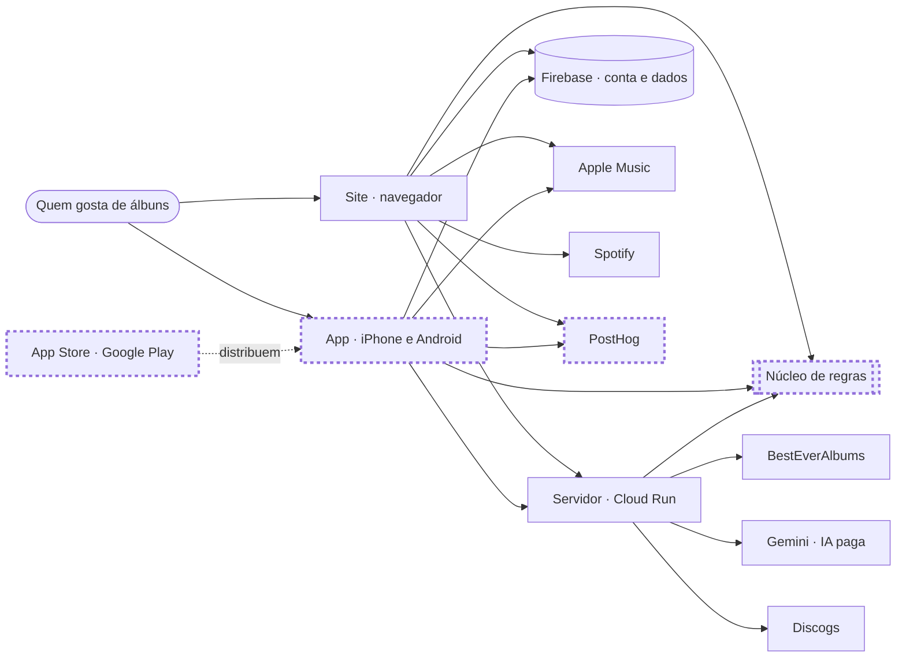
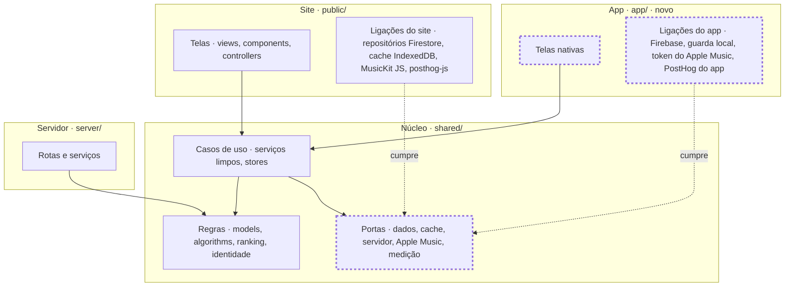
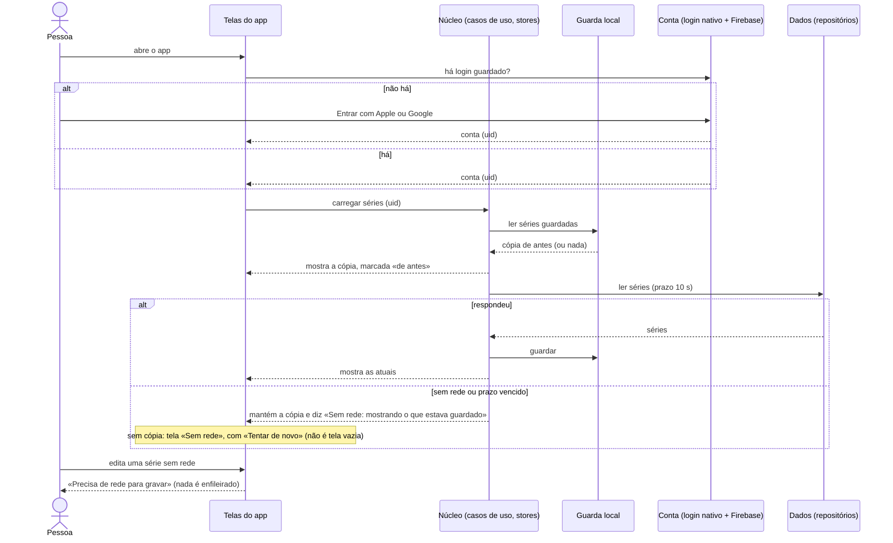
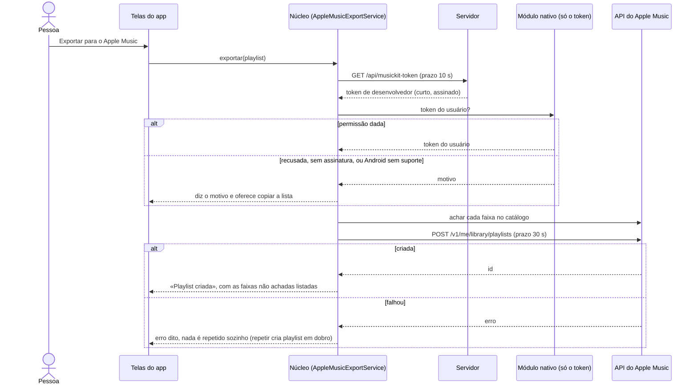
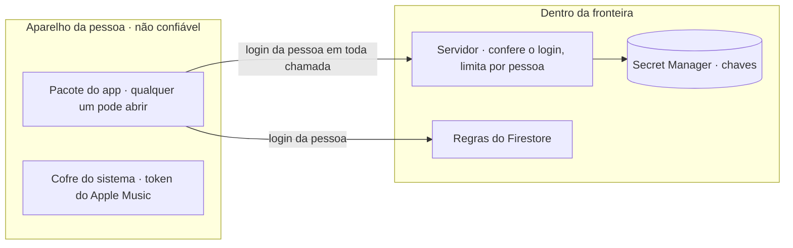
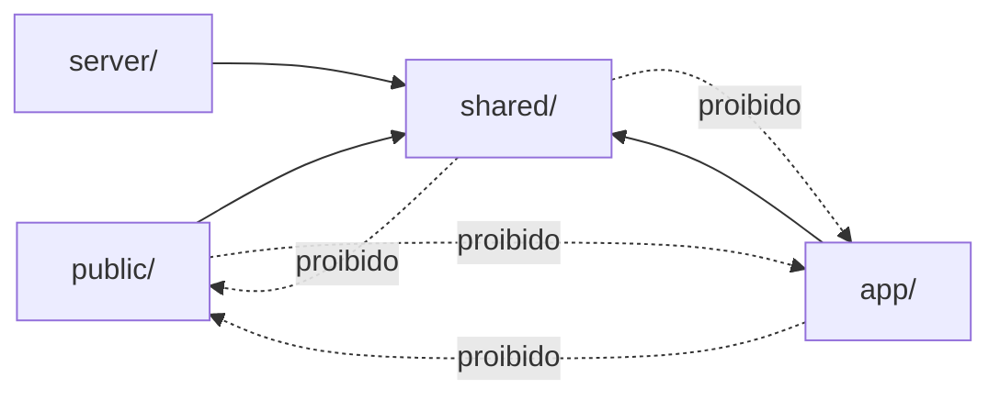
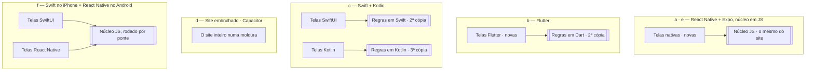

# O Album Blender como app para iPhone e Android — proposta

> **Profundidade:** completa — o risco mais alto é escolher a pilha do app (cara de desfazer: troca a língua, as telas e as ferramentas) apoiado numa promessa não medida («as regras são reaproveitadas»).
> **Página para ler:** https://claude.ai/artifact/35vmLkhuGQhYrBkpzTJzJc (privada, do MJRP; este arquivo é a fonte) · **Crítica:** ainda não feita · **Estado:** proposta, sem ADR
> **Seções usadas:** 1 a 13, cada uma diz o risco que reduz · **Fora:** 14 (o que vai para o ADR) fica em branco até a aprovação · **Vistas:** contexto e contêineres (onde a mudança fica), dependências (R1, R2, R10), duas sequências (R5 e R3), fronteira de confiança (R6), opções lado a lado (R1, R8).
> **Quem escreveu não julga:** a seção 15 diz o que o crítico deve atacar primeiro.

## 1. O que muda e por quê

O MJRP quer o Album Blender nas lojas de apps, nas duas plataformas. Palavras dele (2026-11-20):

- «gostaria de considerar Android e ser pública, não deixaria de fora. Seria uma evolução do produto.»
- «Vamos criar a V6.0 para implementação da app e para implementar o posthog no site e na app em reactive native (pq não flutter?)»
- «E pq valeria a pena ter tb uma app nativa em Swift?»

Serve ao requisito [[S-60-use-the-album-blender-as-an-app-from-the-store]] e divide a porta de medição com a F77 ([[S-59-know-how-the-app-is-used]]).

Quem é afetado: o MJRP, que usa um iPhone 15 Pro e hoje é o único usuário; quem vier a instalar o app; o próprio MJRP como único mantenedor, com agentes de IA. O site continua.

**O que a sessão respondeu a ele, e o que esta proposta faz com isso.** A resposta foi: React Native com Expo (TypeScript), porque as regras do app são JavaScript com mais de 3000 testes e viram um núcleo compartilhado; Flutter obrigaria a reescrever em Dart ou levar tudo ao servidor; Swift inteiro só se o iPhone virar o centro. Esta proposta **mediu** essa resposta no código (seção 4.1). Resultado em três linhas:

1. A parte «as regras são JavaScript puro» é **verdade e mais forte que o dito**: 66 arquivos e 7.392 linhas de regras não tocam nada do navegador.
2. A parte «mais de 3000 testes» é **mais fraca que o dito**: dos 2.640 casos de teste escritos, 954 exercitam só código que pode ir para o núcleo. O resto testa as telas do site, as ligações e o servidor.
3. A parte «um app reaproveita o site» **não vale para as telas**: 46% do código do site é tela (17.562 linhas) e é reescrito em qualquer opção nativa.

## 2. Os direcionadores

**Objetivos (palavras do MJRP):** Android e iPhone; público («não deixaria de fora»); «uma evolução do produto», não um produto novo; medir o uso no site e no app.

**Restrições:**

- Uma pessoa só mantém tudo, com agentes de IA.
- O site continua e tem de funcionar a cada passo.
- A constituição (Art. II) diz JavaScript puro, sem TypeScript, e prefere não usar framework de interface «where possible»; `tech-stack.md` lista «framework de UI» em «Decidido não usar». **React Native é um framework de interface.** A escolha pede emenda da constituição, que só o MJRP aprova, e um ADR.
- A pilha só muda por ADR (`tech-stack.md`, Restrições).
- Segredos nunca no código (Art. V): vale em dobro num app, que qualquer pessoa pode abrir e ler.
- O servidor não acessa o Firestore; as regras do Firestore são a única autorização dos dados (`arch.md`).
- O lançamento público depende de três coisas fora do código (estudo de viabilidade): Spotify, preço do Discogs e autorização do BestEverAlbums. Esta proposta constrói o app; publicar é decisão à parte.

**Requisitos de qualidade.** Os números marcados «perguntar» são do MJRP; não foram inventados.

| Requisito de qualidade | Cenário (estímulo → resposta) | Medida |
|---|---|---|
| Uma regra, um lugar | um agente muda uma regra (receita, ranking, identidade) → site, app e servidor passam a usar a mesma, sem segunda edição | zero regras copiadas fora do núcleo (teste de arquitetura) |
| O site não quebra | uma pasta de regras muda de lugar → a suíte do site passa e o site publicado funciona | suíte verde a cada fatia; conferência em produção |
| Sem rede | o MJRP abre o app sem sinal → vê as séries e os álbuns já vistos | perguntar: só ler, ou também editar sem rede? |
| Nada secreto no aparelho | alguém abre o pacote do app → não acha chave de IA, da Apple, do Discogs nem do Spotify | zero segredos no pacote (teste no build) |
| Custo por pessoa | 100 pessoas usam num mês → a conta de IA e servidor fica dentro do teto | perguntar: qual teto por mês? o gasto de hoje não foi medido |
| Carga de quem mantém | sai uma versão nova do iOS, do Android ou do Expo → o app é atualizado em tempo previsível | perguntar: quantas horas por mês ele aceita gastar só mantendo? |
| Passar na loja | a Apple revisa o app → aprova na primeira ou na segunda tentativa | lista da seção 9 cumprida antes do envio |

**O que só o MJRP sabe** está na seção 13, como perguntas.

## 3. Os riscos

Cada risco é um cenário de falha. P = probabilidade, I = impacto.

| # | Risco (o que pode dar errado, por quê) | Tipo | P | I | Custo de desfazer | Seção que o reduz | Estado |
|---|---|---|---|---|---|---|---|
| R1 | **O núcleo é menos reaproveitável do que se disse.** As regras limpas rodam no navegador e no Node, mas o app roda em outro motor de JavaScript (Hermes). O núcleo usa recursos sensíveis ao motor: `\p{…}` em 3 arquivos, «olhar para trás» em expressões regulares em 2, `.normalize()` em 6, `crypto.` em 2, `localeCompare` em 3. Se um falhar, a identidade de álbum e de faixa dá resultado diferente no app | técnico | média | alto | baixo se achado no spike; alto depois | 4.1, 11, spike S1 | **aberto** até o S1; a parte «não toca o navegador» está **reduzida** (medida) |
| R2 | **Duas cópias das regras divergem.** O app copia uma regra «só por agora», ou o site continua com a regra em `public/js/models` enquanto o app usa outra em `shared/`. O ranking do site e o do app passam a discordar | complexidade | alta sem sensor | alto | médio | 4.3, 11 | **reduzido** pelo desenho se as funções de aptidão existirem; sem elas, aberto |
| R3 | **Apple Music no Android não funciona bem o bastante.** O SDK da Apple para Android existe (1.1.4, maio de 2026), mas tem falhas relatadas no fórum da Apple (login quebrado em versões do app Apple Music, travamentos com itens da biblioteca) e, segundo fonte de terceiros, exige o app Apple Music instalado | técnico | média | médio (exportar é metade do valor) | baixo: fica atrás de uma porta | 4.5, 5.2, spikes S3 e S4 | **aberto** |
| R4 | **A App Store recusa o app.** Por parecer «o site numa moldura» (regra 4.2), por faltar login com a Apple (4.8), apagar a conta (5.1.1(v)) ou rótulo de privacidade | operação | baixa com telas nativas; alta com o site embrulhado | alto | médio | 9, 12 | **reduzido** para a opção recomendada; a lista da seção 9 é a prova |
| R5 | **Sem rede e conflito de gravação.** O celular edita uma série sem sinal, o site edita a mesma série, e a última gravação a chegar apaga a outra sem aviso. O Firestore não funde: quem grava por último vence o documento | dados | média | alto (perde trabalho do usuário) | médio | 5.1, 6 | **reduzido** por decisão: a primeira versão **lê** sem rede e **não grava** sem rede. Gravar sem rede fica aberto e fora |
| R6 | **Segredos e chaves no aparelho.** Uma chave vai no pacote do app e é extraída; ou o login guardado no aparelho é lido | segurança | média | alto | alto (chave vazada tem de ser trocada) | 8 | **reduzido** pelo desenho (nada secreto no app) e por teste; a guarda do login depende do S2 |
| R7 | **Custo por pessoa com usuários públicos.** Cada álbum novo chama o servidor e, às vezes, a IA paga. Com cem contas o custo deixa de ser o de um usuário. O gasto de hoje **não foi medido** | custo | alta | médio | baixo (há limite por pessoa no servidor) | 10 | **aberto**: falta medir (S6) e falta o teto do MJRP |
| R8 | **Três alvos para uma pessoa.** Site, iPhone e Android, cada um com atualizações obrigatórias (o Google exige mirar o Android novo todo ano; o Expo lança várias versões por ano). O tempo de manter come o de evoluir | operação | alta | alto | alto | 12, 13 | **aberto**: é a pergunta mais importante ao MJRP |
| R9 | **O desenho de celular da F76 não se traduz.** A F76 é HTML e CSS (Tailwind, folhas, arrastar com SortableJS). Em telas nativas o arrastar, as folhas e as listas longas são outras peças | técnico | média | médio | baixo | 4.6, spike S5, fatia 4 | **aberto** até a rodada de desenho e a fatia do ranking |
| R10 | **Prisão ao fornecedor (Expo e EAS).** O serviço de build muda de preço ou de regra; o plano grátis tem 15 builds por plataforma, fila lenta e 45 minutos de limite | custo | baixa | médio | médio | 4.4, 11 | **reduzido**: o núcleo não importa nada do Expo; o build pode ser feito no Mac dele |
| R11 | **A exportação para o Spotify não pode ser pública.** Em modo de desenvolvimento o Spotify aceita 5 pessoas autorizadas por aplicativo; o acesso ampliado só é pedido por organização com 250 mil usuários ativos por mês | dados | certa | médio | — | 9 | **reduzido** por decisão: fora da primeira versão pública. A popularidade do Spotify nas receitas fica **aberta** |
| R12 | **Regras do Firestore frouxas com gente de fora.** Hoje qualquer pessoa com login (até visitante) grava em `albums/` e em `spotify_enrichment/` (`firestore.rules:45, 52-53`). Com contas públicas, alguém pode estragar o cache de todos | segurança | média | alto | baixo | 8 | **aberto**: o `firestore.rules` é do MJRP |
| R13 | **Apagar a conta não apaga tudo.** As lojas exigem apagar a conta e os dados. O servidor não acessa o Firestore, então hoje só o próprio app poderia apagar, e uma falha no meio deixa dados órfãos | dados | média | alto (recusa na loja, obrigação de privacidade) | médio | 6, 13 | **aberto**: decisão do MJRP (segurança) |

## 4. O desenho

### 4.1 O inventário: quanto das regras é portável hoje (medido em 2026-11-20)

**Como foi medido.** Um script leu cada arquivo de `public/js`, `shared` e `server`, tirou os comentários e procurou: DOM (`document.`, `window.`, `navigator.`, eventos), armazenamento do navegador (`localStorage`, `sessionStorage`, `indexedDB`), Firebase, `fetch(`, `MusicKit`, `import.meta.env` e `Worker`. Um arquivo é **limpo** quando nem ele nem nada que ele importa, em cadeia, toca nisso. **Limite da medida:** é busca por texto; não prova que o arquivo roda no motor do app (R1).

| Pasta | Arquivos | Linhas | Tocam direto | Sujos por importar | **Limpos** | Linhas limpas |
|---|---|---|---|---|---|---|
| `public/js/models` | 38 | 4.106 | 0 | 0 | **38** | 4.106 |
| `public/js/algorithms` | 11 | 1.443 | 0 | 0 | **11** | 1.443 |
| `public/js/ranking` | 6 | 452 | 0 | 0 | **6** | 452 |
| `public/js/transformers` | 1 | 170 | 0 | 0 | **1** | 170 |
| `public/js/helpers` | 2 | 125 | 0 | 0 | **2** | 125 |
| `public/js/stores` | 8 | 1.096 | 0 | 0 | **8** | 1.096 |
| `public/js/services` | 51 | 7.467 | 19 | 27 | **24** | 3.285 |
| `public/js/api` | 5 | 614 | 4 | 4 | **1** | 172 |
| `public/js/cache` | 3 | 548 | 1 | 2 | **1** | 99 |
| `public/js/utils` | 16 | 1.132 | 5 | 5 | **11** | 707 |
| `public/js/repositories` | 6 | 1.395 | 4 | 6 | 0 | 0 |
| `public/js/controllers` | 6 | 2.004 | 5 | 6 | 0 | 0 |
| `public/js/views` | 25 | 4.990 | 15 | 22 | 3 | 533 |
| `public/js/components` | 72 | 11.993 | 38 | 63 | 9 | 657 |
| raiz, `workers`, `vendor` | 7 | 709 | 6 | 6 | 1 | 4 |
| **`public/js` inteiro** | **257** | **38.244** | | | **116** | **12.849 (34%)** |
| `shared/` | 3 | 1.358 | 1 | 1 | **2** | 1.289 |
| `server/` | 47 | 4.696 | — | — | — | — |

**Leitura.**

- **Regras puras:** `models`, `algorithms`, `ranking`, `transformers`, `helpers` e `stores` estão 100% limpos: 66 arquivos, 7.392 linhas. Com as duas regras de `shared/` (identidade de álbum e de faixa, 1.289 linhas), o núcleo candidato tem **8.681 linhas**.
- **Serviços:** 24 de 51 são limpos (3.285 linhas). Os maiores já recebem o que precisam de fora: `AlbumLoadService` (527 linhas), `InventoryService` (399), `SavedPlaylistsReader` (240), `AppleMusicExportService` (208). Os sujos são, na maioria, os arquivos que ligam o serviço ao Firebase e ao navegador (`*Wiring.js`, `albumLoading.js`): o app escreve as suas próprias ligações.
- **Já em `shared/` hoje:** só `albumIdentity.js` (703 linhas), `trackIdentity.js` (586) e `services/AuthService.js` (69, do navegador: usa `signInWithPopup`, que não existe no app).
- **O que não é reaproveitado em nenhuma opção nativa:** `components`, `views` e a raiz: 102 arquivos, **17.562 linhas, 46% do site**.
- **Zona cinzenta:** os `controllers` (2.004 linhas) estão sujos, mas só 15 linhas deles tocam o navegador direto. Dá para extrair a parte de regra; não foi medido quanto.
- **Firebase:** fica atrás de 6 repositórios (1.395 linhas) mais `firebase-init.js`; um teste de arquitetura já proíbe o Firestore fora dali. O site **não liga** a guarda em disco do Firestore; o que funciona sem rede hoje é o cache próprio (`cache/`, IndexedDB).
- **Servidor:** `createServerFetch` já é pura (recebe quem dá o login e o `fetch`). O endereço do servidor vem de `window.__api_base || '/api'`: o app precisa do endereço completo.
- **Apple Music:** `services/musickit/` (3 arquivos, 630 linhas) usa o MusicKit JS do navegador. Mas **todas as chamadas de catálogo e de biblioteca são caminhos da API da Apple** (`/v1/catalog/{loja}/search`, `/v1/me/library/playlists`), passados a `music.api.music(caminho, …)`. Isso decide o desenho da seção 4.5.
- **Spotify:** `SpotifyAuthService` (329 linhas) usa `window`, `localStorage` e `import.meta.env`; fica fora do app na primeira versão (R11).

**Os testes.** 241 arquivos, 2.640 casos escritos (a suíte conta 3.064 ao rodar, porque casos em tabela se multiplicam). Destes: **954 casos em 71 arquivos exercitam só código limpo** (models 379, serviços 270, shared 114, stores 66, utils 48, algorithms 45, outros 32); 400 são do servidor; 157 são de arquitetura; o resto, cerca de 1.100, testa telas, ligações e repositórios do site. Todos rodam hoje em ambiente de navegador simulado (`jsdom`), não no motor do app.

### 4.2 Contexto



O que é novo está tracejado: o app, o núcleo com casa própria, o PostHog (F77) e as lojas. O servidor, o Firebase e as fontes de fora ficam como estão.

### 4.3 Contêineres e a regra de dependência



**A regra, em uma frase:** tudo aponta para o núcleo; o núcleo não aponta para ninguém. Ele não importa navegador, React, Expo, Firebase nem `fetch`. O que ele precisa do mundo de fora ele pede por uma **porta** (uma lista de funções), e cada lado (site, app) entrega a sua ligação.

**Onde mora cada regra: núcleo ou servidor.** Um critério só, em ordem:

1. Precisa de segredo (chave de IA, chave da Apple, token do Discogs) ou de raspar um site → **servidor**. Sempre.
2. Tem de funcionar sem rede, ou responde ao toque (gerar a playlist, ordenar, filtrar, somar o inventário) → **núcleo**.
3. É a mesma decisão nos dois lados (é o mesmo álbum? é a mesma faixa?) → **núcleo**, e o servidor o importa, como já faz hoje.
4. Custa dinheiro por chamada, ou precisa de limite por pessoa → **servidor**.
5. Na dúvida → núcleo, porque é mais barato de testar e não custa por chamada.

**Portas novas ou a nomear** (a maioria já existe como «o que o serviço recebe de fora»):

| Porta | O que pede | Ligação no site (existe) | Ligação no app (nova) |
|---|---|---|---|
| Dados da pessoa | ler e gravar séries, playlists, inventário, rankings | os 6 repositórios Firestore | repositórios sobre o Firebase do app (ver 4.4) |
| Guarda local | ler e gravar por chave, com validade | `cache/` (IndexedDB), `StorageService` (localStorage) | guarda em disco do aparelho |
| Servidor | chamar `/api/*` com o login | `createServerFetch` + `fetch` | a mesma função, com o endereço completo |
| Apple Music | `request(caminho, parâmetros, opções)` e «quem é o usuário» | MusicKit JS | `fetch` à API da Apple + módulo nativo pequeno que só entrega o token do usuário |
| Medição (F77) | `track(evento, propriedades)` com nomes fixos | `posthog-js` | `posthog-react-native` |
| Conta | entrar, sair, quem está | Firebase Auth com janela (`signInWithPopup`) | login nativo da Apple e do Google, depois credencial no Firebase |

**A porta de medição da F77, dividida.** Em `shared/usage/` moram: a lista fixa dos nomes de evento, a função `track(evento, propriedades)` que recusa o que não está na lista e o que leva texto da pessoa (F77, REQ-03), e o interruptor (REQ-04). Site e app entregam cada um a sua ligação com o PostHog. Nenhuma tela fala com o PostHog (REQ-01); os mesmos nomes servem aos dois (REQ-05).

### 4.4 O app e a organização do repositório

**Organização proposta** (o site não muda de lugar):

```
shared/        o núcleo. Já existe, já tem o apelido @shared no Vite, o servidor já o importa
  models/ algorithms/ ranking/ ...   chegam aqui pasta a pasta
  ports/       as portas, descritas em JSDoc
  usage/       os nomes dos eventos da F77 e a checagem «sem dado pessoal»
public/        o site, onde está
server/        o servidor, onde está (continua recebendo shared/ copiado no build)
app/           o app Expo, com package.json próprio   ← novo
test/          os testes, onde estão; os do núcleo passam a rodar também sem jsdom
```

- **Por que não uma pasta `apps/` e `packages/`:** mover `public/` quebra o `vite.config.js`, os scripts de publicação, os caminhos de 241 arquivos de teste e de 22 testes de arquitetura, sem reduzir nenhum risco listado. A constituição já diz «Shared logic with frontend via `/shared` directory». Fica para depois, se um dia doer.
- **O que muda de lugar, e como o site continua de pé:** uma pasta por vez, na ordem em que o app precisa. Cada mudança é um commit: mover os arquivos, trocar os `import` do site por `@shared/…`, mover os testes, suíte verde, site conferido. Nenhuma pasta é movida «para adiantar».
- **Como o app enxerga o núcleo:** espaços de trabalho do npm (`workspaces`), que o Expo configura sozinho desde o SDK 52. Não foi verificado que um pacote em JavaScript puro (ES Modules) entra limpo no Vite e no empacotador do app ao mesmo tempo: é o spike S1.
- **Linguagem do app:** TypeScript em `app/`, JavaScript com JSDoc no núcleo. É compromisso, com custo: duas convenções no repositório e emenda à constituição. A alternativa (JavaScript em tudo) cumpre a constituição e perde a checagem de tipos nas telas novas. Decisão do MJRP (seção 13).
- **Firebase no app: duas ligações possíveis, ainda não escolhida.**

| | Firebase JS (o mesmo do site) | React Native Firebase (nativo) |
|---|---|---|
| Repositórios | os do site servem quase iguais | um segundo conjunto de ligações |
| Guarda em disco do Firestore | **não tem** no app (cai para memória) | ligada por padrão |
| Onde o login fica guardado | guarda comum do app, a configurar | cofre do sistema |
| Configuração nativa | nenhuma | plugins, arquivos do Google, build próprio |
| Login com Apple e Google | credencial nativa passada ao Firebase | idem, com peças próprias |

  Recomendação provisória: começar pelo **Firebase JS**, porque reaproveita os repositórios e porque a primeira versão não grava sem rede (R5); ler sem rede sai da porta «Guarda local», como no site. O custo: o login guardado fora do cofre do sistema (R6) e nenhuma fila de gravação sem rede. Trocar depois custa um conjunto de ligações, atrás da mesma porta. O spike S2 decide.
- **Build:** build de desenvolvimento (o Expo Go não carrega código nativo próprio). Pode ser feito no Mac do MJRP (`expo run:ios`, Xcode) ou no serviço do Expo (grátis: 15 builds por plataforma, fila lenta; pago: US$ 19 por mês). O núcleo não depende de nenhum dos dois (R10).

### 4.5 Apple Music no app

O site já fala com o Apple Music por **caminhos da API da Apple**. O app faz o mesmo, sem embrulhar o MusicKit inteiro:

- **Catálogo** (buscar artista e álbum, ler faixas): só precisa do token de desenvolvedor, que o servidor já assina (`GET /api/musickit-token`). **Não pede código nativo e funciona igual no iPhone e no Android**, mesmo para quem não assina o Apple Music.
- **Biblioteca** (criar a playlist): precisa também do token do usuário. Esse é o único pedaço nativo: um módulo pequeno em Swift (iPhone) e outro em Kotlin (Android, sobre o SDK de login da Apple) que **só pedem a permissão e devolvem o token**.
- **Se o Android falhar (R3):** o app no Android mostra a playlist e oferece copiar a lista; exportar fica só no iPhone, dito na tela. A porta é a mesma, a ligação do Android responde «não disponível».

Não verificado: a chamada direta a `POST /v1/me/library/playlists` com os dois tokens a partir de um app (a página da Apple não abriu por inteiro); a evidência é o próprio site, que usa esse caminho pelo MusicKit JS. São os spikes S3 e S4.

### 4.6 As telas

O desenho da F76 é o ponto de partida do **conteúdo e da navegação**, não do código: cinco destinos na barra de baixo (Home, Albums, Blend, Playlists, Inventory), folha de baixo para escolhas curtas, folha de tela cheia para ler e editar, medidas de `design-system.md` § Celular (alvo de 44, texto de 12 no mínimo, margem de 16). Essas peças existem como componentes nativos. O que **não** passa: as classes do Tailwind, o CSS de `public/css/mobile/` e o arrastar do SortableJS. A rodada de desenho (`mjrp-designing-ui`) já está nas tarefas da F78 e vem antes das telas. Lembrete: a F76 ainda espera o juízo do MJRP no iPhone (TASK-09); desenhar o app em cima de um desenho não julgado repete o risco.

## 5. Os fluxos

Reduz R5 (sem rede) e R3 (Apple Music).

### 5.1 Entrar e ver as séries pela primeira vez, pronto para abrir sem rede



### 5.2 Exportar uma playlist para o Apple Music, do app



O livro de exportações que já existe (`services/export/exportLedger.js`) continua dizendo o que já foi exportado, para a segunda tentativa não duplicar.

## 6. Os dados

Reduz R5 e R13. O app **não cria entidade nova**: usa as de `data-model.md`, nos mesmos caminhos.

| Entidade | Onde mora | Quem escreve | Obrigação | Vida e purga |
|---|---|---|---|---|
| Série, playlist, inventário, ranking próprio | Firestore, sob o `uid` | site e app, pelos repositórios | dado pessoal: sai quando a conta é apagada | hoje não há purga: ver R13 |
| Cópia local no aparelho | guarda local do app | o app | sai ao sair da conta e ao apagar a conta | regravada a cada leitura boa |
| Token do usuário do Apple Music | cofre do sistema no aparelho | o app | nunca vai ao Firestore nem ao servidor | sai ao sair da conta |
| Preço do Discogs | **nenhum lugar no app público** | — | não pode ir ao Firestore (regra em vigor); fora da versão pública | — |
| Eventos de uso | PostHog | site e app, pela porta | sem dado pessoal nem texto da pessoa (F77, REQ-03) | a do PostHog |

**Dois escritores.** Site e app gravam os mesmos documentos. O Firestore não funde: vence a última gravação. Decisão proposta para a primeira versão: **o app só grava com rede**, então o conflito fica do tamanho que já tem hoje entre duas abas do site. Gravar sem rede pede uma regra de fusão por entidade e fica fora (seção 9).

**Conta de visitante.** O site entra como visitante sozinho, e entrar com Google ou Apple troca de `uid` (os dados do visitante ficam no `uid` antigo). No app, proposta: **sem visitante**; entra com conta ou não entra. Evita levar esse problema para as lojas. É decisão de produto (seção 13).

**Apagar a conta.** Duas formas, nenhuma escolhida:
- pelo app: os repositórios apagam cada coleção da pessoa e depois a conta. Simples; se cair no meio, sobram dados sem dono.
- pelo servidor: uma rota nova apaga tudo com credencial de administrador. Mais segura; muda uma regra do `arch.md` («o servidor não acessa o Firestore») e dá ao servidor uma chave que hoje ele não tem.

## 7. Falhas e prazos

Reduz R3 e R5. Os prazos do servidor são os de hoje; os do app são propostos.

| Chamada ou etapa | Prazo | Retentativa | Se falhar, quem usa vê | Erro distinto de vazio? |
|---|---|---|---|---|
| Entrar (Apple, Google) | o do sistema | não | «Não foi possível entrar», com tentar de novo | sim |
| Ler séries no Firestore | 10 s | uma, ao voltar a rede | a cópia guardada, marcada; sem cópia, tela «Sem rede» | sim |
| Gravar sem rede | — | não | «Precisa de rede para gravar» | sim |
| `/api/enrich-album` | o de hoje (o servidor raspa em até 30 s) | as de hoje (`api/client.js`) | o álbum sem nota, com o motivo (`serverResult.js` já distingue) | sim |
| Token de desenvolvedor do Apple Music | 10 s | uma | «Apple Music indisponível agora» | sim |
| Token do usuário | o do sistema | não | o motivo (sem assinatura, recusou, sem suporte) | sim |
| Criar playlist no Apple Music | 30 s | **não** (duplicaria) | erro dito; o livro de exportações evita o dobro | sim |
| Enviar evento de uso | sem esperar | a do PostHog | nada; o app não depende disso | não se aplica |

## 8. Segurança e privacidade

Reduz R6, R12 e R13.



**O que nunca vai no app:** a chave da IA, a chave privada da Apple, o token do Discogs, o segredo do Spotify, qualquer credencial de administrador do Firebase. Todos ficam no servidor, como hoje.

**O que vai no app, e é público por natureza:** a configuração do Firebase, a chave de projeto do PostHog, o endereço do servidor. Não são segredos; a proteção são as regras do Firestore e a porta do servidor.

**Cada superfície:**

| Ação | Quem pode | Como é conferido | Limite |
|---|---|---|---|
| Rotas pagas (`/api/ai/*`, `/api/generate`) | pessoa com conta, não visitante | o servidor confere o login do Firebase (`server/lib/auth/`) | 60 por hora por pessoa (hoje) |
| Rotas custosas (raspagem) | qualquer pessoa com login | idem | 900 por hora por pessoa (hoje) |
| Ler e gravar os próprios dados | o dono | regras do Firestore | — |
| Gravar em `albums/` e `spotify_enrichment/` | **qualquer pessoa com login** | regra frouxa (R12) | nenhum |

- **R12 fica aberto:** antes de abrir contas ao público, essas duas regras têm de fechar ou a gravação tem de passar pelo servidor. O `firestore.rules` é do MJRP, e nenhum pipeline o publica hoje.
- **O servidor aceita chamada sem cabeçalho de origem.** Um app nunca manda esse cabeçalho, então isso já funciona; a proteção real é o login em cada chamada, que já existe nas rotas pagas e custosas.
- **Privacidade nas lojas:** política de privacidade publicada; rótulo de privacidade (Apple) e formulário de segurança de dados (Google); manifestos de privacidade dos SDKs (a Apple lista o Firebase entre os que exigem). O texto e o consentimento (LGPD) são do MJRP; a F77 já tem a pergunta aberta.

## 9. Relação com o que já existe

Reduz R4, R8 e R11.

- **ADRs em vigor (0015 a 0021):** nenhuma é trocada. A 0016 (regra nasce como serviço) e a 0017 (store só guarda estado) são o que tornou o núcleo portável: ficam e passam a valer também no app.
- **Constituição:** pede emenda no Art. II (framework de interface e TypeScript, só para `app/`). Sem a emenda, a proposta não pode ser construída.
- **`tech-stack.md`:** ganha as linhas do app depois do ADR; a linha «Decidido não usar: framework de UI» passa a dizer «no site».
- **Arquivos que a mudança toca:** `shared/` (cresce), os `import` do site que apontam para as pastas movidas, `vite.config.js` e `vitest.config.js` (nada, se o apelido `@shared` bastar), `scripts/deploy-server.sh` (já copia `shared/`; conferir que copia as pastas novas), `test/architecture/` (testes novos, seção 11), `package.json` da raiz (`workspaces`).
- **Publicação:** o site e o servidor continuam com os scripts de hoje. O app ganha um caminho próprio, do Mac do MJRP até o TestFlight e o teste fechado do Google. Uma versão ruim do app **não se desfaz**: quem instalou fica com ela até atualizar. Por isso o servidor tem de continuar servindo a versão anterior do app: **toda mudança em `/api` passa a ser compatível para trás** (antes, site e servidor eram publicados juntos).

**O que tem de ser verdade antes de cada envio.**

| Antes de… | Tem de ser verdade |
|---|---|
| TestFlight interno (só o MJRP) | conta de desenvolvedor da Apple (US$ 99 por ano); o app entra e lista as séries |
| TestFlight externo e revisão da Apple | login com a Apple ao lado do Google (regra 4.8); apagar a conta de dentro do app (5.1.1(v)); política de privacidade e rótulo; conta de demonstração para o revisor; telas nativas com valor próprio (4.2); Spotify e preço do Discogs desligados; R12 fechado |
| Teste fechado do Google | conta do Google (US$ 25, uma vez); mirar o Android 16 (API 36); **12 testadores inscritos por 14 dias seguidos** (regra das contas pessoais novas) |
| Produção nas duas lojas | autorização escrita do BestEverAlbums (ou o plano B do estudo); apagar a conta também por um endereço na web (Google); limite de IA por conta com teto de custo; decisão do MJRP de publicar |

**Fica fora da primeira versão pública:** exportar para o Spotify; preço do Discogs; gravar sem rede; widget, Atalhos e Siri; iPad e tablet; conta de visitante; compra dentro do app; avisos (notificações).

## 10. Custo com número

Reduz R7 e R10. Onde não há número, está dito.

| Item | Volume esperado | Plano necessário | Custo |
|---|---|---|---|
| Programa de desenvolvedor da Apple | 1 conta | — | US$ 99 por ano (conferido) |
| Conta de desenvolvedor do Google | 1 conta | — | US$ 25, uma vez (conferido) |
| Build do app (Expo) | poucas por semana | grátis (15 por plataforma, fila lenta) ou no Mac dele | US$ 0; Starter US$ 19 por mês se a fila atrapalhar |
| PostHog | eventos de 1 a 100 pessoas | não conferido | não conferido (pergunta aberta da F77) |
| IA (Gemini) e servidor por pessoa | não medido | — | **não medido**; teto técnico de hoje: 60 chamadas pagas por hora por pessoa |
| Firestore | leituras por abertura do app | plano atual | não medido |

**Alerta de orçamento:** um alerta no faturamento do Google Cloud, no valor que o MJRP disser (seção 13). Sem medir o gasto de hoje, qualquer número aqui seria inventado.

## 11. Complexidade e funções de aptidão

Reduz R1, R2, R6 e R10. São testes no estilo de `test/architecture/`, rodando com a suíte.



| Característica que mantém | Risco que protege | Checagem | Limite | Onde roda |
|---|---|---|---|---|
| O núcleo não conhece o mundo de fora | R1, R10 | `coreStaysPortable.test.js`: nenhum arquivo de `shared/` cita `document`, `window`, `navigator`, `localStorage`, `indexedDB`, `fetch(`, `MusicKit`, `import.meta`, nem importa `firebase`, `react`, `react-native`, `expo*`, `posthog*` | zero, sem lista de exceções (o `shared/services/AuthService.js` de hoje sai do núcleo antes) | suíte, pré-commit |
| O núcleo não importa quem o usa | R2 | o mesmo teste: nenhum `import` de `shared/` sai de `shared/` | zero | suíte |
| Site e app não se importam | R2 | `appAndSiteApart.test.js`: nada em `app/` importa `public/`, e o contrário | zero | suíte |
| Nenhuma regra em dobro | R2 | `oneRuleOnePlace.test.js`: cada nome exportado pelo núcleo (por exemplo `pickAlbum`, `matchTracks`, as receitas) não é declarado de novo em `app/` nem em `public/`; e `app/` não tem pasta `models`, `algorithms` nem `ranking` | zero | suíte |
| O núcleo roda sem navegador | R1 | os testes do núcleo rodam uma segunda vez em ambiente `node`, sem `jsdom` | 100% passam | suíte |
| O núcleo roda no motor do app | R1 | um conjunto pequeno de testes de fumaça (identidade de álbum e de faixa, uma receita) roda dentro do app no aparelho | passam no iPhone e no Android | a cada build do app |
| A medição tem uma porta só | R2 | `usageBehindThePort.test.js`: `posthog` só é importado nas duas ligações | 2 arquivos | suíte |
| Nada secreto no pacote | R6 | `noSecretsInTheApp.test.js`: `app/` e a sua configuração não citam os nomes das chaves do servidor; o build procura padrões de chave no pacote | zero | suíte e build |
| Decisão concentrada continua legível | — | o limite de complexidade que já existe (`complexityLimit.test.js`) passa a cobrir `shared/` e `app/` | o de hoje | suíte |
| O servidor não quebra o app instalado | R8 | teste de contrato: as respostas de `/api` continuam aceitas pelas amostras da versão anterior | zero quebras | suíte |

**Onde a complexidade vai crescer:** nas ligações do app (cada porta ganha uma segunda ligação) e no núcleo, que passa a ter três usuários e por isso tem de mudar pouco e com cuidado. Não entra ciclo novo: as setas só apontam para `shared/`.

## 12. As opções

Reduz R1, R4 e R8. Cada opção com o que reaproveita (números da seção 4.1), o que reescreve e o que custa manter.



| Opção | Reaproveita de hoje | Reescreve | Peças nativas | Regras das lojas | Custo de manter, para uma pessoa | Custo de mudar depois | Reversível? |
|---|---|---|---|---|---|---|---|
| **(a) React Native + Expo, núcleo JS** | o núcleo (8.681 linhas de regras, mais até 3.285 de serviços) e 954 casos de teste, **se o S1 passar**; servidor e Firebase inteiros | as telas (o equivalente a 17.562 linhas do site), as ligações de cada porta | token do Apple Music (Swift, Kotlin); login com a Apple | telas nativas atendem a 4.2; login com a Apple e apagar a conta a construir | 2 bases de tela (site, app), 1 de regras; atualizações do Expo várias vezes por ano | médio: as telas se perdem, o núcleo fica | sim, o núcleo sobrevive |
| **(b) Flutter** | servidor e Firebase (o Flutter tem ligações oficiais, com guarda em disco); **nenhuma regra** | as telas **e** as regras: 8.681 a 12.000 linhas e 954 testes passados para Dart; ou levar as regras ao servidor (perde gerar sem rede, custa por chamada); ou rodar o JS dentro do Flutter (`flutter_js`: dois motores diferentes, publicador não verificado) | Apple Music: o plugin `music_kit` foi publicado há cerca de 21 meses | telas próprias atendem a 4.2 | 2 bases de tela **e 2 de regras em línguas diferentes**: toda regra muda duas vezes | alto | parcial |
| **(c) Swift + Kotlin, dois nativos** | servidor e Firebase | telas duas vezes; regras duas vezes, ou por ponte | nenhuma ponte: tudo é nativo; melhor Apple Music | a mais segura na 4.2 | 3 bases de tela, até 3 de regras | muito alto | não |
| **(d) Site embrulhado (Capacitor)** | **tudo**: 100% do site, com o desenho da F76 | quase nada | plugins de login | **o risco da 4.2 é o maior**; há relatos sem solução de login do MusicKit JS dentro de uma moldura de navegador (fórum da Apple e do Ionic) | 1 base | baixo, mas não leva a (a) | sim |
| **(e) (a) + pedaços em Swift** (módulos, depois widget e Atalhos) | igual a (a) | igual a (a); cada pedaço em Swift é pequeno e isolado | os de (a), mais o que for pedido depois | igual a (a) | igual a (a), mais um pouco por pedaço | igual a (a) | sim |
| **(f) Swift inteiro no iPhone, React Native só no Android** | o núcleo, se o Swift o rodar pelo motor de JavaScript do próprio iOS (não medido) | telas duas vezes | Apple Music nativo no iPhone | a melhor no iPhone | 3 bases de tela | alto | parcial |

**Sobre o Flutter, com justiça.** O Flutter é bom no que este projeto precisa de plataforma: Firebase oficial com guarda em disco, telas idênticas nas duas lojas, PostHog oficial. A razão contra não é a qualidade: é que este projeto já tem as regras escritas e testadas em JavaScript, e o site continua. Com Flutter, o risco R2 (duas cópias que divergem) deixa de ser um risco e vira o desenho. Se o site fosse acabar, ou se as regras fossem poucas, o Flutter empataria.

**Sobre Swift, com justiça.** O MJRP usa iPhone e é o único usuário hoje. Para **esse** uso, um app em Swift seria o melhor: Apple Music sem ponte, widget e Siri de graça. O que pesa contra é o que ele disse: Android «não deixaria de fora». Swift inteiro só no iPhone significa uma terceira base de telas. Os pedaços em Swift da opção (e) dão o Apple Music e, depois, o widget, sem a terceira base.

**Sobre o site embrulhado.** Como produto de loja, não. Como degrau **pessoal** (TestFlight interno, só ele), custaria pouco e não passa por revisão pública; mas não tira nenhum risco do caminho recomendado e o login do Apple Music dentro da moldura tem falhas relatadas. O site da F76 na tela de início do iPhone já dá quase o mesmo hoje.

**Recomendação:** **(e)**, que é (a) com os pedaços em Swift e Kotlin só onde a plataforma exige. Pelo custo de mudança: é a única opção em que as regras continuam num lugar só com o site vivo, e em que errar a escolha das telas não joga fora as regras.

**O que mudaria a recomendação:**

- O spike **S1 falha** (o núcleo não roda igual no motor do app, ou não entra limpo nos dois empacotadores) → (a) perde a sua razão; Flutter e Swift passam a empatar e a pergunta vira «qual plataforma primeiro».
- O MJRP diz que o **Android pode esperar um ano ou mais** → Swift inteiro (com as regras pelo motor de JavaScript do iOS, ou reescritas) passa a ser a melhor.
- O MJRP diz que **o site vai acabar** → a vantagem do núcleo em JavaScript cai, e Flutter empata.
- O **S3 falha** (não dá para criar playlist no Apple Music de um app sem embrulhar o MusicKit inteiro) → Swift ganha peso no iPhone.
- A carga de manter três alvos (R8) é maior do que ele aceita → fazer só o iPhone primeiro, pelo mesmo caminho (e), e o Android depois, sem reescrever nada.

## 13. As decisões do humano

Produto, dinheiro, segurança e privacidade. Cada uma com recomendação; nenhuma foi respondida por ele ainda.

1. **Emendar a constituição para o app usar React Native e TypeScript?** Opções: emendar só para `app/`; manter JavaScript também no app; não emendar (então não há app nativo por este caminho). Recomendação: emendar só para `app/`, porque o site e o núcleo continuam em JavaScript puro.
2. **O Android sai junto com o iPhone, ou depois?** Recomendação: mesma base desde o primeiro dia, provada no emulador do Android a cada fatia; envio à loja do Google depois do iPhone. O Google exige 12 testadores por 14 dias: **quem seriam?**
3. **Sem rede: só ler, ou também editar?** Recomendação: só ler na primeira versão, porque editar sem rede pede regra de fusão e é onde se perde dado.
4. **O app aceita visitante sem conta?** Recomendação: não; conta obrigatória (Apple ou Google).
5. **Apagar a conta: pelo app ou pelo servidor?** Recomendação: pelo servidor, com credencial de administrador guardada no Secret Manager, porque não deixa dado órfão; custa mudar a regra «o servidor não acessa o Firestore».
6. **Qual o teto de custo por mês** (IA, servidor, banco, build), e a partir de que valor ele quer ser avisado? Sem recomendação: falta medir o gasto de hoje.
7. **Quantas horas por mês ele aceita gastar só mantendo** três alvos? Sem recomendação: só ele sabe. A resposta pode mudar a pilha.
8. **O site continua por quanto tempo?** A recomendação inteira se apoia em «o site fica».
9. **Fechar as regras do Firestore de `albums/` e `spotify_enrichment/`** antes de qualquer conta de fora? Recomendação: sim, antes do TestFlight externo.
10. **As contas de desenvolvedor** (Apple, Google) são criadas quando? A da Apple é precisa já para os spikes S2 e S3 num iPhone de verdade.
11. **Exportar para o Apple Music só no iPhone é aceitável** se o Android falhar? Recomendação: sim, dito na tela.

## 14. O que vai para o ADR

Em branco até a crítica e a aprovação. Nenhum ADR foi escrito.

## 15. Fatias, spikes e o que esta proposta não decide

### Spikes: antes de se comprometer

Cada um é uma pergunta de sim ou não, com prazo. Um «não» muda a proposta (seção 12).

| # | Pergunta | Prazo | Risco |
|---|---|---|---|
| S1 | O núcleo roda igual no motor do app? Um app Expo vazio importa `shared/albumIdentity.js`, `shared/trackIdentity.js` e uma receita, e os mesmos casos de teste dão o mesmo resultado no iPhone e no emulador do Android; o mesmo pacote continua entrando no Vite | 1 dia | R1 |
| S2 | O Firebase JS serve no app? Entrar com a Apple e com o Google, fechar o app, abrir de novo ainda com a conta, e ler as séries pelo `SeriesRepository` de hoje | 1 dia | R5, R6 |
| S3 | Dá para criar uma playlist no Apple Music de um app Expo com um módulo nativo que só entrega o token do usuário? No iPhone | 1 dia | R3 |
| S4 | O mesmo no Android, com o SDK de login da Apple, num aparelho com o app Apple Music | 1 dia | R3 |
| S5 | Uma lista de 300 álbuns com capa rola lisa, e arrastar para ordenar funciona, em tela nativa? | meio dia | R9 |
| S6 | Quanto custa hoje um mês do MJRP em IA, servidor e banco? (ler o faturamento; não é código) | 2 horas | R7 |

### Fatias e a ordem

O esqueleto ambulante vem primeiro. Cada fatia deixa o site funcionando.

| # | Fatia | O que prova | Risco que retira | Vale sozinha? |
|---|---|---|---|---|
| 0 | Os spikes S1 a S6 | as premissas | R1, R3, R7 (em parte) | sim: decide a pilha |
| 1 | **O núcleo ganha casa e sensor:** os testes de aptidão `coreStaysPortable` e «roda sem jsdom»; `shared/` vira pacote; nada é movido além do que a fatia 2 pede | que a fronteira se mantém sozinha | R2 | sim, mesmo sem app |
| 2 | **Esqueleto ambulante:** app Expo que entra (Apple e Google) e lista as séries pelo núcleo, num iPhone de verdade e num Android (aparelho ou emulador); um evento de uso pela porta da F77 | o caminho inteiro: núcleo, conta, dados, medição, build nas duas plataformas | R1, R6, R10 | sim: primeiro marco da spec |
| 3 | **Albums e a janela do álbum:** carga pelo `AlbumLoadService` do núcleo, catálogo pela API da Apple, notas pelo servidor; leitura sem rede | o maior serviço reaproveitado; Apple Music no Android sem código nativo | R1, R5 | sim |
| 4 | **Ranking próprio:** ver e ordenar as faixas, gravar | arrastar em tela nativa; gravação com dois escritores | R9 | sim |
| 5 | **Blend e playlists:** gerar pelas receitas do núcleo, editar, gravar; exportar para o Apple Music (iPhone, depois Android) | as receitas no aparelho; o módulo do token | R3 | sim |
| 6 | **Inventário:** itens, status, valor à mão, totais; sem preço do Discogs | as regras de inventário no app | — | sim |
| 7 | **Pronto para a loja:** apagar a conta, política e rótulos, conta de demonstração, regras do Firestore fechadas; TestFlight externo; teste fechado do Google | a lista da seção 9 | R4, R12, R13 | sim |

A F77 (medição no site) pode andar em paralelo; a porta de eventos nasce em `shared/usage/` com a primeira das duas que chegar.

### O que esta proposta não decide

- **A pilha.** É recomendação; o ADR só depois da crítica e do «sim» do MJRP.
- **Firebase JS ou React Native Firebase** no app: o S2 decide.
- **TypeScript ou JavaScript** em `app/`: decisão 1.
- **O desenho das telas do app:** é da rodada de desenho, a partir da F76.
- **Publicar ou não:** é decisão à parte, presa ao BestEverAlbums, ao Discogs e ao Spotify (estudo de viabilidade).
- **De onde vem a popularidade** nas receitas se o Spotify ficar fora do produto público.
- **Como apagar a conta:** decisão 5.
- **Os requisitos da F78:** as fatias viram requisitos na spec depois da aprovação.

### O que não foi verificado

- Que o núcleo roda no motor do app (Hermes): não testado; é o S1.
- A chamada direta à API do Apple Music para criar playlist a partir de um app, e a função nativa de criar playlist (iOS 16 ou mais novo): de memória; as páginas da Apple não abriram por inteiro.
- Que o SDK da Apple para Android exige o app Apple Music instalado: só fonte de terceiros.
- As bibliotecas que embrulham o MusicKit no React Native (`@lomray/react-native-apple-music` e outras): saúde não conferida (data da última versão, se criam playlist). A proposta não depende delas.
- Os pacotes de login com a Apple e com o Google no Expo, e o estado deles: não pesquisados; padrão conhecido, a provar no S2.
- Se o Firebase JS ganhou guarda em disco no app depois de junho de 2025: sem confirmação oficial; tratado como «não tem».
- Se os 15 builds grátis do Expo são por mês.
- Preço e limites do PostHog; se a gravação de sessão dele no celular é estável.
- O formulário de segurança de dados do Google: a página não foi lida.
- A versão estável atual do Flutter (provável 3.50) e se o `cloud_firestore` liga a guarda em disco por padrão no celular (provável, por ser nativo).
- As regras do Spotify depois de março de 2026.
- O gasto atual de IA, servidor e banco.
- A medida da seção 4.1 é por texto: um arquivo «limpo» pode usar algo que o motor do app não tem.

### O que o crítico deve atacar primeiro

1. **O «limpo» da seção 4.1.** É busca por texto em ambiente de navegador simulado. Quanto disso roda de verdade no motor do app? Os 954 testes provam as regras, não a portabilidade.
2. **A escolha do Firebase JS** como ponto de partida: troca guarda em disco e cofre do sistema por reaproveitar repositórios. É a troca certa para um app público?
3. **«Só grava com rede».** Resolve o conflito ou só o adia e entrega um app pior que o site no metrô?
4. **`shared/` como núcleo sem mover o site.** É o caminho mais barato ou é dívida que cresce (um «núcleo» com 12.000 linhas e três usuários numa pasta sem versão)?
5. **Apple Music só pelo token.** A proposta aposta que não precisa embrulhar o MusicKit. Se a aposta falhar no iPhone, a opção Swift ganha.
6. **A carga de três alvos (R8)** não tem número. A recomendação se sustenta se a resposta do MJRP for «poucas horas por mês»?
7. **A opção (f) e a ideia de rodar o núcleo JS dentro de um app Swift** foram descartadas sem medida. Mereciam um spike?
8. **A compatibilidade para trás do `/api`** entra como regra nova para um servidor que sempre foi publicado junto com o site: o teste de contrato proposto basta?

## Fontes

Conferidas em 2026-11-20 por leitura das páginas (ferramenta de busca, sem disfarce de navegador). «Secundária» quer dizer que não é a página oficial.

- Expo SDK 58 (2026-10-15, React Native 0.88): https://expo.dev/changelog/sdk-58
- Nova arquitetura do React Native sempre ligada desde o SDK 55: https://docs.expo.dev/guides/new-architecture/ (a página parecia desatualizada)
- Preços de build do Expo: https://expo.dev/pricing
- Build de desenvolvimento e módulos nativos: https://docs.expo.dev/workflow/overview/ · https://docs.expo.dev/modules/overview/
- Monorepo com Expo (desde o SDK 52): https://docs.expo.dev/guides/monorepos/
- React Native Firebase v27: https://rnfirebase.io/ · https://rnfirebase.io/platforms
- Firestore JS sem guarda em disco no React Native: https://github.com/firebase/firebase-js-sdk/issues/7947 (secundária)
- Guarda em disco do Firestore por plataforma: https://firebase.google.com/docs/firestore/manage-data/enable-offline
- MusicKit (inclui Android e a API): https://developer.apple.com/musickit/
- Falhas do SDK do Apple Music para Android (1.1.4): https://developer.apple.com/forums/thread/838633
- Login do MusicKit JS em moldura de navegador: https://developer.apple.com/forums/thread/746776 · https://developer.apple.com/forums/thread/710088 · https://forum.ionicframework.com/t/using-musickit-javascript-sdk-with-ionic/146906
- PostHog para React Native: https://posthog.com/docs/libraries/react-native
- Regras de revisão da App Store (4.2, 4.8, 5.1.1(v)): https://developer.apple.com/app-store/review/guidelines/
- Manifestos de privacidade de SDKs: https://developer.apple.com/support/third-party-SDK-requirements/
- Programa de desenvolvedor da Apple: https://developer.apple.com/programs/whats-included/
- Google Play, teste fechado (12 testadores, 14 dias): https://support.google.com/googleplay/android-developer/answer/14151465
- Google Play, apagar a conta: https://support.google.com/googleplay/android-developer/answer/10144311
- Google Play, taxa de registro: https://support.google.com/googleplay/android-developer/answer/6112435
- Google Play, versão do Android a mirar: https://developer.android.com/google/play/requirements/target-sdk
- Flutter: https://docs.flutter.dev · https://pub.dev/packages/cloud_firestore · https://pub.dev/packages/music_kit · https://pub.dev/packages/posthog_flutter · https://pub.dev/packages/flutter_js
- Capacitor 8: https://ionic.io/blog/announcing-capacitor-8 (secundária)
- Spotify, modos de cota: https://developer.spotify.com/documentation/web-api/concepts/quota-modes · mudança de fevereiro de 2026: https://developer.spotify.com/blog/2026-02-06-update-on-developer-access-and-platform-security (lida em resumo)
- Do projeto: `reports/audits/2026-11-20-mjrpalbumblender-v0-public-product-study.md`, `reports/audits/2026-11-20-mjrpalbumblender-v0-cd-prices-feasibility.md`, `docs/specs/arch.md`, `docs/specs/constitution.md`, `docs/specs/tech-stack.md`, `docs/specs/design-system.md` § Celular, `docs/specs/info-arch.md` § O celular (F76), `firestore.rules`.
