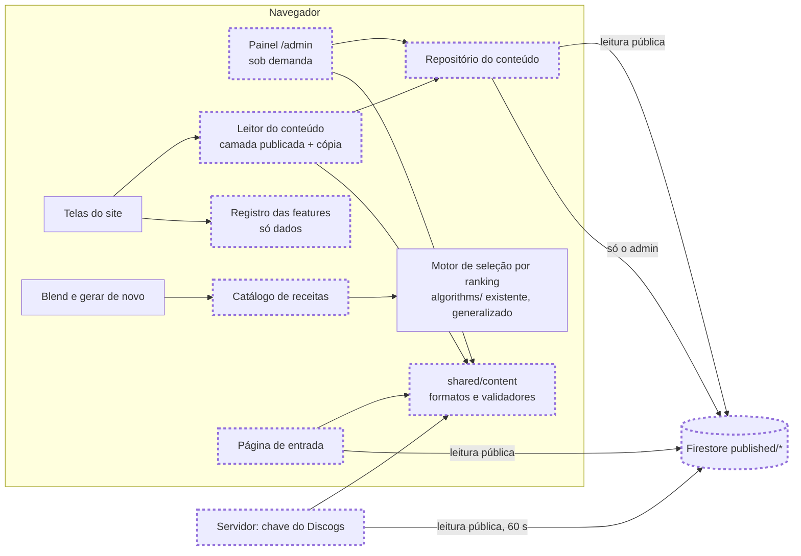
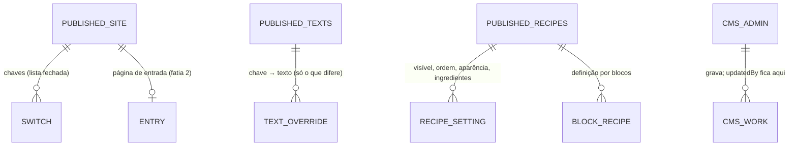
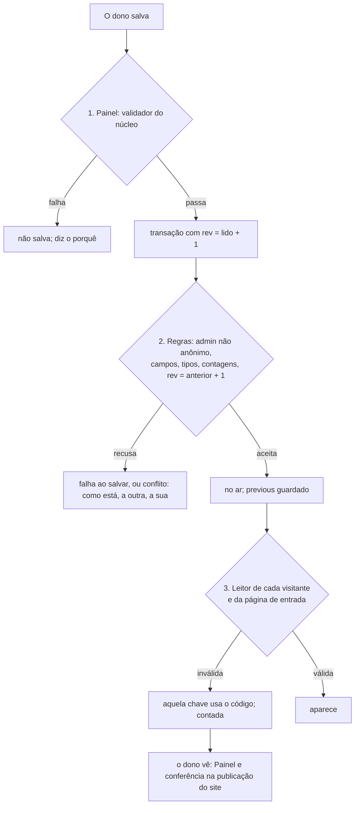
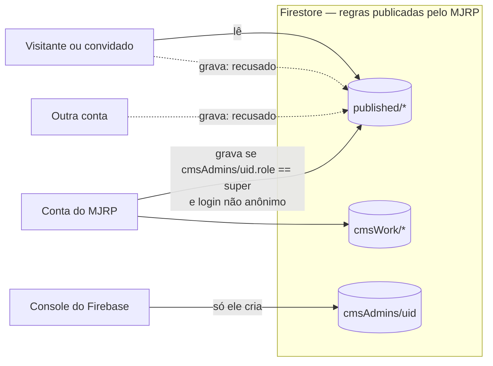
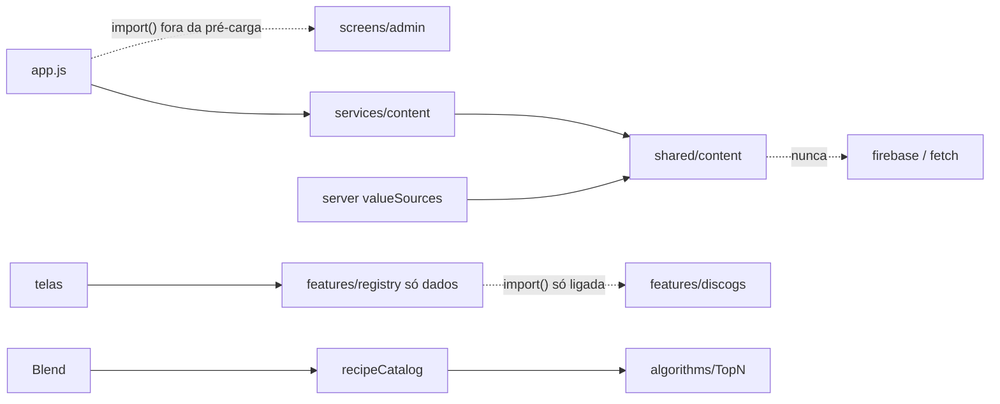

# O conteúdo publicado do CMS — proposta de arquitetura

> **Profundidade:** completa — o risco mais alto é de segurança e de dados: **salvar publica**, sem rascunho nem desfazer (decisão do MJRP, «1. Mantém»), então um texto quebrado ou uma gravação de um convidado vai ao ar para todos na hora; e a escolha de onde o conteúdo mora é cara de desfazer depois que três features (F82, F92, F93) se apoiarem nela.
> **Estado:** criticada em 2026-11-22 por um agente separado ([relatório](../../../reports/audits/2026-11-22-mjrpalbumblender-v0-cms-published-content-architecture-audit.md): pode ir, 0 P0, 9 P1, 9 P2) e **revista no mesmo dia** (tabela no fim); à espera do MJRP; sem ADR. **Página para ler:** ainda não publicada.
> **Seções usadas:** 1–4; 5 fluxos; 6 dados; 7 falhas e prazos; 8 segurança; 9 relação com o que existe e arquivos impactados; 10 custo (uma linha); 11 funções de aptidão; 12 opções; 13 decisões do humano.
> **Vistas:** blocos, sequência (a leitura ao abrir), dados, fluxograma (as barreiras de uma gravação), fronteira de confiança, dependências.
> **Base:** o enquadramento [`reports/proposals/2026-11-22-…-cms-framing.md`](../../../reports/proposals/2026-11-22-mjrpalbumblender-v0-cms-framing.md) (R1–R8), o protótipo ([`proposal.md`](proposal.md)), as specs F82, F92, F93, e a linha do React lida em `integrate/staging-2026-11-21` com `git show`.

## 1. O que muda e por quê

O dono passa a mudar, do **Painel** (área só dele), o que o site diz e mostra, sem pedir a um agente nem publicar código: os textos em inglês e português (F82), as chaves de ligar e desligar features, a começar pelo Discogs (F93), e as receitas da mistura, inclusive receitas novas por blocos (F92). Afetados: **o dono** (mudar rápido sem quebrar), **o visitante** (nunca tela vazia, lenta ou quebrada), **o agente** (uma fonte só da verdade por texto, chave e receita). Esta proposta decide **o conteúdo publicado**: onde mora, quem grava, o que é conferido, como site, página de entrada e servidor o leem. As telas do Painel são do kit (F332 do harness).

## 2. Os direcionadores

**Decisões do dono, não reabertas:** Painel primeiro; salvar publica, sem rascunho, publicar ou desfazer na v1; admin = só a conta dele, nunca convidado, garantido no banco e no servidor; papéis depois, ele superadministrador; chaves no CMS, Discogs primeiro; receitas no CMS e por blocos, «Deep cuts» e «As menos ouvidas» como no protótipo; começar já o que não depende do kit.

**Restrições:** o site sai só da `main` local (constituição V.1): o conteúdo **é lido quando o site abre**; a interface fala inglês (I.2); nenhuma falha calada (I.1); o Firestore só atrás dos repositórios (III.3); nada morto (III.5); `shared/` não importa fora dele nem usa `fetch` (III.7); `firestore.rules` é dele (V.5); documentos só crescem (V.6); texto de fora é texto e endereço é conferido (V.9); App Check no Firestore quando `app/` existir (V.14); tecnologia nova = ADR e linha em `tech-stack.md` (II.1). **O servidor não lê o Firestore hoje** (`tech-stack.md`, linha 28): esta proposta **muda isso** (só leitura de um documento público), e o ADR o registra.

| Requisito de qualidade | Cenário (estímulo → resposta) | Medida |
|---|---|---|
| A primeira tela não espera | banco lento ou fora → a primeira tela desenha com o guardado ou o código | mesmo tempo (±50 ms) com a leitura bloqueada; prazo 3 s |
| Peso | o leitor entra no script principal | ≤ 2.000 B gzip a mais, declarado no orçamento; admin 0 B |
| Gravação ruim não chega ao visitante | texto sem `{count}` ou vazio → aquela chave usa o código | 100% das inválidas trocadas; o dono vê a lista (§ 6.3) |
| Só o dono grava | convidado ou outra conta grava → recusa | 0 aceitas, provado **rodando** as regras (F-4) |
| Desligar uma feature | o dono desliga → some já na próxima abertura, **inclusive para quem já visitou** | 0 pedido do arquivo da feature; servidor ≤ 60 s |
| Receita determinística | mesma receita, mesmos álbuns → mesmas faixas | saída igual byte a byte na amostra fixa |

## 3. Os riscos

| # | Risco | Tipo | Prob. | Impacto | Desfazer | Reduzido por | Estado |
|---|---|---|---|---|---|---|---|
| R1 | a leitura falha e o site abre sem texto | técnico | média | alto | baixo | 4, 5 | reduzido |
| R2 | o site espera o conteúdo e a primeira tela demora | técnico | alta se bloqueante | alto | médio | 5, F-1 | reduzido |
| R3 | um convidado ou outra conta grava no conteúdo | segurança | média | muito alto | — | 8, F-4 (emulador) | reduzido; depende de ele publicar as regras |
| R4 | o dono salva um erro e ele vai ao ar sem desfazer | dados | alta | alto | baixo | 6.3 | reduzido; volta manual (decisão 2) |
| R5 | feature desligada continua no pacote, na tela, ou ligada pela cópia guardada | complexidade | alta | médio | médio | 5, 6.4, F-5, F-6 | reduzido por feature; Discogs é o caro |
| R6 | uma receita do CMS executa algo não testado | segurança | baixa | alto | alto | 6.5 | reduzido |
| R7 | o código do admin vaza para o pacote de todos | técnico | média | médio | baixo | 6.6, F-3 | reduzido |
| R8 | duas fontes da verdade discordam (código × banco, site × servidor, dois motores de receita) | dados | alta | médio | alto | 4, 6.4, 6.5, F-7, F-12 | reduzido |
| R9 | o formato muda e um site antigo lê errado | dados | média | médio | alto | 6.1 | reduzido |
| R10 | dois aparelhos, uma gravação apaga a outra | dados | baixa | médio | baixo | 6.3 (regras exigem `rev`) | reduzido |
| R11 | convidado grava popularidade falsa em `spotify_enrichment/` e enviesa as receitas por blocos | segurança | média | médio | médio | 8, F-13, decisão 4 | **aberto**, com sensor que segura a fatia 4 |
| R12 | a página de entrada, lida sem script, mostra o texto do build | técnico | certa | baixo | baixo | 6.2 | aceito |
| R13 | a página de entrada vira porta de código (texto com marcação, capa de endereço qualquer) | segurança | média | alto | baixo | 6.2, F-14 | reduzido |
| R14 | o App Check, ligado no Firestore (V.14), corta as leituras sem login (servidor, página de entrada) | operação | certa no gatilho | médio | médio | 8.1 | reduzido: gatilho e caminho escritos |
| R15 | uma publicação do site faz o leitor recusar textos publicados e o dono não sabe | dados | média | médio | baixo | 6.3, F-15 | reduzido |

## 4. O desenho



- **`shared/content/` (núcleo, puro):** o formato e a versão de cada documento e os validadores (texto contra a sua reserva; chave da lista fechada; definição de receita de blocos dentro dos limites). Sem Firebase, sem `fetch`: o Painel, o leitor do site, a página de entrada e o servidor usam **a mesma regra** (III.4).
- **Repositório do conteúdo:** os caminhos e o formato em `shared/data/PublishedContentRepository`, que **recebe de fora** a função de leitura (REST no servidor e na página; a store do Firebase no site) e a de gravação (III.7; `coreStaysPortable` sem exceção); o lado do site em `public/js/repositories/`. O único lugar que fala com `published/*` (III.3, F-11).
- **Leitor do conteúdo** (`public/js/services/content/`): a camada publicada do `t()` e o estado das chaves (§ 5).
- **Registro das features** (`public/js/features/registry.js`): **só dados** — id, padrão quando desconhecida, o `import()` do módulo. Nenhuma lógica de feature (F-3).
- **Catálogo de receitas:** junta as receitas do código e o documento publicado num modelo só; executa **sempre** pelo motor que já existe em `public/js/algorithms/` (§ 6.5).
- **Painel** (`/admin`): rota do mesmo app, sob demanda; as telas vêm do kit.

**O que muda pouco e o que muda muito:** motores, validadores e formatos mudam raramente (código com teste); textos, chaves e configuração das receitas mudam toda semana (dados). A fronteira é o validador do núcleo.

## 5. Os fluxos — a leitura ao abrir

```mermaid
sequenceDiagram
  participant App as app.js
  participant L as Leitor
  participant N as Cópia no navegador
  participant F as Firestore published/*
  App->>L: start() — não espera
  L->>N: lê a cópia (síncrono)
  N-->>L: textos (se ≤ 30 dias) e chaves
  Note over L: da cópia, uma chave só pode DESLIGAR; ligar espera a leitura nova
  L-->>App: camada publicada aplicada; versão dos textos = n
  App->>App: desenha a primeira tela
  L->>F: um pedido: published/site + texts_<idioma> (3 s)
  alt chegou e é válido
    L->>L: valida chave por chave; inválida volta ao código e é contada
    L->>N: guarda a cópia
    L-->>App: versão dos textos n+1 → telas em React e à mão redesenham
  else o documento não existe
    L->>N: apaga a cópia (voltar atrás chega a quem já visitou)
  else falhou ou demorou
    L-->>L: fica com a cópia; chaves no padrão declarado, nunca ligadas pela cópia
  end
```

- **A camada publicada do `t()` (contrato):** por idioma, três camadas com precedência fixa — **publicado > dicionário do código > inglês do código** — que não depende da ordem de chegada: o dicionário português que chega depois não apaga o publicado. Uma **versão dos textos** sobe a cada mudança da camada, e `useLocale` passa a observar `idioma + versão` (hoje `useSyncExternalStore(subscribe, getLocale)` só redesenha quando o idioma muda); as telas feitas à mão ouvem o mesmo aviso. Arquivos: `public/js/i18n/t.js` e `public/js/react-bridge/useLocale.ts`, na linha do React (esperam a migração na `main`).
- **A cópia no navegador:** textos com idade máxima de **30 dias** (mais velha, é descartada e vale o código); chaves da cópia **só desligam**, nunca ligam; «documento não existe» **apaga** a cópia. Guardar e reaproveitar, nunca esperar: o visitante pode ver o texto anterior por um instante (o «piscar»), medido na fatia 1.
- **Sem rede:** cópia (dentro da idade) ou código. **Documento fora do formato, ou maior que o limite:** ignorado inteiro, a cópia fica.
- **O idioma:** o documento de um idioma só é pedido por quem fala esse idioma.

## 6. Os dados

### 6.1 Onde mora e com que forma



| Documento | Quem escreve | Quem lê | Máximo |
|---|---|---|---|
| `published/site` — chaves, página de entrada | admin | todos, sem login; servidor | 16 KB |
| `published/texts_en`, `texts_pt` — só as chaves que diferem do código | admin | quem fala o idioma | 900 KB (Firestore: 1 MiB) |
| `published/recipes` | admin | Blend e gerar de novo, sob demanda | 64 KB |
| `cmsAdmins/{uid}` — `role` | **ninguém pelo app** na v1 (o console) | a própria pessoa | — |
| `cmsWork/*` — aprovações do português, `updatedBy` e hora de cada gravação | admin | admin | — |

- **Só o que difere:** o código continua a reserva completa; uma chave renomeada deixa um texto órfão que o leitor ignora e o Painel mostra «órfão».
- **Versão do formato, não do conteúdo:** `_schemaVersion` que nunca desce (`shared/data/schemaVersion.js`, `keepsSchemaVersion()` nas regras); versão maior é lida só nos campos conhecidos; campo sai por *expand and contract* (V.6). **Ordem de um campo novo:** as regras (que listam os campos com `hasOnly`) são publicadas por ele **antes** do Painel que grava o campo; até lá o Painel diz «as regras ainda não aceitam este campo», nunca falha calado.
- **O que um leitor anônimo aprende de `published/*`:** os textos publicados, o texto anterior das chaves da última gravação (`previous`), e os ids das chaves — inclusive de features ainda fechadas (`portugueseForAll`). Nenhum identificador de pessoa: `updatedBy` mora em `cmsWork/*`.

### 6.2 A página de entrada (fatia 2)

Hoje o build escreve os textos no HTML (`public/splash/copy.js`) e `public/splash/lang.js:52` troca o idioma com `el.innerHTML`; nenhum texto de `copy.js` tem marcação (conferido: 0 tags). **Na fatia 2**, a página ganha um leitor depois do `load` que: lê `published/site` pela leitura simples; **valida cada texto com o mesmo validador de `shared/content`**; escreve **só por `textContent`** (e `lang.js` passa a `textContent` também); aceita uma capa só se o endereço passa por `safeUrl` (V.9) **e** é do único host que a política de imagens da página libera (`is1-ssl.mzstatic.com`, o CDN da Apple). **A política de `public/splash.html` muda:** `connect-src` hoje é `'self' https://cdn.jsdelivr.net` e passa a liberar só `https://firestore.googleapis.com`. As capas ficam na fatia 2 (é o REQ-03 da F82) porque com o host fechado e o `safeUrl` uma capa ruim apenas não aparece. Quem lê sem script vê o texto do build (R12).

### 6.3 Gravar quando salvar publica



- **O que é conferido:** texto — os mesmos `{marcadores}` da reserva inglesa, não vazio, sem `<` nem `>`, até 3× a reserva (aviso a partir de 1,5×); chave — ids da lista fechada, `true`/`false`; receita — só os blocos do vocabulário, nos limites (6.5), aparência de lista fechada.
- **Onde:** Painel (ele sabe na hora); **regras** (quem, campos, tipos, contagens, `rev == anterior + 1`; não percorrem um mapa livre, então não conferem o marcador de cada texto; para chaves e receitas, de campos fixos, conferem tipo e limite); **leitor de cada visitante e da página** (a barreira que não depende de quem gravou).
- **O dono sabe o que foi recusado (I.1):** o Painel valida o documento vivo contra a reserva da versão do site no ar e lista «recusado pela versão atual» por chave; e o script de publicação do site lê os `published/texts_*` vivos (leitura pública) e lista as chaves que **o build novo** vai recusar, antes de publicar (aviso, não bloqueio: o conteúdo é dele).
- **A rede mínima, sem «desfazer»:** cada gravação leva `previous` com o valor anterior **só das chaves que mudou** e `rev`. Cobre **só a última gravação** (a seguinte sobrescreve) e na v1 **ninguém o lê**: a volta é ele copiar o valor no console. Não é histórico.

### 6.4 As chaves de features

| Chave | Esconde | Não carrega | Desconhecida (sem leitura e sem cópia que desligue) |
|---|---|---|---|
| `discogsValues` | valor, botão, aviso e atribuição do Discogs | o módulo de valores do inventário | site: pergunta ao servidor (abaixo) |
| `usageMeasurement` | nada visível | o adaptador do PostHog (já assim, F77) | **decisão 3** |
| `portugueseForAll` | o seletor de idioma | o dicionário português para quem não pediu | fechada (o site fala inglês, como hoje) |

- **Um modelo para esconder e não carregar:** a tela pergunta ao registro; desligada, o registro devolve «nada» e **nunca chama o `import()`**; o encaixe na tela não desenha nem a caixa. Os importadores das features com chave e o do admin **não entram** na lista de pré-carga de `app.js` (`prefetchScreensAfterTheFirstScreen`, F-3).
- **Desconhecida não é desligada** (I.1): o leitor guarda «desconhecida» com o motivo; o Painel mostra «não foi possível ler».
- **Discogs: duas travas, uma autoridade.** O servidor liga só com a variável do serviço **e** a chave do CMS; o site pergunta ao servidor como hoje (`GET /api/value-sources`). O servidor responde **três estados**: `on`, `off` e `unknown` (não pôde ler a chave), e o inventário não mostra o Discogs em `unknown` mas o diz no log e o Painel o mostra. **Instância nova:** o primeiro pedido espera a leitura da chave até 1,5 s antes de responder. «Para quem» fica em `DISCOGS_VALUES_FOR` (o documento é público).
- **Custo por feature:** separar o Discogs em um módulo atrás do registro mexe em ~8 arquivos do inventário; até lá a chave esconde, e F-5 o lista como exceção que só encolhe.

### 6.5 Receitas como dados — um motor só

| É dado (`published/recipes`) | Fica código |
|---|---|
| visível; ordem; recomendada; aparência (lista fechada de `recipeLooks.js`); ingredientes visíveis e valores de partida (listas de `recipeIngredients.js`); nome e descrição (chaves do dicionário para as receitas do código; `{en, pt}` na receita de blocos); as definições por blocos | a receita equilibrada do MJRP; **o motor de seleção por ranking que já existe** (`TopNAlgorithm` e as estratégias de `ranking/`), generalizado com sentido, pular, pegar e exclusão; o selo «recomendada» como texto único da tela |

**Um motor, não dois.** O intérprete **não** é reescrito em `shared/`: o motor de `public/js/algorithms/` ganha os parâmetros dos blocos, e as três receitas «Top N» do código passam a ser **definições fixas em código** no mesmo vocabulário (`top-n-popular` = spotify, top, pular 0, pegar N). O validador da definição (só dados) mora em `shared/content`. **Teste de equivalência (F-12):** cada receita «Top N» de hoje e a sua forma em blocos dão as mesmas faixas na amostra fixa; se a regra «sem dado sempre fora» mudar alguma faixa de uma receita de hoje, a diferença é listada e vai a ele antes de mudar. Mover o motor para `shared/` (III.7) fica para quando o app precisar dele.

| Bloco | Valores | Partida |
|---|---|---|
| fonte | `spotify`, `bea`, `combined`, `user` | `spotify` |
| sentido | `top` ou `bottom` | `top` |
| pular K por álbum | 0–10 | 0 |
| pegar N por álbum | 1–10, K + N ≤ 15 | 3 |
| exclusão | faixa mais curta que S s (0–300) | 0 |
| faixa sem dado | sempre fora nas receitas de blocos (I.1); fixo | — |
| desempate | ordem da faixa no álbum; fixo | — |
| agrupamento | as listas de hoje menos `shuffle` | `by_album` |

«Deep cuts» = spotify, top, pular 3, pegar 3; «As menos ouvidas» = spotify, bottom, pular 0, pegar 3. A receita de blocos nasce escondida. **Playlist guardada:** as faixas nunca mudam; ids nunca reaproveitados nem apagados; gerar de novo com receita escondida abre na recomendada e diz por quê; redefinida, usa a definição de hoje. **Blend configurável sem segundo caminho:** a tela desenha sempre o catálogo; sem documento, o catálogo é o código; a tela não importa `algorithms/index.js` (F-7).

### 6.6 O admin

- **Mesmo app, `/admin`, sob demanda** (`loadScreen(() => import('./screens/admin/index.ts'))`; `lazyOnlyAtTheRoute` já cobra o lugar). Antes do `import()`, a rota lê o próprio `cmsAdmins/{uid}`: quem não é admin vê «não encontrado» e o arquivo **não é baixado**; fora da pré-carga.
- **Textos do admin no dicionário**, numa área `admin.*` fora do dicionário inglês do script principal, registrada pelo arquivo do admin; os textos do kit passam pelo adaptador e pelo `t()` (I.2).
- **Adaptador** entre um arquivo por idioma e os pares `{pt, en}` do kit: monta as áreas pelas chaves (`area.peca.nome`), junta código, publicado e aprovações, e devolve as diferenças por idioma.

## 7. Falhas e prazos

| Etapa | Prazo | Retentativa | Quem usa vê | Distinto de vazio? |
|---|---|---|---|---|
| leitura do site | 3 s | próxima abertura | cópia (≤ 30 dias) ou código | sim: estado «publicado / cópia / código» com motivo; contagem de recusadas |
| leitura de receitas | 3 s | nenhuma | receitas do código | sim |
| leitura do servidor | 1,5 s (o primeiro pedido de uma instância espera) | depois de 60 s | o último lido; nunca lido = `unknown` | sim: `unknown` ≠ `off` |
| gravação do Painel | 10 s | ele, pelo botão | falha ou conflito, com motivo; nada pela metade | sim |
| leitor da página de entrada | 3 s | próxima abertura | o texto do build | sim, no log |

## 8. Segurança



| Opção para «quem grava» | A favor | Contra | Custo de mudar |
|---|---|---|---|
| A. uid nas regras | simples | uid no repositório; segundo editor = editar regras | alto para papéis |
| B. atributo no login | sem leitura extra | Admin SDK com credencial para dar o atributo; papéis pedem rota privilegiada | médio |
| **C. `cmsAdmins/{uid}` criado no console** | sem uid no repositório nem credencial; vira papéis sem reescrita | um `get()` por gravação; a coleção fechada ao app (teste) | baixo |

**Recomendação: C** (decisão 1). Regra: grava `published/*` e `cmsWork/*` quem tem login não anônimo (`request.auth.token.firebase.sign_in_provider != 'anonymous'`) e `get(/databases/$(database)/documents/cmsAdmins/$(request.auth.uid)).data.role == 'super'` (caminho absoluto); ninguém grava `cmsAdmins/*` pelo app. As regras de hoje não têm curinga na raiz: manter. **No servidor:** na v1 nenhuma rota grava conteúdo; o servidor só lê o documento público. **Papéis depois:** `role` ganha valores e `cmsRoles/{id}` diz o que cada papel muda por seção.

**Provado rodando as regras (F-4).** `test/security/firestoreRules.test.js` hoje lê o arquivo como texto («it does not run the rules»): não prova a recusa. Entra o **emulador das regras** (`@firebase/rules-unit-testing` com o emulador do Firestore, dependência de desenvolvimento) — **tecnologia nova**: pede o ADR e uma linha em `tech-stack.md` (II.1), e um passo na suíte. Casos: convidado, outra conta, a conta dele com login anônimo, qualquer um em `cmsAdmins/*`, campo fora da lista, `_schemaVersion` descendo, `rev` errado — recusados; admin aceito.

**As coleções que convidados gravam:** o CMS não depende delas. `albums/` não tem escritor desde a F65 e fecha na mesma publicação. `spotify_enrichment/` alimenta a popularidade das receitas por blocos (R11): **F-13** é um caso do emulador que falha enquanto convidado puder gravar lá, com a exceção numa lista que só encolhe; o catálogo das receitas de blocos tem um teste que falha se a exceção existir — a fatia 4 não sai sem a decisão 4 cumprida.

### 8.1 O App Check e as leituras sem login (R14)

O **gatilho** é ligar a imposição do App Check no Firestore (V.14, «vale quando `app/` existir»). Nesse dia: o site manda o atestado (já terá o App Check); **o servidor** passa a ler pela conta de serviço do Cloud Run com as credenciais padrão (sem arquivo de chave; um papel de leitura no IAM); **a página de entrada** pergunta ao servidor (`/api/published/entry`, em cache na borda) em vez do Firestore. **Alternativa agora:** o servidor já com a conta de serviço — mais seguro para o futuro, mas é uma dependência nova (o Admin SDK ou o token do metadata) antes de haver necessidade. **Recomendação:** leitura REST pública agora; a troca escrita no ADR com este gatilho, e o plano da F78 que ligar o App Check a lista como tarefa.

## 9. Relação com o que já existe — arquivos impactados

- **Mantém:** `t()` e os dicionários como reserva; carregamento sob demanda; a porta da medição (F77); o interruptor do Discogs (F75); `schemaVersion.js`; repositórios como único adaptador.
- **Na linha do React, depois da migração:** `public/js/i18n/t.js` (camadas e versão), `public/js/react-bridge/useLocale.ts` (instantâneo com a versão), `public/js/app.js` (leitor no arranque, `/admin`, fora da pré-carga), a tela de Blend e `screens/playlists/RegeneratePanel.tsx` (catálogo), `public/js/algorithms/TopNAlgorithm.js` e as três receitas «Top N» (parâmetros e definições fixas), o inventário (registro e Discogs), `public/splash/lang.js` (`textContent`), `public/splash.html` (política).
- **Na `main`, agora:** `shared/content/`; `server/lib/valueSources/` (a chave do CMS e o estado `unknown`) e `server/routes/values.js`; `test/security/` (emulador); `package.json` (dependência de desenvolvimento); `docs/specs/tech-stack.md` (o emulador; o servidor lê um documento do Firestore); `firestore.rules` (blocos novos, publicados por ele); o script de publicação do site (a conferência dos textos vivos, fatia 1).
- **Sensores tocados:** `noDeadModules.test.js` (nenhum módulo sem importador: § 14), `coreStaysPortable.test.js`, `firestoreBehindRepositories.test.js` (F-11), `scripts/bundle-budget.json` (+2.000 B declarados).

## 10. Custo

Por abertura: 1 pedido com 2 leituras (site + textos do idioma); +1 ao abrir o Blend; +1 na rota do admin; +1 `get()` por gravação; servidor ≤ 1.440 leituras por dia por instância. A cota gratuita do Firestore é 50.000 leituras por dia, dividida com o uso atual: acaba perto de **20.000 aberturas por dia** só com o CMS. Alerta: um alerta de orçamento no Google Cloud, decidido por ele quando houver tráfego.

## 11. Funções de aptidão



| # | Mantém | Risco | Checagem | Onde |
|---|---|---|---|---|
| F-1 | a primeira tela não espera | R2 | `app.js` não espera o leitor; no navegador, leitura bloqueada, mesmo tempo ±50 ms | suíte; navegador (fatia 1) |
| F-2 | peso | R2 | `bundle-budget.json`, +2.000 B declarados | publicação |
| F-3 | admin fora do pacote e da pré-carga | R7 | só `app.js` importa `screens/admin`, por `import()`; nem ele nem as features com chave na lista da pré-carga; o registro sem lógica | suíte |
| F-4 | só o admin grava | R3 | casos do emulador (§ 8) | suíte |
| F-5 | desligada não carrega código (NFR-03) | R5 | como `usageBehindThePort`: módulo só pelo `import()` do registro; exceções só encolhem | suíte |
| F-6 | desligada não deixa rastro | R5 | sem `data-feature=<id>` e sem pedido do arquivo da feature | **navegador** (os pedidos de rede só se veem lá) |
| F-7 | um caminho para o Blend | R8 | a tela e o painel de gerar não importam `algorithms/index.js` | suíte |
| F-8 | camadas do `t()` e a cópia | R1, R4, R5 | amostras ruins voltam ao código; cópia velha descartada; cópia não liga chave; «não existe» apaga; o português do código não apaga o publicado; a versão redesenha React e telas à mão | suíte |
| F-9 | núcleo portátil | VT-06 | `coreStaysPortable` cobre `shared/content`, sem `fetch` | suíte |
| F-10 | receita limitada | R6 | blocos fora do limite recusados; complexidade ≤ 10 | suíte |
| F-11 | `published/*` só no repositório | R8 | `firestoreBehindRepositories` procura também `firestore.googleapis.com` | suíte |
| F-12 | um motor | R8 | equivalência das receitas «Top N» com a sua forma em blocos, saída igual | suíte |
| F-13 | convidado não grava popularidade antes da fatia 4 | R11 | caso do emulador + teste do catálogo de blocos | suíte |
| F-14 | página de entrada sem marcação | R13 | texto publicado com `` não vira elemento; capa de outro host não aparece | suíte |
| F-15 | o dono sabe o que foi recusado | R15 | a publicação do site lista as chaves vivas que o build recusa | publicação |

## 12. As opções (onde mora e como é lido)

| Opção | A favor | Contra | Custo de mudar |
|---|---|---|---|
| **A. Firestore, lido sem esperar, cópia no navegador, código como reserva** | sem build; uma leitura pequena; o servidor lê o mesmo | um piscar; leitor no script principal; colide com o App Check (8.1) | baixo |
| B. arquivos gerados no build | zero custo ao abrir | cada salvar = build e publicação: **proibido** (V.1) | — |
| C. Remote Config | feito para chaves | não serve a 2.300 textos; cache de horas; segunda pilha | alto |
| D. o servidor entrega o conteúdo | mesma origem | partida a frio no caminho de abrir | médio |

**Recomendação: A**, com D como o caminho da página de entrada no dia do App Check (8.1).

## 13. As decisões do humano

1. **Como as regras reconhecem você como admin?** Um documento que você cria uma vez no console (C), o seu identificador escrito nas regras (A), ou um atributo no login (B).
   *Ganha com C:* nenhum identificador seu no repositório, nenhuma chave nova, e os papéis chegam sem reescrever. *Paga:* criar o documento no console e publicar as regras. **Recomendo C.**
2. **A rede de segurança sem desfazer.** Cada salvar guarda o valor anterior das chaves que mudou — mas **só do último salvar**, e voltar é você copiar o valor no console. Além disso, ligar a recuperação do banco a um ponto no tempo (7 dias, volta o banco inteiro por comando)?
   *Ganha:* volta para um erro grande. *Paga:* um valor por mês proporcional ao tamanho do banco (pequeno hoje; ver no console), e a volta não é um botão. **Recomendo:** o anterior agora; a recuperação só se o valor no console for baixo.
3. **O que uma chave faz quando o site não consegue ler o CMS?** Proposta: a cópia guardada no navegador **só pode desligar** — desligar vale já na próxima abertura de todo mundo, inclusive quem já visitou; **ligar** espera a leitura nova (quem abre sem rede não liga nada por cópia). Sem leitura e sem cópia: Discogs pergunta ao servidor; «Português para todos» fica fechado.
   *Ganha:* «tirar de produção» funciona para todos e na hora. *Paga:* uma feature recém-ligada aparece um instante depois (na leitura nova), não na primeira tela.
   **A medição de uso, em particular:** hoje ela começa antes da primeira tela, para medir a primeira tela. Se ficar «fechada sem leitura», **a primeira tela de todo visitante novo deixa de ser medida** — o contrário de hoje. **Recomendo:** sem leitura, a medição segue a variável do build, como hoje; o CMS pode desligá-la (e o desligar vale já pela cópia).
4. **Fechar a gravação de convidados na popularidade do Spotify antes das receitas por blocos?** Hoje um convidado pode gravar popularidade, e «As menos ouvidas» escolhe por ela.
   *Ganha:* receitas que ninguém de fora enviesa; cumpre a constituição (V.13). *Paga:* um trabalho próprio para mudar quem grava a popularidade, antes da fatia 4. **Recomendo sim**; um teste já segura a fatia 4 até isso.

## 14. As fatias (cada uma publicável sozinha e reversível)

| Fatia | Contém | Migração em produção? | Kit? | Ele faz |
|---|---|---|---|---|
| **0 · Alicerce, só o que tem usuário já** | o rascunho das regras (`published/*`, `cmsAdmins/*`, `cmsWork/*`, fechar `albums/`) e o **teste que as roda no emulador** (F-4, F-13; com o ADR e a linha em `tech-stack.md`); `shared/content` com o validador das chaves, **usado pelo servidor**; o servidor lê a chave do Discogs (duas travas, estado `unknown`, espera na instância nova) | não | não | publica as regras; cria `cmsAdmins/{uid}`; liga a chave no CMS (sem Painel: no console) |
| 1 · Textos | camadas do `t()` e versão; leitor no arranque; `/admin` com o Painel de textos e a revisão do português; validador de textos; adaptador; conferência dos textos vivos na publicação; F-1–F-3, F-8, F-11, F-15 | sim | sim | revisa e aprova o português |
| 2 · Chaves e página de entrada | registro ligado às telas (medição, Discogs, português); leitor da página de entrada (F-14) e a política de `splash.html`; F-5, F-6 | sim | sim | aceita o NFR-03 |
| 3 · Receitas: aparecer e configurar | catálogo no Blend e no gerar de novo; F-7 | sim | sim | — |
| 4 · Receitas por blocos | motor generalizado, definições fixas, equivalência (F-12), construtor, «Deep cuts» e «As menos ouvidas» | sim | sim | decisão 4 cumprida (F-13 verde) |

Nada da fatia 0 fica sem importador (III.5, `noDeadModules`): o catálogo, o registro, o adaptador e os validadores de texto e de receita entram **com a fatia que os usa**. Voltar atrás: cada fatia pelo histórico do Hosting ou a revisão do Cloud Run; o conteúdo, apagando o documento (a cópia some na leitura seguinte); as regras, pela versão anterior no console.

## 15. Vetos do cânone

- **VT-01:** passa — `published/*`, `cmsAdmins/*`, `cmsWork/*` têm um escritor só; nenhuma coleção existente ganha escritor.
- **VT-02:** passa — site 3 s com reserva, fora do caminho síncrono; servidor 1,5 s, último lido, `unknown`.
- **VT-03:** não se aplica (sem fila).
- **VT-04:** não se aplica — um servidor só; o salto novo é a um armazenamento gerenciado, em cache. Gatilho: um segundo serviço próprio no fluxo.
- **VT-05:** passa — `_schemaVersion` que não desce; campo novo com a ordem regras → Painel (§ 6.1).
- **VT-06:** passa — `shared/content` sem Firebase nem `fetch`; a leitura chega de fora.

## 16. O que vai para o ADR (depois da aprovação)

- **Decisão:** conteúdo em `published/*` no Firestore, só o que difere do código; lido sem esperar, com cópia que só desliga, até 30 dias, apagada quando o documento some; camadas fixas no `t()`; validado chave por chave por um validador do núcleo usado por todos os leitores; gravado só por quem está em `cmsAdmins/*` com login não anônimo e `rev` em sequência, provado no emulador; **o servidor passa a ler um documento público do Firestore** (muda `tech-stack.md`); o emulador das regras entra como ferramenta de teste; um motor de receitas. Gatilho escrito: App Check (8.1). · **Como saber:** F-1 a F-15 verdes.
- **B:** proibida (V.1). · **C:** não serve a textos. · **D:** partida a frio no caminho de abrir; fica para a página de entrada no gatilho.

## 17. O que acrescentar às specs (não editadas aqui)

- **F82:** REQ-01 = editar e salvar os textos pt e en com as três barreiras; «recusado pela versão atual» no Painel e na publicação; `previous` cobre só o último salvar; admin por `cmsAdmins/{uid}`; a página de entrada na fatia 2 com `textContent`, `safeUrl` e a política nova.
- **F92:** um motor, as receitas «Top N» como definições fixas e o teste de equivalência; vocabulário e limites; `shuffle` fora; ids nunca reaproveitados; F-13 segura a fatia 4.
- **F93:** a cópia só desliga; padrão por chave quando desconhecida (com a decisão 3 sobre a medição); Discogs com duas travas e o estado `unknown`; «para quem» na variável do serviço; F-5 e F-6 como o NFR-03.

## Crítica independente: o que mudou

| Achado | O que a proposta diz agora | Seção |
|---|---|---|
| 1 cache sem idade | cópia ≤ 30 dias; chaves da cópia só desligam; «não existe» apaga | 5, 6.4, 13.3 |
| 2 página de entrada | validador do núcleo, `textContent` (também em `lang.js`), `safeUrl` + host da Apple, `connect-src` novo nomeado; capas ficam | 6.2, F-14 |
| 3 regras sem sensor | emulador das regras, tecnologia nova com ADR e `tech-stack.md` | 8, F-4 |
| 4 contrato do `t()` | camadas com precedência fixa; versão dos textos em `useLocale`; dois arquivos nomeados | 5, 9 |
| 5 dois motores | um motor (`algorithms/` generalizado), receitas «Top N» como definições, teste de equivalência | 6.5, F-12 |
| 6 fatia 0 morta | fatia 0 = regras, emulador, `shared/content` usado pelo servidor, chave do Discogs | 14 |
| 7 falha calada | «recusado pela versão atual» no Painel e na publicação; servidor responde `unknown` | 6.3, 6.4, F-15 |
| 8 App Check | gatilho e o que cada leitor faz; alternativa comparada | 8.1 |
| 9 medição | a perda da primeira tela dita; recomendação: segue a variável do build | 13.3 |
| 10, 11, 17 (P2 principais) | `rev == anterior + 1` nas regras; `updatedBy` em `cmsWork/*` e o que o anônimo aprende; F-13 segura a fatia 4 | 6.1, 6.3, 8 |
| 12–16, 18 (P2) | ordem regras → Painel; custo em uma linha; pré-carga em F-3 e F-6 no navegador; `fetch` recebido de fora; `previous` só o último; espera na instância nova | 6.1, 10, 11, 4, 6.3, 6.4 |
| premissas falsas | a política vale só para `index.html` (`splash.html` muda); o `t()` são dois arquivos e um modelo; o servidor passa a ler o Firestore (dito) | 2, 5, 6.2, 16 |
