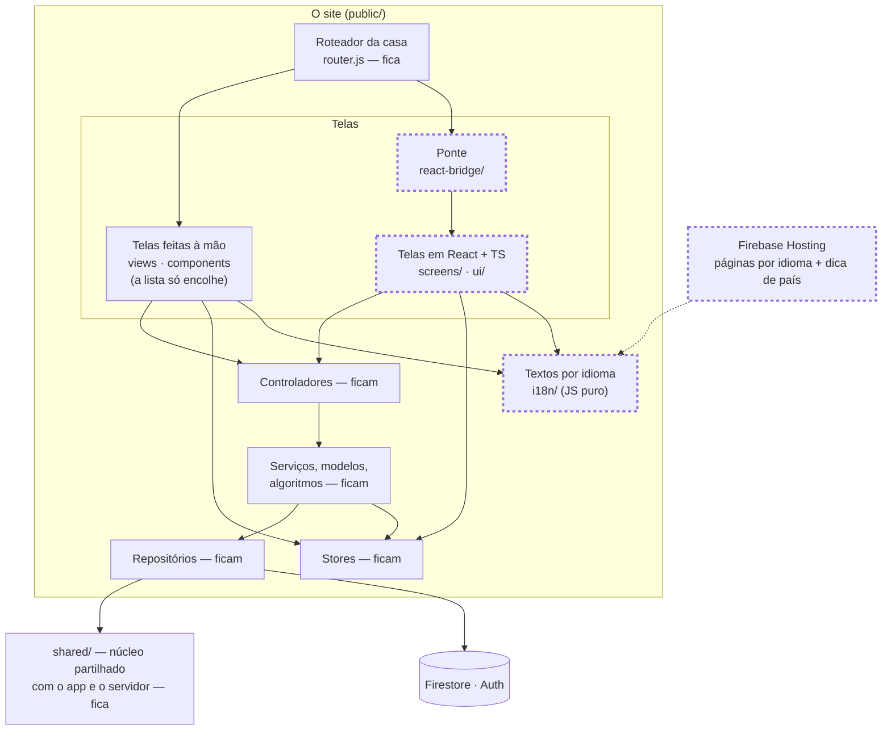
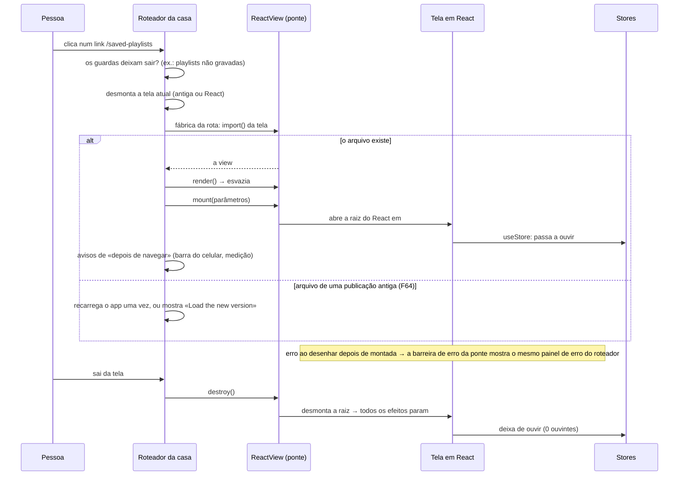
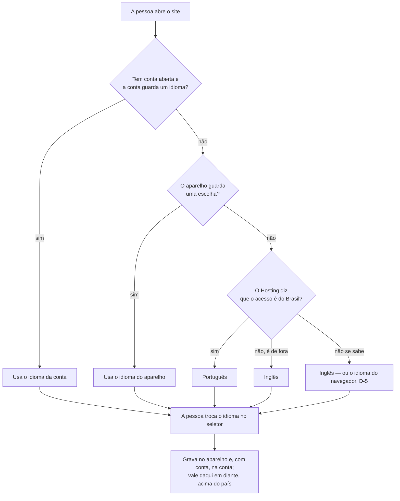
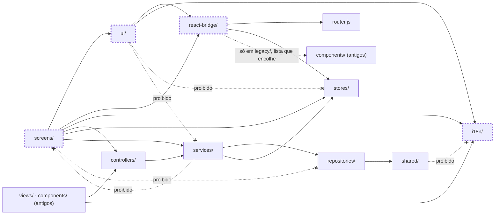

# As telas do site em React, tela a tela, com os idiomas — proposta

> **Profundidade:** completa — o risco mais alto é a migração parar no meio e o site ficar para sempre com dois jeitos de fazer tela; desfazer a adoção fica caro depois de quatro ou cinco telas, e a escolha muda a constituição.
> **Página para ler:** não publicada nesta entrega (este arquivo é a fonte; os diagramas são Mermaid) · **Crítica:** `reports/audits/2026-11-21-mjrpalbumblender-v0-f83-architecture-critique.md` (pode ir ao MJRP: 0 P0, 10 P1, 3 P2) · **Estado:** proposta **revista depois da crítica** (2026-11-21), com a ADR-0023 em «Proposed»; a resposta a cada achado está na seção 17
> **Seções usadas:** 1 a 13, cada uma diz o risco que reduz; 15 (as ondas), 16 (o que não foi conferido) e 17 (resposta à crítica) · **Fora:** 10 vira uma nota curta (não há custo pago novo) · **Vistas:** blocos (onde a mudança fica), dependências (R3), duas sequências (R2, R6), dois fluxogramas (R8, R9), opções em tabela (R1, R4, R9).
> **Quem escreveu não julga.** A seção 16 diz o que o crítico deve atacar primeiro.
> **Sobre os números:** a medição numa tela real ainda não foi entregue (ramo `wip/react-measurement-spike`). O que este texto cita como «prévia» vem do rascunho do relatório dela, lido em 2026-11-21; o que o rascunho ainda não tinha está como «a medir». Nenhum número foi inventado.

## 1. O que muda e por quê

O MJRP decidiu em 2026-11-21 que o site adota o React («sim vamos com react»), que os idiomas entram junto com a migração, tela a tela, e que o CMS vem depois («Bora !»). Esta proposta diz **como**: como as telas novas convivem com as antigas, o que não muda, como os textos passam a existir em inglês e português do Brasil, em que ordem as telas migram e como se evita parar no meio.

Quem é afetado e o que cada um quer:

- **Quem usa o site:** nenhuma tela muda de aparência nem de comportamento ao migrar; o site abre no seu idioma.
- **O MJRP, dono:** cada tela nova custa menos; um jeito só de fazer tela no site, no CMS e (mais tarde) no app; a migração termina.
- **Os agentes que constroem:** uma regra clara de onde nasce cada arquivo, e sensores que avisam quando ela é quebrada.
- **As features vizinhas:** a F81 (idiomas) precisa do contrato do dicionário; a F82 (CMS) precisa que o kit caiba; a F85 («Start» no menu) é a estrutura de rotas de onde a migração parte; a F84 (sensor visual) é como cada tela migrada é conferida.

Requisitos servidos: S-65 (F83), S-63 (F81), e o que a S-64 (F82) vai pedir desta base.

**O que esta proposta não faz:** não migra tela nenhuma, não escreve código de produto, não decide o desenho do CMS (é a proposta da F82) e não planeja o app (F78, em pausa): só mantém seguro o que é partilhado com ele.

## 2. Os direcionadores

**Objetivos.** (1) Um jeito só de fazer tela. (2) O site em dois idiomas. (3) A base pronta para o kit do CMS. (4) Nada do que funciona muda para quem usa.

**Restrições.**

- A constituição v2.0.0 proíbe framework de interface e `.ts` em `public/` sem ADR (*Proibições*, *Tipagem*, art. II.2) e diz «a interface fala inglês» (art. I.2). Esta proposta pede as duas emendas; só o MJRP muda a constituição (art. VIII.1).
- ADR-0016 e ADR-0017: a tela chega aos dados só pelo serviço; a store só guarda estado. Ficam como estão.
- ADR-0022 (Proposed, aceito em conversa «pra essa iteração»): `shared/` é JavaScript sem navegador, sem React, sem Firebase; `app/` e `public/` não se importam. Ficam como estão.
- O site sai da `main` local por `npm run deploy:site`, um trabalho pesado por vez pela fila da máquina; cada feature pronta vai sozinha para produção.
- O trem de merge cobra a reconferência visual de todo ramo que muda `public/` (`visual_gate.py`).
- O React do repositório é um só: a raiz fixa `react` 19.3.0 por `overrides`, por causa do app.
- O kit do CMS não é copiado para o V0: chega pelo harness (F332 de lá).

**Requisitos de qualidade.**

| Requisito de qualidade | Cenário (estímulo → resposta) | Medida |
|---|---|---|
| Sem mudança para quem usa | uma tela migra → o HTML dentro de `#app` e as capturas a 1280 e a 393 são os da tela antiga, com os mesmos dados | HTML idêntico nos estados conferidos (prévia: idêntico byte a byte em 4 estados da tela das playlists guardadas); 0 P0 na reconferência visual |
| O comportamento provado não se perde | os testes da tela antiga são levados para a nova → afirmam o mesmo | 0 asserções mudadas de sentido (prévia: 0 de 39 na tela medida) |
| A migração termina | a cada merge → a lista de arquivos feitos à mão só encolhe | 99 arquivos hoje em `views` (24) e `components` (75) → 0; o número nunca sobe (os 6 controladores ficam) |
| Peso baixado | quem abre o site → não baixa mais do que hoje além de um teto | o React num arquivo à parte: 68.922 B comprimidos na prova bruta da medição (221.716 B sem comprimir) — **53% acima** dos 45 KB que a análise estimava; o script principal +177 B na tela medida; o teto, com número, na seção 11 |
| A primeira tela não espera o idioma | abrir o site sem escolha guardada, com a rede lenta → a tela desenha no idioma que já se sabe | no máximo 300 ms a mais do que hoje até a primeira tela, no pior caso (seção 7); o tempo de hoje é «a medir» na onda 0 |
| Trocar de tela sem rede | a rede cai e a pessoa vai a uma tela → o site diz que está sem rede e deixa tentar de novo | nunca recarrega o app nem diz «versão nova» por queda de rede; prazo de 10 s para o arquivo de tela |
| Tela deixada não ouve mais nada | entrar e sair de uma tela cinco vezes → nenhum ouvinte sobra | 0 ouvintes fora da tela (prévia: 0 em 5 voltas) |
| Idioma certo sem perguntar | primeira visita do Brasil → português; de fora → inglês; escolha feita → vale sempre | 3 de 3 nos casos do fluxograma da seção 5.3; sem pedido de localização ao navegador |
| Nenhum texto fora do dicionário | um texto visível escrito direto no código → o sensor acusa | ~985 lugares hoje («entre 900 e 1.100», prévia) → 0; o número nunca sobe |
| Os dois idiomas completos | uma chave existe em inglês → existe em português, com os mesmos espaços reservados | 100% das chaves nos dois |
| Tempo de trabalho | a migração inteira | prévia: 25 a 60 horas de agente, extrapoladas de **uma** tela fácil; o tempo de conferência e aceite não foi medido. Refeito com número depois da onda 2 |

**O que só o MJRP sabe** está na seção «Decisões do MJRP»: o ritmo, as emendas da constituição, os endereços por idioma, onde a escolha de idioma fica guardada.

## 3. Os riscos

| # | Risco (o que pode dar errado, por quê) | Tipo | Prob. | Impacto | Custo de desfazer | Seção que o reduz | Estado |
|---|---|---|---|---|---|---|---|
| R1 | A migração para no meio: outra prioridade entra, e o site fica com dois jeitos de fazer tela, duas formas de testar e sensores em dobro, para sempre | complexidade | alta | alto | alto (cresce a cada tela) | 4.6, 11, 15 | reduzido pelas listas que só encolhem e pelo ponto de revisão da onda 2; **aberto** enquanto o MJRP não escolher o ritmo (D-1) |
| R2 | Uma tela migrada muda de aparência ou de comportamento sem ninguém notar: o React desenha depois (não na hora), a ordem dos nós muda, uma classe some | técnico | média | alto | baixo por tela (reverter o commit) | 5.1, 9.2, 9.4, 11 | reduzido: HTML idêntico como critério, testes levados sem mudar asserção, reconferência visual por onda; desfazer só é barato para a última onda publicada (seção 9.4) |
| R3 | Os sensores de arquitetura não enxergam `.ts`/`.tsx`: 26 dos 28 leem só `.js`. Uma tela em React importaria um repositório, escreveria o histórico, passaria de complexidade 10 ou teria texto em português sem nenhum acusar; e um `.js` importado só por um `.tsx` apareceria como morto | complexidade | certa, se nada for feito | alto | médio | 11 | reduzido: a onda 0 ensina os sensores antes da primeira tela |
| R4 | A tela em React fica com dado velho ou entra em laço: as stores são classes que mudam por dentro; `getState()` devolve um objeto novo a cada chamada; uma store muda um campo sem avisar (`playlists.js:85`) | técnico | média | médio | baixo | 4.3 | reduzido **por desenho, não por medida** (a prévia não usou esta ponte); fica **aberto** até o teste da onda 0 passar nas três formas de store; a auditoria dos `set` de cada store é tarefa da onda que a usa |
| R5 | Arrastar e soltar: o `sortablejs` mexe em nós que o React acha que são dele, e a lista se desfaz ou duplica | técnico | média | alto na tela das playlists | médio | 4.5, 15 (onda 2) | **aberto**: é a segunda medição; a decisão entre manter o `sortablejs` atrás de uma ponte ou trocar pelo `@dnd-kit` sai dela |
| R6 | Um erro de desenho depois de montada a tela não chega ao painel de erro do roteador (o `try/catch` dele só cobre a montagem), e a pessoa vê a tela em branco | técnico | média | médio | baixo | 5.1 | reduzido: barreira de erro dentro da ponte, com o mesmo painel |
| R7 | O site fica mais pesado: o React entra para todos, cada tela vira um arquivo, o dicionário em dois idiomas entra no script principal | custo (tempo de quem usa) | média | médio | baixo | 11 (teto), 9.3 | reduzido pelo teto conferido na publicação; os números são «a medir» |
| R8 | Tela meio traduzida ou texto traduzido que quebra a tela: uma tela migrada usa pedaços antigos que ficam em inglês (prévia: 5 textos na tela medida); 201 textos estão dentro de HTML montado à mão e uma tradução com aspas ou `<` abriria uma brecha | técnico, produto | alta | médio | baixo | 5.2, 5.4, 15 (uma onda leva a tela **com** os pedaços dela) | reduzido: o português fica fechado por uma chave até a cobertura combinada (seção 5.4) |
| R9 | O país não chega como se acredita: o Firebase Hosting escolhe conteúdo pelo país do IP (documentado), mas como o cache dele trata isso e se a regra vale junto com a reescrita para `/app.html` **não está na documentação**; nenhum cabeçalho de país para o servidor está documentado | técnico | média | médio | baixo | 5.3 | **aberto**: um teste de uma hora num canal de prévia do Hosting (TASK da onda 0); a saída, se falhar, está escrita |
| R10 | Os buscadores veem um idioma só, ou duas páginas iguais brigando: o conteúdo da raiz muda pelo país e o robô vem quase sempre dos EUA | produto | média | médio | baixo | 5.3 | reduzido: um endereço fixo por idioma na página de entrada, com `hreflang` |
| R11 | Guardar a escolha de idioma na conta pede um caminho novo no Firestore, e `firestore.rules` só o MJRP publica (ainda há uma publicação pendente) | dados, operação | certa | baixo | baixo | 6 | reduzido: vale no aparelho desde o primeiro dia; a conta entra quando a regra for publicada (D-4) |
| R12 | Um React só para o site e o app: uma atualização que o site precise fica presa à versão que o React Native aceita | operação | baixa | médio | médio | 9.1 | aceito e vigiado por sensor (`oneReact`); o app está em pausa |
| R13 | O kit do CMS não cabe depois: ele escreve o histórico do navegador por conta própria (`KitApp.tsx`), e o roteador da casa é o único dono do histórico | técnico | média | médio | baixo | 4.7 | reduzido por desenho (o CMS como uma terceira página do build); a decisão é da proposta da F82 |
| R14 | Os testes levados perdem o sentido: reescritos «no jeito React», passam sem provar o que provavam | qualidade | média | alto | médio | 9.2 | reduzido: a regra «muda o andaime, não a asserção», contada em cada onda |
| R15 | A camada do celular e o design system mudam sem querer: o Tailwind não lê `.tsx` e a classe não é gerada; alguém traz CSS por componente | técnico | alta, se nada for feito | alto | baixo | 4.4, 11 | reduzido |
| R16 | Depois de uma publicação, a aba aberta pede um arquivo de tela que não existe mais (cada tela vira um arquivo com nome novo) | operação | média | baixo | — | 5.1 | reduzido: o carregamento de tela passa só pela fábrica da rota, onde o conserto da F64 já atua |
| R17 | Listas grandes (300 capas, tabelas de faixas) ficam lentas: toda mudança de store redesenha a tela inteira | técnico | baixa | médio | baixo | 4.3, 11, 15 (onda 5) | **aberto**: medido na onda das séries; não há número hoje |
| R19 | Toda troca de tela passa a depender da rede: hoje só uma rota é carregada sob demanda; depois, cada primeira ida a uma tela é um pedido sem prazo, e uma queda de rede é confundida com «versão nova» (`isMissingBuildFile` reconhece qualquer falha de `import()`) e recarrega o app | operação | alta no celular | médio | baixo | 5.1, 7 | reduzido: prazo, estado «sem rede» próprio, e as telas do menu baixadas em segundo plano (onda 0, antes do canário) |
| R20 | Uma peça usada por telas de ondas diferentes (ícones: 59 arquivos; avisos: 20; janela: 10; Folha: 8) fica com duas implementações da onda 1 ao fim, e um conserto visual é feito duas vezes ou diverge | complexidade | certa, se nada for feito | médio | médio | 4.4 | reduzido: uma fonte só por peça partilhada (seção 4.4) |
| R21 | O site fica misturado em produção: uma tela em português e as outras em inglês para quem acessa do Brasil, por semanas — ou para sempre, se a migração parar | produto | certa, se nada for feito | alto no produto público | baixo | 5.4 | reduzido pela chave que mantém o português fechado; **aberto** enquanto o MJRP não escolher quando abrir (D-8) |
| R18 | A conferência visual de cada onda custa mais do que a migração e segura o trem | operação | média | médio | — | 9.2 | reduzido em parte: depende do sensor da F84 entrar; sem ele, a conferência é feita por agente a cada onda |

## 4. O desenho

### 4.1 Onde a mudança fica

Uma linha por bloco novo:

- **`public/js/screens/`** — uma pasta por tela, em React e TypeScript. É dona do desenho da tela e de mais nada.
- **`public/js/ui/`** — as peças do design system em React (botão, cartão, folha, janela, ícone, linha de faixa). São **portes** das peças de hoje: o mesmo HTML e as mesmas classes. Não conhecem store nem serviço.
- **`public/js/react-bridge/`** — a ponte: `ReactView` (o que o roteador enxerga), `useStore` (ler uma store), `usePhone`, `useLocale`, a barreira de erro. Dentro dela, `legacy/` guarda as pontes para pedaços antigos (`useVanillaComponent`, `useKeyedNodes`), que **somem** quando a migração acaba.
- **`public/js/shell/`** — a moldura em React, a partir da onda 3: barra do topo, rodapé, a moldura do celular, o login. Não é tela (fica fora de `#app`) nem peça pura (lê a store de quem entrou): por isso tem pasta própria. Quem a monta é o `app.js`, pela ponte, uma raiz por contêiner.
- **`public/js/i18n/`** — os textos. JavaScript puro, sem React: serve às telas antigas e às novas.
- **Firebase Hosting, páginas por idioma** — a página de entrada em inglês e em português, e um arquivo pequeno que diz se o acesso vem do Brasil (seção 5.3).

Os nomes das pastas dizem o que são (telas, peças), não a biblioteca: quando `views/` e `components/` acabarem, sobram `screens/` e `ui/`.

**Princípios aplicados.** A regra de dependência não muda: tela → controlador → serviço → repositório. O React fica na borda de fora: nada abaixo da tela o importa. O que muda muito (o desenho da tela) fica separado do que muda pouco (regras, serviços, dados), que já estava separado e é o que torna a troca possível.

**Dobras, com o custo.**

- **Dois jeitos de tela por um tempo.** Custo: pontes (prévia: 181 linhas pagas uma vez), sensores que leem as duas formas, dois andaimes de teste. Some no fim da migração.
- **TypeScript só nas telas novas.** O JavaScript antigo é lido pelos seus JSDoc e não verificado por dentro. Custo: os tipos na fronteira são frouxos (prévia: 14 avisos na primeira verificação, nenhum defeito). A regra: ao migrar uma tela, o JSDoc das funções que ela chama é acertado no próprio JavaScript; nada de conversão de tipo espalhada.

### 4.2 Convivência: opções

| Opção | A favor | Contra | Custo de mudar depois | Reversível? |
|---|---|---|---|---|
| **A. A tela em React é uma «view» do roteador da casa** (recomendada) | a `ReactView` foi provada na prévia: 47 linhas, 0 ouvintes sobrando, o roteador montou e desmontou sem mudar (o resto da ponte desta proposta — `useStore`, o ícone sem HTML cru, os invólucros dos pedaços antigos — **não** foi medido); os guardas de saída (playlists não gravadas), o conserto de versão antiga (F64), a barra do celular e a medição continuam ligados ao mesmo roteador | uma raiz do React por tela (o estado não atravessa telas pelo React: atravessa pelas stores, como hoje); o roteador da casa continua sendo código nosso | baixo: as telas recebem os parâmetros da rota por propriedade e navegam por uma função só | sim |
| B. Um roteador de biblioteca (React Router) assume, e as telas antigas viram componentes embrulhados | um roteador conhecido; uma árvore React só | reescreve de uma vez o que já funciona e é guardado por sensor (histórico, guardas, F63, F64, F67); toda tela antiga muda no primeiro dia; o risco R2 vale para o site inteiro de uma vez | alto | não, na prática |
| C. O React como páginas à parte no build (uma entrada do Vite por tela) | isolamento total | cada troca de tela recarrega a página; perde o estado em memória e a sensação de app; a barra e o menu duplicados | médio | sim |

**Recomendação: A.** O roteador só é revisto quando a última tela antiga sair (seção 15, onda 8): nesse dia a pergunta «manter o da casa ou adotar um de biblioteca» é barata, porque nenhuma tela chama o roteador direto.

**As três regras da convivência.**

1. **Um contêiner, um dono por vez.** O roteador desmonta a tela que sai antes de montar a que entra, seja qual for o tipo. Nenhuma tela desenha fora do seu contêiner, a não ser por folha, janela ou aviso (seção 4.4).
2. **A tela nova não importa a tela antiga, nem o contrário.** Um pedaço antigo dentro de uma tela nova passa por um invólucro em `react-bridge/legacy/` (um por pedaço), e uma peça nova dentro de uma tela antiga passa por `mountReactPiece`, da mesma pasta. Cada uso está numa lista que só encolhe. (Na prévia a tela importou seis pedaços antigos direto; as 181 linhas de ponte dela são um piso, não a conta.)
3. **Uma tela, uma versão.** Ao migrar, o arquivo antigo **da tela** e os testes dele saem no mesmo commit que troca a rota. Não há rota «-legacy» na `main`. As peças que outras telas ainda usam seguem a regra da fonte única (seção 4.4). Como se volta atrás está na seção 9.4.

**O que muda no roteador, e só isto:** o painel de erro (hoje uma string de HTML com `onclick` dentro de `router.js`) passa para uma função que o roteador e a barreira de erro do React usam — o mesmo texto e os mesmos botões, sem mudança para quem vê; `afterNavigate` passa a devolver como parar de ouvir (hoje não devolve); o erro de carregar uma tela passa a distinguir «sem rede» de «versão nova» (seção 5.1). O casamento de rotas, o histórico, os guardas e a ordem de montar não mudam.

**Navegar de dentro de uma tela em React:** só pela função `navigate()` de `react-bridge/`, que adia a troca para depois do desenho em curso (uma microtarefa). Sem isso, uma tela que navega de dentro de um efeito faria o roteador desmontar a raiz do React no meio do desenho.

### 4.3 O que fica, e como a tela em React o usa

| Parte | Decisão | Como a tela em React chama |
|---|---|---|
| `models`, `algorithms`, `ranking`, `transformers`, `utils` | ficam em JavaScript, como estão | `import` direto; funções puras |
| `services`, `repositories`, `api`, `shared/` | ficam | a tela chama o serviço ou o controlador; **nunca** um repositório, o Firebase ou `shared/data/` |
| `controllers` (6 arquivos) | ficam na primeira passada, como «o que a tela sabe fazer»; o que neles mexer no DOM passa para a tela na onda dela (a conferir por controlador) | a tela cria ou recebe o controlador e o ouve como ouve uma store |
| `stores` (8) | ficam (ADR-0017). **Nenhuma biblioteca de estado** | `useStore(store, ler)` da ponte |
| Estado só da tela (filtro aberto, linha em edição) | `useState` / `useReducer` do React | — |
| Rotas | o roteador da casa fica | parâmetros por propriedade; links são `<a href="/…">` comuns (o roteador já os intercepta); navegar por código é uma função só, em `react-bridge/` |
| Formulários | sem biblioteca: campos controlados e a validação que já mora nos modelos | os formulários do site são poucos e curtos (lista colada, busca, lote, inventário, login) |

**Estado: por que não uma biblioteca.** As opções eram manter as stores, adotar Zustand/Redux, ou uma biblioteca de dados do servidor (TanStack Query). As stores já são guardadas por sensor, não dependem do DOM, e os serviços são os únicos que escrevem nelas (ADR-0017, ADR-0019: um dono só para a carga dos álbuns). Uma biblioteca nova traria um segundo dono do estado. Volta à mesa se o app precisar partilhar estado com o site (hoje partilha só regras).

**A ponte com as stores, e o risco R4.** O React pede uma «foto» estável do estado; cinco stores devolvem um objeto novo a cada `getState()` e três não têm foto nenhuma. A ponte não usa a foto: ela conta **versões**. O contrato de `useStore`:

- **Onde mora o número:** na ponte, um por store (uma tabela fraca `store → número`). Na primeira vez que qualquer tela usa uma store, a ponte se inscreve nela **uma vez e não sai mais**: cada aviso soma um. É um ouvinte fixo por store usada, declarado, que o teste de «zero ouvintes» desconta.
- **Por que fixo:** cinco stores avisam na hora (`albums`, `playlists`, `albumSeries`, `inventory`, `UserStore`). Se o número só contasse enquanto a tela ouve, uma mudança feita entre o primeiro desenho e a inscrição da tela se perderia e a tela ficaria com dado velho. Com o ouvinte fixo, o número já mudou quando o React confere depois de se inscrever, e ele redesenha.
- **O que a tela lê:** os mesmos `get…` de hoje, durante o desenho. Nenhuma store muda.
- **O teste (TASK-04), nas três formas de store** (`getState`, sem foto, aviso em lote): a store muda entre o primeiro desenho e a inscrição, e a tela mostra o valor novo.

O que a ponte não resolve, e fica como regra, **sem sensor** (seção 11): (a) uma mudança sem aviso continua invisível, como já é hoje para as telas antigas — o mapa de cada onda audita os `set` das stores que a tela lê; (b) as stores mudam listas por dentro: nada derivado de uma lista da store fica guardado por `useMemo`, e nenhum filho recebe a lista sob `React.memo`, sem que a store troque a lista inteira; (c) o React redesenha **depois** do aviso, não dentro dele: código que escreve numa store e lê o DOM em seguida acha o desenho antigo — quem precisa disso usa `flushSync`, pela ponte.

**TypeScript: o escopo.** `.ts`/`.tsx` só em `screens/`, `ui/`, `react-bridge/` e nos testes deles; modo estrito; `allowJs` ligado e `checkJs` desligado. `i18n/` fica em JavaScript com JSDoc (as telas antigas o importam). `shared/` e o servidor não mudam (ADR-0022). Converter o JavaScript antigo não faz parte desta feature.

### 4.4 A camada do celular e o design system, sem mudança visual

- **O CSS não muda de lugar nem de forma.** As mesmas folhas, a mesma ordem de carga em `app.js`, as mesmas classes. A tela em React escreve o mesmo HTML com o mesmo `className`. Na prévia, o HTML a 393 px saiu idêntico byte a byte.
- **Nada de CSS por componente.** Sem CSS Modules, sem CSS dentro do JavaScript, sem biblioteca de componentes prontos. É regra com sensor (seção 11): a constituição manda portar o design system, não reescrever.
- **Tailwind:** o `content` passa a ler `public/js/**/*.{js,ts,tsx}`, e o teste `tailwindBuiltWithSite` passa a montar os dois lados com os `.tsx`. Sem isso uma classe escrita só em JSX não existiria no CSS (R15).
- **«É celular?»** `usePhone()` na ponte, sobre o mesmo `isPhone()` / `onPhoneChange` (`utils/isPhone.js`): a linha dos 767 px continua escrita em dois lugares só, conferida pelo mesmo teste.
- **A Folha (`components/ui/Sheet.js`), a janela (`BaseModal`), o aviso (`Toast`), o diálogo (`DialogService`):** o motor fica. A Folha tem 173 linhas de comportamento testado (trava da página, foco, arrastar para fechar, fechar quando deixa de ser celular). Em React ela ganha um invólucro em `ui/` que abre a Folha de hoje e desenha os filhos dentro dela (um «portal»). Uma lógica só, nenhuma mudança visual. O motor só é reescrito na última onda, se ainda valer a pena.
- **Uma fonte só para cada peça usada por telas de ondas diferentes (R20).** Três casos, e nenhum deixa duas implementações:
  1. **Peças que são dados** (os ícones, importados por 59 arquivos): os desenhos dos ícones passam para um módulo de dados puro; o `getIcon()` de hoje (que devolve texto) e o `<Icon>` em React leem os mesmos dados. O `<Icon>` monta o `<svg>` por elementos, **sem** HTML cru (a prévia usou `dangerouslySetInnerHTML`, que esta proposta proíbe): o HTML igual tem de ser provado na onda 0, antes de qualquer tela depender dele. Se não sair igual, o ícone ganha a única entrada da lista de exceções, com o motivo.
  2. **Peças que são um serviço** (aviso, diálogo, janela, Folha — 20, 10 e 8 arquivos): o motor antigo fica até a onda 8; o React só o chama ou o embrulha.
  3. **Peças de desenho usadas em mais de uma onda** (cartão de álbum, linha de faixa, barra de filtros, paginador, trilha): migram **uma vez**, para `ui/`, na primeira onda que as usa; as telas antigas que ainda as usam passam a montar a peça nova por `mountReactPiece` (ponte, lista que encolhe), e o arquivo antigo sai. O mapa de cada onda lista essas peças antes de construir.
- **`PhoneShell`, a barra do topo e o rodapé** ficam fora de `#app` e são antigos até a onda 3 (seção 15). Continuam funcionando com telas em React, porque ouvem o roteador, não a tela. O título que uma tela põe na barra do celular e na aba passa por um `useScreenTitle` da ponte, que chama as funções de hoje.
- **`design-system.md`** ganha, depois da aceitação, uma linha por peça de `ui/` dizendo de que peça antiga ela é o porte.

### 4.5 Arrastar e soltar (R5)

Duas saídas, e a escolha depende de medir:

| Opção | A favor | Contra |
|---|---|---|
| **Manter o `sortablejs` atrás de uma ponte** (ponto de partida) | o comportamento no celular e no computador já foi aceito; nenhuma dependência nova | o React e o `sortablejs` disputam os mesmos nós: a ponte precisa desfazer o movimento no DOM e refazê-lo pelo estado; é o tipo de código que quebra em silêncio |
| Trocar pelo `@dnd-kit` | feito para o React; é a biblioteca do kit do CMS, que vai entrar no repositório de qualquer jeito | muda o comportamento de arrastar (toque longo, rolagem, animação): pede conferência de tela e talvez aceite do MJRP; mais peso no pedaço da tela |

A onda 2 (a tela de edição das playlists) é a **segunda medição** e decide — antes de a moldura migrar. Até lá, R5 está aberto.

### 4.6 A regra da casa, e como a migração não para no meio (R1)

**A regra, que vale para sempre:** tela nova ou redesenhada nasce em React, em `screens/`. Nenhum arquivo novo entra em `views/` nem em `components/`.

**O ritmo — duas opções, e a escolha é do MJRP (D-1):**

| Opção | A favor | Contra |
|---|---|---|
| **Esforço dedicado, em ondas, até o fim** (recomendada) | é o que ele disse querer («vamos nos concentrar na migracao pra react + internacionalizacao»); o custo dos dois estilos dura semanas e não anos; os idiomas chegam ao site inteiro | durante as ondas, menos feature nova; cada onda passa pela conferência visual |
| Migrar só quando a tela for mexida | custo diluído; nenhuma parada | telas pouco mexidas nunca migram; o site fica anos com dois estilos e meio traduzido; é exatamente o risco R1 |

**O que impede parar no meio, qualquer que seja o ritmo:**

1. **Listas que só encolhem**, conferidas a cada execução da suíte: os arquivos feitos à mão, os usos de ponte para pedaço antigo, os lugares de texto fora do dicionário. Um número que sobe quebra a suíte.
2. **Cada onda termina num estado inteiro:** uma tela com todos os pedaços dela, nos dois idiomas, sem arquivo antigo sobrando. Parar entre ondas deixa o site coerente; parar no meio de uma onda não vai para a `main`.
3. **Um ponto de revisão com número, depois da onda 2, antes de a moldura (que está em toda tela) migrar:** com duas telas medidas (uma fácil, uma difícil) o custo do resto deixa de ser palpite. Ali o MJRP confirma o ritmo, desacelera ou para — sabendo quanto falta.
4. **Um placar:** `scripts/migration-status.mjs` imprime quantos arquivos, linhas, pontes e textos faltam; o número vai para o registro de cada onda.
5. **Mexer numa tela antiga durante a migração:** conserto pequeno entra na tela antiga; qualquer coisa maior espera a onda dela ou a antecipa.

**O critério de fim:** `views/` e `components/` vazias; `react-bridge/legacy/` apagada; `SafeDOM`, `BaseView` e os sensores só das telas antigas apagados; a constituição e o `tech-stack.md` dizendo «React» sem «durante a migração».

### 4.7 O que a página do CMS (`/admin`, F82) vai precisar desta base

Lido no kit (`MJRPpersonal/src/admin-kit/`, só leitura): ele importa `react`, `clsx` e `@dnd-kit`; recebe do projeto o esquema, as portas (ler, gravar, imagem, traduzir) e uma pele de CSS; todo o CSS dele é prefixado (`[data-admin-skin]`, `.ak-*`); o texto editável é um registro com uma entrada por idioma (`KitText`), e os idiomas vêm do esquema, não estão fixos no kit.

O que esta base entrega para ele, e o que fica para a proposta da F82:

| O CMS precisa de | Esta base entrega | Fica para a F82 |
|---|---|---|
| React 19 e TypeScript no build do site | sim (onda 0) | — |
| Não pesar para quem não é o dono | cada tela é um arquivo à parte; o CMS é carregado só em `/admin` | — |
| Ser dono do próprio histórico (o `KitApp` lê e escreve `location`/`history`) | o desenho recomendado: **o CMS como uma terceira página do build** (`admin.html`), fora do roteador da casa, com a mesma base de React | a decisão; a reescrita `/admin/**` no `firebase.json` e o teste `hostingServesFreshPage` |
| O texto editável como par por idioma | o contrato da seção 5.2: `{ en, pt }`, lido por uma função só | o esquema do kit para o V0; quais textos são editáveis |
| Conteúdo lido do Firestore em tempo de execução | a costura: `t()` procura primeiro no conteúdo publicado, depois no dicionário do build (que é a reserva: o site funciona com o Firestore fora) | onde o documento mora, as regras, quem publica |
| Os álbuns da página de entrada escolhidos no CMS (REQ-03) | a forma de `covers.js` (14 registros, lados A e B) vira o contrato do dado | como a escolha chega a uma página estática: leitura ao abrir com o conjunto fixo de reserva, ou publicação que refaz a página |
| A chave da medição de uso (REQ-02) | `usageSwitch.js` já decide por ordem (teste > desligado no aparelho > desligado no build > chave); ganha mais uma fonte: o valor publicado no CMS | a peça de liga-desliga nasce no kit (F332 do harness) |
| Login só do dono, tradução no servidor | nada novo aqui | portas, regra do Firestore, rota de tradução |

## 5. Os fluxos

### 5.1 Entrar e sair de uma tela em React (R2, R6, R16)

Três regras saem deste fluxo:

- A tela desenha **na hora** ao montar (não «quando o React puder»): os avisos de depois de navegar encontram a página pronta, como com as telas antigas.
- **Dividir o código em arquivos só acontece na fábrica da rota.** Um carregamento tardio no meio de uma tela não passaria pelo conserto da F64 (R16).
- A barreira de erro é da ponte, não de cada tela: nenhuma tela esquece dela. Cada erro que ela pega é contado pela porta de medição de uso que já existe (seção 9.4).
- **Sem rede não é versão nova (R19).** Hoje `isMissingBuildFile` reconhece qualquer falha de `import()`. Passa a haver três desfechos distintos ao carregar uma tela: (1) chegou; (2) o arquivo não existe mais porque houve publicação — conferido pedindo `/app.html` sem cache e comparando o nome do script principal — e aí vale o conserto da F64; (3) a rede não respondeu em 10 s ou caiu — a pessoa vê «sem rede», com «tentar de novo», a tela anterior não é recarregada e nada em memória se perde. Enquanto o arquivo carrega, a barra de progresso que já existe aparece.
- **As telas do menu são baixadas em segundo plano** depois que a primeira tela aparece (como o `react-vendor`): trocar de tela volta a funcionar sem rede depois da carga inicial, como hoje. Entram no teto de peso como o que é baixado «depois», não «antes de ver a primeira tela».

### 5.2 Os textos: um dicionário para as telas antigas e as novas (R8)

**O contrato** (a F81 escreve os textos; esta proposta fixa a forma):

- **Idiomas:** `en` (padrão e reserva) e `pt` (português do Brasil). Os identificadores são esses dois, no dicionário e no conteúdo editável; a etiqueta para o navegador e os buscadores (`lang`, `hreflang`) é `en` e `pt-BR`, traduzida num lugar só.
- **Onde moram:** `public/js/i18n/en/<área>.js` e `public/js/i18n/pt/<área>.js` — um dicionário por idioma, partido por área (`common`, `nav`, `start`, `albums`, `playlists`, `savedPlaylists`, `inventory`, `blend`, `entry`). O inglês vai no script principal (é a reserva); o português é um arquivo à parte, baixado só por quem o usa.
- **A chave:** `área.peça.nome` (`savedPlaylists.empty.title`). Estável: é o endereço que o CMS vai editar.
- **O valor:** texto puro, com espaços reservados `{nome}`. **Nunca HTML.** Um sensor recusa `<` num valor. Onde uma frase tem um link ou um negrito no meio, ela é partida em chaves.
- **A função:** `t(chave, valores)`, `tPlural(chave, quantidade, valores)` (formas `.one` e `.other`, escolhidas pelo `Intl.PluralRules` do navegador), `getLocale()`, `setLocale()`, `onLocaleChange()`. JavaScript puro. Uma chave que falta no idioma mostra o inglês; uma que falta nos dois mostra a própria chave (e um teste garante que isso não chega à `main`).
- **Datas, números e dinheiro:** por `formatDate`, `formatNumber`, `formatMoney` de `i18n/`, que usam o idioma atual. As 14 chamadas `toLocale…` de hoje em `public/js`, cada uma com um idioma escrito à mão, passam por elas. A **moeda** do inventário continua sendo escolha da pessoa, não do idioma.
- **Telas antigas:** chamam `t()` como as novas. Dentro de HTML montado à mão, sempre `escapeHtml(t(…))` — o sensor `outsideTextEscaped` passa a exigir.
- **Telas em React:** `useLocale()` faz a tela redesenhar quando o idioma muda; o React já protege o texto.
- **O conteúdo editável (F82):** um campo editável é o par `{ en: "…", pt: "…" }` — a forma `KitText` do kit, com `languages: ['en', 'pt']` no esquema. Uma função só o lê, `inLanguage(valor, idioma)`: aceita o par ou um texto simples; se o idioma pedido estiver vazio, devolve o inglês. É a mesma regra do site do MJRPpersonal, com o inglês como principal. **O kit edita esse formato sem adaptação.**
- **O que nunca é traduzido:** nomes de álbum, artista e faixa; nomes que a pessoa escreveu (série, lote, playlist); marcas (Album Blender, Spotify, Apple Music, Discogs, BestEverAlbums); gêneros como vêm dos catálogos. Passam direto, sem `t()`.
- **Quem não importa `i18n/`:** `shared/`, `models/`, `algorithms/`, `ranking/`. Uma regra devolve um código ou um dado; quem escreve a frase é a tela. (Quantos textos visíveis moram hoje nessas pastas e nos serviços: «a medir», no levantamento da F81; a prévia contou só telas, componentes e controladores.)

**A regra «a interface fala inglês» muda de sentido.** Hoje o sensor `interfaceInEnglish` proíbe português em `public/js`. Passa a ser: **o código fala inglês; todo texto visível vem do dicionário; português só existe em `i18n/pt/`.** É emenda do art. I.2 da constituição (D-2).

### 5.3 Qual idioma abrir (R9, R10)

A decisão do MJRP: o país de acesso primeiro; a escolha da pessoa vale acima.

**De onde vem o país, sem pedir a localização ao navegador — as opções:**

| Opção | A favor | Contra |
|---|---|---|
| **A. O Firebase Hosting escolhe um arquivo pelo país do IP** (reescritas de i18n; recomendada) | documentado: o Hosting tira o país do endereço IP e serve o arquivo da pasta daquele país; não há código nosso no servidor, nem custo; não guardamos IP nem país | o que **não** está na documentação: como o cache trata o mesmo endereço servido diferente por país, e a convivência com a reescrita geral para `/app.html`. **A conferir** num canal de prévia (uma hora) |
| B. O servidor (Cloud Run) lê o país de um cabeçalho | uma rota nossa, testável | nenhum cabeçalho de país está documentado para o que o Hosting repassa ao Cloud Run; sem ele, seria preciso uma base de IPs (custo e manutenção). O servidor hoje não lê cabeçalho nenhum de quem pede |
| C. O idioma do navegador (`navigator.language`) | simples, sem rede | não é o que o MJRP decidiu (ele disse o lugar); um brasileiro com o sistema em inglês veria inglês. Serve como reserva quando o país não é sabido (D-5) |

**Como a opção A funciona, em duas peças:**

1. **A dica de país.** Um arquivo `geo.json` na raiz do site com `{"country": null}`, e uma cópia na pasta de i18n do Brasil (`ALL_br/geo.json`) com `{"country": "BR"}`. O site pede `/geo.json` na primeira visita sem escolha guardada; o Hosting responde com a cópia do Brasil para quem acessa de lá. O arquivo é servido sem cache (uma linha a mais em `firebase.json`). O pedido tem prazo curto (1,5 s): sem resposta, é «não se sabe».
2. **A página de entrada.** Ela é a única página pública e é HTML estático, lido sem script. O build passa a gerar três arquivos a partir do mesmo molde e do mesmo dicionário: `/` (inglês), `/pt/` (português) e `/en/` (inglês), mais a cópia em português na pasta do Brasil, para que a raiz já abra em português para quem acessa de lá, sem piscar.

**A escolha da pessoa acima do país.** O seletor de idioma grava a escolha (`localStorage`, chave `mjrp.lang`). Na página de entrada, o pequeno script que já roda antes de pintar (a «decisão da raiz», `splash/gate.js`) passa a ler também essa chave: se a página servida não é a do idioma escolhido, vai para `/pt/` ou `/en/`. No app, o idioma é lido antes de a primeira tela desenhar.

**O que os buscadores veem (R10).** Dois endereços fixos, `/en/` e `/pt/`, cada um com `lang`, título, descrição e dados estruturados no seu idioma, e as três linhas `hreflang` (`en`, `pt-BR`, `x-default` para `/`). A raiz varia por país, mas não é a única porta: o robô que vem dos EUA encontra o português pelo `hreflang`. O app atrás do login não é indexado e **não ganha prefixo de idioma** nos endereços: `/albums` é `/albums` nos dois idiomas, e o idioma é uma preferência. Isso mantém intactos o retorno do Spotify (`/callback`, registrado por endereço exato), as rotas da F85 e os links guardados (D-3).

**Se o teste da opção A falhar** (o cache servir o Brasil para todos, por exemplo): a página de entrada continua com `/pt/` e `/en/` fixos e a raiz fica em inglês para todos. O que acontece na primeira visita depende da D-5: se ele escolher «o idioma do navegador», quem tem o navegador em português abre em português; se escolher «inglês, sempre», **nenhum brasileiro abre em português na primeira visita** — só depois de escolher no seletor. O MJRP é avisado antes, porque nos dois casos muda o que ele decidiu.

**O que o teste de uma hora prova e o que não prova.** Num canal de prévia, de um lugar só, ele exercita o país pelo cookie de substituição do Hosting (`firebase-country-override`), a convivência com a reescrita para `/app.html` e o `/pt` sem barra. O caminho pelo IP de verdade só se confere em produção: o MJRP abrindo do Brasil e um pedido feito de fora do Brasil (de uma máquina na nuvem). A tarefa diz as duas partes.

### 5.4 Quando o português abre para quem usa (R21)

As ondas vão a produção uma a uma, cada tela com os dois idiomas prontos. Sem cuidado, quem acessa do Brasil veria uma tela em português e as outras em inglês por semanas, sem seletor até a moldura migrar — e para sempre, se a migração parasse.

**A chave:** `i18n/` tem uma lista só, `OPEN_LOCALES`, escrita no build. Enquanto ela for `['en']`, o site abre em inglês para todos, a dica de país não é pedida, o seletor não aparece e a página de entrada tem só a versão em inglês. O português já está no código e nos testes, e o dono o vê com uma marca no próprio navegador (`localStorage`, `mjrp.lang.preview`), para revisar cada onda. Abrir o português é mudar a lista para `['en','pt']` e publicar.

**A cobertura que abre a chave** é escolha do MJRP (D-8). A recomendação: a moldura, a página de entrada e todas as telas — isto é, no fim das ondas. Um sensor (`localeCoverage`) confere que a lista só inclui um idioma quando os lugares de texto fora do dicionário chegaram a zero nas áreas declaradas.

## 6. Os dados

Só um dado novo nesta proposta: a escolha de idioma.

| Entidade | Onde mora | Quem escreve | Obrigação | Vida e purga |
|---|---|---|---|---|
| Idioma escolhido (aparelho) | `localStorage`, chave `mjrp.lang` (`en` ou `pt`) | o seletor de idioma | nenhuma (não é dado pessoal sensível; não sai do aparelho) | até a pessoa limpar o navegador |
| Idioma escolhido (conta) | Firestore, `users/{uid}/preferences/site`, campo `language`, com `_schemaVersion` | o serviço de preferências, pela conta dona | a regra de acesso é «só o dono» | apagado com a conta |
| Idioma deduzido do país (um palpite, não uma escolha) | a memória da aba (`sessionStorage`, `mjrp.lang.guess`) | o `i18n/`, ao receber `/geo.json` | **nunca** é gravado em `mjrp.lang` nem na conta: só o seletor grava escolha | até a aba fechar; a visita seguinte sem escolha pede `/geo.json` de novo (sem segurar o desenho, seção 7) |
| País de acesso | **não é guardado** | — | — | serve só para o palpite acima |

- **Acesso pelo caminho de sempre:** um repositório em `shared/data/` (para o app ler a mesma preferência um dia) e um serviço em `services/preferences/`. A tela e o `i18n/` não tocam o Firestore.
- **«Com conta» é conta de verdade.** Todo visitante tem uma sessão de convidado no Firebase; ela não conta: convidado usa só o aparelho.
- **Dois escritores** (dois aparelhos da mesma conta): vale a última **escolha** gravada. Ao entrar na conta: se a leitura respondeu e a conta tem idioma, ele vence o do aparelho; se a leitura respondeu «não existe», a escolha do aparelho (se houver; o palpite não) é gravada na conta.
- **Leitura que falha não é «não existe» (achado 1 da crítica).** Recusa, prazo ou rede: a conta fica intocada, nada é gravado nela nesta visita, e vale o idioma do aparelho. Sem isso, um aparelho com rede lenta apagaria a escolha feita noutro. Um teste prova os três casos.
- **`firestore.rules` (R11):** o caminho `users/{uid}/preferences/…` não está nas regras de hoje. A regra nova é escrita no ramo e **quem publica é o MJRP**. Até lá, a escolha vale só no aparelho; o serviço trata a recusa como **falha de leitura** (não como «não existe»): não mostra erro e não grava nada na conta.
- O conteúdo editável do CMS e a chave da medição são dados da F82 (seção 4.7).

## 7. Falhas e prazos

| Chamada ou etapa | Prazo | Retentativa | Se falhar, quem usa vê | Erro distinto de vazio? |
|---|---|---|---|---|
| Baixar o arquivo de uma tela (`import()` na fábrica da rota) | 10 s | a pessoa decide: «tentar de novo» | sem rede ou prazo: «sem rede», com «tentar de novo», sem recarregar o app; arquivo de publicação antiga: o conserto da F64 (recarrega uma vez, ou «Load the new version») | sim: três desfechos distintos (seção 5.1) |
| Baixar o arquivo do React (junto com a primeira tela em React; a partir da onda 3, na abertura) | 10 s | a mesma da tela | o mesmo | sim |
| Baixar o dicionário em português | segura a primeira tela por até 300 ms; continua em segundo plano até 3 s | nenhuma nesta visita | a tela desenha em inglês e troca quando o dicionário chega (as telas em React na hora; as antigas na próxima troca de tela); a escolha guardada não é apagada | sim: «não chegou» não é «não existe» |
| Pedir `/geo.json` | segura a primeira tela por até 300 ms; desiste em 1,5 s | nenhuma | nada: o idioma segue a regra do «não se sabe»; se a resposta chega depois do desenho, vale a partir da próxima troca de tela | sim: `null` é «não é do Brasil ou não se sabe»; falha de rede é «não se sabe» |
| Ler a preferência da conta | **não segura** a tela; desiste em 3 s | nenhuma | o idioma do aparelho; se a conta responder com outro idioma, o site troca e avisa numa linha | sim: falha não é «não existe» (seção 6) |
| Gravar a preferência na conta | 5 s | uma, na próxima troca | nada (a escolha já vale no aparelho) | sim |
| Erro ao desenhar uma tela em React | — | — | o painel de erro do roteador, com «Go Back» | sim |

Nenhuma dessas falhas impede o uso do site em inglês, que é como ele funciona hoje.

**A regra do tempo:** as três esperas do idioma correm **ao mesmo tempo** que a abertura normal do app (o login e o Firebase já levam mais do que isso) e, juntas, seguram a primeira tela por no máximo 300 ms além do que ela levaria. Quem já escolheu um idioma não espera nada: a escolha está no aparelho. O tempo até a primeira tela de hoje é medido na onda 0, e a meta é «o de hoje + 300 ms, no pior caso».

## 8. Segurança e privacidade

- **Texto de fora continua texto.** O React escapa o que desenha. `dangerouslySetInnerHTML` é proibido por regra de lint e por sensor, com lista de exceções vazia. Um endereço que vem de fora continua passando por `safeUrl` (o sensor `outsideUrlChecked` aprende a ler `href={…}` em JSX).
- **O texto traduzido nunca é HTML** (seção 5.2), nem o do dicionário nem, depois, o do CMS.
- **A política de conteúdo (CSP)** de `public/index.html` não muda: o React não precisa de `eval` nem de script de outro endereço. Os pacotes novos vêm do `npm`, com versão exata e `package-lock`.
- **Nenhum segredo novo.** Nenhuma chave nova no navegador nem no servidor.
- **Privacidade:** o país é deduzido pelo Hosting a partir do IP, para escolher um arquivo; o site não guarda IP nem país, e não pede a localização ao navegador. A escolha de idioma é uma preferência, guardada no aparelho e, com conta, na conta, sob a regra «só o dono». A página de privacidade, quando existir para o produto público, diz isso em uma linha.
- **O `/admin`** (login do dono, regra de escrita, rota de tradução com chave de IA) é superfície nova da F82 e é desenhado lá.

## 9. Relação com o que já existe

### 9.1 Decisões e documentos tocados

| O que | Efeito |
|---|---|
| Constituição v2.0.0 | **emendas, pelo MJRP:** *Proibições* e art. II (o site passa a usar React nas telas); *Tipagem* (`.ts`/`.tsx` permitidos em `screens/`, `ui/`, `react-bridge/`); art. I.2 («a interface fala inglês» → o código fala inglês, todo texto visível vem do dicionário); art. III.1 (a palavra «view» passa a incluir a tela em React) |
| `tech-stack.md` | sai a linha «Framework de UI — decidido não usar (no site)»; entram React 19.3.0, react-dom 19.3.0, TypeScript 6.0.3 e `@vitejs/plugin-react` (versões da prévia), cada linha citando a ADR-0023 |
| ADR-0016, ADR-0017, ADR-0019, ADR-0021 | mantidas; os sensores delas passam a ler `.ts`/`.tsx` |
| ADR-0022 (app) | mantida. O `overrides` do React passa a valer para o site também: **um React só** (R12). Atualizar o React passa a ser do site e do app ao mesmo tempo; um sensor confere que as versões são a mesma |
| `arch.md` | depois da aceitação: o mapa de componentes ganha `screens/`, `ui/`, `react-bridge/`, `i18n/`; uma seção curta «As telas em React e os idiomas» aponta para cá |
| `design-system.md`, `info-arch.md` | sem mudança de conteúdo: nenhuma tela muda. `design-system.md` ganha a tabela de portes |
| F85 | é a base: a tela de montar série em `/start`, `/home` leva a ela, o logotipo leva a `/?entry`. A migração parte dessas rotas; a decisão da raiz passa a levar em conta o idioma |

### 9.2 Os testes (R14, R18)

Hoje: 280 arquivos `*.test.js` em `test/` (contados nesta árvore; a prévia fala em 294 arquivos e 3.722 testes, com os dela). Dos 75 arquivos de `test/views` (14), `test/components` (44) e `test/controllers` (17):

- **Os de controlador ficam** enquanto o controlador ficar.
- **Os de tela e de componente são levados junto com a peça**, na mesma onda, com uma regra: **muda o andaime, não a asserção.** O teste continua lendo o DOM por seletor e afirmando o mesmo; o que muda é como a tela é montada e o `act()` em volta de cada mudança. Cada onda conta: asserções levadas, asserções mudadas de sentido (a meta é zero; cada uma que mudar é justificada no registro da onda), asserções novas.
- **A biblioteca:** nenhuma além do próprio React (`createRoot` e `act`), com um ajudante da casa de umas 30 linhas (`test/support/renderScreen.tsx`). É o que a prévia usou. A React Testing Library ficou de fora **por agora**: as consultas dela (por papel e por texto) mudariam as asserções, que é o que queremos provar que não mudou. Volta à mesa quando uma tela nova, sem teste antigo, for desenhada; é dependência só de desenvolvimento, barata de somar.
- **Um teste igual para toda tela em React:** entrar e sair cinco vezes deixa zero ouvintes (stores, idioma, celular).
- **O modo estrito do React** fica ligado no desenvolvimento e nos testes: ele monta cada tela duas vezes e mostra o efeito que não se desfaz.
- **`vitest.config.js`:** `include` ganha `*.test.ts` e `*.test.tsx`; entra o plugin do React. O projeto `core-node` não muda.

**A conferência de tela, por onda:**

1. **A prova de HTML igual**, enquanto as duas versões existem no ramo: a mesma tela, os mesmos dados postos na memória, `#app` comparado a 1280 e a 393 em cada estado. Evidência em `reports/evidence/F83/`.
2. **O portão visual do trem:** todo ramo que muda `public/` leva o relatório de reconferência visual, feito por um agente que não construiu.
3. **O sensor visual (F84, Playwright):** montado, não juntado, e hoje cobre a Home e a página de entrada sem conta. Para servir à migração ele precisa mostrar cada tela com dados de exemplo, sem login e sem gravar em produção. **A conferir com a F84**; enquanto não cobrir, o passo 2 é feito à mão por agente, e é o custo do R18.

### 9.3 O build e a publicação

- **`vite.config.js`:** entra `@vitejs/plugin-react`; o React vai para um arquivo próprio (`react-vendor`), baixado uma vez e guardado pelo navegador entre publicações; as telas em React são carregadas sob demanda pela fábrica da rota. Hoje todas as telas menos uma estão no script principal: à medida que migram, o script principal **encolhe**. Até a moldura migrar (onda 3), o `react-vendor` é pedido em segundo plano depois que a primeira tela aparece, para a primeira tela em React não esperar por ele; da onda 3 em diante a moldura é React, e o `react-vendor` passa a ser carregado na abertura, junto do script principal — é a linha «para ver a primeira tela» do teto de peso.
- **O plugin da página de entrada (`scripts/entryPage.mjs`):** não muda para o React. Para os idiomas, passa a preencher os textos a partir do dicionário e a gerar as páginas por idioma e a pasta do Brasil (seção 5.3).
- **`firebase.json`:** ganha `"i18n": {"root": "/geo"}` (o nome da pasta é da onda 0) e `no-cache` para `/geo.json`. As reescritas não mudam nesta feature. O teste `hostingServesFreshPage` é atualizado junto.
- **`scripts/deploy-site.sh`:** ganha a verificação de tipos (`tsc --noEmit`) ao lado do lint; `verify_build` passa a conferir o teto de peso, que existe um só `react-vendor`, e que as páginas por idioma existem. O caminho de publicar e de voltar atrás não muda.
- **`eslint.config.mjs`:** um bloco para `public/js/**/*.{ts,tsx}` com o leitor de TypeScript, as regras dos hooks do React, a complexidade 10 e a proibição de `dangerouslySetInnerHTML`.
- **`package.json`:** `react` e `react-dom` 19.3.0 exatos; em desenvolvimento, `typescript`, `@types/react`, `@types/react-dom`, `@vitejs/plugin-react`, `typescript-eslint`, `eslint-plugin-react-hooks`. `npm run typecheck` novo; `npm run lint` passa a incluí-lo, para que o sensor `lint` do contrato o cubra.
- **CI (`ci.yml`):** o mesmo, mais o `typecheck`.

### 9.4 Voltar atrás, e como se fica sabendo (R2)

- **Na última onda publicada:** reverter o commit da onda e publicar, ou voltar à versão anterior do Hosting (imediato). É barato só enquanto nada foi publicado depois.
- **Um defeito achado ondas depois:** não se desfaz por `git revert` (as ondas seguintes usam as peças de `ui/`, as chaves do dicionário e as listas que encolheram), e a versão anterior do Hosting levaria junto tudo o que veio depois. **O caminho é consertar à frente**, como um conserto comum (via rápida), com o teste que faltou. É por isso que cada onda só é dada como pronta depois da prova de HTML igual, da reconferência visual **e** de o MJRP usar a tela com a conta dele (a prova de HTML é feita sem login, com dados postos na memória).
- **O sinal em produção:** a barreira de erro conta cada erro de desenho pela porta de medição de uso (`services/usage/track.js`, evento novo `screen_error` com o nome da tela, sem dado pessoal). **Limite, dito às claras:** a medição está desligada por decisão do MJRP até o CMS existir; até lá o único sinal é o painel de erro que ele mesmo vê. Antes de o produto ir a público, a pergunta «monitor de erros no site», que já está com ele, precisa de resposta.

## 10. Custo com número

Não há custo pago novo. As reescritas de i18n do Hosting não têm preço próprio; a leitura da preferência é um documento por sessão com conta (longe do limite gratuito do Firestore); o React é código aberto. O custo real é tempo: a prévia estima 25 a 60 horas de agente para o site inteiro, a partir de uma tela fácil, **sem** o tempo de conferência e de aceite, que não foi medido e pode ser maior. O número é refeito depois da onda 2.

## 11. Complexidade e funções de aptidão

A adoção acrescenta bordas (tela → ponte → React) e uma regra que só fica verdadeira com sensor: «o React não desce». A vista de dependências:

**Sensores que já existem e precisam aprender a ler `.ts`/`.tsx`** (onda 0, antes da primeira tela):

| Sensor | O que muda nele |
|---|---|
| `support/importGraph.js` (`noDeadModules`) | resolve e segue `.ts`/`.tsx` (a prévia fez pelo próprio leitor do TypeScript, sem verificar tipos) |
| `support/sourceImports.js` (`layerBoundaries`, `screensLoadThroughTheService`, `usageBehindThePort`, `firestoreBehindRepositories`) | lista `.ts`/`.tsx`; `screens/` e `ui/` entram na lista do que é «tela» |
| `complexityLimit` | mede `.ts`/`.tsx` com o leitor de TypeScript; o teto de 10 vale para o código novo **sem lista de exceções** |
| `historyOwnedByRouter` | lê `.ts`/`.tsx`; código React não escreve o histórico |
| `outsideTextEscaped`, `outsideUrlChecked` | exigem `escapeHtml(t(…))` em HTML montado à mão; leem `href={…}` em JSX; `dangerouslySetInnerHTML` com lista vazia |
| `interfaceInEnglish` | reescrito com o novo sentido (seção 5.2): lê `.ts`/`.tsx`; português só em `i18n/pt/` |
| `tailwindBuiltWithSite` | monta os dois lados com `.tsx`; a ordem das folhas em `app.js` continua a mesma |
| `viewLifecycle`, `oneTabTitle` | valem para as telas antigas que restam (o mínimo de cinco telas sai); o equivalente para React é o teste de zero ouvintes e o `useScreenTitle` |
| `coreStaysPortable`, `appAndSiteApart`, `phoneStylesStayOnThePhone`, `goldenCoreUnchanged` | **não mudam**: já guardam o que é partilhado com o app e a camada do celular |

**Sensores novos:**

| Característica que mantém | Risco que protege | Checagem | Limite | Onde roda |
|---|---|---|---|---|
| A migração só anda para a frente | R1 | `handMadeScreensOnlyShrink`: a lista dos arquivos de `views/` e `components/`, **com as linhas de cada um**, mais o desenho que mora fora das duas pastas (`services/DialogService.js`, `utils/SafeDOM.js`, `utils/pageScrollLock.js` e o que o levantamento da onda 0 achar); arquivo novo ali falha; arquivo que cresce mais de 20 linhas falha (conserto pequeno cabe; redesenho não); entrada que não existe mais falha | 99 arquivos hoje (views 24, components 75) → 0 | suíte |
| As pontes para pedaço antigo são temporárias | R1 | `bridgesOnlyShrink`: cada uso de `react-bridge/legacy/` numa lista | só encolhe; 0 no fim | suíte |
| O React fica na borda | R3 | `reactStaysAtTheEdge`: só `screens/`, `ui/`, `shell/`, `react-bridge/` importam `react`; `ui/` não importa store, serviço nem controlador; só o `app.js` (as fábricas das rotas e a montagem da moldura) importa `screens/` e `shell/` | a exceção é o `app.js`, escrita no sensor | suíte |
| Texto solto não entra no código novo, e o antigo só encolhe | R8 | `noLooseTextInScreens`: em `.tsx`, nenhum texto solto em JSX nem em `aria-label`, `title`, `placeholder`, `alt`; no JavaScript antigo, a contagem de lugares de texto pelo script da prévia. **Não prova «zero textos fora do dicionário»:** não vê um texto que chega por variável, ternário, objeto ou aviso, e a contagem do antigo é uma heurística (±10%) que não olha serviços nem modelos | `.tsx`: 0 dos que ele vê; antigo: ~985 hoje, só encolhe | suíte |
| O português só abre com a cobertura combinada | R21 | `localeCoverage`: `OPEN_LOCALES` só inclui `pt` quando a contagem acima é 0 nas áreas declaradas e as páginas de entrada por idioma existem | — | suíte, publicação |
| Os dois idiomas completos e sem HTML | R8 | `dictionariesAgree`: as mesmas chaves e os mesmos espaços reservados em `en` e `pt`; nenhum valor com `<` | 100% | suíte |
| As regras não falam | R8 | `rulesDoNotSpeak`: `shared/`, `models/`, `algorithms/`, `ranking/` não importam `i18n/` | sem exceções | suíte |
| O design system é portado, não reescrito | R15 | `oneStyleSystem`: nenhum `*.module.css`, nenhuma biblioteca de CSS em JavaScript, nenhuma de componentes prontos no `package.json` | sem exceções | suíte |
| Tela deixada não ouve nada | R2 | toda inscrição do código React passa pelos ganchos da ponte, que contam as suas (`bridgeListenerCount()`: uma leitura só, em vez de perguntar a cada store); `everyScreenHasTheLeaveTest` exige, em cada pasta de `screens/` e em `shell/`, o teste do molde | 0 ouvintes de tela depois de 5 voltas (o ouvinte fixo da ponte por store é descontado) | suíte |
| Os tipos não são calados na fronteira | R3 | lint em `screens/`, `ui/`, `shell/`: sem `any` explícito e sem `as unknown as`; as conversões de tipo ficam em `react-bridge/`, numa lista que só encolhe (a prévia usou uma) | lista de `react-bridge/`: só encolhe | lint |
| O carregamento tardio passa pelo conserto da F64 | R16 | `lazyOnlyAtTheRoute`: `import()` de tela e `React.lazy` só na fábrica da rota | sem exceções | suíte |
| Um React só | R12 | `oneReact`: a versão de `react` e `react-dom` na raiz é a do `overrides` e a do app | iguais | suíte |
| Os tipos fecham | R3 | `npm run typecheck` | 0 erros | lint, CI, publicação |
| O peso baixado tem teto | R7 | `scripts/bundle-budget.mjs`, sobre `dist/` | ver abaixo | publicação (`verify_build`), sensor `build` |

**O que nenhum sensor prova, e fica como revisão no mapa de cada onda:** (1) que os `set` de uma store avisam sempre; (2) que nada derivado de uma lista da store ficou guardado em memória; (3) que código não lê o DOM logo depois de escrever numa store; (4) que **todo** texto visível vem do dicionário (o sensor vê os casos comuns; o resto é a leitura da tela nos dois idiomas, na reconferência visual); (5) que uma tela «redesenhada» nasceu em React (o sensor só vê o arquivo crescer). O critério de fim da migração declara os itens 4 e 5 conferidos por pessoa, não por máquina.

**O teto de peso** (comprimido com gzip; os bytes vêm da prova bruta da medição, `reports/evidence/F83/raw/gzip-*.txt`, feita **sem** as chaves do `.env`: não é o site publicado. A onda 0 mede o build publicável e acerta a tabela antes do canário; o que ainda não tem base está como «a medir»):

| Arquivo | Hoje | Teto proposto |
|---|---|---|
| Script principal | 301.051 B | na onda 0: até 316.000 B (entram a ponte, o `i18n/` e o dicionário em inglês; sai só uma tela de 66 linhas — o acréscimo real é «a medir»); a partir da onda 1 o teto é o valor medido na onda anterior: só desce |
| `react-vendor` | não existe (68.922 B na medição) | 72.000 B |
| Cada tela | a tela medida: 3.960 B | 30.000 B como alarme; a que passar entra numa lista com o motivo |
| Dicionário em português | não existe | 20.000 B (estimativa a conferir: uns 1.000 textos, cerca de 40 KB sem comprimir) |
| Para ver a primeira tela, até a onda 2 | o script principal | o teto do script principal + uma tela |
| Para ver a primeira tela, da onda 3 em diante (a moldura é React) | o script principal | o teto do script principal + 72.000 B + uma tela |
| Baixado em segundo plano, depois da primeira tela | nada (hoje está tudo no script principal) | as telas do menu: «a medir»; a soma com o script principal não passa do script principal de hoje + 72.000 B + 20.000 B |

O redesenho com listas grandes (R17) ganha número na onda 5: o mapa dela mede a tela de hoje com 300 capas, e a tela em React não pode levar mais do que 1,2 vez esse tempo.

## 12. As opções

As opções de cada decisão estão na seção em que ela é tomada: convivência (4.2), estado, rotas e formulários (4.3), arrastar e soltar (4.5), ritmo (4.6), testes (9.2), país (5.3). A escolha de fundo — React com o Vite, e não Vue, Next nem ficar como está — foi feita pelo MJRP em 2026-11-21 sobre a análise `reports/audits/2026-11-21-mjrpalbumblender-v0-frontend-framework-analysis.md` e não é reaberta aqui; a ADR-0023 a registra com uma linha por opção.

O que faria reabrir: (a) o produto público ganhar muitas páginas abertas e indexáveis (catálogo, páginas de álbum) — aí o Next volta à mesa, e as telas já em React migram para ele com custo bem menor do que as de hoje; (b) a onda 2 mostrar que o custo por tela é muito maior do que a faixa da prévia — o MJRP decide no ponto de revisão.

## 13. As decisões do humano

Estão na seção «Decisões do MJRP», no fim, cada uma como uma pergunta com opções.

## 14. O que vai para o ADR

Preenchido em `docs/decisions/0023-site-screens-in-react-screen-by-screen.md` (Proposed). A ADR registra só a escolha; a análise fica aqui.

## 15. As ondas

Cada onda é um ramo, entra na `main` pelo trem e vai sozinha para produção. Cada uma leva a tela **com** os pedaços dela, os testes e os textos nos dois idiomas.

| Onda | O que migra | Por que nesta posição |
|---|---|---|
| **0. A base** | nenhuma tela de produto. As ferramentas (plugin, `tsconfig`, lint, `typecheck`), os sensores ensinados, a ponte com o contrato das stores, o estado «sem rede», o `<Icon>` com o HTML igual provado, o teto de peso medido no build publicável. Da F81, na mesma onda: o `i18n/`, a chave `OPEN_LOCALES` (fechada) e o teste do Hosting por país (R9). E a tela «Coming soon» (66 linhas, 3 rotas) como canário | tudo o que as outras ondas precisam, e a prova em produção de que o React chega a quem usa, na tela de menor risco |
| **1. Playlists guardadas** (`/saved-playlists`) | a tela e os 8 pedaços dela (barra e folha de filtros, grupo de série, cartões, janela de detalhes, diálogos) | já medida; ao levar os pedaços, entrega as primeiras peças de `ui/` e a primeira tela inteira nos dois idiomas |
| **2. Edição das playlists** (`/playlists`, `/playlists/edit`) | a tela com arrastar e soltar, o painel de regenerar, a exportação | **a segunda medição**: a tela difícil cedo, **antes de a moldura migrar**, para o custo do resto deixar de ser palpite (R5) enquanto parar ainda é barato. **Ponto de revisão com o MJRP** |
| **3. A moldura** | barra do topo, rodapé, a moldura do celular (`PhoneShell`, menu, abas), login; **o seletor de idioma** | está em toda tela; só migra depois de o custo estar medido. Depois da F85, que mexe nesses arquivos agora |
| **4. Start** (a antiga Home) | o palco, a lista colada, a base, o equalizador | é a primeira tela que a pessoa vê; acabou de ser redesenhada e aceita (F79) e tem a conferência visual mais exigente |
| **5. Séries e álbuns** (`/albums`, `/albums/:seriesId`) | a maior: a tela, os componentes de série, as janelas de ranking, o seletor de álbuns | o coração do produto; entra com `ui/` já madura. Aqui se mede o desempenho com listas grandes (R17) |
| **6. Inventário** (`/inventory`) | a tela (693 linhas), os desenhistas, as folhas do celular, as janelas de editar e ver | muito formulário; usa tudo o que as ondas anteriores entregaram |
| **7. Blend** (`/blend`) | a tela e os componentes de receita | a última tela de produto |
| **8. Fecho** | apaga `react-bridge/legacy/`, `SafeDOM`, `BaseView`, os motores antigos de janela, Folha e aviso (ou os mantém, com o motivo) e os sensores só das telas antigas; decide o roteador (manter o da casa ou biblioteca); atualiza a constituição e o `tech-stack.md` | o critério de fim da seção 4.6 |

**Fora das ondas:** a página de entrada **não** migra para React. Ela precisa ser lida sem script, e o React não lhe dá nada. Ela é traduzida no build, pela F81, com o mesmo dicionário.

**O que é da F81 e o que é da F83.** Da F81: os textos, o `i18n/`, a escolha do idioma, a dica de país, a página de entrada por idioma, o desenho do seletor e a chave que abre o português. Da F83: o React, a ponte, os sensores e as ondas. O levantamento dos textos (em curso noutra sessão) entrega as chaves e os dois idiomas por área; a onda da tela os aplica. Uma tela antiga pode receber `t()` antes de migrar se o produto pedir (custa passar duas vezes pelo arquivo; a prévia mediu as mesmas 26 edições nos dois casos).

## 16. O que não foi conferido, e o que o crítico deve atacar

**Não conferido:**

- A medição não foi entregue: todo número marcado «prévia» vem de um rascunho; os bytes da seção 11 vêm da prova bruta dela, feita sem as chaves do `.env`; os marcados «a medir» não existem ainda (o script principal depois da onda 0, o dicionário em português, as telas do menu, o tempo até a primeira tela, o tempo do build e da suíte depois).
- **O que a medição provou e o que não provou:** provou a `ReactView`, o HTML idêntico e os zero ouvintes — mas com outra ponte: sem `useStore` (a tela ouviu um controlador), com o ícone por HTML cru, com a tela importando os pedaços antigos direto e com um dicionário por tela. O contrato da ponte, o ícone sem HTML cru e os invólucros desta proposta são desenho, a provar na onda 0.
- A constituição (*Tipagem*) pede que o passo do site para TypeScript mostre o caminho de build funcionando: a mostra está no ramo da medição, ainda não entregue.
- Só **uma** tela foi medida, das mais fáceis. Nada sobre arrastar e soltar, listas grandes, a Home com animação, o site com login e dados reais.
- As reescritas de i18n do Firebase Hosting foram lidas na documentação, não testadas: o cache por país, a convivência com a reescrita para `/app.html`, o comportamento de `/pt` sem a barra final.
- Nenhum cabeçalho de país do Hosting para o Cloud Run foi encontrado na documentação; não foi testado se algum chega.
- Quais controladores mexem no DOM, e quais `set` das stores mudam sem avisar: conferido só por amostra.
- Como o `sortablejs` é usado em `ranking/UserRankModal.js` e `ranking/TracksTable.js`.
- Quantos textos visíveis moram em `models/`, `services/` e no que o servidor devolve.
- Se o sensor da F84 consegue mostrar telas com dados de exemplo.
- O kit do CMS foi lido, não montado no V0.
- Esta proposta não tem página visual publicada.

**O que o crítico deve atacar primeiro:**

1. A ponte com as stores por número de versão (4.3): há um caso em que a tela fica com dado velho?
2. «Uma tela, uma versão» e voltar atrás só por `git revert` (4.2): é pouco para produção?
3. A ordem das ondas: a moldura logo depois da primeira tela, antes da medição difícil, é cedo demais? (A crítica respondeu que sim; a ordem mudou: seção 17, achado 8.)
4. O idioma pelo Hosting (5.3) apoiado num comportamento não documentado: a saída escrita basta?
5. Os sensores novos (11): algum promete o que não consegue medir?
6. O teto de peso sem número: é um teto?

## 17. Resposta à crítica

Crítica de 2026-11-21 10:21, por agente separado: **pode ir ao MJRP, 0 P0, 10 P1, 3 P2**. Todos os achados foram tratados no texto; nenhum pediu outra arquitetura. O que continua aberto depois da revisão está na última coluna.

| # | Achado | O que mudou | Fica aberto? |
|---|---|---|---|
| 1 | a leitura da preferência que falha apagava a escolha da conta | § 6 e § 7: falha não é «não existe»; só grava na conta depois de uma leitura que respondeu «não existe»; teste | não |
| 2 | o idioma deduzido do país sem vida declarada | § 6: é um palpite, vive na memória da aba, nunca vira escolha; convidado não é conta | não |
| 3 | o site misturado em produção | § 5.4: a chave `OPEN_LOCALES` mantém o português fechado; o sensor `localeCoverage`; risco R21 | sim: quando abrir é do MJRP (D-8) |
| 4 | a ponte com as stores sem contrato | § 4.3: onde mora o número, o ouvinte fixo, as três regras, o teste do caso; R4 passa a «por desenho, não medido» | sim, até o teste da onda 0 |
| 5 | a rede ao trocar de tela | § 5.1 e § 7: prazo de 10 s, estado «sem rede», três desfechos, as telas do menu em segundo plano; risco R19 | não |
| 6 | peças partilhadas com duas implementações; o ícone | § 4.4: uma fonte só, três casos; o `<Icon>` sem HTML cru provado na onda 0; risco R20 | sim: o HTML igual do ícone, a provar |
| 7 | voltar atrás só vale para a última onda; sem sinal em produção | § 9.4: consertar à frente; o erro contado pela porta de medição; o MJRP usa a tela com a conta dele antes de a onda fechar | sim: a medição está desligada; o monitor de erros é decisão pendente dele |
| 8 | a tela difícil medida depois da moldura | § 15: a edição das playlists é a onda 2, a moldura a onda 3; o ponto de revisão vem antes da moldura | não (a ordem ainda é dele, D-7) |
| 9 | regras sem sensor que meça o que promete | § 11: os sensores renomeados e ampliados (linhas por arquivo, desenho fora das pastas, uma leitura só de ouvintes, o teste exigido por pasta, os tipos); a lista «o que nenhum sensor prova» | não |
| 10 | o teto de peso sem número; o tempo até a primeira tela | § 11: bytes por linha; § 7: no máximo 300 ms a mais; § 2: os dois como requisito | sim: quatro linhas «a medir» na onda 0 |
| 11 | a moldura sem pasta | § 4.1: `shell/`; o sensor da borda a inclui; § 9.3 diz quando o `react-vendor` carrega | não |
| 12 | pontas soltas na ponte | § 4.2: o que muda no roteador, a exceção do `app.js`, os invólucros por pedaço, navegar de dentro de um efeito | não |
| 13 | a saída do teste do Hosting dependia da D-5 | § 5.3: a saída escrita para as duas respostas; o que o teste prova e o que só se vê em produção | não |

Higiene: os dois números errados foram acertados (14 chamadas `toLocale…`; 280 arquivos de teste); o peso do React deixou de ser «a medir»; a ADR-0023 passou a listar os arquivos que faltavam e a dizer que a ADR-0022 ainda está em «Proposed».

## Decisões do MJRP

Cada pergunta é uma só; a recomendação é opinião do agente que escreveu. A aceitação da ADR-0023 não está nesta lista: é uma válvula dele (o commit dele com o carimbo). A crítica deixa com ele também o **quando** aceitar: agora, sabendo o que ficou aberto (seção 17), ou depois da onda 0 provar a ponte e o ícone.

**D-1. Em que ritmo a migração anda?**
- a) Esforço dedicado: as ondas em sequência até o fim, com uma revisão sua depois da onda 2, quando houver duas telas medidas (uma fácil, uma difícil) e antes de a moldura migrar.
- b) Só quando a tela for mexida por outro motivo.
- c) Dedicado só até a onda 2; o resto você decide com o número na mão.
- *Recomendação (opinião): a.* É o que você disse querer, e é o que tira o risco de o site ficar anos com dois estilos e meio traduzido. A revisão da onda 2 já lhe dá a saída da opção c.

**D-2. Você aceita emendar a constituição para o site usar React e falar dois idiomas?**
- a) Sim, as duas emendas juntas, com a ADR-0023: React e TypeScript nas telas do site; «a interface fala inglês» vira «todo texto visível vem do dicionário, em inglês e português do Brasil».
- b) Só a do React agora; a dos idiomas numa emenda própria, quando a F81 for aprovada.
- c) Não por enquanto.
- *Recomendação (opinião): a.* As duas mudanças andam juntas, tela a tela; separar as emendas deixaria o primeiro texto em português descumprindo a constituição.

**D-3. Os endereços do site mudam por idioma?**
- a) Só na página de entrada: `/en/` e `/pt/` (é o que os buscadores leem). Dentro do app o endereço é o mesmo nos dois idiomas (`/albums`).
- b) Em tudo: `/en/albums`, `/pt/albums`.
- c) Em nada: só a raiz, que muda conforme o país.
- *Recomendação (opinião): a.* O app fica atrás do login e ninguém o acha por buscador; prefixo em tudo mexeria no retorno do Spotify, nas rotas da F85 e em todo link guardado, sem ganho. Sem endereço nenhum por idioma (c), o Google veria quase sempre só o inglês.

**D-4. Onde fica guardada a escolha de idioma de quem tem conta?**
- a) No aparelho desde já, e também na conta assim que você publicar a regra nova do Firestore (`users/{uid}/preferences`).
- b) Só no aparelho: cada navegador lembra o seu.
- c) Na conta, num caminho que as regras de hoje já permitem (dentro de `curator`), sem publicar regra nova.
- *Recomendação (opinião): a.* É o que foi lido da sua decisão («com conta, na conta») e não depende de você publicar nada para começar. A opção c funciona, mas guarda uma preferência numa pasta que é de outra coisa.

**D-5. Quando o site não consegue saber o país, que idioma ele abre?**
- a) Inglês, sempre (é o padrão de hoje).
- b) O idioma do navegador da pessoa: português se o navegador estiver em português, senão inglês.
- *Recomendação (opinião): b.* Só vale quando o país não é sabido, então não muda o que você decidiu. E pesa mais do que parece: se o teste do Firebase Hosting falhar e a resposta for a), nenhum brasileiro abre o site em português na primeira visita.

**D-6. A página de entrada já sai em português junto com os idiomas (F81)?**
- a) Sim: a página de entrada em inglês e em português desde a primeira publicação dos idiomas.
- b) Depois: primeiro o app, a página de entrada numa segunda etapa.
- *Recomendação (opinião): a.* É a única página que quem não tem conta vê, e a única que os buscadores leem.

**D-7. A ordem das telas é a da seção 15?**
- a) Sim: base e canário; playlists guardadas; edição das playlists (a medição difícil, e a sua revisão); a moldura com o seletor de idioma; Start; séries e álbuns; inventário; Blend; fecho.
- b) A moldura antes da medição difícil (o menu e a barra migram mais cedo; a revisão chega com eles já em React).
- c) Start primeiro, por ser a primeira tela que se vê.
- d) Outra ordem (você diz qual).
- *Recomendação (opinião): a.* Medir a tela mais difícil antes de mexer no que está em toda tela é o que deixa parar barato, se o número for ruim; a Start acabou de ser aceita e ganha em esperar as peças prontas.

**D-8. Quando o português abre para quem usa o site?**
- a) De uma vez, quando tudo estiver pronto: a moldura, a página de entrada e todas as telas. Até lá o site é inglês para todos, e só você vê o português, para revisar.
- b) Aos poucos, tela a tela: quem acessa do Brasil vê as telas já migradas em português e as outras em inglês.
- c) Antes do fim: as telas antigas recebem os textos traduzidos sem migrar, e o português abre assim que a moldura e a página de entrada estiverem prontas.
- *Recomendação (opinião): a.* Um produto público não deve misturar idiomas; e se a migração parar no meio, o site continua inteiro em inglês. A opção c abre mais cedo, ao custo de passar duas vezes por cada tela antiga.

## Fontes

- `reports/audits/2026-11-21-mjrpalbumblender-v0-frontend-framework-analysis.md` (a análise das quatro opções)
- O rascunho da medição, no ramo `wip/react-measurement-spike` (`reports/audits/2026-11-21-mjrpalbumblender-v0-react-measurement-spike.md`, ainda não entregue; `reports/evidence/F83/raw/`)
- O código lido em 2026-11-21: `public/js/router.js`, `app.js`, `views/`, `components/`, `stores/`, `test/architecture/`, `vite.config.js`, `firebase.json`, `scripts/entryPage.mjs`, `scripts/deploy-site.sh`, `firestore.rules`
- `docs/specs/constitution.md` v2.0.0, `docs/specs/arch.md`, `docs/specs/tech-stack.md`, ADR-0016, 0017, 0019, 0021, 0022
- O kit do CMS, só leitura: `MJRPpersonal/src/admin-kit/` (`ports.ts`, `schema.ts`, `values.ts`, `components/KitApp.tsx`) e a ADR-0011 de lá
- Firebase Hosting, documentação lida em 2026-11-21: `firebase.google.com/docs/hosting/i18n-rewrites` (o país pelo IP; a ordem de prioridade; os cookies de substituição), `…/full-config`, `…/manage-cache` (só o cookie `__session` passa para o servidor; nada sobre cache por país)
- Fairbanks, *Just Enough Software Architecture* (o modelo guiado por risco); Ford, Parsons e Kua, *Building Evolutionary Architectures* (funções de aptidão)
