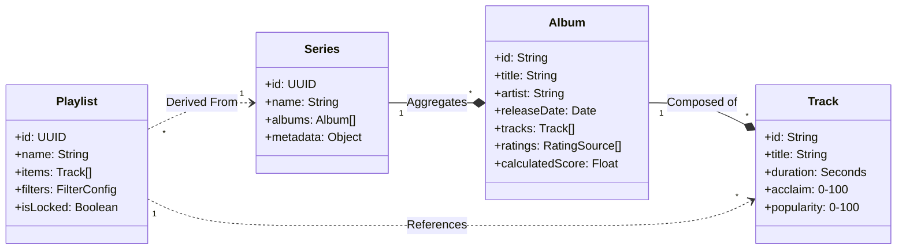
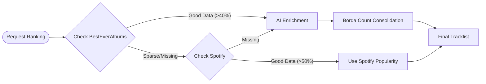
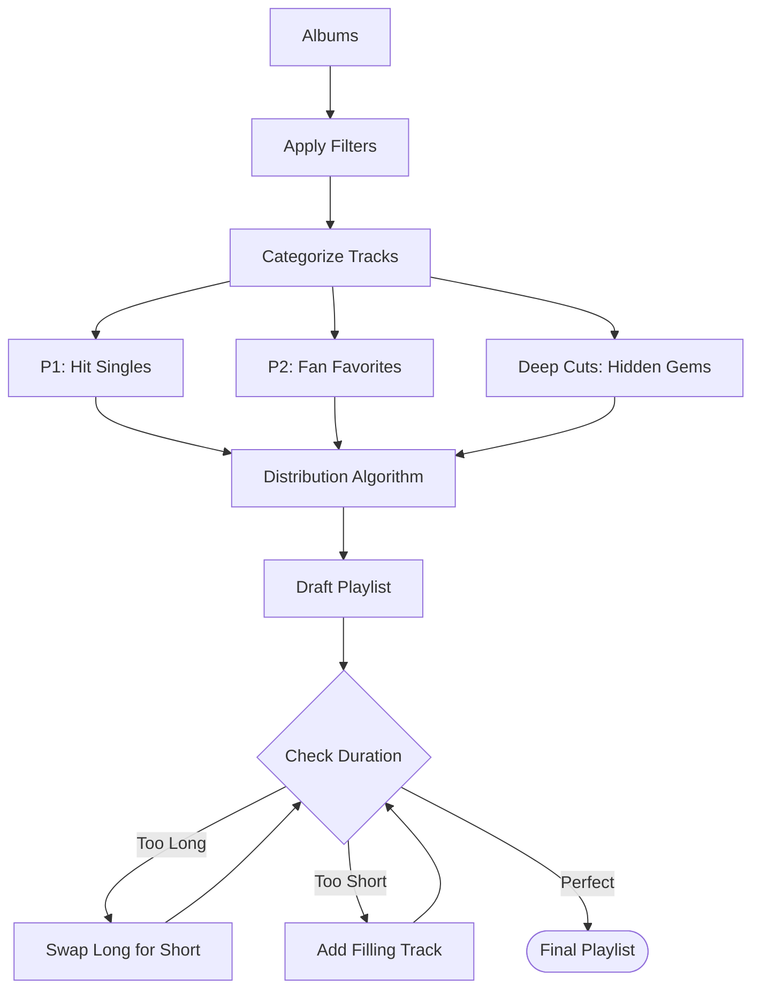
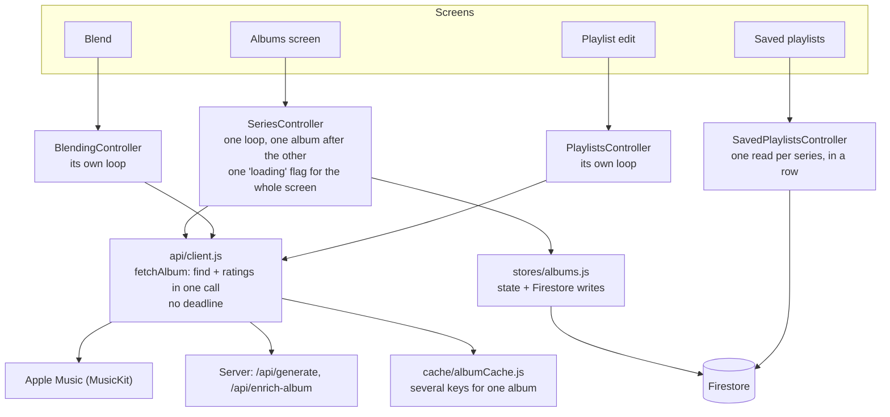
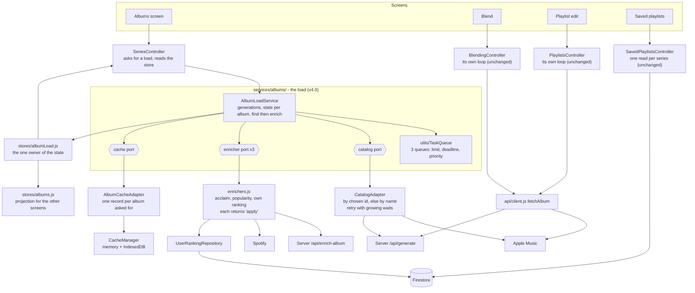
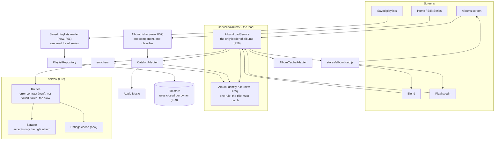

# System Architecture & Design Patterns

> **[⬅️ Back to Reference Guide Index](00_MJRP_Album_Blender_Ref_Guide_Index.md)**

> **Master Map**: This document provides the holistic "Big Picture" of the MJRP codebase. It consolidates architectural decisions, design patterns, data flows, and project structure into a single source of truth.

## 0. Ground Rule
Respect the Separation of concerns (View vs Logic vs Data), the Modularization of logic and data access, and the Componentization of UI.


## 1. High-Level Architecture
**Type**: Hybrid SPA/SSR (Single Page Application with rich Server-Side Intelligence).

The system splits responsibilities into two distinct layers:
1.  **Frontend (The Client)**: A Vanilla JS SPA (Model-View-Controller) responsible for user interaction, state management, and final playlist curation.
2.  **Backend (The Brain)**: A Node.js/Express server responsible for AI orchestration, HTML scraping, and "Truth" application (Ranking verification).

```mermaid
graph TD
    Client[Frontend Client] <-->|JSON API| Server[Node.js Server]
    
    subgraph "Frontend Layer (Browser)"
        Router[SPA Router]
        Store[State Store (hand-written observer)]
        View[MVC Views]
        Controller[Controllers]
    end
    
    subgraph "Server Layer (Node.js)"
        API[Express API]
        Orchestrator[Ranking Engine]
        Scraper[HTML Scrapers]
        AI_Proxy[Google Gemini Client]
    end
    
    subgraph "Persistence Layer"
        Firebase[Firestore DB]
        Cache[IndexedDB / LocalStorage]
    end

    subgraph "External Ecosystem"
        Spotify[Spotify API]
        Apple[Apple MusicKit]
        BEA[BestEverAlbums.com]
    end

    View --> Controller
    Controller --> Store
    Store --> Router
    
    API --> Orchestrator
    Orchestrator --> Scraper
    Orchestrator --> AI_Proxy
    
    Store <--> Firebase
    Client <--> Spotify
    Server <--> BEA
```

---

## 2. Domain & Data Architecture (ERD)
The application models a "Music Curator" domain, focusing on the relationship between **Series** (Artist Discographies) and **Playlists** (Curated Outputs).



---

## 3. Design Patterns Registry
Top-level architectural patterns chosen to solve specific problems.

> The patterns that arrived with the album load of v4.0 (Port, Adapter, Composition Root, Timeout, Retry, pure core) and the ones planned for v5.0 are mapped, with the place and the release of each, in **section 6.3**; the components are in **section 6.4**.

| Pattern | Where It's Used | Why It Was Chosen |
| :--- | :--- | :--- |
| **Model-View-Controller (MVC)** | `js/views/`, `js/controllers/`, `js/stores/` | **Separation of Concerns**. Keeps UI rendering (`Views`) separate from Business Logic (`Controllers`) and State (`Stores`). Essential for maintainability in Vanilla JS. |
| **Observer/PubSub** | `js/stores/*.js`, `BaseView.js` | **Reactivity**. Stores (Subject) notify Views (Observer) when state changes (e.g., `inventoryStore.subscribe(this.render)`). Decouples data updates from UI updates. |
| **Strategy Pattern** | `ranking/*Strategy.js`, `album-search/classification/` | **Flexibility**. Allows hot-swapping algorithms (e.g., switching between `BestEverRanking` and `SpotifyPopularity`) without changing the consuming code. |
| **Factory Pattern** | `server/routes/albums.js` | **Dependency Injection**. Routes are initialized (`initAlbumRoutes`) by injecting Services (`EnrichmentService`, `GenerationService`). Makes testing significantly easier by allowing mocks. |
| **Singleton Pattern** | `js/services/*.js`, `js/stores/*.js` | **State Consistency**. Services like `AuthService`, `SpotifyExportService` and Stores must have only one instance. |
| **Service Layer** | `server/lib/services/`, `public/js/services/` | **Logic Decoupling**. Extracts complex business logic (Scraping, AI, State Machines) from Routes and Components into testable, reusable classes. |
| **Command Pattern** | `js/controllers/InventoryController.js` | **Action Encapsulation**. User actions (Delete, Update) are encapsulated as methods in controllers, allowing Views to simply "Delegate" commands without knowing internal logic. |
| **Facade Pattern** | `server/lib/fetchRanking.js` | **Simplification**. Hides the complex complexity of Scraping + AI + Fallbacks behind a single simple function call (`fetchRankingForAlbum`). |

---

## 4. Core Logic Architectures

### 4.1 Server-Side: The "Acclaim" Waterfall
How the system determines the "Truth" about a song's quality.



### 4.2 Client-Side: The "Balanced Cascade" Generator
How the system constructs a playlist that flows well.



---

## 5. Comprehensive Directory Structure
The physical layout of the codebase, annotated with purpose.

```text
/
├── .github/                # CI/CD Workflows
├── config/
│   └── prompts.json        # Externalized AI Prompts (Configuration as Code)
├── docs/                   # Documentation & Analysis
├── public/                 # FRONTEND (Hosted Static Assets)
│   ├── css/                # Vanilla CSS (Split by Domain: animations, modals, etc.)
│   ├── js/
│   │   ├── algorithms/     # Core Logic (Pure Functions, e.g., TopN)
│   │   ├── cache/          # Persistence Layers (IndexedDB, Memory)
│   │   ├── components/     # UI Web Components (Reusable Blocks)
│   │   ├── controllers/    # MVC Controllers (User Input -> Logic)
│   │   ├── models/         # Domain Objects (Album, Track)
│   │   ├── ranking/        # Ranking Strategies (BEA, Spotify)
│   │   ├── repositories/   # Data Access Layer (Abstracts Stores/Cache)
│   │   ├── services/       # External Integrations (Spotify, Auth)
│   │   ├── stores/         # State Management (The "Truth")
│   │   ├── utils/          # Helpers (SafeDOM, Formatting)
│   │   ├── views/          # MVC Views (DOM Manipulation)
│   │   ├── workers/        # Web Workers (Off-main-thread Search)
│   │   ├── app.js          # App Entry Point
│   │   └── router.js       # Client-Side Router
│   └── index.html          # Single Page Application Shell
├── server/                 # BACKEND (Node.js API)
│   ├── lib/
│   │   ├── scrapers/       # HTML Scrapers (BestEverAlbums)
│   │   ├── services/       # Core Services (Enrichment, Generation)
│   │   ├── fetchRanking.js # Orchestrator Facade
│   │   └── ranking.js      # Consolidation Math
│   ├── routes/             # Express Route Definitions (Thin Routes)
│   ├── schema/             # JSON Schemas (Validation)
│   ├── services/           # Backend Auth Services (Tokens)
│   └── index.js            # Server Entry Point
├── shared/                 # SHARED CODE (public/js/shared is a symlink to it)
│   ├── curation.js         # Playlist curation used by the server (POST /api/playlists)
│   ├── normalize.js        # Key normalization used by the server and by curation.js
│   └── services/           # AuthService.js (Firebase Auth, used by the browser)
└── test/                   # VERIFICATION
    ├── e2e/                # End-to-End Tests (Puppeteer, own runner)
    └── <layer>/            # Unit Tests (Vitest), one folder per layer: stores/, services/, models/, views/, ...
```

---

## 6. Architecture Evolution: v3 → v4.0 → v5.0

> **What this section is**: how the part of the app that finds, enriches, keeps and shows albums changed, and where it is going. Three pictures of the same system: **before** (v3.x, in production until 2026-11-19), **today** (v4.0, in production) and the **target** (v5.0, planned, not built). Then the map of design patterns (6.3) and the map of components (6.4), with the version each one arrived in.
>
> **How to trust it**: the "before" and "today" pictures were drawn from the code (`public/js/`, `server/`) on 2026-11-19. The "target" picture is a plan: nothing in it exists until its feature is delivered. The decisions are recorded in `docs/decisions/0019-one-owner-for-the-album-load.md` and in `docs/specs/arch.md`, section «Carga da tela de álbuns — proposta». Pattern ids (`DP-xx`) are the ones of `docs/wiki/harness/design-patterns.md`.

### 6.1 The three pictures

#### Before: v3.x — every screen loads on its own

Four screens show albums. Each one had its own way of getting them, and the controller of the screen talked to the network itself.



What this cost, measured on 2026-11-19 with 20 series and 80 albums: the first album at 8.5 s, then one every 5 to 6 s; 46 of 80 (found and rated) after 4 min 40 s. A failed album left no sign, a series could disappear mid-load, and the list of series was cut at 20.

#### Today: v4.0 — one owner for the albums screen

The albums screen asks one service. The service owns the queue, the state and the cache, and reaches the outside only through ports. The other three screens are **unchanged**: that is the gap v5.0 closes.



Measured on 2026-11-19: 80 albums found and on screen in 8.5 s; 45 series and 217 albums in 31 s. Ratings still arrive after the albums and take minutes for the whole library, because the server scrapes each one again on every visit.

Known gaps of this picture, kept honest here (they are the work of v5.0):

| Gap | Where | Feature |
| :--- | :--- | :--- |
| Blend and playlist edit load with their own loop | `controllers/BlendingController.js`, `controllers/PlaylistsController.js` | F56 |
| Saved playlists reads the playlists of each series one after the other (20 s) | `components/playlists/SavedPlaylistsController.js` | F61 |
| "Is this the album asked for?" is decided in five places, each its own way; with the right artist any album passes | `models/AlbumIdentity.js`, Spotify match, server scraper, local cover, AI second source | F55 |
| A failure can still end as "the source has nothing" | `adapters/enrichers.js`, server ratings route | F52 |
| `stores/albums.js` still has other writers besides the projection | `services/SeriesService.js`, Refetch | F56 |
| Two functions above the complexity limit of 10 | `AlbumLoadService._enrichOne` (21), `CatalogAdapter.find` (12) | F58 |

#### Target: v5.0 — the same owner for every screen, and one rule of identity

**Planned, not built.** Each box marked *(new)* does not exist yet.



The order inside v5.0 is the one the MJRP sets in `docs/specs/priority.md`. Each feature goes to production on its own once tested.

### 6.2 What changed, side by side

| Question | Before (v3.x) | Today (v4.0) | Target (v5.0) |
| :--- | :--- | :--- | :--- |
| Who loads albums? | each controller, in a loop | `AlbumLoadService` for the albums screen; two controllers still loop | `AlbumLoadService` for every screen |
| How many at once, how long to wait? | one at a time, no deadline | 3 catalog searches, 6 quick and 4 slow sources, 45 s to find, 20 s per source | the same limits, measured against the server |
| What is "loading"? | one flag for the whole screen | a state per album and per source; the series' state is derived | the same, read by every screen |
| What happens when an album fails? | nothing shown | a notice on the series and "Try again" | the same, on blend and edit too |
| Is it the album that was asked for? | first result of the search | the chosen id; by name, a weighted score that any album of the artist passes | one rule: the title must match, or a notice |
| Where is an album kept? | several keys per album | one record per album asked for, with the status of each source | the same, plus ratings kept on the server |
| Who talks to Firestore? | stores, controllers and repositories | repositories, with a short list of known exceptions that can only shrink | repositories only |
| How is a rule enforced? | by convention | by tests in `test/architecture/` | the same, plus a complexity limit |

### 6.3 Design patterns: what is used, where, since when

This extends the registry of section 3 with the pattern ids of `docs/wiki/harness/design-patterns.md` (`DP-xx`) and the release in which each pattern arrived in that place.

| Pattern | Id | Where it is used | Since | Why |
| :--- | :--- | :--- | :--- | :--- |
| Model-View-Controller | — | `views/`, `controllers/`, `stores/` | v2 | keeps drawing, deciding and state apart |
| Repository | DP-01 | `repositories/*` (`SeriesRepository`, `PlaylistRepository`, `InventoryRepository`, `UserRankingRepository`, `SharedAlbumRepository`) | v2; the load stopped bypassing it in v4.0 | Firestore behind one door per kind of data |
| Factory | DP-02 | `server/routes/albums.js` (`initAlbumRoutes`), `views/helpers/SeriesComponentFactory.js` | v3 | build with the dependencies given |
| Singleton | DP-03 | the exported instance of each store and service | v2 | one state per kind of data |
| Strategy | DP-04 | `ranking/*Strategy.js`, `services/album-search/classification/`, `algorithms/*Algorithm.js` | v3 | swap an algorithm without touching who calls it |
| Observer | DP-05 | every store's `subscribe`; the window event `spotify-auth-change` | v2; one signal for the Spotify session in v4.0 | the screen follows the state |
| Adapter | DP-07 | `services/albums/adapters/CatalogAdapter.js`, `enrichers.js`, `AlbumCacheAdapter.js` | **v4.0** | Apple Music, the server, Spotify and the cache behind the shape the load expects |
| Facade | DP-11 | `server/lib/fetchRanking.js` | v3 | one call hides scraping, AI and fallbacks |
| Service | DP-12 | `services/albums/AlbumLoadService.js`, `services/series/SeriesFactsService.js`, `services/ranking/OwnRankingService.js`, `services/SeriesService.js`, `server/lib/services/` | v3; the load in **v4.0** | one owner for a piece of work |
| Port | DP-14 | the catalog, enricher and cache ports of `AlbumLoadService`; the ports of `OwnRankingService` | **v4.0** | the service is tested without network |
| Composition Root | DP-15 | `services/albums/albumLoading.js` | **v4.0** | the only file that wires the load to the real sources |
| Registry | DP-16 | `algorithms/index.js` | v3 | the list of recipes in one place |
| Result / typed error | DP-19 | `AlbumNotFoundError`, `TaskTimeoutError`, `TaskCancelledError`, `FailureReason` in `models/albumLoadState.js` | **v4.0**, client only | "not found" is told apart from "too slow" and "network". **v5.0 (F52)** takes it to the server |
| Pure core, effects at the edge | DP-20 | `utils/TaskQueue.js`, `utils/duration.js`, `utils/localAddress.js`, `models/albumLoadState.js`, `albumQuery.js`, `seriesFilter.js`, `paging.js`, `albumFacts.js`, `ownRanking.js`, `text.js` | **v4.0** | rules that are tested with no browser and no network |
| Timeout | DP-22 | `utils/TaskQueue.js` (deadline per task), `CatalogAdapter` (Apple deadline) | **v4.0** | a slow call does not hold the rest |
| Retry with backoff and jitter | DP-23 | `CatalogAdapter` (Apple Music), `utils/retry.js` (server second source) | **v4.0** | a busy source is asked again, later |
| Command | — | controller methods the views delegate to (`InventoryController`, `SeriesController`) | v3 | the view does not know how an action is done |

Patterns of this codebase that have no id in the catalog:

| Pattern | Where | Since | Why |
| :--- | :--- | :--- | :--- |
| **Generation token** | `AlbumLoadService` (`generation`), `stores/albumLoad.js` (`startGeneration`) | v4.0 | only the current load writes; an older one that answers late is dropped |
| **Latest ask wins** | `AlbumLoadService._asks` | v4.0 | the same idea one level down: per album and per source |
| **Answer applied over the newest value** | `apply` returned by each enricher | v4.0 | two sources can finish in any order without undoing each other |
| **Projection** | `stores/albums.js` fed by `projectLoadedAlbums` | v4.0 | the screens not yet migrated keep reading the old shelf |
| **Derived state** | `deriveSeriesState` in `models/albumLoadState.js` | v4.0 | the state of a series is computed from its albums, never stored apart |
| **Fitness function** | `test/architecture/albumLoadBoundaries.test.js`, `ownRankingBoundaries.test.js` | v4.0 | an architecture rule that fails the test run when broken |

Planned for v5.0, not in the code yet:

| Pattern | Id | Where it will go | Feature |
| :--- | :--- | :--- | :--- |
| Result / typed error across the wire | DP-19 | server routes and the adapters that read them | F52 |
| Cache-aside | — | ratings on the server | F52 |
| One rule object for identity | — | the five places that decide "same album" | F55 |
| Write-then-swap (no delete before write) | — | saving an edited batch of playlists | F60 |

### 6.4 Component map

One line per component of the album path. "State" says whether it is in production, unchanged since v3, or planned.

#### Front end

| Layer | Component | File | What it does | State |
| :--- | :--- | :--- | :--- | :--- |
| Screen | Albums screen | `views/SeriesView.js`, `components/series/*` | draws series, albums, notices, pager | v4.0 |
| Screen | Filter toolbar | `components/ui/FilterToolbar.js` | search and filters; the search field is drawn once | v4.0 |
| Screen | Pager | `components/ui/Pager.js` | series per page, pages or scroll | v4.0 |
| Screen | Ranking window | `components/ranking/UserRankModal.js` | opens in the saved order; reports through `onSubmit` | v4.0 |
| Screen | Album picker (Home) | `components/home/SearchController.js`, `views/renderers/DiscographyRenderer.js` | search an artist, group by type, choose | v3; replaced by one picker in F57 |
| Screen | Album picker (Edit Series) | `components/series/ArtistScanner.js` | the same task, drawn again | v3; replaced by one picker in F57 |
| Controller | `SeriesController` | `controllers/SeriesController.js` | asks for a load; filters and pages over what the series ask for | v4.0 |
| Controller | `BlendingController` | `controllers/BlendingController.js` | generates playlists; **own load loop** | v3; F56 |
| Controller | `PlaylistsController` | `controllers/PlaylistsController.js` | edit, save, export; **own load loop**; the save rule left it for `PlaylistsService.saveCurrentBatch` (F60) | v3; F56, F58 |
| Controller | `InventoryController` | `controllers/InventoryController.js` | inventory actions | v4.0 (delete fixed) |
| Service | `AlbumLoadService` | `services/albums/AlbumLoadService.js` | the load: generations, queues, find then enrich | v4.0 |
| Service | `SeriesFactsService` | `services/series/SeriesFactsService.js` | writes year and sources of each album into the series | v4.0 |
| Service | `OwnRankingService` | `services/ranking/OwnRankingService.js` | saves a ranking; keeps the list of ranked albums | v4.0 |
| Service | `SeriesService` | `services/SeriesService.js` | create, read, update, delete series | v3; list without the cut in v4.0 |
| Composition | `albumLoading.js` | `services/albums/albumLoading.js` | wires the load to the real sources | v4.0 |
| Adapter | `CatalogAdapter` | `services/albums/adapters/CatalogAdapter.js` | Apple Music by id, else by name; server second source | v4.0 |
| Adapter | enrichers | `services/albums/adapters/enrichers.js` | acclaim, popularity, own ranking | v4.0 |
| Adapter | `AlbumCacheAdapter` | `services/albums/adapters/AlbumCacheAdapter.js` | one record per album asked for | v4.0 |
| Store | `AlbumLoadStore` | `stores/albumLoad.js` | the state of the load | v4.0 |
| Store | `albumsStore` | `stores/albums.js` | projection of the load for other screens; no Firestore | v4.0 |
| Store | `albumSeriesStore`, `ownRankingsStore`, `playlistsStore`, `inventoryStore`, `userStore` | `stores/*` | pure state per kind of data | v3 (ADR 0017) |
| Model | load state, query, filter, paging, facts, text, own ranking | `models/albumLoadState.js`, `albumQuery.js`, `seriesFilter.js`, `paging.js`, `albumFacts.js`, `text.js`, `ownRanking.js` | pure rules | v4.0 |
| Model | `AlbumIdentity` | `models/AlbumIdentity.js` | "is this the album asked for?" - today any album of the right artist passes | v3; F55 |
| Utility | `TaskQueue`, `retry`, `duration`, `localAddress`, `SafeDOM` | `utils/*` | queue with limit and deadline; retry; one duration formatter; one local address; DOM without `innerHTML` | v4.0 (`SafeDOM` v3, fixed in v4.0) |
| Repository | series, playlists, inventory, rankings, shared albums | `repositories/*` | the only door to Firestore | v2; `SharedAlbumRepository` in v4.0 |
| Cache | `CacheManager` | `cache/CacheManager.js` | memory + IndexedDB | v3 |
| Edge | `serverFetch` | `api/serverFetch.js` | every call to the app's own server carries the person's login | **v5.0 (F59)** |
| Legacy | `api/client.js` (`fetchAlbum`) | `api/client.js` | the old find-and-rate call, still used by blend and edit | v3; retired by F56 |

#### Server

| Component | File | What it does | State |
| :--- | :--- | :--- | :--- |
| Album routes | `server/routes/albums.js` | `/api/generate`, `/api/enrich-album` | v3; error contract in F52 |
| Route guards | `server/lib/auth/guards.js`, `verifyIdToken.js`, `requireUser.js`, `server/lib/rateLimit.js` | the paid and the costly routes answer only to a signed-in person, each with a limit per person | **v5.0 (F59)** |
| AI routes | `server/routes/ai.js`, `server/routes/handlers/ai.js` | artist's album list by AI; a failure leaves by the table of the AI provider, never as 200 and empty | **v5.0 (F52, slice 1)** |
| Answer contract | `server/lib/outcome.js`, `server/lib/aiProviderOutcome.js` | the one builder of answers (`{ data, outcome }` / `{ error: { code, retryable } }`) and the table of the AI provider | **v5.0 (F52, slice 1)** |
| Debug routes | `server/routes/debug.js`, `server/lib/debugGate.js` | off unless the server starts with `ENABLE_DEBUG_ROUTES=true`; `/debug/files` lists any path when on | v3; off by default since v5.0 (F59) |
| MusicKit route | `server/routes/musickit.js` | issues the Apple developer token | v3 |
| `EnrichmentService` | `server/lib/services/EnrichmentService.js` | ratings per track from BestEverAlbums | v3; F52 |
| `GenerationService` | `server/lib/services/GenerationService.js` | album by AI (second source) | v3; F52 |
| Scraper | `server/lib/scrapers/` | reads BestEverAlbums; no cache, no handling of 429 | v3; F52 |
| `fetchRanking` | `server/lib/fetchRanking.js` | facade over scraping and AI | v3 |

#### Outside

| System | Used for | Reached from |
| :--- | :--- | :--- |
| Apple Music (MusicKit) | catalog search, album details, export | the browser; the storefront comes from the browser's language, never from the account |
| Spotify | popularity, export | the browser (tokens in `localStorage`) |
| BestEverAlbums | ratings per track | the server (scraping) |
| Google Gemini | album and album list by AI | the server |
| Firebase Auth, Firestore, Hosting | sign-in, data, the site | the browser; the site is published by `firebase deploy --only hosting` |
| Cloud Run (`mjrp-proxy`) | runs the server | Hosting rewrites `/api/**` to it |

### 6.5 Where the decisions are written

| Decision | Record |
| :--- | :--- |
| One owner for the album load | `docs/decisions/0019-one-owner-for-the-album-load.md` (Proposed) |
| The design, its risks and what was built | `docs/specs/arch.md`, «Carga da tela de álbuns — proposta», sections 1 to 19 |
| Pure state stores | `docs/decisions/0017-pure-state-stores.md` |
| Service layer | `docs/decisions/0016-service-layer-extraction.md`, `0018-fine-grained-services.md` |
| The analysis behind v5.0, with measured complexity | `reports/audits/2026-11-19-mjrpalbumblender-v0-load-architecture-analysis.md` |
| Every open finding and the feature that resolves it | `reports/audits/2026-11-19-mjrpalbumblender-v0-v5-map.md` |
