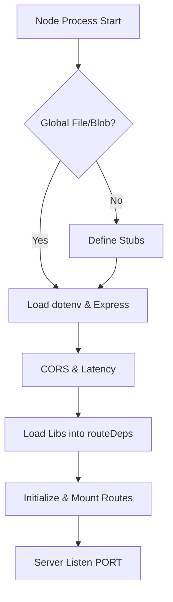
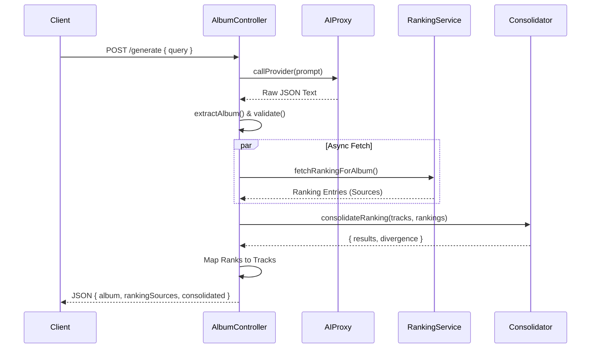
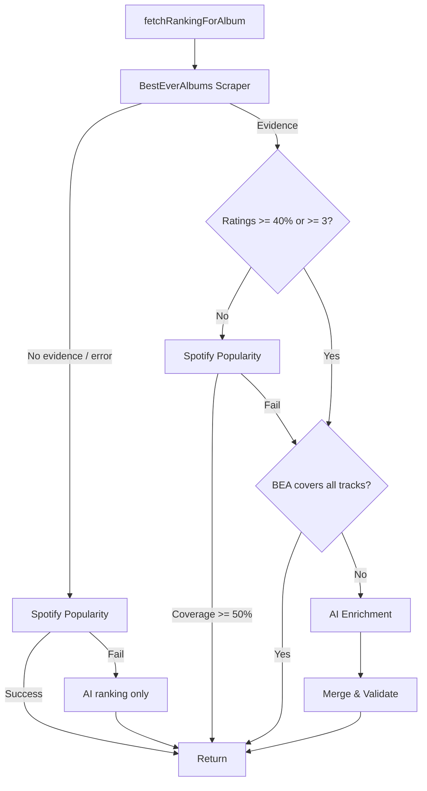

# Server Core Analysis

> **Deep Dive Enrichment**: This document details the logic flow, dependencies, and side effects of the Server Core components.

## 1. Entry Point: `server/index.js`
**Status**: `[ACTIVE]`
**Type**: Express Application Entry Point

### 1.1 Global Polyfills (Lines 1-40)
*   **Logical Trace**:
    1.  **CheckGlobals**: Checks if `File` or `Blob` are undefined in the global scope (Node.js < 20 often lacks these).
    2.  **TryImport**: Attempts to require `fetch-blob` if available.
    3.  **FallbackStub**:
        *   `_Blob` class: Stubs `size`, `type`, `text()`, `arrayBuffer()`. Side Effect: Sets `global.Blob`.
        *   `_File` class: Extends `_Blob` with `name`, `lastModified`. Side Effect: Sets `global.File`.
*   **Why**: Required by `undici` or `node-fetch` when importing libraries that expect browser-like File APIs.

### 1.2 Configuration & Middleware (Lines 42-87)
*   **Environment**: Loading `.env` via `dotenv`.
*   **CORS Logic**:
    *   **Input**: `process.env.ALLOWED_ORIGIN`.
    *   **Prod Logic**: Splitting comma-separated origins. Custom `origin` function allows non-browser requests (no origin header) and whitelisted domains.
    *   **Dev Logic**: `origin: true` (Matches any request).
*   **Latency Metric**: Middleware injects `req._startTime = Date.now()` for performance logging in downstream controllers.
*   **Health Check**: `GET /_health` -> Returns JSON `{ ok: true }`.
*   **Port**: `process.env.PORT`, default `3000`. The server only listens when `index.js` is run directly (`require.main === module`).

### 1.3 Dependency Injection (Lines 90-114)
*   **Pattern**: Manual Dependency Injection.
*   **Components Loaded**:
    *   `lib/prompts`: `loadPrompts`, `renderPrompt`
    *   `lib/aiClient`: `callProvider`
    *   `lib/normalize`: `extractAlbum`
    *   `lib/schema`: `validateAlbum`, `ajvAvailable` (AJV)
    *   `lib/scrapers/besteveralbums`: `getRankingForAlbum`, injected as `getBestEverRanking`
    *   `lib/fetchRanking`: `fetchRankingForAlbum`
    *   `lib/ranking`: `consolidateRanking`, and `normalizeKey` injected as `normalizeRankingKey`
    *   `lib/logger`: `logger` (falls back to `console`)
*   **Injection Object**: `routeDeps` bundle passed to route configurators. This facilitates testing by allowing mock injections.

### 1.4 Route Mounting (Lines 120-141)
*   `api/` -> `routes/musickit.js` (Apple Music Token)
*   `api/` -> `routes/albums.js` (Generation & Enrichment) -> *Initialized with `routeDeps`*
*   `api/` -> `routes/playlists.js` (Curation)
*   `api/` -> `routes/debug.js` (System Tools) -> *Initialized with `routeDeps`*
*   `api/ai` -> `routes/ai.js` (Direct AI Proxy)

### 1.5 Architecture Diagram


---

## 2. API Routes: `server/routes/albums.js`
**Status**: `[ACTIVE]`
**Type**: Thin Route Handler
**Dependencies**: Injected via `initAlbumRoutes(deps)`, which instantiates `EnrichmentService` and `GenerationService` (`server/lib/services/`). The route handlers only check `AI_API_KEY` (503 if missing) and delegate; the logic below lives in the services.

### 2.1 `POST /api/enrich-album` -> `EnrichmentService.enrichAlbum(albumData)`
**Purpose**: Enhances a raw album tracklist with "BestEverAlbums" community ratings.

*   **Logic Trace**:
    1.  **Validation**: the service checks the `albumData` structure (`title` and a `tracks` array), and an invalid body becomes a 400 `invalid_request`. The route no longer asks for `AI_API_KEY` (F52).
    2.  **Scraping**: Calls `getBestEverRanking(title, artist, { deadlineAt, stats })` through `inFlight.share(key, ...)`, raced against the request's budget (F52, slice 3):
        *   *One search per album at a time*: a request for an album whose search is already running joins it (`server/lib/inFlight.js`; the key is artist and title, case and spacing apart). Nothing is kept once the search ends.
        *   *Budget*: `ALBUM_BUDGET_MS` = 15 s per request (`server/lib/timeBudget.js`); at the deadline the result is `upstream_timeout`, whatever the scraper is doing. The scraper reads `deadlineAt` and stops asking the source.
        *   *Failure Handling* (F52): the scraper throws an `UpstreamError`; the service returns a failure with its code (502, 504 or 503, the last with `Retry-After` when the source asked to wait). `null` from the scraper means the source has no page: outcome `not_found`.
        *   Every result carries `trace` (`{ how, sourceRequests }`) for the route's log line; it does not go on the wire.
    3.  **Indexing**:
        *   If evidence found: Normalizes all track titles in evidence using `normalizeRankingKey`.
        *   Creates `evidenceIndex` Map: `NormalizedKey -> evidence entry`.
    4.  **Mapping** (two passes):
        *   Iterates input `tracks`.
        *   Pass 1: normalizes each track title and looks it up in `evidenceIndex`.
        *   Pass 2: if not found, compares `toFuzzyCore` of both titles (`server/lib/normalize.js`).
        *   Constructs `ratingsMap`: `[{ title, rating }]` and `evidenceMap`: `[{ title, evidence: [{ source: 'BestEverAlbums', score, votes: null, url }] }]`.
    5.  **Fallback**: If no ratings, fills `ratingsMap` with `null` and `evidenceMap` with empty lists (outcome `no_ratings` when the page exists, `not_found` when it does not).
    6.  **Response**: Returns a typed result of `server/lib/outcome.js`; on the wire, `{ data: { bestEverInfo, trackRatings, trackEvidence }, outcome }`. See `03_Backend_API_Layer.md`.

*   **Side Effects**: External HTTP requests to BestEverAlbums, at the pace of `server/lib/politeQueue.js`. One log line per request (`msg: "enrich"`, see `03_Backend_API_Layer.md`), and the service's own lines about match rates.

### 2.2 `POST /api/generate` -> `GenerationService.generateAlbum(reqBody, serverConfig)`
**Purpose**: Core endpoint. Generates album structure via AI, then enriches with rankings.

*   **Logic Trace**:
    1.  **AI Generation**:
        *   Loads prompt template `albumSearchPrompt`.
        *   Calls `callProvider` (AI Proxy).
        *   Logs Latency & Token Usage.
    2.  **Extraction & Validation**:
        *   `extractAlbum(response)` parses JSON from AI text.
        *   `validateAlbum(album)` checks against Schema (Draft-07). Returns 422 if invalid.
    3.  **Ranking Fetch (Deep Logic)**:
        *   Calls `fetchRankingForAlbum(album, query)`.
        *   *Logic*: This service attempts to find rankings from multiple sources (Spotify, BEA, etc.).
    4.  **Consolidation**:
        *   Calls `consolidateRanking(tracks, acclaim)`.
        *   *Logic*: Merges external ranking lists with the AI-generated tracklist to compute a "Consolidated Score" and "Divergence" metrics.
    5.  **Mapping**:
        *   Maps `finalPosition` and `rating` back to the specific `track` objects in the album.
    6.  **Sorting**:
        *   Creates `tracksByAcclaim` array (sorted clone of tracks).
    7.  **Response**: Returns `{ data: albumPayload }`.

*   **Architecture Diagram**:


---

## 3. API Routes: `server/routes/playlists.js`
**Status**: `[ACTIVE]`
**Type**: Controller / Route Handler

### 3.1 `POST /api/playlists` (Lines 14-71)
**Purpose**: Splits an album into curated playlists (e.g., "Greatest Hits", "Deep Cuts").

*   **Logic Trace**:
    1.  **Validation**: Requires `albums` array.
    2.  **Dynamic Import**: Imports `shared/curation.js` (ES Module).
        *   *Note*: Used dynamic import because `shared/` is outside CommonJS scope or treated as ESM.
    3.  **Option Parsing**:
        *   Calculates `targetSeconds`. supports `min/max` (average) or explicit `targetDuration`. Default: 45 min.
    4.  **Execution**: Calls `curateAlbums(albums, { targetSeconds })`.
    5.  **Formatting**: Maps internal domain objects to API response structure (id, name, tracks).
    6.  **Response**: Returns `{ playlists, summary, sources }`.

*   **Dependencies**: `shared/curation.js` (Pure business logic).

---

## 3.2 Services: `server/services/MusicKitTokenService.js`
**Status**: `[ACTIVE]`
**Type**: Service / Singleton

**Purpose**: Generates JWT tokens for Apple MusicKit JS on the frontend to authenticate with Apple Music using the developer credentials.

*   **Logic Trace**:
    1.  **Inputs**: `APPLE_TEAM_ID`, `APPLE_KEY_ID`, `APPLE_MUSIC_PRIVATE_KEY` (from Env).
    2.  **Algorithm**: ES256 (ECDSA P-256 + SHA-256).
    3.  **Caching**:
        *   Checks `_cachedToken` and `_tokenExpiry` (instance fields of the singleton `musicKitTokenService`).
        *   If valid (expiration > 1 hour away), return cached token.
    4.  **Generation**:
        *   Signs new JWT with `jwt.sign`.
        *   Sets TTL to 180 days (max allowed by Apple).
        *   Updates cache.
    5.  **Output**: Returns `{ token, expiresAt, cached }`.
    6.  **Config check**: `checkConfig()` returns `{ ready, missing }`; the route answers 503 when a variable is missing.

### Token Generation Flow
```mermaid
flowchart LR
    Req[Request Token] --> Cache{Cache Valid?}
    Cache -- Yes --> Return[Return Cached Token]
    Cache -- No --> Load[Load Env Vars]
    Load --> Sign[Sign JWT (ES256)]
    Sign --> SetCache[Update Cache (TTL 180d)]
    SetCache --> Return
```

---

## 4. Libraries & Business Logic

### 4.1 `server/lib/fetchRanking.js` (Ranking Orchestrator)
**Status**: `[ACTIVE]`
**Type**: Service Facade

**Purpose**: Orchestrates the multi-source strategy to find "acclaim" rating for tracks.

*   **Logic Trace (`fetchRankingForAlbum`)**:
    1.  **Preparation**: Loads prompt templates and gets `normalizeKey` function.
    2.  **Strategy 1 (BestEverAlbums)**:
        *   Calls `getBestEverRanking`.
        *   Counts the tracks that have a rating; fewer than 40% of the album's tracks **and** fewer than 3 rated tracks is "insufficient".
    3.  **Strategy 2 (Spotify Popularity Fallback)**:
        *   *Trigger*: If BEA has < 40% coverage and < 3 total ratings.
        *   Calls `getSpotifyPopularityRanking`.
        *   *Decision*: If Spotify returns valid data >= 50% coverage, **returns immediately** (Short-circuit).
    4.  **BEA is complete**: if BEA returned at least as many entries as the album has tracks (or the track count is unknown), returns the BEA entries, without calling the AI.
    5.  **Strategy 3 (AI Enrichment)**:
        *   *Trigger*: BEA returned fewer entries than the album has tracks.
        *   Calls `callProvider` with `rankingPrompt`.
        *   *Merges*: fills the tracks BEA did not cover with the AI entries, matched by normalized title (`normalizeKey`). If the AI call fails, returns the BEA entries alone.
    6.  **BEA returned nothing or failed**: tries `getSpotifyPopularityRanking`; if that also returns nothing, the ranking comes from the AI alone (`rankingPrompt`).
    7.  **Output**: Returns `{ entries, sources, debugTrace }`, plus `bestEver` or `spotify` when that source was used. With `options.raw` it returns the raw AI response instead (`{ raw, debugTrace }`).

*   **Architecture Diagram**:


### 4.2 `server/lib/ranking.js` (Consolidation Logic)
**Status**: `[ACTIVE]`
**Type**: Domain Logic (Pure Function)

**Purpose**: Merges an unordered set of "Acclaim" ratings onto the official tracklist.

*   **Algorithm (Borda Count Variant)**:
    1.  **Normalization**: Creates a map of official tracks using `normalizeKey`.
    2.  **Matching**:
        *   Iterates through external `acclaim` entries.
        *   First pass: Exact normalized key match.
        *   Second pass: containment of one normalized key in the other, then fuzzy token overlap (requires >= 0.4).
    3.  **Scoring**:
        *   `Score = N - Position + 1`.
        *   Accumulates scores if multiple sources cite the same track.
    4.  **Sorting**:
        *   Primary Sort: Explicit Rating (if any track has one; the BestEverAlbums rating is preferred).
        *   Secondary Sort: Calculated Borda Score.
    5.  **Divergence**: Captures "Unmatched Mentions" (tracks in valid Ranking sources that aren't in the official album) and `tracksWithoutSupport`.
    6.  **Output**: `{ results, divergence, debugInfo }`; each result has `trackTitle`, `rawScore`, `supporting`, `rating`, `finalPosition`, `normalizedScore`.

---

## 5. Scrapers: `server/lib/scrapers/besteveralbums.js`
**Status**: `[ACTIVE]`
**Type**: External Adapter / Scraper

**Purpose**: Extracts track-level ratings from besteveralbums.com.

*   **Logic Trace**:
    0.  **Entry (`getRankingForAlbum`, through `locateAlbum`)**: an explicit, ordered list of attempts (F68); the first that has the album ends the search. With an artist, the first attempt (`artist-page`) looks for the artist page (`findArtistPage`: the result of `suggest.php` whose label is the artist's name by the rule's `sameArtist`, so "Robert Plant & Jimmy Page" reaches "Jimmy Page & Robert Plant") and the album among the links of that page (`parseArtistDiscography`); otherwise, or if not found, goes to discovery.
    1.  **Discovery (`findAlbumId` / `findAlbum`, the texts of `searchAttempts`)**:
        *   `artist-and-title`: queries `suggest.php` with "artist title", once per title of the rule's `titlesToSearch` (the title WITHOUT edition notes, then the other known writings: "AC/DC PWR/UP"). Each result comes with a label "Title by Artist"; in the first attempt a result whose label cannot be read that way has its page opened and read (`<title>`, `h1`).
        *   `title-alone`: the title with no artist, for an artist the source writes another way ("And" for "&").
        *   `artist-alone`: what the source suggests for the artist's name (the request of the artist page, asked once).
        *   `html-search`: the HTML search `search.php`, whose album links are opened and read, up to five.
        *   The source matches word by word: a text with a word its title does not have lists nothing. Other words widen what the source lists, not what is accepted. There is no title cleaner in the scraper: the texts come from the rule.
        *   **Acceptance (F55, slice 1)**: at every one of these points the scraper turns what the source gave into `{ title, artist }` and asks the one identity rule (`shared/albumIdentity.js`, loaded through `server/lib/albumIdentity.js`). It compares no text itself. An album absent from the source, with its artist present, is `null` ("not found"): another album of the artist is never returned. Before F55 each point accepted when one text contained the other (title or artist), and the HTML search took the first link. Since slice 2, where the scraper has a list (the suggestions, the artist's page) the rule's second tier applies: the title asked for before a subtitle is accepted when it is the only such album and the album asked for itself is not listed. A page opened and checked alone accepts the first tier only.
    2.  **Parsing (`parseChartRankingById`)**:
        *   Uses `cheerio` to find specific Table rows.
        *   Extracts the track title and the rating from the rating cell.
        *   Check columns for 'Track' and 'Rating' headers to adapt to different layouts.
    3.  **Resilience**:
        *   `parseAlbumRanking` is the fallback for an album page with no chart table (table rows, then `<li>` items).
    4.  **One door, with pace and time (F52, slice 3)**: every request to the source goes through `getPage`, built per piece of work by `pageGetter({ deadlineAt, stats })`. It hands the request to the polite queue (`pace`, injected; the exported scraper uses the real one, `BEA_PACE`: 2 at once, 250 ms apart, growing waits on 429/503), gives it `min(REQUEST_TIMEOUT_MS = 8 s, what is left of the album request)`, asks each address once per piece of work, and throws `UpstreamError` (`upstream_timeout` when the album request's time is over or the queue is too long, `upstream_busy` with `retryAfterMs` when the source asked to wait). The queue is per instance of the server.

*   **Key Dependencies**:
    *   `axios` (HTTP Client)
    *   `cheerio` (DOM Parser)
    *   `server/lib/politeQueue.js` (the pace), `server/lib/outcome.js` (`UpstreamError`)

---

## 6. Schemas: `server/schema/album.schema.json`
**Status**: `[ACTIVE]`
**Type**: JSON Schema (Draft-07)

### Structure
*   **Root**: Object
*   **Required**: `title`, `artist`, `tracks`.
*   **Tracks**: Array of objects.
    -   Each track MUST have: `id` (string), `rank` (integer), `title`.
    -   Optional: `duration` (integer).
*   Other declared properties: `id`, `year` (integer or string), `cover`. Additional properties are allowed at both levels.

### Usage
Used by `server/lib/schema.js` (via `ajv`, with `coerceTypes: true`) to validate the album extracted from the AI response in `GenerationService` (422 when invalid).
