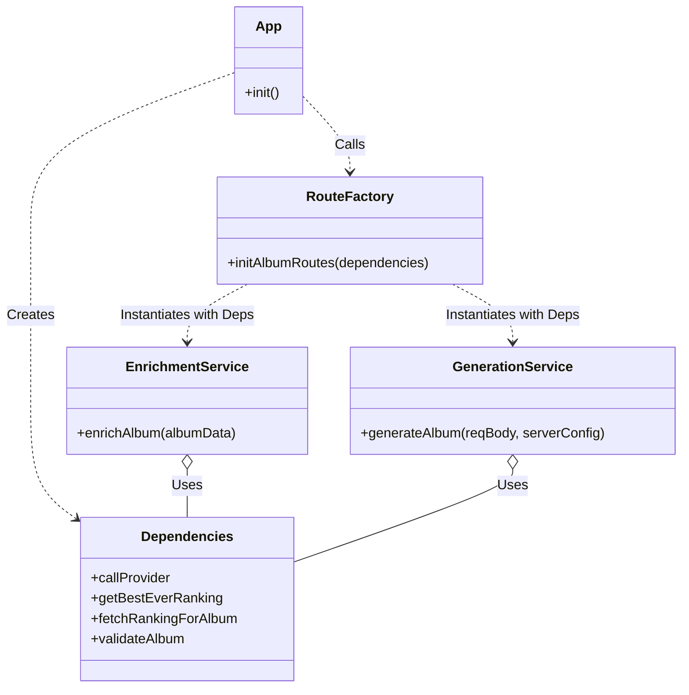
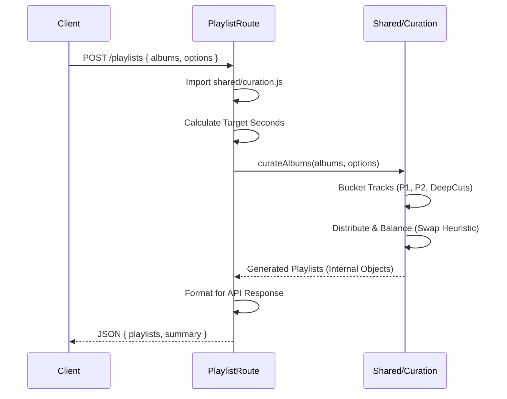

# Server Routes Analysis

## 1. AI Routes: `server/routes/ai.js`
**Status**: `[ACTIVE]`
**Type**: Express Router
**Mount Path**: `/api/ai`

### Endpoints
-   `POST /studio-albums`:
    -   **Input**: `{ artistName }`
    -   **Logic**: Uses Google Gemini to generate a strict JSON list of "original studio albums" for the artist, excluding compilations, EPs, singles, DJ mixes, live and remix albums.
    -   **Response** (F52): `{ data: { albums: [...] }, outcome }`, with `outcome: 'found'`, or `'not_found'` when the AI answered with an empty list. A failure is never a 200 with an empty list: it leaves by the table of the AI provider (below), and the provider's message never leaves (it can carry the request address, with the key). No `artistName` is 400 `invalid_request`; no `AI_API_KEY` is 503.
    -   **Features**: Includes robust JSON parsing fallback (regex extraction) to handle AI formatting errors. An answer with no list in it is the `unusable` row of the table, not an empty list.
    -   **Where**: the handler is `server/routes/handlers/ai.js` (`createAiHandlers`), apart from Express so it is tested with no server; `routes/ai.js` only mounts it.

---

## 2. Album Routes: `server/routes/albums.js`
**Status**: `[ACTIVE]`
**Type**: Express Router / Factory
**Mount Path**: `/api`

### Architecture
Uses a **Factory Pattern** (`initAlbumRoutes`) to inject dependencies (`callProvider`, `scrapers`, etc.) instead of requiring them directly. This facilitates testing and decoupling. `initAlbumRoutes(deps)` instantiates `EnrichmentService` and `GenerationService` (`server/lib/services/`) with those dependencies; the route handlers are thin and delegate to them. Since F52 the handlers live in `server/routes/handlers/albums.js` (`createAlbumHandlers`), apart from Express: each asks its service for a typed result and hands it to `respond` (`server/lib/outcome.js`).

### Endpoints
-   `POST /enrich-album`:
    -   **Input**: `{ albumData: { title, artist, tracks } }`
    -   **Logic**: Scrapes BestEverAlbums for the album to get community ratings/rankings. Maps these ratings to the provided tracklist using fuzzy string normalization.
    -   **Response** (F52): `{ data: { bestEverInfo, trackRatings, trackEvidence }, outcome }`:
        -   `found`: the source has the album and at least one rating matched a track asked for;
        -   `not_found`: the source answered every search and has no page for the album (`bestEverInfo: null`);
        -   `no_ratings`: the source has the page, with no rating for the tracks asked for (`bestEverInfo.url` is told).
    -   **Failure**: when the source could not answer, the route answers 502 `upstream_failed`, 504 `upstream_timeout` or 503 `upstream_busy` (the source said 429 or 503), never a 200. An unusable body is 400 `invalid_request`.
    -   It uses no AI and no longer asks for `AI_API_KEY`.
-   `POST /generate`:
    -   **Input**: `{ albumQuery, model, maxTokens, rawStage }` (`rawStage: 'ranking'` returns the raw ranking response)
    -   **Logic**:
        1.  Calls AI to search/generate album metadata.
        2.  Validates response against `album.schema.json`.
        3.  Fetches external rankings (BestEverAlbums, Spotify popularity, AI) via `fetchRankingForAlbum`.
        4.  Consolidates AI + External data to rank tracks (`consolidateRanking`).
        5.  Sorts tracks by acclaim (`tracksByAcclaim`).
    -   **Response** (F52): `{ data: albumPayload, outcome: 'found' }`. Every failure of the provider leaves by the table below; the provider's raw answer and its messages no longer leave (it used to pass them on, status and all). No `albumQuery` is 400 `invalid_request`, and the provider is not called.
    -   It answers 503 (`internal`, not retryable) when `AI_API_KEY` is not set.

### The contract of an answer (F52): `server/lib/outcome.js`
One module builds every answer of the album and AI routes, of the last error handler, of the door and of the limit. A service returns `success(data, outcome)` or `failure(code, options)`; a route calls `respond(res, result)`.

| Outcome | HTTP | Body |
| :--- | :--- | :--- |
| The source has it | 200 | `{ data, outcome: 'found' }` |
| The source answered and has none | 200 | `{ data, outcome: 'not_found' \| 'no_ratings' }` |
| It could not be known, or the request was refused | 4xx / 5xx | `{ error: { code, retryable } }` |

`outcome` is always there on a 200: a 200 without it comes from a server before F52. `code` is one of a closed list, each with the status it leaves with unless the caller names another:

| `code` | Status | `retryable` | Who answers it |
| :--- | :--- | :--- | :--- |
| `upstream_failed` | 502 | true | the outside source failed (network, 5xx) |
| `upstream_timeout` | 504 | true | the outside source passed its deadline |
| `upstream_busy` | 503 | true | the outside source said 429 or 503; also the door when Google's keys could not be fetched |
| `invalid_request` | 400 (or the 4xx of a request that could not be read) | false | a body the route cannot use |
| `unauthorized` | 401, and 403 for a guest on a paid route | false | `requireUser.js`, `rateLimit.js` with nobody in the request |
| `rate_limited` | 429 with `Retry-After` | false | `rateLimit.js` |
| `internal` | 500, and 503 when the AI key is not set | false | `errorResponder` |

`retryable` means "the same request, sent again within seconds, may work". No message of a provider or of the server's inside goes in a body; it goes to the log. `UpstreamError` (same file) is what a scraper throws when a request to its source fails; `upstreamErrorFrom(err, source)` builds it from an HTTP client error, without the request address.

Not yet in this format: `routes/musickit.js`, `routes/playlists.js` and the debug routes still build their own errors.

### The table of the AI provider (F52): `server/lib/aiProviderOutcome.js`
`POST /generate` and `POST /ai/studio-albums` call a paid provider. A browser tab opened before F52 asks again, up to twice, after any 5xx. So only a failure that may pass leaves as 5xx; the rest leaves as 424 Failed Dependency, a 4xx that an old tab does not repeat and that is neither 401 nor 429 (those are this server's own door and limit, and the app holds its queue on them).

| What the provider did | Case | Leaves as | `code` | `retryable` |
| :--- | :--- | :--- | :--- | :--- |
| no answer before the deadline (60 s) | `timeout` | 504 | `upstream_timeout` | true |
| no answer at all (network) | `no_answer` | 502 | `upstream_failed` | true |
| 5xx | `5xx` | 502 | `upstream_failed` | true |
| 402 (billing) | `402` | 424 | `upstream_failed` | false |
| 429 (quota) | `429` | 424 | `upstream_busy` | false |
| any other 4xx (400, 401, 403, 404) | `4xx` | 424 | `upstream_failed` | false |
| answered, and the answer cannot be used (no album or no list in it, schema, or it broke while being read) | `unusable` | 424 | `upstream_failed` | false |

The table is data (`AI_PROVIDER_TABLE`), and `test/server/aiProvider.test.js` tests every row on both routes. An error that is not the provider's (a bug of the server) is not in the table: it goes to the last error handler and leaves as 500 `internal`.

### The ratings scraper propagates failure (F52): `server/lib/scrapers/besteveralbums.js`
`createBestEverScraper({ http, loadHtml })` receives the HTTP client and the HTML reader (the module also exports one scraper wired to axios and cheerio). Every request goes through one function, `getPage`, which throws an `UpstreamError` on no answer, a deadline or any HTTP status that is not a success. No search path catches it any more: `getRankingForAlbum` returns `null` only when the source answered every search and nothing matched. Before F52 a failed search was read as "not found", a failed album page was accepted unseen, and `getRankingForAlbum` returned `{ error }` instead of throwing. How a match is accepted did not change (that is the next slice of F52), and neither did the 30 s deadline per request.

---

## 3. Debug Routes: `server/routes/debug.js`
**Status**: `[ACTIVE]` (Development/Diagnostics)
**Type**: Express Router / Factory
**Mount Path**: `/api`

### Endpoints
> **Off unless turned on by name.** These four routes are mounted only when the server starts with `ENABLE_DEBUG_ROUTES=true` (`server/lib/debugGate.js`). Without it they answer 404, in production and locally. `NODE_ENV` does not turn them on. The `rawStage` option of `POST /generate` follows the same switch.

-   `GET /list-models`: Proxies call to Google Gemini API to list available models.
-   `POST /debug/raw-ranking`: Returns the raw AI and Scraper responses without normalization, for debugging pipeline issues.
-   `GET /debug/files`: Lists one directory of the server file system (the server folder, or the one given in the `path` query parameter) to verify container structure in Cloud Run. There is no allow-list; like the other debug routes it only answers when `AI_API_KEY` is set.
-   `GET /debug/import`: Tests dynamic import of ES modules (specifically `shared/normalize.js`).

---

## 4. MusicKit Routes: `server/routes/musickit.js`
**Status**: `[ACTIVE]`
**Type**: Express Router
**Mount Path**: `/api`

### Endpoints
-   `GET /musickit-token`:
    -   **Logic**: Calls `MusicKitTokenService` to get/generate a signed JWT for Apple Music. Answers 503 with the `missing` list when the service is not configured.
    -   **Caching**: Returns cached token if valid.
    -   **Response**: `{ token, expiresAt, expiresIn, cached }`
-   `GET /musickit-status`:
    -   **Logic**: Checks if all required Env Vars (Team ID, Key ID, Private Key) are present. Returns `{ configured, missing }`.

---

## 5. Playlist Routes: `server/routes/playlists.js`
**Status**: `[ACTIVE]`
**Type**: Express Router
**Mount Path**: `/api`

### Dependencies
-   **Dynamic Import**: Imports `../../shared/curation.js` at runtime.

### Endpoints
-   `POST /playlists`:
    -   **Input**: `{ albums: [], options: { minDuration, maxDuration, targetDuration } }` (minutes; default target 45 min)
    -   **Logic**: Converts duration targets to seconds and delegates to `curateAlbums` (shared logic) to generate balanced playlists.
    -   **Response**: `{ playlists: [...], summary, sources }`

### Playlist Logic Flow

### Errors of a route
`server/lib/asyncRoute.js`: `asyncRoute(handler)` hands a rejected async handler to Express, and `errorResponder` (the last middleware in `server/index.js`) answers 500 `{ error: { code: 'internal', retryable: false } }`, or `invalid_request` with the 4xx of a request the server could not read, with no detail of the error. An `UpstreamError` that no service caught leaves with its own code. The detail goes to the log. `POST /generate`, `POST /enrich-album` and `POST /ai/studio-albums` are wrapped by it.

### Who may call what (F59)
Wired in `server/index.js` before the routers, from `server/lib/auth/guards.js`:

| Routes | Who | Limit per person |
| :--- | :--- | :--- |
| `POST /api/generate`, `POST /api/ai/*` (paid AI) | a signed-in person with an account; a guest (anonymous login) gets 403 | 60 calls per hour (`PAID_CALLS_PER_HOUR`) |
| `POST /api/enrich-album`, `POST /api/playlists` | any signed-in person, guests included | 900 calls per hour (`COSTLY_CALLS_PER_HOUR`) |
| `GET /api/musickit-token`, `GET /api/musickit-status`, `GET /_health` | anyone | none |

The login is the Firebase ID token in `Authorization: Bearer <token>`. `server/lib/auth/verifyIdToken.js` checks it without the Admin SDK: signature against Google's keys for Firebase logins (fetched by `guards.js`, kept while Google says they are valid), project, issuer, expiry and subject. `requireUser.js` answers 401 (no login or one that does not check), 403 (guest on a paid route) or 503 (the keys could not be fetched: nobody goes through); `rateLimit.js` answers 429 with `Retry-After`. The bodies are the one error format of `outcome.js` (see "The contract of an answer"). The count lives in the memory of each server instance. Switches: `REQUIRE_SIGN_IN=false` turns the door off (local experiments only), `PAID_ROUTES_ALLOW_ANONYMOUS=true` lets guests use the paid routes, `FIREBASE_PROJECT_ID` names the project. With no switch set the routes are closed to who is not signed in.
