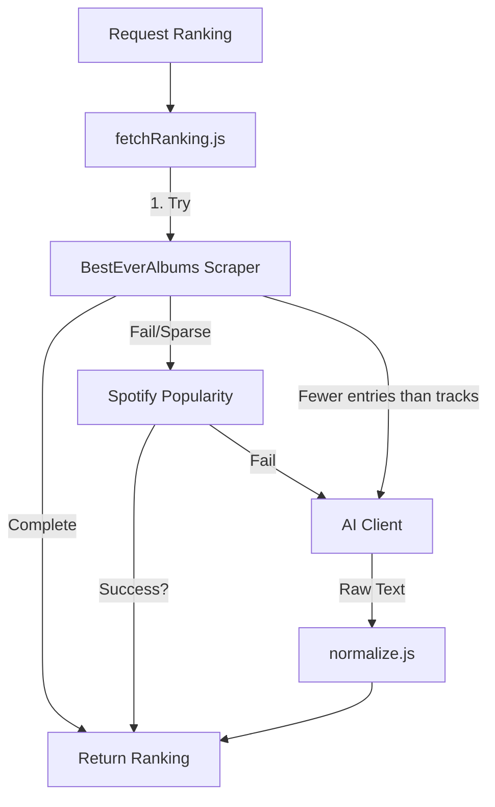
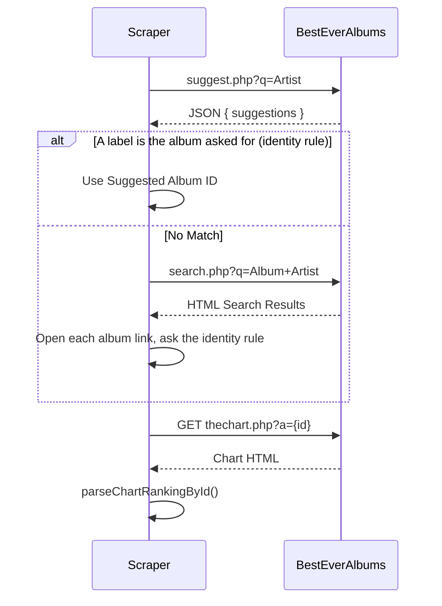

# Deep Dive: Server Logic & Utilities

This document audits the backend logic layer located in `server/lib/` (including `server/lib/services/`) and `server/services/`. This layer handles data acquisition, normalization, and intelligence (AI/Ranking).

## 1. Intelligence Orchestration

The backend uses a **waterfall strategy** to determine the best ranking for an album. This is orchestrated by `fetchRanking.js`.

### Ranking Strategy (`fetchRanking.js`)
The `fetchRankingForAlbum` function implements a specific priority chain (The "Sprint 9 Pivot"):

1.  **BestEverAlbums (Community)**: First tries to scrape community rankings.
    *   *Quality Threshold*: Requires **>= 3 rated tracks** or **40% of the album** to have ratings.
    *   *Logic*: If this threshold isn't met, the data is considered "sparse" and the system falls back to Spotify.
2.  **Spotify Popularity (Fallback 1)**: If community data is sparse/missing, it fetches track popularity from Spotify.
    *   *Logic*: Sorts tracks by popularity index (0-100).
    *   *Condition*: This fallback **exclusively wins** if it finds data for >= 50% of the tracks. It does not merge with sparse BestEver data to avoid polluting the ranking.
    *   It is also tried when BestEverAlbums returns nothing at all.
3.  **AI (Fallback 2)**: Last resort when neither source returned data; also used to fill the tracks BestEverAlbums did not cover when its list is shorter than the album. Uses LLM (Gemini, with the `google_search` grounding tool) to retrieve a critical ranking.
    *   *Method*: Injects the `rankingPrompt` into the AI Provider.
    *   *Anti-Hallucination*: Strictly instructed to set `referenceUrl` to `null` if it cannot verify a source.

### Ranking Services

| Service | Location | Responsibility |
| :--- | :--- | :--- |
| **`scrapers/besteveralbums.js`** | `server/lib/` | **Primary Source**. Scrapes HTML from besteveralbums.com to extract user-generated track content/ratings. |
| **`spotifyPopularity.js`** | `server/lib/services/` | **Secondary Source**. Queries Spotify API for track popularity. Caches the access token in memory; there is no rate limiting. Typed outcomes and thrown failures since F69. |
| **`EnrichmentService.js`** | `server/lib/services/` | Logic of `POST /api/enrich-album`: maps BestEverAlbums ratings to the given tracklist. |
| **`GenerationService.js`** | `server/lib/services/` | Logic of `POST /api/generate`: AI album generation, validation, ranking fetch and consolidation. |
| **`aiClient.js`** | `server/lib/` | **Tertiary Source**. Wrapper around the AI Provider (Gemini). Handles prompt injection (`prompts.js`) and response parsing. |

---

## 2. Core Utilities

These files provide the foundational logic for data processing and safety.

| File | Type | Details |
| :--- | :--- | :--- |
| **`normalize.js`** | **Data Cleaning** | **Heavy Logic**. Contains regex and parsing logic to clean "dirty" JSON/Markdown from AI responses. Handles specific edge cases like "Thriller Bug" (forcing tracks array) and numbered list parsing. |
| **`schema.js`** | **Validation** | Uses **Ajv** to validate album objects against `album.schema.json`. Ensures database integrity. |
| **`validateSource.js`** | **Security** | Verifies metadata URLs. Performs a GET request to ensure reference links provided by AI/Scrapers are valid (status < 400). Used by `normalize.js` when it validates ranking entries. |
| **`logger.js`** | **Observability** | A lightweight structured logger (JSON format) replacing standard `console.log` for better ingestion in production. |

---

## 3. Data Flow Diagram

### Ranking Acquisition Flow


### Folder Structure Anomalies
> [!NOTE]
> *   `MusicKitTokenService.js` is in `server/services/`.
> *   `spotifyPopularity.js`, `EnrichmentService.js` and `GenerationService.js` are in `server/lib/services/`.
> *   Recommendation: Consolidate all third-party integration services into `server/services/` in a future refactor.

### Consolidation Logic (Borda Count)
This diagram details the `consolidateRanking` function logic in `server/lib/ranking.js`.

```mermaid
flowchart TD
    Input[Sources: BEA, Spotify, AI] --> Norm[Normalize Keys]
    Norm --> Match{Match Official Tracks?}
    
    Match -- Exact Match --> Score[Assign Score (N - Rank)]
    Match -- Fuzzy >= 40% --> Score
    Match -- No Match --> Div[Add to Divergence List]
    
    Score --> Accum[Accumulate Scores per Track]
    Accum --> Sort[Sort Tracks]
    Sort --> Rule1{Has Explicit Rating?}
    Rule1 -- Yes --> Rank1[Primary Sort]
    Rule1 -- No --> Rank2[Secondary Sort (Borda Score)]
    
    Rank1 --> Final[Final Ordered Tracklist]
    Rank2 --> Final
```

---

# Server Libraries Analysis

## 1. AI Client: `server/lib/aiClient.js`
**Status**: `[ACTIVE]`
**Type**: Utility / Service wrapper

### Logic
-   Wraps calls to Google Gemini API (`generativelanguage.googleapis.com`).
-   **Features**:
    -   Supports `google_search` grounding tool.
    -   Fixed `temperature` (0.1) and configurable `maxTokens` (default 16384).
    -   Default model `models/gemini-2.5-flash` (`AI_MODEL` overrides it); request timeout 60 s.
    -   Legacy fallback for proxied endpoints.

---

## 2. Ranking Fetcher: `server/lib/fetchRanking.js`
**Status**: `[ACTIVE]`
**Type**: Domain Logic (Complex)

### Core Workflow
1.  **Preparation**: Loads normalization keys and ranking prompts.
2.  **Primary Source**: Scrapes **BestEverAlbums** (Community ratings).
3.  **Fallback Logic** (Critical):
    -   If BestEver has insufficient data (few rated tracks), triggers **Spotify Popularity** fallback.
    -   If Spotify Popularity has good coverage (>=50% tracks), it **replaces** the weak BestEver data entirely.
4.  **Enrichment**:
    -   When BestEver lists fewer tracks than the album, fills the missing ones with AI results. When BestEver covers the whole album, no AI call is made.
5.  **Evidence per track (Sprint 23)**:
    -   The per-track `evidence: []` array is produced by `EnrichmentService.enrichAlbum` (`trackEvidence` in the response of `/api/enrich-album`), with BestEverAlbums as the only source: `evidence: [{ source: 'BestEverAlbums', score: 90, votes: null, url }]`.
    -   `fetchRanking.js` still contains `mergeRankingEvidence` (BestEverAlbums + Musicboard), but nothing calls it.

### Architecture Diagram
```mermaid
flowchart TD
    Start([Fetch Ranking]) --> BEA[BestEverAlbums Scraper]
    BEA --> Check{Suffient Data?}
    Check -- Yes --> AI_Check{Fewer entries than album tracks?}
    Check -- No --> Spotify[Spotify Popularity Fallback]
    Spotify --> SpotCheck{Spotify Coverage >= 50%?}
    SpotCheck -- Yes --> UseSpotify[Use Spotify Data exclusively]
    SpotCheck -- No --> AI[AI Enrichment (Gemini)]
    AI_Check -- Yes --> AI
    AI_Check -- No --> Return
    AI --> Norm[Normalize & Merge]
    Norm --> Return([Return Ranking])
    UseSpotify --> Return
```

---

## 3. Logger: `server/lib/logger.js`
**Status**: `[ACTIVE]`
**Type**: Utility

### Logic
-   Simple structured logging (JSON output).
-   `info`, `warn`, `error` levels.
-   Prints one JSON line per event (`{ ts, level, msg, meta }`) through `console`.

---

## 4. Normalization: `server/lib/normalize.js`
**Status**: `[ACTIVE]`
**Type**: Utility / Data Cleaning

### Responsibilities
-   **Text Cleaning**: `cleanFencedMarkdown` removes Markdown code blocks from LLM responses.
-   **JSON Repair**: `tryParseJson` and `tryRecoverRankingFromText` attempt to extract valid JSON from broken AI text responses (e.g., finding the first valid `{}` block).
-   **Ranking Extraction**: Parsers for various list formats (Numbered lists, "ranking" keys).
-   **Album Normalization**: `extractAlbum` ensures fields like `tracks` are arrays and defaults are set.

---

## 5. Prompts Loader: `server/lib/prompts.js`
**Status**: `[ACTIVE]`
**Type**: Config Loader

### Logic
-   Loads `prompts.json` from the container path (`server/config/prompts.json`) if it exists, otherwise from the repository's `config/prompts.json`. The result is cached in memory.
-   **Template Rendering**: `renderPrompt` handles `{{variable}}` substitution.

---

## 6. Ranking Logic: `server/lib/ranking.js`
**Status**: `[ACTIVE]`
**Type**: Algorithm

### Logic
-   **Consolidation**: Merges rankings from multiple sources.
-   **Matching**: Uses **Fuzzy Token Overlap** (`tokenOverlapRatio`) to match tracks (e.g., "Song (Live)" vs "Song").
-   **Scoring**:
    -   **Borda Count**: Points = `N - Position + 1`.
    -   **Prioritization**: Prefers explicit ratings (0-100) over calculated position scores when sorting.
-   **Output**: Returns consolidated `results` and `divergence` stats (unmatched tracks).

---

## 7. Schema Validator: `server/lib/schema.js`
**Status**: `[ACTIVE]`
**Type**: Validation

### Logic
-   Wraps `ajv` to compile `server/schema/album.schema.json`.
-   Gracefully handles missing `ajv` (logs warning instead of crashing).

---

## 8. Source Validator: `server/lib/validateSource.js`
**Status**: `[ACTIVE]`
**Type**: Validation / Network

### Logic
-   `verifyUrl(url)`: Performs a GET request (max 50KB) to ensure a URL is reachable (status < 400).
-   `isBestEverUrl(url)`: Whitelists `besteveralbums.com` (skips verification for known good domain).

---

## 9. Scraper: `server/lib/scrapers/besteveralbums.js`
**Status**: `[ACTIVE]`
**Type**: Web Scraper / Crawler

### Logic
-   **Target**: `besteveralbums.com`
-   **Heuristics**:
    -   **Search (F68)**: an explicit, ordered list of attempts (`locateAlbum`), each judged by the one identity rule: the artist's own page (`artist-page`); then `suggest.php`, whose results are labelled "Title by Artist", asked with "artist title" (`artist-and-title`), the title alone (`title-alone`) and the artist alone (`artist-alone`); then the HTML search `search.php` (`html-search`), each album link opened and read. The titles sent are the rule's own (`titlesToSearch`: the title without edition notes, then the other known writings): the source matches word by word, so a text with "(2007 Stereo Mix)" lists nothing. The scraper has no title cleaner of its own.
    -   **Acceptance (F55, slice 1)**: one rule, `shared/albumIdentity.js`, at every point: the label, the page (`<title>` and `h1`) or the link on the artist's page is read into `{ title, artist }` and the rule answers. The title must match on its own (an edition note such as "(Deluxe Edition)" is dropped; "Core" is not "Core Memories"), and the artist must match. No result passes: "not found", never another album of the artist. Since slice 2 the rule has a second tier (the title asked for before a subtitle, when it is the only such album): the suggestions and the artist's page get it from `pickAlbum`; a page checked alone (`pageIsTheAlbum`) accepts the first tier only, because the HTML search opens one page at a time and stops at the first it accepts.
-   **Parsers**:
    -   `parseChartRankingById`: Extracts ratings from chart tables (looking for "Rating: 84 (398 votes)").
    -   `parseAlbumRanking`: HTML fallback if no chart table found.
    -   **Regex Robustness (Sprint 23)**: Improved matching regex to handle track titles starting with numbers (e.g., "72 Seasons") by requiring explicit separators (dot, paren, dash).

### Scraper Discovery Sequence


---

## 10. Service: `server/lib/services/spotifyPopularity.js`
**Status**: `[ACTIVE]`
**Type**: External API Client

### Logic
-   **Auth**: Client Credentials Flow (`grant_type: client_credentials`) to get a server-side Access Token.
-   **Workflow**:
    1.  `findSpotifyAlbum`: searches `album:{title} artist:{name}` (5 results), then the title without its edition notes (the identity rule's `titleWithoutEditionNotes`, F68), then the albums of the artist (20). The searches only list candidates; the one identity rule (`shared/albumIdentity.js`) accepts the album asked for or none (F55, slice 1), with the rule's second tier per search since slice 2. Before F55 the first result of the search was taken as it came, and the artist-only search broke on a name that was never imported.
    2.  Get Album (`/v1/albums/{id}`) to read the track IDs.
    3.  **Batch Request**: Query `/v1/tracks` with up to 50 IDs to get the full track objects (which contain the `popularity` field).
    4.  **Output**: Maps `popularity` (0-100) directly to `rating`.
-   **Answer (v5.0, F69)**: `getSpotifyPopularityRanking` follows the answer contract of F52 (`lib/outcome.js`). It returns `{ outcome: 'found', provider, providerType, referenceUrl, evidence }`, `{ outcome: 'not_found' }` (Spotify answered: no such album, or the album lists no track) or `{ outcome: 'not_configured' }` (the server has no Spotify credentials: Spotify is not asked). A call that failed (network, 4xx/5xx, 429, too slow, the token request included) is thrown as an `UpstreamError`; before, all of these came back as `{ error }`. Its caller, `fetchRanking.js`, still goes on to the next source of the ranking when it throws.


---

## 4. AI Prompts & Configuration

The application uses externalized JSON configuration for AI prompts, located in `config/prompts.json`.

### `rankingPrompt`
Used by `fetchRanking.js` (Fallback 2).
*   **Goal**: "What are the most acclaimed tracks and the ranking for all tracks... considering BestEverAlbums ratings?"
*   **Rules**:
    1.  **Primary Evidence**: Use BestEverAlbums if available.
    2.  **Fallback Sources**: Use `defaultRankingProviders` (e.g., Rolling Stone, NME, Pitchfork) if BEA is missing.
    3.  **Anti-Hallucination**: "Do NOT invent URLs. If you cannot verify a URL, set `referenceUrl` to null."
*   **Output Format**: Strictly enforces a dual-format response:
    1.  Compact JSON (`ranking` array + `sources` array).
    2.  Numbered plain-text list (for human readability/debugging).

### `defaultRankingProviders`
A curated list of 11 music sources. `fetchRanking.js` passes the first 10 to `renderPrompt` as `rankingProviders`, but the current `rankingPrompt` template has no `{{rankingProviders}}` placeholder, so the list does not reach the AI:
*   Ultimate Classic Rock
*   Tenho Mais Discos Que Amigos (TMDQA!)
*   Reddit (Fan Subreddits)
*   TheTopTens.com
*   Wikipedia
*   Billboard
*   Rolling Stone
*   NME
*   AllMusic
*   Rate Your Music
*   Pitchfork
