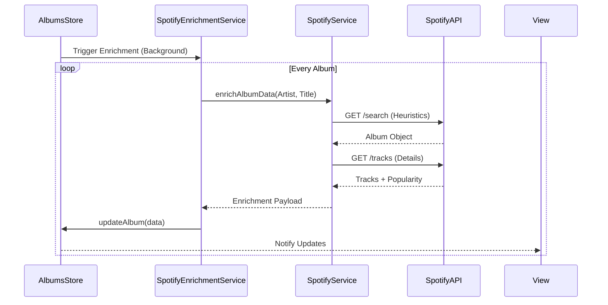

# Frontend Data Layer Analysis

> **Deep Dive Enrichment**: This document details the Store-Service architecture, focusing on State Management patterns, Sync logic, and External Integrations.

## 1. Store Architecture
**Status**: `[ACTIVE]`
**Pattern**: Singleton Observables (Flux-like)

### 1.1 `stores/albumLoad.js` (AlbumLoadStore) - v4.0
**Purpose**: the one owner of which albums each series has and of the load state of each album. Pure state; only `AlbumLoadService` writes to it. Details in [08_Frontend_Models.md](08_Frontend_Models.md).

### 1.1a `stores/ownRankings.js` (OwnRankingsStore) - v4.0
**Purpose**: the albums the person has ranked (which, not how): the list, the person it belongs to and its state (`idle`, `loading`, `ready`, `failed`). Pure state; only `OwnRankingService` writes to it. `getIndex()` is derived and answers "is this album query ranked?" for the 'My Ranking' filter.

### 1.1c `stores/savedPlaylists.js` (SavedPlaylistsStore) - v5.0 (F61)
The state of the saved playlists list: the status of the list (`idle`, `loading`, `ready`, `failed`), the order of the series and one entry per series, `{ seriesId, series, status, playlists, batches, thumbnails, error, refreshing }`, with `status` one of `loading`, `ready`, `empty`, `failed`. Pure state: `begin`, `setSeries`, `setListFailed`, `patchEntry`, getters and `subscribe`; several changes in the same tick give one notice. An entry is replaced, never mutated, so the screen knows a series changed by comparing objects. Only `SavedPlaylistsReader` writes here; `begin` with another user id empties the list.

### 1.1b `stores/albums.js` (AlbumsStore)
**Purpose**: the shelf of loaded albums the other screens read.
*   Since v4.0 it is filled by projection from `AlbumLoadStore` (`setAlbumsBySeries`).
*   `ALL_SERIES_VIEW` holds the albums of every series on screen; each series id holds its own.
*   `removeAlbumsBySeriesIdFromContext` and the "surgical injection" of Sprint 21.5 still exist for the edit and delete flows; the next load reconciles them.
*   It is a pure state container (v4.0, F48): it imports no Firestore. The write of "Refetch Metadata" into the shared `albums` collection moved to `repositories/SharedAlbumRepository.js`; `saveToFirestore`, `loadFromFirestore` and `updateAlbum(db, album)` no longer exist.

### 1.2 Pure State Containers (Sprint 19)
**Status**: `[REFACTORED]`
**Pattern**: Pure State (Setters/Getters only)

The following stores were refactored to remove all business logic, delegating it to specialized Services. They now only hold reactive state and expose thin setters.

*   **`stores/playlists.js`**: Holds generated playlists, edit mode context, and undo history.
*   **`stores/albumSeries.js`**: Holds the list of series, active series index, and database context.

---

## 2. Service Layer
The Service Layer orchestrates complex operations and state transitions, isolating business logic from the pure state containers.

### 2.1 `services/PlaylistsService.js` [NEW]
**Purpose**: Orchestrates playlist lifecycle, history, and persistence.
*   **History Management**: Manages undo/redo stacks.
*   **Persistence**: keeps the browser draft of the playlists not saved yet (`saveToLocalStorage`, `watchStore`, `restoreDraft`) and saves through `PlaylistRepository`; it does not import Firestore (v5.0, F60).
*   **The save rule** (`saveCurrentBatch`, v5.0, F60): one save at a time; the series is the one of the playlists on screen (`playlistsStore.seriesId`); an edited batch is replaced by one atomic write; the screen changes only after the write is confirmed. `resolveBatchName` and `hasUnsavedChanges` answer the screen.
*   **Track Ops**: Business logic for moving/removing/reordering tracks, and `removePlaylist` for a whole playlist.

### 2.2 `services/SeriesService.js` [NEW]
**Purpose**: Manages Music Series lifecycle and album mapping.
*   **CRUD**: Create, Update, and Delete logic for series.
*   **Context Management**: Syncs user context and database instances to the store.
*   **Persistence**: Handles `localStorage` for quick-start data.

### 2.3 `services/SpotifyService.js`
**Status**: `[ACTIVE]`
**Type**: API Gateway / Adapter
**Dependencies**: `SpotifyAuthService` (Tokens)

**Purpose**: Handles all interactions with Spotify Web API, including complex search heuristics and data normalization.

#### A. Album Search (`searchAlbum`)
*   **Goal**: find the Spotify album that IS the album asked for, or none.
*   **Logic Trace** (F55, slice 1):
    1.  **Cleaning** of the search text only: removes common suffixes like `(Remastered)`, `(Deluxe Edition)`, `(Anniversary)`.
    2.  **Search 1**: `q=artist:Pink Floyd album:<clean title>` (5 results).
    3.  **Search 2**: the title as written, when cleaning changed it.
    4.  **Search 3**: `artist:Pink Floyd` (20 results).
    5.  **Acceptance**: the searches only list candidates. After each one, the one identity rule (`shared/albumIdentity.js`, through `models/askedAlbum.js`) picks the album asked for among them: the title must match on its own, the artist must match, the plain album comes before an edition. When a search lists no such album and exactly one album is accepted by a rule of the second tier (the title asked for before a subtitle, without what the candidate has in parentheses, and the others of `SECOND_TIER_RULES`), that one is taken (F55 slice 2, F68). The title without edition notes sent to the search is the rule's own (`titleWithoutEditionNotes`). No candidate passes all three searches: `null`.
*   **What it no longer does**: take the first result when nothing matched, accept a title that contains the other, or score by Levenshtein distance. Those three let another album of the same artist stand in for the album asked for (UAT-184).

#### B. Enrichment Flow (`enrichAlbumData`)
*   **Goal**: Add Metadata, Artwork, and Track Popularity to an existing Album.
*   **Logic Trace**:
    1.  **Find**: Calls `searchAlbum()`.
    2.  **Validate**: nothing more to check: `searchAlbum` accepts only the album asked for, title and artist.
    3.  **Details**:
        *   Fetches Album Tracks (Simplified Objects).
        *   **Batch Fetch**: Calls `/tracks?ids=...` to get Full Objects (needed for `popularity` field).
    4.  **Aggregate**: Calculates `Average Popularity` (0-100).
    5.  **Map**: Returns normalized artifact with `trackPopularityMap`.

*   **Architecture Diagram (Enrichment Loop)**:

### 2.2 Other Services
*   **`AuthService.js`**:
    *   Wraps Firebase Auth.
    *   Exposes `waitForAuth()` Promise for safe bootstrapping.
*   **`SpotifyAuthService.js`**:
    *   Handles OAuth 2.0 PKCE flow.
    *   Manages Token Refresh logic automatically.

---

## 3. Models (`models/`)
**Status**: `[ACTIVE]`
**Type**: Domain Entities

-   **`Album.js`**: Core entity. Aggregates tracks, manages `original` vs `acclaim` order.
-   **`askedAlbum.js`**: The app's side of the one identity rule (`shared/albumIdentity.js`): reads a stored query into what was asked, and an Apple Music, Spotify or local-dataset album into a candidate, each as `{ artist, title, year }`. Since slice 2 it also reads an album the app keeps (`keptAlbum`), says which query of a series asked for an album (`indexOfQueryFor`, `alreadyAskedFor`) and gives the one-line notice of an album accepted by the second tier (`identityNotice`). It replaced `AlbumIdentity.js` (a confidence score), removed in F55.
