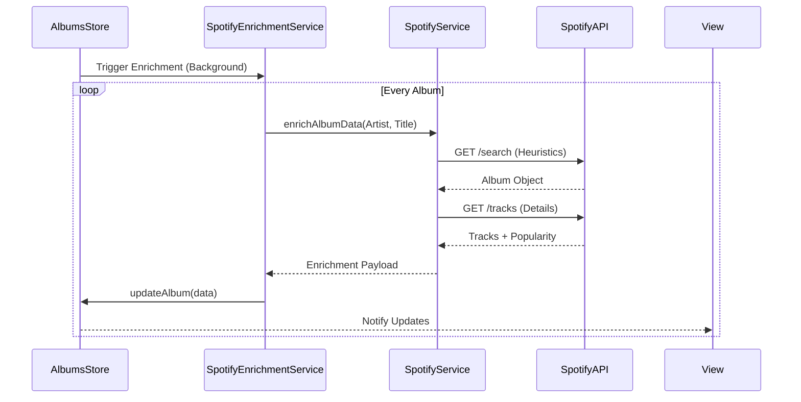

# Frontend Data Layer Analysis

> **Deep Dive Enrichment**: This document details the Store-Service architecture, focusing on State Management patterns, Sync logic, and External Integrations.

## 1. Store Architecture
**Status**: `[ACTIVE]`
**Pattern**: Singleton Observables (Flux-like)

### 1.1 `stores/albumLoad.js` (AlbumLoadStore) - v4.0
**Purpose**: the one owner of which albums each series has and of the load state of each album. Pure state; only `AlbumLoadService` writes to it. Details in [08_Frontend_Models.md](08_Frontend_Models.md).

### 1.1b `stores/albums.js` (AlbumsStore)
**Purpose**: the shelf of loaded albums the other screens read.
*   Since v4.0 it is filled by projection from `AlbumLoadStore` (`setAlbumsBySeries`).
*   `ALL_SERIES_VIEW` holds the albums of every series on screen; each series id holds its own.
*   `removeAlbumsBySeriesIdFromContext` and the "surgical injection" of Sprint 21.5 still exist for the edit and delete flows; the next load reconciles them.
*   It is a pure state container (v4.0, F48): it imports no Firestore. The write of "Refetch Metadata" into the shared `albums` collection moved to `repositories/SharedAlbumRepository.js`; `saveToFirestore`, `loadFromFirestore` and `updateAlbum(db, album)` no longer exist.

### 1.2 Pure State Containers (Sprint 19)
**Status**: `[REFACTORED]`
**Pattern**: Pure State (Setters/Getters only)

The following stores were refactored to remove all business logic, delegating it to specialized Services. They now only hold reactive state and expose thin setters.

*   **`stores/playlists.js`**: Holds generated playlists, edit mode context, and undo history.
*   **`stores/albumSeries.js`**: Holds the list of series, active series index, and database context.

---

## 2. Service Layer
The Service Layer orchestrates complex operations and state transitions, isolating business logic from the pure state containers.

### 2.1 `services/PlaylistsService.js` [NEW]
**Purpose**: Orchestrates playlist lifecycle, history, and persistence.
*   **History Management**: Manages undo/redo stacks.
*   **Persistence**: Handles `localStorage` backups and Firestore CRUD orchestration.
*   **Track Ops**: Business logic for moving/removing/reordering tracks.

### 2.2 `services/SeriesService.js` [NEW]
**Purpose**: Manages Music Series lifecycle and album mapping.
*   **CRUD**: Create, Update, and Delete logic for series.
*   **Context Management**: Syncs user context and database instances to the store.
*   **Persistence**: Handles `localStorage` for quick-start data.

### 2.3 `services/SpotifyService.js`
**Status**: `[ACTIVE]`
**Type**: API Gateway / Adapter
**Dependencies**: `SpotifyAuthService` (Tokens)

**Purpose**: Handles all interactions with Spotify Web API, including complex search heuristics and data normalization.

#### A. Smart Search (`searchAlbum`)
*   **Goal**: reliably find a specific album given potentially dirty metadata (e.g., "The Dark Side (2011 Remaster)").
*   **Logic Trace**:
    1.  **Cleaning**: Removes common suffixes like `(Remastered)`, `(Deluxe Edition)`, `(Anniversary)`.
    2.  **Attempt 1: Structured Query**:
        *   `q=artist:Pink Floyd album:Dark Side`
        *   *Validation*: Checks if returned Artist & Album title contain target keywords.
    3.  **Attempt 2: Direct Search**:
        *   Tries original string if cleaning failed.
    4.  **Attempt 3: Fuzzy Artist Fallback** (Last Resort):
        *   Searches `artist:Pink Floyd` (limit 20).
        *   **Fuzzy Match**: Calculates Levenshtein Distance / Similarity Score (0-1) between target album name and results.
        *   *Threshold*: Accepts match if Score > 0.5.

#### B. Enrichment Flow (`enrichAlbumData`)
*   **Goal**: Add Metadata, Artwork, and Track Popularity to an existing Album.
*   **Logic Trace**:
    1.  **Find**: Calls `searchAlbum()`.
    2.  **Validate**: Double checks Artist name match to prevent false positives.
    3.  **Details**:
        *   Fetches Album Tracks (Simplified Objects).
        *   **Batch Fetch**: Calls `/tracks?ids=...` to get Full Objects (needed for `popularity` field).
    4.  **Aggregate**: Calculates `Average Popularity` (0-100).
    5.  **Map**: Returns normalized artifact with `trackPopularityMap`.

*   **Architecture Diagram (Enrichment Loop)**:

### 2.2 Other Services
*   **`AuthService.js`**:
    *   Wraps Firebase Auth.
    *   Exposes `waitForAuth()` Promise for safe bootstrapping.
*   **`SpotifyAuthService.js`**:
    *   Handles OAuth 2.0 PKCE flow.
    *   Manages Token Refresh logic automatically.

---

## 3. Models (`models/`)
**Status**: `[ACTIVE]`
**Type**: Domain Entities

-   **`Album.js`**: Core entity. Aggregates tracks, manages `original` vs `acclaim` order.
-   **`AlbumIdentity.js`**: Scores how well an album found by name matches the album asked for. It is not a hash and the cache does not use it.
