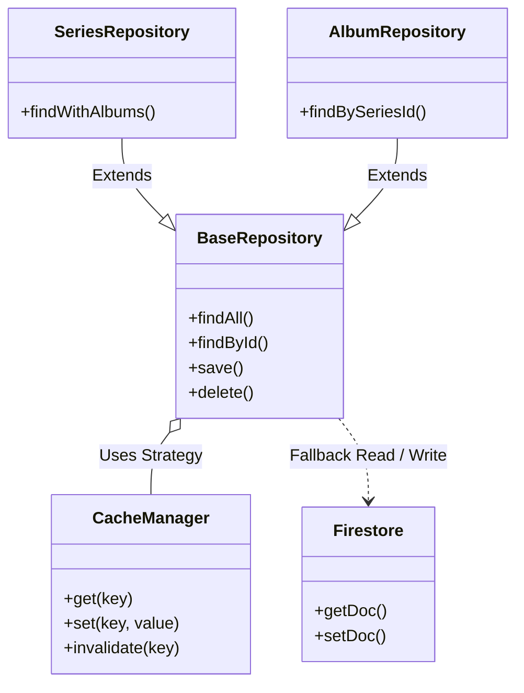

# Deep Dive: Data Infrastructure & State Management

This document analyzes the Data Layer, linking the transient frontend state (STORES) with the persistent backend (REPOSITORIES) via an optimized caching layer (CACHE).

## 1. Architecture Overview
The application handles data using a **"Three-Tiered Persistence Strategy"**:
1.  **Store (UI State)**: Reactive singletons holding the working state (Playlists, Config).
2.  **Cache (Optimization)**: Dual-layer (Memory + IndexedDB) interception to minimize reads.
3.  **Repository (Source of Truth)**: Abstracted Firestore access.

---

## 2. Repositories (Data Access Object Pattern)

### BaseRepository (`public/js/repositories/BaseRepository.js`)
*   **Role**: Abstract parent class for all data entities.
*   **Integration**: Tightly coupled with `CacheManager`.
    *   **Read**: only `findById` checks the cache first and writes the result back. `findAll` always goes to Firestore.
    *   **Write**: writes to Firestore, then invalidates the cache keys of that document.
*   **Tech**: Uses Firebase Modular SDK (`getDoc`, `query`, `orderBy`).

### Data Access Architecture Diagram

### SharedAlbumRepository (`public/js/repositories/SharedAlbumRepository.js`) - v4.0 (F48)
*   **Path**: the root collection `albums`, one document per album, shared by every account.
*   **No writer since F56** (on the branch `fix/f56-screens-load-through-the-service`, not yet published): its one writer was `SeriesService.refetchAlbumMetadata` ("Refetch Metadata"), which no longer exists; the reload of an album goes through the album load, which does not write here. Nothing in the app reads the collection back. The class stays until the owner decides what the shared collection is for.
*   **Nothing personal goes in**: `toSharedAlbumData` writes the album as plain data without `hasUserRanking`, `userRanking` and the `userRank` of each track. The personal ranking lives only in `users/{uid}/albumRankings`.
*   `saveAlbum` refuses an album without an id. It goes through `BaseRepository.save`, so the document also gets `updatedAt` and `_schemaVersion`.

### UserRankingRepository (`public/js/repositories/UserRankingRepository.js`)
*   **Path**: `users/{userId}/albumRankings/{albumId}` (`/` and `\` of the id become `_`).
*   **Cache that acts** (v4.0, F48): the repository uses the `cacheManager` instance (it used to hold the class, so no read was ever cached). What `getRanking` reads is kept for **one hour** (`USER_RANKING_TTL_MS`) under `userRanking:{userId}:{albumId}`, as `{ ranking }`, with `ranking: null` when the album has no ranking: "no ranking" is remembered too, so the album load asks the cloud once per album and not on every visit.
*   **Why one hour**: the ranking changes, and it may be edited on another device, where this browser cannot forget it.
*   `saveRanking` and `deleteRanking` forget the cached entry. A failed read is not cached. `getAllRankings` always goes to Firestore.

### SeriesRepository (`public/js/repositories/SeriesRepository.js`)
*   **Path**: `artifacts/{appId}/users/{userId}/curator/data/series`
*   **Features**:
    *   Subcollection Loading: Fetches `albums` subcollection manually in `findWithAlbums`.
    *   `deleteWithPlaylists(seriesId)` (v5.0, F60): deletes the series and the playlists saved under it in one atomic write (Firestore does not remove a subcollection with its parent). With more playlists than one write carries, the playlists go first and the series document last, so a failure never leaves playlists with no series. `findPlaylists(seriesId)` lists them. The `albums` subcollection read by `findWithAlbums` is not deleted.
    *   `saveAlbumFacts(seriesId, albumQueries)` (v4.0): saves what the app learned about the albums of a series (see [32_Data_Schema_Reference.md](32_Data_Schema_Reference.md)): the `facts` and, since F55 slice 2, the corrected Apple Music id of an album found under another id than the stored one. `SeriesFactsService` is its only caller. It leaves `updatedAt` alone: it is not the person editing the series.
*   **The whole list is read** (v4.0): `SeriesService.loadFromFirestore` asks for every series, with no limit and no `orderBy` (Firestore leaves out a document that lacks the ordered field). The order by update date is applied in the browser.

---

## 3. Caching (Dual-Layer Strategy)

### CacheManager (`public/js/cache/CacheManager.js`)
*   **Role**: The coordinator preventing excessive read bills.
*   **Layers**:
    *   **L1 (Memory)**: Instant access, cleared on refresh.
    *   **L2 (IndexedDB)**: Persistent access, survives refresh.
*   **Promotion Logic**: `Get L2` -> `Found?` -> `Promote to L1`.
*   **Resilience**: If L2 (IDB) fails or is blocked, it silently falls back to pure L1 mode.
*   **`clear()`** empties both layers and **fails** when IndexedDB could not be cleared (v4.0, F48), so the "Clear Cache" button never says "cleared" over data that is still there. `get`, `set` and `invalidate` still only log an L2 failure.
*   **What lives in it**: the albums (`album:…` keys of `albumCache` and of the album load), the personal rankings that were read (`userRanking:…`, one hour) and the documents the repositories cache.

### Clearing the album caches (`public/js/services/albums/clearAlbumCaches.js`) - v4.0 (F48)
*   `clearAlbumCaches({ loadService, cache, storage })`: stops the album load in flight (so nothing is written back), clears the `CacheManager`, and removes the entries of the old album cache from localStorage (`album_cache_v…`). It returns how many old entries it removed and fails when the cache could not be cleared.
*   It touches nothing else of localStorage: the Spotify login, the saved series, the screen choices and `album_cache_migration_start` stay.
*   The dependencies are injected; `services/albums/albumLoading.js` exports the wired `clearAppAlbumCaches`, which `app.js` hands to the footer.

---

## 4. Stores (State Management)

### PlaylistsStore (`public/js/stores/playlists.js`)
*   **Role**: Manages the core Playlist "Workspace".
*   **Key Features**:
    *   **Modes**: Explicit `CREATING` vs `EDITING` modes to handle "Edit Batch" logic.
    *   **Undo/Redo**: Implements a Memento Pattern with `versions` array (Snapshotting state on every mutation like drag/drop).
    *   **Pure state** (ADR-0017): the store only holds the working set and its flags (`isDirty`, `isSynchronized`, `isSaving`). The operations are in `PlaylistsService`.
    *   **Draft in the browser** (v5.0, F60): `PlaylistsService.watchStore()` follows the store and keeps the playlists that are not saved yet in `mjrp_current_playlists`, with the `uid` of the person; `restoreDraft({ seriesId })` puts them back after a reload, for the same person and series only.
    *   **Permanent save** (v5.0, F60): `PlaylistsService.saveCurrentBatch` (explicit user action), one at a time.
*   **Batching**: the save is one atomic `writeBatch`, inside `PlaylistRepository.replaceBatch` (see below).

### PlaylistRepository (`public/js/repositories/PlaylistRepository.js`)
*   **Path**: `artifacts/{appId}/users/{userId}/curator/data/series/{seriesId}/playlists`
*   **`replaceBatch(playlists, replacedIds)`** (v5.0, F60): writes the playlists (update with `id`, create without) and deletes the replaced ones that are not among them, in one atomic write. The same write touches `updatedAt` of the series document, so a series that no longer exists refuses the whole write (`not-found`): no playlist is stored without its series. More than 500 operations is refused before writing.

### Other Stores
*   **UserStore**: Manages Auth state and User Profile.
*   **InventoryStore**: Manages the "Pool" of available albums. When the person changes (`handleUserChange`, v5.0, F60) the albums in memory are dropped at once, nothing is read while there is no user, a late answer for the previous person is discarded, and nothing is copied between accounts.

---

## 5. Models (Domain Entities)
*   **`Album.js`**: Enriched entity with `tracks`, `rankingSources`, and `stats`.
*   **`Track.js`**: The atomic unit, carrying the `rankingInfo` provenance chain.
*   **`Series.js`**: Container for albums.

### `api/serverFetch.js` — the one way to call the app's own server
`serverFetch(url, init)` is `fetch` plus the person's login: it asks Firebase for the ID token on every call (Firebase renews it) and sends it as `Authorization: Bearer <token>`. With nobody signed in the call goes without it and the server answers 401. `createServerFetch({ getIdToken, fetchImpl })` is the pure version, used by the tests. Every call to `/api/*` that the server guards goes through it: `api/client.js` (`/enrich-album`, `/generate`, `/playlists`) and `services/album-search/AlbumSearchService.js` (`/ai/studio-albums`). `/api/musickit-token` is open and is still called with plain `fetch`.

### `api/serverResult.js` — the one place that reads an answer of the server (F52)
The server answers `{ data, outcome }` or `{ error: { code, retryable } }` (see `03_Backend_API_Layer.md`, "The contract of an answer"). `readServerResult(response)` is pure and gives a typed result:

| Result | When | What the caller does |
| :--- | :--- | :--- |
| `{ kind: 'found' \| 'not_found' \| 'no_ratings', data }` | 200 with `outcome` | uses the data; `not_found` and `no_ratings` are "the source has none" |
| `{ kind: 'legacy', body }` | 200 **without** `outcome`: the server before F52 | follows the rule it had before F52; it is never read as "the source has none" |
| `{ kind: 'failed', code, retryable, status, hold }` | any 4xx or 5xx, or a 200 that cannot be read | treats it as a failure; it is stored nowhere |

*   **`retryable`** is the field the new server sent, never the status alone. With the server before F52 (errors as `{ error: 'text' }`, or the AI provider's own error passed on raw) it is the rule of before: only a 5xx.
*   **`hold`** is set only for the server's own 401 (`{ reason: 'unauthorized' }`) and 429 (`{ reason: 'rate_limited', retryAfterMs }`, from `Retry-After` in seconds or as a date, 60 s when absent). A 401, 402 or 429 of the AI provider that the old server passes on raw has another body and never holds.
*   **`failedWithoutAnswer(cause, { timedOut })`**: no answer may be asked again (`no_answer`); a call cut at its deadline may not (`deadline`), because the paid work may still be running.
*   **`ApiError`** (re-exported by `api/client.js`) is a failure, thrown: `kind` (`http`, `network`, `timeout`), `status`, `code`, `retryable`, `hold`.

Who uses it:
*   `api/client.js`: `_post` is the one call to the server; `requestRatings(albumData)` (`POST /enrich-album`) returns `{ kind, data }` and throws `ApiError` on failure; `BEAenrichAlbum`, `fetchAlbum` and `fetchMultipleAlbums` were removed by F56 (on its branch) with `BEAEnrichmentHelper.enrichAlbum`, when their last callers left; `_fetchAlbumFromAPI` (`POST /generate`) asks again only when `error.retryable` says so.
*   `services/album-search/AlbumSearchService.js`: the AI list of studio albums. A failure gives an empty list for that search only and is **not** remembered in `aiCache` (it used to be kept as "the AI knows no album" for the session); one search asks the list once.
*   `services/albums/adapters/enrichers.js` (`AcclaimEnricher`): `not_found` and `no_ratings` end as `empty`, with nothing written into the album; a failure is thrown as it came, so `AlbumLoadService` marks the source `failed` and nothing goes to the cache. **Changed in F52:** a page with zero matched ratings used to count as `done` (its address was written into the album, and an album with that address reads as "already has its ratings"); with the new server it is `empty`. That changes the "by source" filter and the facts written into the series: such an album stops counting as "has ratings". With the server before F52 (`legacy`) the old rule still applies. Records already in the browser cache are not touched in this slice.

### Hold: the server said "sign in" or "wait" (F52)
`AlbumLoadService` does not mark an album as failed when a port throws an error with `hold` (the server's own 401 or 429). The ask waits and goes again when the hold ends:
*   **Where**: `_addHeld(queue, task, options, generation)` wraps every task the load adds to a queue (the album search and each source). The hold starts inside the task, before the queue frees its slot, so no other ask starts in between.
*   **429**: the hold lasts what `Retry-After` says and ends by itself. **401**: it has no end of its own; `resume()`, a new `load()` or `retryFailed()` ends it.
*   **Which queue stops**: the slow queue (ratings) only talks to the app's server, so `TaskQueue.pause()` stops it when that server said "wait" to it, or "sign in" to anyone. The album-search queue is never paused (it also reaches Apple Music): only the album that heard "wait" from the second source waits.
*   **One notice**: `onHold({ reason, until })` is called once per hold ("sign in" once per load, even when the screen asks again and hears it again); `albumLoading.js` shows a toast with the text of `holdNotice` (`models/albumLoadState.js`). `getHold()` gives the hold in force. No screen shows the hold yet beyond that toast.
*   `CatalogAdapter._findInServer` rethrows an error with `hold` instead of turning it into "not found".
*   `utils/TaskQueue.js` gained `pause()`, `resume()` and `paused`: a paused queue starts no new task, what is running finishes, and a paused queue with tasks waiting is not idle.
*   `AlbumLoadService._enrichOne` was split while it was touched (`_newAsk`, `_askSource`, `_overNewestAlbum`, `_publishSource`).

### Site and server are published apart (F52)
| Pair | What happens | Test |
| :--- | :--- | :--- |
| new site, old server | a 200 without `outcome` is `legacy`; `{ albums: [], error }` from the AI list is a failure; `{ error: 'text' }` is read by status | `test/api/serverResult.test.js`, `test/api/client.test.js`, `test/services/album-search/AlbumSearchService.aiList.test.js` |
| old tab, new server | a ratings failure becomes `null`, then `failed`; `/api/generate` is asked again only for the rows of the provider table that say so; the AI list is not read by an old tab until it is reloaded (it moved to `data.albums`) | `test/api/oldTabAgainstNewServer.test.js` |
