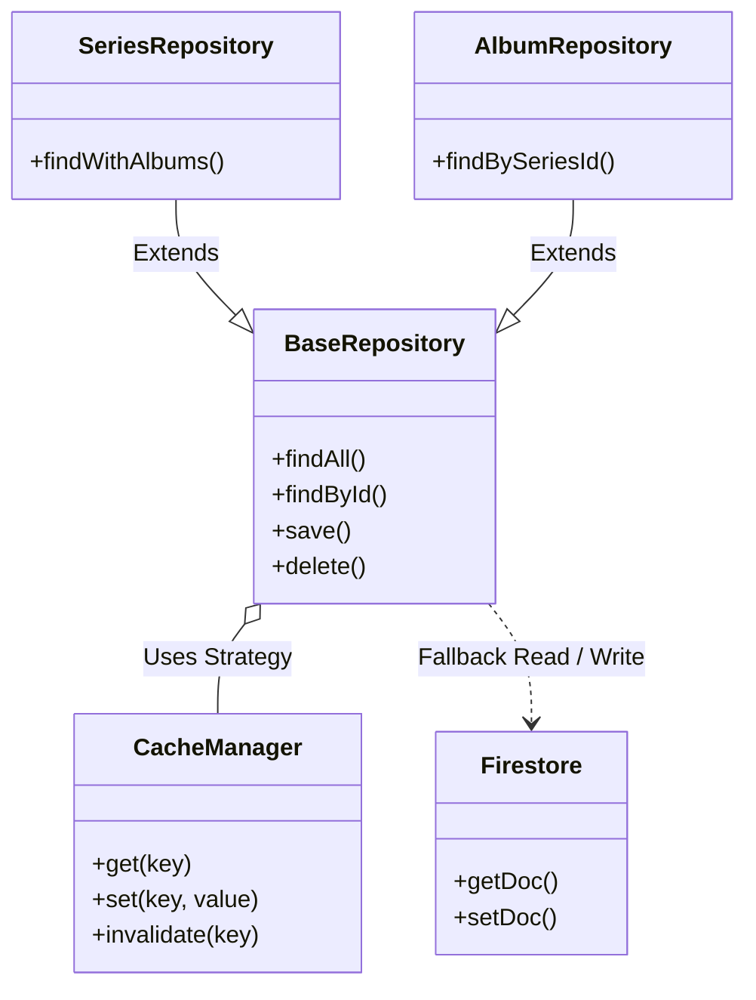

# Deep Dive: Data Infrastructure & State Management

This document analyzes the Data Layer, linking the transient frontend state (STORES) with the persistent backend (REPOSITORIES) via an optimized caching layer (CACHE).

## 1. Architecture Overview
The application handles data using a **"Three-Tiered Persistence Strategy"**:
1.  **Store (UI State)**: Reactive singletons holding the working state (Playlists, Config).
2.  **Cache (Optimization)**: Dual-layer (Memory + IndexedDB) interception to minimize reads.
3.  **Repository (Source of Truth)**: Abstracted Firestore access.

---

## 2. Repositories (Data Access Object Pattern)

### BaseRepository (`public/js/repositories/BaseRepository.js`)
*   **Role**: Abstract parent class for all data entities.
*   **Integration**: Tightly coupled with `CacheManager`.
    *   **Read**: only `findById` checks the cache first and writes the result back. `findAll` always goes to Firestore.
    *   **Write**: writes to Firestore, then invalidates the cache keys of that document.
*   **Tech**: Uses Firebase Modular SDK (`getDoc`, `query`, `orderBy`).

### Data Access Architecture Diagram

### SharedAlbumRepository (`public/js/repositories/SharedAlbumRepository.js`) - v4.0 (F48)
*   **Path**: the root collection `albums`, one document per album, shared by every account.
*   **One writer**: `SeriesService.refetchAlbumMetadata` ("Refetch Metadata"), through `saveAlbum(album)`. The album load does not write here, and nothing in the app reads the collection back.
*   **Nothing personal goes in**: `toSharedAlbumData` writes the album as plain data without `hasUserRanking`, `userRanking` and the `userRank` of each track. The personal ranking lives only in `users/{uid}/albumRankings`.
*   `saveAlbum` refuses an album without an id. It goes through `BaseRepository.save`, so the document also gets `updatedAt` and `_schemaVersion`.

### UserRankingRepository (`public/js/repositories/UserRankingRepository.js`)
*   **Path**: `users/{userId}/albumRankings/{albumId}` (`/` and `\` of the id become `_`).
*   **Cache that acts** (v4.0, F48): the repository uses the `cacheManager` instance (it used to hold the class, so no read was ever cached). What `getRanking` reads is kept for **one hour** (`USER_RANKING_TTL_MS`) under `userRanking:{userId}:{albumId}`, as `{ ranking }`, with `ranking: null` when the album has no ranking: "no ranking" is remembered too, so the album load asks the cloud once per album and not on every visit.
*   **Why one hour**: the ranking changes, and it may be edited on another device, where this browser cannot forget it.
*   `saveRanking` and `deleteRanking` forget the cached entry. A failed read is not cached. `getAllRankings` always goes to Firestore.

### SeriesRepository (`public/js/repositories/SeriesRepository.js`)
*   **Path**: `artifacts/{appId}/users/{userId}/curator/data/series`
*   **Features**:
    *   Subcollection Loading: Fetches `albums` subcollection manually in `findWithAlbums`.
    *   Cascade Awareness: Designed to support cascade deletes (though logic is often distributed).
    *   `saveAlbumFacts(seriesId, albumQueries)` (v4.0): saves what the app learned about the albums of a series (see [32_Data_Schema_Reference.md](32_Data_Schema_Reference.md)). It leaves `updatedAt` alone: it is not the person editing the series.
*   **The whole list is read** (v4.0): `SeriesService.loadFromFirestore` asks for every series, with no limit and no `orderBy` (Firestore leaves out a document that lacks the ordered field). The order by update date is applied in the browser.

---

## 3. Caching (Dual-Layer Strategy)

### CacheManager (`public/js/cache/CacheManager.js`)
*   **Role**: The coordinator preventing excessive read bills.
*   **Layers**:
    *   **L1 (Memory)**: Instant access, cleared on refresh.
    *   **L2 (IndexedDB)**: Persistent access, survives refresh.
*   **Promotion Logic**: `Get L2` -> `Found?` -> `Promote to L1`.
*   **Resilience**: If L2 (IDB) fails or is blocked, it silently falls back to pure L1 mode.
*   **`clear()`** empties both layers and **fails** when IndexedDB could not be cleared (v4.0, F48), so the "Clear Cache" button never says "cleared" over data that is still there. `get`, `set` and `invalidate` still only log an L2 failure.
*   **What lives in it**: the albums (`album:…` keys of `albumCache` and of the album load), the personal rankings that were read (`userRanking:…`, one hour) and the documents the repositories cache.

### Clearing the album caches (`public/js/services/albums/clearAlbumCaches.js`) - v4.0 (F48)
*   `clearAlbumCaches({ loadService, cache, storage })`: stops the album load in flight (so nothing is written back), clears the `CacheManager`, and removes the entries of the old album cache from localStorage (`album_cache_v…`). It returns how many old entries it removed and fails when the cache could not be cleared.
*   It touches nothing else of localStorage: the Spotify login, the saved series, the screen choices and `album_cache_migration_start` stay.
*   The dependencies are injected; `services/albums/albumLoading.js` exports the wired `clearAppAlbumCaches`, which `app.js` hands to the footer.

---

## 4. Stores (State Management)

### PlaylistsStore (`public/js/stores/playlists.js`)
*   **Role**: Manages the core Playlist "Workspace".
*   **Key Features**:
    *   **Modes**: Explicit `CREATING` vs `EDITING` modes to handle "Edit Batch" logic.
    *   **Undo/Redo**: Implements a Memento Pattern with `versions` array (Snapshotting state on every mutation like drag/drop).
    *   **Dual-Sync**:
        *   `saveToLocalStorage()`: Auto-saves on every change (Session recovery).
        *   `saveToFirestore()`: Explicit user action (Permanent save).
*   **Batching**: Uses `writeBatch` for atomic saves of multiple playlists.

### Other Stores
*   **UserStore**: Manages Auth state and User Profile.
*   **InventoryStore**: Manages the "Pool" of available albums.

---

## 5. Models (Domain Entities)
*   **`Album.js`**: Enriched entity with `tracks`, `rankingSources`, and `stats`.
*   **`Track.js`**: The atomic unit, carrying the `rankingInfo` provenance chain.
*   **`Series.js`**: Container for albums.
