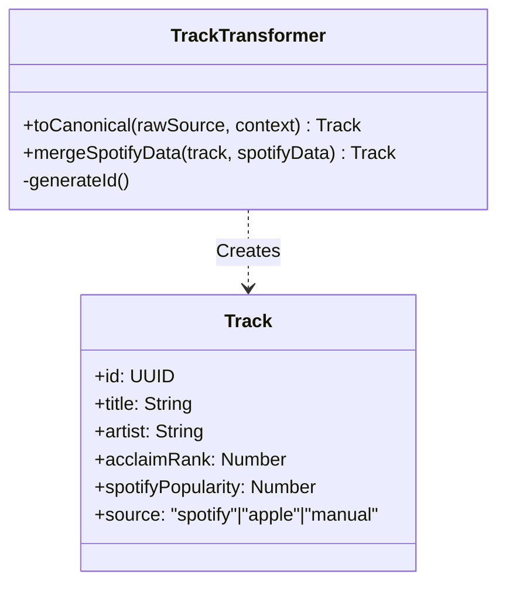

# Deep Dive: Frontend Infrastructure & Utilities

This document analyzes the "Plumbing" of the frontend: The utilities, transformers, and workers that power the application.

## 1. Web Workers & Performance
### Search Worker (`public/js/workers/search.worker.js`)
*   **Role**: Offloads heavy fuzzy search operations from the main thread.
*   **Tech Stack**: `uFuzzy` (Micro-library for fuzzy search).
*   **Flow**:
    1.  Fetches `albums-autocomplete.json` on init.
    2.  Builds a "Haystack" of strings (`Artist - Album`).
    3.  Receives `postMessage` query -> Returns Top N matches sorted by year.
*   **Why**: Ensures smooth UI interactions even when searching 1000+ albums.

---

## 2. Security & DOM Manipulation
### SafeDOM (`public/js/utils/SafeDOM.js`)
*   **Role**: A lightweight, ergonomic wrapper for `document.createElement`.
*   **Security**: **ZERO `innerHTML` usage**. All text is set via `textContent` or text nodes, eliminating XSS vectors by design.
*   **API**: Fluent interface (`SafeDOM.div({ className: 'foo' }, [children])`).
*   **SVG Support**: Dedicated namespace handling for SVG creation (`SafeDOM.svg`, `SafeDOM.path`).

### escapeHtml (`public/js/utils/stringUtils.js`) - v5.0 (F59)
*   **Role**: The one way text from outside the code goes into an HTML string (a template given to `innerHTML`, `outerHTML`, `insertAdjacentHTML` or `SafeDOM.fromHTML`). Outside text: names of albums, tracks, artists, series, playlists and batches, inventory notes, the message of an error, a provider's addresses and ids, anything read from the URL.
*   **What it does**: A pure function, no DOM. `null` and `undefined` give `''`; any other value is turned into its text; then `&`, `<`, `>`, `"` and `'` become `&amp;`, `&lt;`, `&gt;`, `&quot;` and `&#39;`.
*   **Where it is safe**: Element content and a **quoted** attribute value: `<h3 title="${escapeHtml(name)}">${escapeHtml(name)}</h3>`.
*   **Where it is not enough**: An attribute with no quotes, a URL scheme (`href="javascript:..."`), text inside `<script>` or inside an inline handler (`onclick="f('${x}')"`).
*   **Where it must not be used**: A text node, `textContent`, `setAttribute`, a `SafeDOM` child or prop. They take plain text; escaping there shows `&amp;` on screen. Stored names are plain too (`models/text.js` undoes old stored entities), so a name with `&` is escaped once, when drawn, and shows as `&`.
*   **No second helper**: `FilterToolbar.escapeHtml` and `RegeneratePanel.escapeHtml` call this one.
*   **Tests**: `test/utils/escapeHtml.test.js` (the function), `test/security/outsideTextIsText.test.js` (17 renderers drawn with a name such as ``), `test/architecture/outsideTextEscaped.test.js` (fitness: an HTML template that interpolates a field named `title`, `name`, `artist`, `message`... without `escapeHtml` fails; text written in the code is listed there).

---

## 3. Data Normalization
### TrackTransformer (`public/js/transformers/TrackTransformer.js`)
*   **Role**: The "Universal Adapter" for track data.
*   **Concept**: Converts disparate data shapes (Spotify API, Apple Music Kit, Firestore DB, Legacy JSON) into a strict **Canonical Track** format.
*   **Key Properties**:
    *   `acclaimRank` vs `spotifyRank` (Clear separation of authorities).
    *   `id`: Uses `crypto.randomUUID()` fallback.
    *   `metadata`: Preserves original source data for debugging.
*   **Methods**:
    *   `toCanonical(raw, context)`: The factory method.
    *   `mergeSpotifyData(track, spotifyData)`: Late-binding enrichment.

### Transformer Class Diagram

---

## 4. Task Queue (`public/js/utils/TaskQueue.js`) - v4.0
*   **Role**: runs async tasks with a limit of tasks at once, a priority (per task or per group), a deadline per task, cancellation, and a pause (`pause()`, `resume()`, `paused`; F52): a paused queue starts no new task and is not idle while tasks wait.
*   **Contract**: a task is `({ signal }) => Promise`. The signal is aborted at the deadline or when the queue is cancelled. Errors have names: `TaskTimeoutError`, `TaskCancelledError`.
*   **Boundary**: it imports nothing from the project. The album load uses three queues: catalog searches (3), quick sources (6) and ratings (4).

---

## 4b. Retry (`public/js/utils/retry.js`) - v4.0 (F48)
*   **Role**: calls again after a failure that may pass, with growing waits and jitter (pattern `DP-23`).
*   **`retryWithBackoff(attempt, { retries, baseMs, capMs, shouldRetry, pause, random, onRetry })`**: up to `retries` new attempts; the caller says which failures may pass (`shouldRetry`); when it gives up it throws the last real error.
*   **`backoffWaitMs(n, …)`**: the wait before new attempt `n` is `min(capMs, baseMs × 2^n)`, of which the upper half is drawn, so it stays between half the step and the whole step.
*   **Boundary**: it imports nothing from the project. Used by `api/client.js` for `POST /api/generate`. `CatalogAdapter` keeps its own fixed list of waits for Apple Music.

---

## 5. Other Utilities
*   **`stringUtils.js`**: String similarity and album keys, and `escapeHtml` (section 2).
*   **`dom-helpers.js`**: Low-level DOM traversal/manipulation helpers.
*   **`SvgGenerator.js`**: Dynamic SVG generation (likely for placeholders or dynamic icons).

### `utils/duration.js`
`formatDuration(seconds)` is the one formatter of a track duration: "m:ss", "h:mm:ss" from one hour on, and "--:--" when there is none. Durations are kept in **seconds** everywhere (`models/Track.js`; `services/musickit/MusicKitCatalog.js` converts Apple's milliseconds). Used by the ranking window and the track table. `TrackRow.formatDuration` and `PlaylistGrid.calculateDuration` still format on their own (also in seconds).

### `utils/reloadApp.js`
`reloadApp()` starts the app again from `/home` in a fresh page. Called after sign-out (`components/navigation/AuthNav.js`), so nothing of the person who left stays in memory or on screen.
