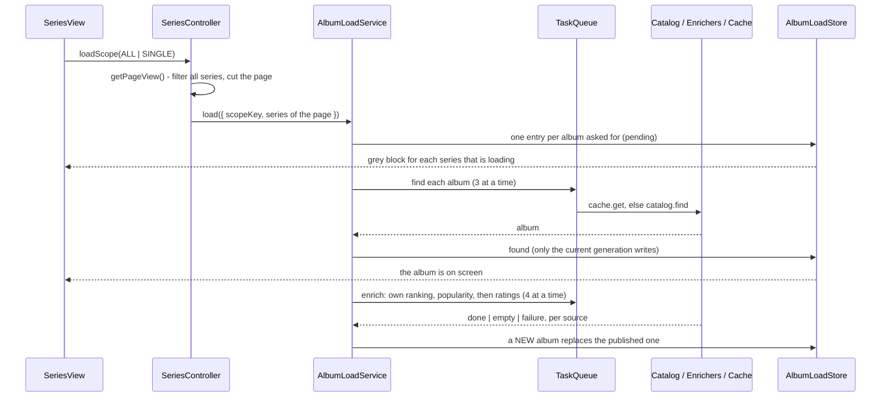

# Deep Dive: State Management & Core Integrations (Gap Fill)

This document fills the remaining gaps in the "Brain" and "Data" layers, specifically covering the primary Controller, Data Models, and the Album Store/Cache internals.

## 1. The Controller Layer

### Series Controller (`public/js/controllers/SeriesController.js`)
*   **Role**: translates what the Albums screen wants into requests. It replaced the legacy `AlbumsStateController`, whose file was removed in v4.0 (F48).
*   **What it does**:
    1.  **Scope**: ALL series (the hub) or a SINGLE series.
    2.  **Page view** (`getPageView`): sorts the series, filters them with `models/seriesFilter.js`, and cuts the result to the current page with `models/paging.js`. The filter runs over every series, then the page is cut; never the other way round.
    3.  **Load request** (`requestLoad`): hands the series of the page to `AlbumLoadService.load`. It can be called again at any time; the service keeps what it has.
    4.  **Paging state**: `page`, `pageSize` (10 to 100) and `pagingMode` (`pages` or `scroll`), the last two kept in `localStorage`.
    5.  **Subscriptions**: `init` runs on every visit, so it first ends the subscriptions of the previous visit. When the screen closes, `SeriesView.destroy` calls `detachView`, which ends them at once: the controller lives for the whole session and must not draw into a screen that is gone. The load itself goes on in the service.
    6.  **Own ranking**: `saveRanking(album, rankings)` is what the ranking modal reports to. It saves through `OwnRankingService` and then asks `AlbumLoadService.refreshSource(album.id, 'userRanking')`, so only that source of that album is read again, at once: it does not wait for the album's other sources (each source puts its answer on the newest album through `apply`, and only the latest ask of a source writes). The 'My Ranking' filter (`getOwnRankedKeys`) answers for every series: the list of ranked albums is read once (`OwnRankingService.ensureLoaded`, when the filter is chosen) and matched to the album queries by `models/ownRanking.js`.
    7.  **Albums not checked yet**: with a source filter on (`pending`, `acclaim`, `popularity`), `getPageView` counts the queries with no `facts` in the scope on screen (`paging.unchecked`); the pager shows the notice.
    8.  **Names shown plain**: `getScreenSeries` undoes HTML entities left in a stored series name (UAT-180).
*   **What it no longer does** (since v4.0): it has no load loop, no `AbortController`, no "is loading" flag of its own, and it does not write albums to Firestore. Loading belongs to `AlbumLoadService`.

### Album load sequence (v4.0)

### Where the load lives (v4.0)
| File | Responsibility |
| :--- | :--- |
| `services/albums/AlbumLoadService.js` | The one owner of the load: generations, reconciliation, find then enrich, retry. Imports no network, Firestore or screen. |
| `services/albums/albumLoading.js` | Puts the service together with its real sources, and projects the load store into `stores/albums.js`. |
| `services/albums/adapters/CatalogAdapter.js` | Apple Music (by the chosen edition id, else by name), with the server `/api/generate` only when Apple has no such album. Since F55, slice 1, both are checked by the one identity rule: an id that leads to another album is not obeyed (the album is searched by name, and `metadata.replacedSourceId` says which id was not used), and the search by name takes only the album asked for among its results. Since slice 2: the album carries `metadata.identityReason` (the reason of the rule it was accepted by); a title the catalog only has with a subtitle is accepted by the rule's second tier; a stored id that leads to such an album is not believed alone (the search decides); and `SeriesFactsService` writes the new id back to the series. Retries Apple with growing waits. |
| `services/albums/adapters/enrichers.js` | Ratings, popularity and the person's own ranking; each returns a new album. |
| `services/albums/adapters/AlbumCacheAdapter.js` | One record per album query: the base album and one status per source. Since F55, slice 2, a read drops a record that is not the album the query asks for. |
| `utils/TaskQueue.js` | Concurrency limit, priority, deadline per task, cancellation. Knows nothing about albums. |
| `stores/albumLoad.js` | The one owner of "album asked for -> album and its load state". Pure state. |

## 2. The Data Models (`public/js/models/`)

### Pure rules of the albums screen (v4.0)
No DOM, no store, no service: each imports only other models (checked by `test/architecture/`).

| File | What it decides |
|---|---|
| `albumQuery.js` | The one reader and the one writer of an album query. `parseAlbumQuery` reads "Artist - Title" or `{ artist, title }` and undoes HTML entities left in stored text; `plainAlbumQuery` is what a catalog is asked with; `toAlbumQuery(album)` is the shape a series stores for an album the person picked (Home, edit series), always plain text. `parsePastedAlbumLine(line)` (F63) reads one line of the Home's pasted list: it is `parseAlbumQuery` plus what only a pasted line has (a list marker, an en or em dash or a tab as the separator, a space missing on one side of the hyphen) and answers `{ ok, artist, title }` or `{ ok: false, problem }`. |
| `bulkPaste.js` | The pasted list of the Home as data (F63), pure: `readPastedList(text)` (the lines that are albums and the skipped ones, with the line number and the reason), `bulkInputState(text)` (`empty`, `valid`, `invalid`), `toStagedAlbum(match)` and `bulkOutcome({ added, skipped })` (the toast, the report under the box and what stays in the box). |
| `text.js` | `decodeEntities`: undoes the common HTML entities of a stored text (`&amp;`, `&lt;`, `&#39;`, numeric ones), also when escaped more than once. Rule: text is stored and compared plain; escaping belongs to drawing an HTML template, never to the data and never to a text node. |
| `albumLoadState.js` | The states of an album and of a series, and `queryKey`: the same query gives the same key, whether stored with `&amp;` or with `&`. |
| `seriesFilter.js` | The filters over the album queries of every series; `countUnchecked` and `readsFacts` say how many queries a source filter cannot answer for yet. |
| `ownRanking.js` | Which queries the person has ranked. A ranking is stored under the id of the album that was loaded, a series stores what was asked: they are matched by name written the same way on both sides (case, accents, punctuation, "&" and "and", HTML entities and the edition note do not count), and by id when the ranking has no names. A loaded album that carries a ranking is matched exactly. |
| `paging.js`, `albumFacts.js` | Pages of series (10 to 100); the facts a series keeps about each album. |

### Album Model (`Album.js`)
*   **Role**: The canonical representation of an Album.
*   **Key Distinction**: Supports **Dual-Tracklists**.
    *   `tracksOriginalOrder`: The disk order (1..N).
    *   `tracks` (or `tracksByAcclaim`): The sorted order based on ranking.
*   **User Ranking (Sprint 20)**: Implements `setUserRankings(rankings)` to inject personal track order across both tracklists simultaneously, ensuring UI consistency.
*   **Integrity**: `ensureRankingIntegrity()` ensures that if external ranking data is missing, the model falls back to using the Original Order as the "Ranking" to prevent crashes in the Algorithm layer.

### The album asked for (`askedAlbum.js`) - v5.0 (F55, slices 1 and 2)
*   **Role**: the app's side of the one rule that says "this is the album that was asked for" (`shared/albumIdentity.js`, described in `23_Shared_Code.md`).
*   **Problem it closes (UAT-184)**: a series asked for "Stone Temple Pilots - Core" and the screen showed "Shangri-La Dee Da". The model it replaced, `AlbumIdentity.js`, gave a confidence score from 0 to 1 in which the right artist alone was enough to pass.
*   **What it has**:
    *   `askedAlbum(query)`: what a stored query asks for, `{ artist, title, year }` (read through `albumQuery.js`, so HTML entities are already undone).
    *   `appleCandidate`, `spotifyCandidate`, `localCandidate`: what each source gives back, read into the same three fields.
    *   The rule itself, re-exported: `compareAlbumIdentity`, `compareKeptAlbum`, `pickAlbum`, `Verdict`, `Reason`.
    *   Slice 2: `keptAlbum(album)` reads an album the app keeps (an `Album`, or the plain data of a cache record) into `{ artist, title, year, identityReason }`; `indexOfQueryFor(albumQueries, album)` says which query of a series asked for the album on screen (the album's own title before a query it is only an edition of); `alreadyAskedFor(albumQueries, album)` says whether a series already asks for that very title; `identityNotice(album)` is the one line the album card shows for an album accepted by the second tier, or `null`.
*   **Who uses it**: `CatalogAdapter` and `api/client.js` (Apple Music, the AI answer), `SpotifyService`, `OptimizedAlbumLoader`, the read-only count (`services/albums/albumIdentityAudit.js`) and, since slice 2, `AlbumCacheAdapter` (a record is checked when it is read), `SeriesService` (adding and removing an album) and `AlbumCardRenderer` (the notice). A fitness test (`test/architecture/albumIdentityRule.test.js`) fails when one of them stops asking the rule, compares texts by itself, or grants the second tier by itself.

### Playlist Model (`Playlist.js`)
*   **Role**: Lightweight DTO for generated playlists.
*   **Features**:
    *   `getDuration()`: Calculates total seconds.
    *   `getDurationMinutes()`: Returns float minutes.
    *   Ensures all children are hydrated `Track` instances.

## 3. Store & Cache Internals

### Album Load Store (`public/js/stores/albumLoad.js`) - v4.0
*   **Role**: the one owner of which albums a series has and where each one is in the load.
*   **Shape**: per series, one entry per album query: `{ key, seriesId, query, status, album, error, enrichment }`.
    *   `status`: `pending`, `finding`, `found`, `failed` (with `error.reason`: `not-found`, `timeout` or `network`), `cancelled`.
    *   `enrichment`: one status per source (`acclaim`, `popularity`, `userRanking`): `pending`, `loading`, `done`, `empty`, `failed`. "The source has nothing" (`empty`) is never the same as "the source failed".
*   **Series state is derived, never stored** (`models/albumLoadState.js`, `deriveSeriesState`): `loading`, `complete`, `failed` (nothing loading and at least one album failed) or `empty`.
*   **Notices are grouped**: several changes in the same tick give one notice. `subscribe` returns the function that ends the subscription.

### Albums Store (`public/js/stores/albums.js`)
*   **Role**: the shelf the other screens read (`getAlbums`, `getAlbumsForSeries`). Since v4.0 it is a projection of the load store, written through `setAlbumsBySeries` by `services/albums/albumLoading.js`.
*   **Still true**: `albumsByAlbumSeriesId` keeps the albums per series, and `ALL_SERIES_VIEW` holds the albums of every series on screen.
*   **State only** (F48): the store imports no Firestore. `saveToFirestore`, `loadFromFirestore` and `updateAlbum(db, album)` were removed; "Refetch Metadata" writes the shared album document through `repositories/SharedAlbumRepository.js` (see [07_Frontend_Data_Infra.md](07_Frontend_Data_Infra.md)). The fitness function in `test/architecture/albumLoadBoundaries.test.js` fails if the store imports Firestore again.

### Album Load Cache (`public/js/services/albums/adapters/AlbumCacheAdapter.js`) - v4.0
*   **Storage**: `CacheManager` (memory + IndexedDB `mjrp-cache`), keys `albumload:v1:<album query>`, 7 days.
*   **Record**: `{ album, enrichment: { <source>: { status, at } } }`. The base album is saved as soon as it is found; each source adds its own status later.
*   **Rules**: an `empty` answer is trusted for 1 hour only; a failure is never saved; the person's own ranking is never saved with the album; every read gives a new `Album`.
*   **A record is valid only while it is the album asked for** (F55, slice 2): the key is the query, so a record written when "the right artist was enough" may hold another album. `get` asks the identity rule (`compareKeptAlbum`) and forgets a record that does not pass, so the album is searched again; a record of the title with a subtitle stays only when it carries `metadata.identityReason = 'title-before-subtitle'`. No record version was changed: a record that passes keeps its ratings. `peek` reads without dropping anything.

### Legacy Album Cache (`public/js/cache/albumCache.js`)
*   **Status**: still used by `apiClient.fetchAlbum`, which the Blending Menu and the playlist edit mode call. The Albums screen no longer uses it. Since F55, slice 2, `fetchAlbum` uses an entry only while it is the album the query asks for (`_keptAlbumAskedFor`); another album is invalidated and searched again.
*   **Keys**: `album:<artist - title>` in IndexedDB, plus a 7-day window that still reads old `localStorage` entries. An entry found in `localStorage` is copied to IndexedDB; it is **not** deleted from `localStorage`.
*   **TTL**: 7 days.
