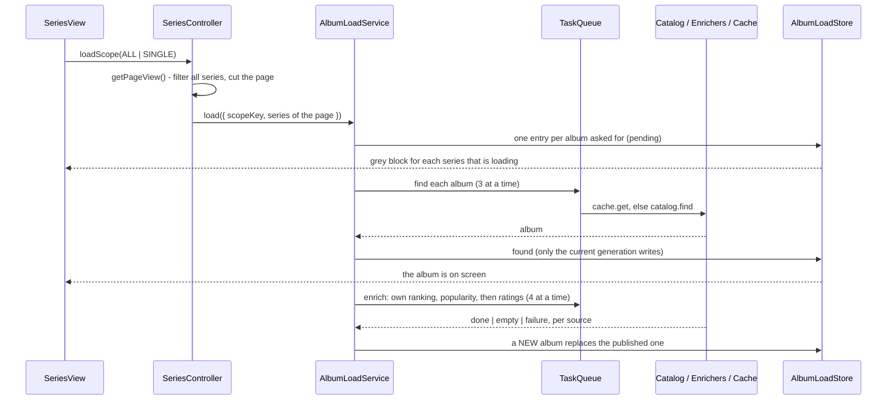

# Deep Dive: State Management & Core Integrations (Gap Fill)

This document fills the remaining gaps in the "Brain" and "Data" layers, specifically covering the primary Controller, Data Models, and the Album Store/Cache internals.

## 1. The Controller Layer

### Series Controller (`public/js/controllers/SeriesController.js`)
*   **Role**: translates what the Albums screen wants into requests. It replaced the legacy `AlbumsStateController`, whose file was removed in v4.0 (F48).
*   **What it does**:
    1.  **Scope**: ALL series (the hub) or a SINGLE series.
    2.  **Page view** (`getPageView`): sorts the series, filters them with `models/seriesFilter.js`, and cuts the result to the current page with `models/paging.js`. The filter runs over every series, then the page is cut; never the other way round.
    3.  **Load request** (`requestLoad`): hands the series of the page to `AlbumLoadService.load`. It can be called again at any time; the service keeps what it has.
    4.  **Paging state**: `page`, `pageSize` (10 to 100) and `pagingMode` (`pages` or `scroll`), the last two kept in `localStorage`.
    5.  **Subscriptions**: `init` runs on every visit, so it first ends the subscriptions of the previous visit.
*   **What it no longer does** (since v4.0): it has no load loop, no `AbortController`, no "is loading" flag of its own, and it does not write albums to Firestore. Loading belongs to `AlbumLoadService`.

### Album load sequence (v4.0)

### Where the load lives (v4.0)
| File | Responsibility |
| :--- | :--- |
| `services/albums/AlbumLoadService.js` | The one owner of the load: generations, reconciliation, find then enrich, retry. Imports no network, Firestore or screen. |
| `services/albums/albumLoading.js` | Puts the service together with its real sources, and projects the load store into `stores/albums.js`. |
| `services/albums/adapters/CatalogAdapter.js` | Apple Music (by the chosen edition id, else by name), with the server `/api/generate` only when Apple has no such album. Retries Apple with growing waits. |
| `services/albums/adapters/enrichers.js` | Ratings, popularity and the person's own ranking; each returns a new album. |
| `services/albums/adapters/AlbumCacheAdapter.js` | One record per album query: the base album and one status per source. |
| `utils/TaskQueue.js` | Concurrency limit, priority, deadline per task, cancellation. Knows nothing about albums. |
| `stores/albumLoad.js` | The one owner of "album asked for -> album and its load state". Pure state. |

## 2. The Data Models (`public/js/models/`)

### Album Model (`Album.js`)
*   **Role**: The canonical representation of an Album.
*   **Key Distinction**: Supports **Dual-Tracklists**.
    *   `tracksOriginalOrder`: The disk order (1..N).
    *   `tracks` (or `tracksByAcclaim`): The sorted order based on ranking.
*   **User Ranking (Sprint 20)**: Implements `setUserRankings(rankings)` to inject personal track order across both tracklists simultaneously, ensuring UI consistency.
*   **Integrity**: `ensureRankingIntegrity()` ensures that if external ranking data is missing, the model falls back to using the Original Order as the "Ranking" to prevent crashes in the Algorithm layer.

### Album Identity (`AlbumIdentity.js`)
*   **Role**: Solves the "Fuzzy Match Problem".
*   **Problem**: User saves "Pink Floyd - Dark Side". API returns "Pink Floyd - The Dark Side of the Moon (2011 Remaster)". Are these the same?
*   **Solution**:
    *   Calculates a **Confidence Score** (0.0 - 1.0) using string similarity algorithms.
    *   Stores `originalQuery` (User Intent) vs `resolvedTitle` (API Reality).
    *   Used by `CatalogAdapter` to check that what Apple Music found by name is the album asked for. The cache does not use it: the cache key is the album query.

### Playlist Model (`Playlist.js`)
*   **Role**: Lightweight DTO for generated playlists.
*   **Features**:
    *   `getDuration()`: Calculates total seconds.
    *   `getDurationMinutes()`: Returns float minutes.
    *   Ensures all children are hydrated `Track` instances.

## 3. Store & Cache Internals

### Album Load Store (`public/js/stores/albumLoad.js`) - v4.0
*   **Role**: the one owner of which albums a series has and where each one is in the load.
*   **Shape**: per series, one entry per album query: `{ key, seriesId, query, status, album, error, enrichment }`.
    *   `status`: `pending`, `finding`, `found`, `failed` (with `error.reason`: `not-found`, `timeout` or `network`), `cancelled`.
    *   `enrichment`: one status per source (`acclaim`, `popularity`, `userRanking`): `pending`, `loading`, `done`, `empty`, `failed`. "The source has nothing" (`empty`) is never the same as "the source failed".
*   **Series state is derived, never stored** (`models/albumLoadState.js`, `deriveSeriesState`): `loading`, `complete`, `failed` (nothing loading and at least one album failed) or `empty`.
*   **Notices are grouped**: several changes in the same tick give one notice. `subscribe` returns the function that ends the subscription.

### Albums Store (`public/js/stores/albums.js`)
*   **Role**: the shelf the other screens read (`getAlbums`, `getAlbumsForSeries`). Since v4.0 it is a projection of the load store, written through `setAlbumsBySeries` by `services/albums/albumLoading.js`.
*   **Still true**: `albumsByAlbumSeriesId` keeps the albums per series, and `ALL_SERIES_VIEW` holds the albums of every series on screen.
*   **State only** (F48): the store imports no Firestore. `saveToFirestore`, `loadFromFirestore` and `updateAlbum(db, album)` were removed; "Refetch Metadata" writes the shared album document through `repositories/SharedAlbumRepository.js` (see [07_Frontend_Data_Infra.md](07_Frontend_Data_Infra.md)). The fitness function in `test/architecture/albumLoadBoundaries.test.js` fails if the store imports Firestore again.

### Album Load Cache (`public/js/services/albums/adapters/AlbumCacheAdapter.js`) - v4.0
*   **Storage**: `CacheManager` (memory + IndexedDB `mjrp-cache`), keys `albumload:v1:<album query>`, 7 days.
*   **Record**: `{ album, enrichment: { <source>: { status, at } } }`. The base album is saved as soon as it is found; each source adds its own status later.
*   **Rules**: an `empty` answer is trusted for 1 hour only; a failure is never saved; the person's own ranking is never saved with the album; every read gives a new `Album`.

### Legacy Album Cache (`public/js/cache/albumCache.js`)
*   **Status**: still used by `apiClient.fetchAlbum`, which the Blending Menu and the playlist edit mode call. The Albums screen no longer uses it.
*   **Keys**: `album:<artist - title>` in IndexedDB, plus a 7-day window that still reads old `localStorage` entries. An entry found in `localStorage` is copied to IndexedDB; it is **not** deleted from `localStorage`.
*   **TTL**: 7 days.
