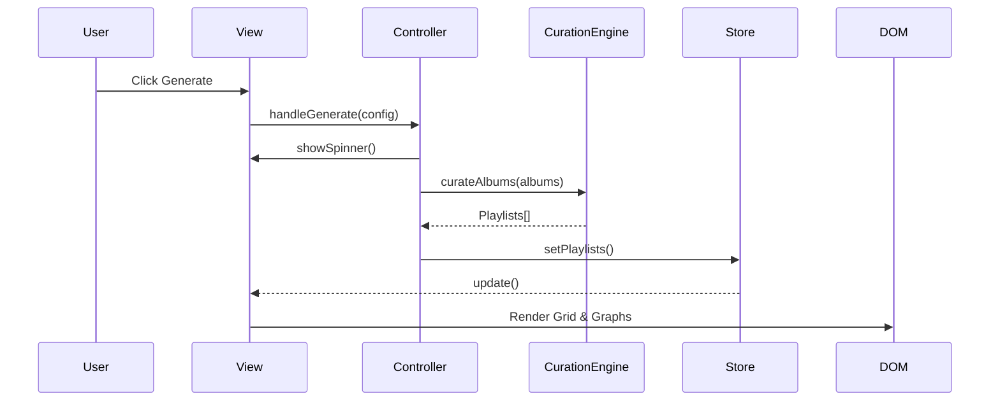
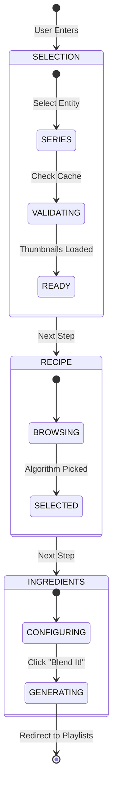

# Frontend Views Analysis

> **Deep Dive Enrichment**: This document details the View Layer architecture, specifically the MVC patterns, Renderers, and Helper strategies used to build the UI.

## 1. Core Architecture
**Status**: `[ACTIVE]`

*   **`BaseView.js`**: *(removed in F83: the tab title is written by `react-bridge/useScreenTitle.ts`)*
    *   **Role**: Abstract Base Class.
    *   **Key Behavior**:
        *   `mount()`: Called after DOM insertion.
        *   `destroy()`: Called before removal. Auto-cleans up event listeners registered via `this.on()`.
        *   `$delegate`: Utility for efficient event delegation (e.g., clicking items in a large grid).

---

## 2. Main Views (Deep Dive)

### 2.1 Inventory System: `views/InventoryView.js` *(F83: now `screens/inventory/Inventory.tsx`)*
**Status**: `[ACTIVE]`
**Pattern**: MVC (View + Controller + Store)
**Dependencies**: `InventoryController`, `inventoryStore`, `InventoryGridRenderer`

*   **Purpose**: Manages the user's collection, providing filtering, searching, and CRUD status updates.

*   **Logic Trace**:
    1.  **Mounting**:
        *   Subscribes to `inventoryStore` updates -> triggers `render(state)`.
        *   Calls `controller.initialize()` to fetch initial data.
    2.  **Rendering (`render`)**:
        *   Shows the Header Stats the controller computed (`renderTitleRow`): "N albums", the three counts "✓ n Owned", "n Not Owned", "♡ n Wishlist" (F71), which are buttons that filter by status (F75, REQ-02). Under the title, the totals strip (`renderTotals`, `views/renderers/InventoryValueHeader.js`): "Estimated value of what I own", "To buy the rest" and the four currencies (F75); then the notices of the values (`renderNotices`). Since F83 this is `screens/inventory/Totals.tsx` and `screens/inventory/Notices.tsx` (React).
        *   Renders Filters (Search, Format; the status select left the row in F75), the button "Update values" while the Discogs values are on (F75; `renderUpdateValues`, `showValues` draws a run in place), the order select `#inventorySort` (each criterion in both directions: "Artist (A-Z)", "Artist (Z-A)", "Avg Rating (↓)", "Avg Rating (↑)", "Avg Pop (↓)", "Avg Pop (↑)", "Value (↓)", "Value (↑)", "Newest", "Oldest"; F71, S-56; F75), the button "Add the albums of my series" (F71; `renderAddSeriesAlbums`, `showSeriesAdd` for its busy state) and the button "Update ratings" (S-56; `renderUpdateRatings`, `showRatings`; the two buttons lock each other while one runs). `destroy()` (called by the router when the person leaves) drops the ask for the ratings (`controller.dispose()`).
        *   Delegates Grid rendering to `InventoryGridRenderer` (Pure HTML String generation for performance).
    3.  **Event Handling**:
        *   Uses **Event Delegation** on `#inventory-grid-container`.
        *   Intercepts clicks on `.view-album-btn`, `.edit-album-btn`, `.delete-album-btn`.
        *   Routes logic to `controller.handleDelete`, `controller.handleUpdate`, etc.

*   **Architecture Diagram**:
```mermaid
flowchart Trip
    Store[InventoryStore] -- Notify --> View[InventoryView]
    View -- Render --> DOM
    DOM -- Click Event --> View
    View -- Delegate --> Controller[InventoryController]
    Controller -- CRUD --> API
    API -- Success --> Store
```

#### No celular
Até 767 px de largura (`isPhone()`); a tela de computador não muda. As regras estão em `docs/specs/behavior.md` § No celular e as telas em `docs/specs/info-arch.md` § O celular (F76).

*   **Lista em linhas.** `InventoryView` escolhe entre `renderComputer` (o cartão de cinco linhas, igual ao de antes) e `renderPhone`. No celular cada álbum é uma linha (`views/renderers/InventoryPhoneRow.js`): capa, título, artista, valor com a origem, status, as duas médias e «⋯». Tocar na linha abre a janela do álbum. Since F83 this is `screens/inventory/phone/PhoneRow.tsx` (React).
*   **De 50 em 50.** A lista desenha 50 linhas (`PHONE_CHUNK` em `models/inventoryJump.js`) e termina com «Show 50 more». O botão «A–Z» da barra presa salta para uma letra de artista (ou, em outra ordem, para um trecho de 25 posições).
*   **Folhas.** O status, o «⋯» do álbum, «Filters and order», «Collection actions», o salto e «About the values» abrem como folha de baixo (`views/InventoryPhoneSheets.js`). Os totais ficam em duas linhas; a moeda é um controle de quatro opções. Since F83 this is `screens/inventory/phone/Sheets.tsx` (React).
*   **Para mudar o status:** tocar na pílula de status da linha, escolher na folha. Para editar ou remover: «⋯» da linha.

### 2.2 Playlist Generator: `views/PlaylistsView.js` *(F83: now `screens/playlists/Playlists.tsx`)*
**Status**: `[ACTIVE]`
**Pattern**: Complex Interactive/Stateful View
**Dependencies**: `PlaylistsController`, `playlistsStore`, `PlaylistsGridRenderer`

*   **Purpose**: The "Workbench" for creating, viewing, and editing playlists. Handles both "New Batch" and "Edit Batch" modes.

*   **Logic Trace**:
    1.  **Initialization**:
        *   Checks `playlistsStore.isEditingExistingBatch()` to determine mode.
        *   `Mount`: Sets up `PlaylistsDragHandler` for drag-and-drop song reordering.
    2.  **Generation Flow**:
        *   User selects `Algorithm` (e.g., Balanced Cascade) and `RankingStrategy`.
        *   Click `Generate` -> `controller.handleGenerate()`.
        *   **Overlay**: Shows "Generating..." spinner during async work.
    3.  **Edit Mode**:
        *   If editing, header shows "Edit Playlist Batch" and locks series selection.
        *   "Regenerate Panel" allows tweaking settings for the *current* batch without losing context.
    4.  **Export**:
        *   Provides integrations for Spotify (OAuth), JSON, and Apple Music.

*   **Visual Logic**:


#### No celular
Até 767 px de largura (`isPhone()`); a tela de computador não muda. As regras estão em `docs/specs/behavior.md` § No celular e as telas em `docs/specs/info-arch.md` § O celular (F76).

*   **Uma playlist por vez.** `/playlists` mostra fichas no topo, uma por playlist («n · Nome», faixas e duração); a aberta rola com a página (`components/playlists/PhonePlaylists.js`). O nome do lote, com Undo e Redo, fica numa linha. Since F83 this is `screens/playlists/PhoneParts.tsx` (React).
*   **Faixas.** Cada faixa tem a posição (é a alça de arrastar) e um «⋯». Para mover ou remover: «⋯» abre a folha da faixa (Move up, Move down, Move to the top, Move to the end, «Move to another playlist», «Remove from this playlist»). Remover mostra «Undo» por 6 segundos; apagar a playlist inteira pergunta antes.
*   **Gravar e exportar.** A barra de ação tem «Export» (folha com Spotify, Apple Music e JSON) e «Save». O painel «Reconfigure your Music Playlist Blend» abre pelo «⋯» da playlist.

### 2.3 Series Browser: `views/SeriesView.js` (V3) *(F83: now `screens/albums/Albums.tsx` and `screens/albums/index.ts`)*
**Status**: `[ACTIVE]`
**Pattern**: "Thin View" / Orchestrator
**LOC**: ~350 (Refactored Sprint 19)

*   **purpose**: Browse albums grouped by Series.
*   **Refactor Note**: This view delegates logic to specialized components and helpers to maintain a thin orchestrator role.
*   **Sub-Components**:
    *   `SeriesHeader`: Page title and "Blend Your Albums" action button.
        *   **Responsive**: Uses `flex-col md:flex-row` to stack on mobile.
        *   **Blend Button**: Direct link to `/blend`. Checks for album count on click (Toast feedback), no longer strictly disabled.
    *   `FilterToolbar` [NEW]: Generic, state-driven toolbar handling Filters (Artist, Year, Source), Search, and Sort.
        *   **Filters read the series, not what is loaded** (v4.0): series, artist, year, source and search run over the album queries of every series (`models/seriesFilter.js`), so they answer the same on any page. The artist list comes from the series too.
        *   **The search field is drawn once** (v4.0): the other controls are redrawn only when what they show changes. Before, the whole toolbar was redrawn on each key and the field lost the cursor.
        *   **'My Ranking' reads every series** (v4.0): the list of ranked albums is read once and matched to the album queries by name; before, the filter only saw loaded albums.
        *   **Reusability**: Replaces the legacy `SeriesToolbar`, now shared with `SavedPlaylistsView`.
        *   **Sorting**: Supports "**Name (A-Z)**", "**Name (Z-A)**", "**# of Albums (↑)**", "**# of Albums (↓)**", "**Newest**", and "**Oldest**". Sorting logic is handled by `SeriesController.js`.
        *   **Labels**: Uses standardized labels like "**All Albums Series**" and "**All Playlist Series**" for consistency across views (Sprint 22).
    *   ~~`SeriesToolbar`~~: Removed (Sprint 22) - Replaced by `FilterToolbar`.
    *   ~~`SeriesProgressBar`~~: Removed (Sprint 21.5) - Skeletons provide visual feedback.
    *   `SeriesEmptyState`: Renders when the account has no series.
    *   `SeriesGridRenderer`: Responsible for the main content layout (Grid/List). It draws each series by its load state: a grey block while it is loading, the albums when they are found, and the notice "N albums did not load · Try again" when some failed. A series whose albums all failed stays on screen with the notice. In the grid of all the series it draws the first 12 albums of each series and the button "Load N more albums" (`ui/LoadMoreButton.js`); a series listed in `props.expandedSeriesIds` is drawn whole, with no button. The list layout and a single series have no cut.
    *   **Series opened whole** (v5.0, F49): the click on "Load N more albums" reaches `SeriesEventHandler` (`load-more-series`), which tells the view (`showAllAlbums`). The view keeps the choice in one `SeriesExpansion` (`models/seriesExpansion.js`), created with the view, and hands its list to the grid on every redraw; nothing is loaded again, since the load already asks for every album of the series on screen. The choice outlives redraws, pages and filters, is emptied when the scope changes, and goes away with the view.
    *   `Pager` (v4.0): how many series are shown out of how many, the series per page (10 to 100), and the two ways to move on: numbered pages, or a list that grows at its end. With a source filter on, it also says how many albums were never checked against the sources ("N albums have not been checked against the sources yet…"); with one series on screen it shows only that notice.
    *   **Ranking an album**: the card opens `UserRankModal`; the modal reports the save to the view (`onSaveRanking`), the controller saves and asks the load to read that album's ranking again. The view never touches the ranking repository, and the album on screen is replaced, not changed.
*   **Leaving the screen**: `destroy()` tells the controller to let go of the view (`detachView`). The album load goes on in `AlbumLoadService`; coming back shows the progress made.
*   **Helpers**:
    *   `SeriesViewUpdater` [NEW]: Handles DOM updates (Header, Grid, Toolbar) based on Controller state.
    *   `SeriesComponentFactory` [NEW]: Abstract Factory for instantiating Header, Toolbar, and Grid components with correct props.
    *   `SeriesModalsManager` [NEW]: Encapsulates logic for opening Edit/Delete modals and handling "Soft Reloads".

#### No celular
Até 767 px de largura (`isPhone()`); a tela de computador não muda. As regras estão em `docs/specs/behavior.md` § No celular e as telas em `docs/specs/info-arch.md` § O celular (F76).

*   **De cima para baixo.** Busca e «Filters» (a folha de `components/ui/FilterSheet.js`), fichas dos filtros ligados, depois as séries (`SeriesView`, `components/ui/AlbumPhoneCard.js`). O nome da série aberta vai para a barra do topo (`nameThisScreen`). *(F83: `FilterSheet.js` is now `ui/FilterToolbar.tsx`; `AlbumPhoneCard.js` is now `screens/albums/AlbumCard.tsx`)*
*   **Álbum.** Grade de duas colunas, ou uma linha por álbum na visão em lista. As ações (ver, ranquear, pôr no inventário, buscar de novo, abrir no Spotify, tirar da série) ficam na folha do «⋯» do álbum (`components/series/SeriesPhoneSheets.js`); editar e apagar a série, na folha do «⋯» da série. Since F83 this is `screens/albums/PhoneSheets.tsx` (React).
*   **Filtros.** «Filters» mostra quantos estão ligados; a folha tem a visão (Grid ou List), a ordem, os filtros e «Reload albums from the sources».
*   **Barras.** O cabeçalho da série fica preso sob a barra do topo. O pager de baixo tem «Page n of m», «Series per page» e Pages/Scroll.

### 2.4 Playlists History: `views/SavedPlaylistsView.js` *(F83: now `screens/saved-playlists/SavedPlaylists.tsx`)*
**Status**: `[ACTIVE]`
**Pattern**: Component-Driven View
**LOC**: ~325 (Refactored Sprint 19; the read moved out in v5.0, F61)

*   **Purpose**: Display saved playlists grouped by Series and Batches.
*   **Drawn once** (v4.0): `update()` draws the page the first time; after that it only updates the toolbar (`toolbar.update(toolbarProps())`) and brings the list up to date (`refreshContent`). Before, the whole page was rebuilt on every key and on every cover that arrived, which replaced the search field and took the cursor away (UAT-179).
*   **Waits for no read** (v5.0, F61): `mount()` subscribes to `SavedPlaylistsStore` (through the controller) and asks for the list; it does not wait. Each change of the store calls `update()`, and `refreshContent` keeps the node of every series group that did not change (`syncGroups`, `groupNodeOf`), so a group on screen does not move or close while the others arrive. A line above the list says what is being read; a failed series and a failed list each have a notice with "Try again". `destroy()` stops listening, so a late change draws nothing.
*   **Key Behavior**:
    1.  **Iterative Rendering**: Delegates rendering of complex data structures (Series -> Batches -> Playlists) to components.
    2.  **Lazy Drawing** (v5.0, F61): the playlists of a batch and the tracks of a playlist are built the first time the person opens them, not when the list is drawn.
*   **Sub-Components**:
    *   `SavedSeriesGroup` [NEW]: Standalone component for rendering a Series header and its batch container.
    *   `PlaylistDetailsModal` [NEW]: Reusable modal logic for viewing playlist track details.
    *   `SavedPlaylistCard`: Renders a full batch with cascade thumbnails and batch-level actions.
    *   `SavedPlaylistRow`: Renders individual playlists with track lists.
    *   `SavedPlaylistActions`: Centralizes action buttons for series, batches, and rows.


#### No celular
Até 767 px de largura (`isPhone()`); a tela de computador não muda. As regras estão em `docs/specs/behavior.md` § No celular e as telas em `docs/specs/info-arch.md` § O celular (F76).

*   **Séries fechadas.** As séries abrem fechadas, cada uma com o resumo na linha («n batches · n playlists»); a tela lembra as abertas (`components/playlists/SavedPlaylistsPhone.js`, `SavedSeriesGroup.js`). O lote mostra o nome legível (`components/playlists/batchNames.js`); o nome real é o usado ao editar e apagar. Since F83: `SavedPlaylistsPhone.js` is now `screens/saved-playlists/PhoneParts.tsx`; `batchNames.js` is now `screens/saved-playlists/listText.ts`.
*   **Folhas.** O «⋯» da série (Add playlists, Open the album series, apagar tudo) e o do lote (Edit batch, Delete batch) abrem folhas; apagar pergunta antes. Para ver as faixas de uma playlist: tocar nela, e abre a janela da playlist.
*   **Para exportar** um lote gravado: abrir com «Edit batch» e usar «Export» na barra de ação (a tela não tem exportação própria).

---

## 3. Strategies & Renderers

### Blending Wizard State Machine


### 3.1 `strategies/ViewModeStrategy.js` *(removed in F65: `ViewModeStrategy.js`)*

> **F65 (2026-11-19):** `ViewModeStrategy.js` was removed from the repository (nothing reached it from an entry point, or its screen was retired). Where this section describes the code of that file, it describes history; the code is in the git history.
**Purpose**: Toggles between specific rendering layouts (Compact Card vs Expanded Row) based on user preference, persisting to LocalStorage.

### 3.2 `views/renderers/InventoryGridRenderer.js` *(F83: now `screens/inventory/Grid.tsx` and `screens/inventory/ItemCard.tsx`)*
**Purpose**: Pure function that takes `state` and returns HTML strings.
**Why**: Performance. Generating thousands of DOM nodes individually is slower than `innerHTML` for large grids.
**Features**:
*   Money is written by `models/inventoryValue.js` (`moneyOf`, `formatMoney`); `formatPrice` and `renderPrice` left in F75: the card shows the estimated value, not the price paid.
*   `cardSurface(cardProps, valueBlock)` (F75): the Card of the app made into a surface, with the five lines of `views/renderers/InventoryCardValue.js` under the title. Since F83 this is `screens/inventory/CardValue.tsx` (React).
*   `renderCard(album)`: Generates the main card HTML with the Status selector (the status and its options come from `models/inventoryStatus.js`, F71). An item with no format shows no format badge and an item with no price shows no price (`renderPrice`). An item that has `averages` shows one small line, "Avg Rating: 78.4 · Avg Pop: 42.6%" (`renderAverages`, grid and list); an item that has none shows nothing, not a dash (F71, S-56).
