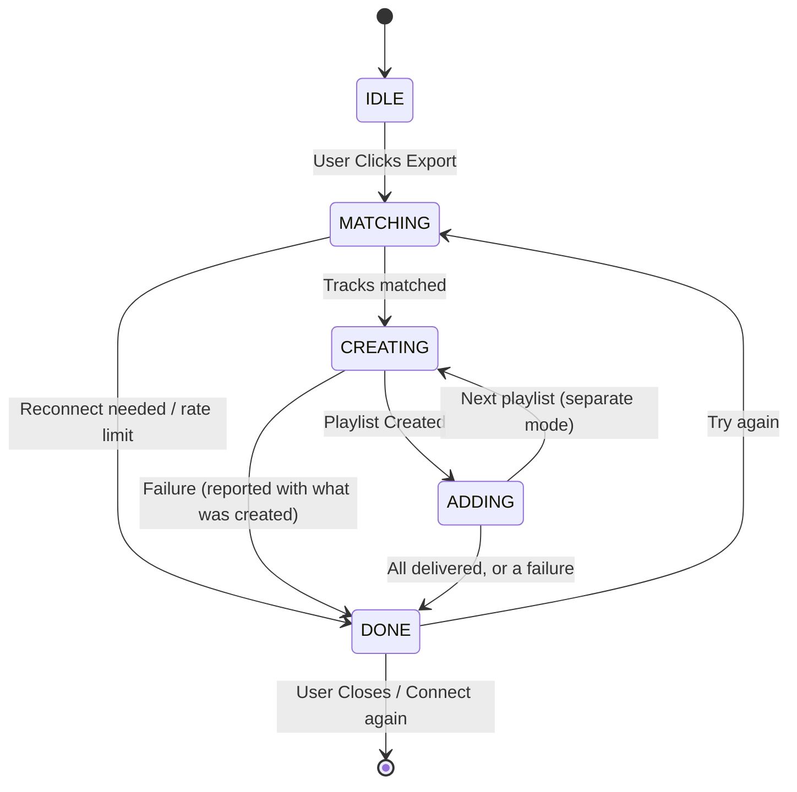

# Root Components Analysis

> **Scope**: Shared UI components located in `public/js/components/`.
> **Status**: All components in this directory are `[ACTIVE]` and use `SafeDOM` or native DOM methods (Legacy `innerHTML` usage is minimal/isolated).

## 1. App Shell & Navigation

### 1.1 `TopNav.js`
**Role**: Main Application Controller & App Shell.
**Dependencies**: `UserStore`, `navigation/SeriesDropdown.js`, `navigation/AuthNav.js`, `Icons.js`. It imports no database, cache or repository (F58) and is built with no argument (`new TopNav()`): the `MigrationUtility` it used to receive left in F65, with the migration screen.

*   **Logic Trace**:
    1.  **Auth Subscription**: Subscribes to `UserStore` to toggle between "Guest", "User", and "Admin" views.
    2.  **Mobile Drawer**: Manages a hidden sliding drawer (`translate-x-full`) for mobile viewports (< 768px).
    3.  **Data Sync**: removed in F65. The button was written and never drawn (UAT-11); `needsMigration`, `renderDataSyncLink` and `handleDataSync` are gone.
    4.  **Routing**: Uses `data-link` delegation for client-side navigation via `Router.js`.
    5.  **Account menu** (F63, `navigation/AuthNav.js`): the avatar is a button (`#userMenuBtn`, `aria-haspopup`, `aria-expanded`) that opens and closes the menu (`#userMenu`) on a click or a tap; a click outside and Escape close it (Escape gives the focus back to the avatar), and Arrow Down on the avatar opens it on the first item. It no longer opens by the mouse being over it. The listeners on the page are attached once per `AuthNav`, however many times the nav is drawn.
    6.  **"Soon" items** (F63, `navigation/SeriesDropdown.js`): By Artist, By Genre and By Track are shown in the "Music Series" menu and are not links.

### 1.2 `Footer.js`
**Role**: Static Footer & Debug Tools.
**Logic**:
*   Displays the Last Updated timestamp.
*   **Clear Cache** (v4.0, F48): calls the `clearCaches` function it receives in the constructor (`app.js` passes `clearAppAlbumCaches` from `services/albums/albumLoading.js`), shows "Cache Cleared!" and reloads the page after one second. That function stops the album load, clears the app cache (memory and the IndexedDB `mjrp-cache`: albums, ratings, the personal rankings that were read) and removes the old `album_cache_v…` entries of localStorage.
*   It no longer runs `localStorage.clear()`: the Spotify login, the saved series and the screen choices stay.
*   If the clearing fails, the footer says "Could not clear the cache" and does not reload.
*   The footer imports no service: what the button does is injected (`new Footer({ clearCaches, reload, reloadDelayMs })`).

### 1.3 `Breadcrumb.js`
**Role**: Dynamic Path Visualizer.
**Logic**:
*   Parses valid URL segments (`/albums`, `/ranking`, `/playlists`) to build a breadcrumb trail.
*   **UX**: Clicking a previous crumb triggers `Router.navigate()` (Back navigation).

#### No celular
Até 767 px de largura (`isPhone()`); a tela de computador não muda. As regras estão em `docs/specs/behavior.md` § No celular e as telas em `docs/specs/info-arch.md` § O celular (F76).

*   **Moldura.** `components/navigation/PhoneShell.js` põe na página, só no celular, a barra do topo (nome da tela e botão do menu), a barra de baixo com os cinco destinos (`phoneTabs.js`) e o «voltar ao topo». O `TopNav` e o `Footer` continuam na página e o CSS os esconde. O `app.js` liga a moldura com `startPhoneShell`.
*   **Para ir a outra tela:** a barra de baixo (Create, Albums, Blend, Playlists, Inventory). Tocar no destino atual leva ao topo. Para o resto: o botão do topo abre o menu (`PhoneMenu.js`), uma folha com a conta, as playlists novas, a ligação com o Spotify, «Clear album cache» e «Sign Out».
*   **Folha.** Toda janela do celular usa `components/ui/Sheet.js` (de tela cheia ou de baixo); as janelas antigas viram folha pela casca, e a página de trás é presa por `windowsHoldThePage.js`.

---

## 2. Interactive Widgets

### 2.1 `Autocomplete.js`

> **F65 (2026-11-19):** `Autocomplete.js` was removed from the repository (nothing reached it from an entry point, or its screen was retired). Where this section describes the code of that file, it describes history; the code is in the git history.
**Role**: Generic Typeahead Search.
**Props**: `{ loader, onSelect, placeholder }`
**Logic**:
*   **Debounce**: Waits 300ms after keystroke before querying.
*   **Dynamic Loader**: Delegates search logic to the provided `loader` object (Dependency Injection pattern).
*   **Artwork Handling**: Supports template strings (`{w}x{h}`) for responsive image fetching.

### 2.2 `SpotifyConnectButton.js`
**Role**: Standalone Auth Toggle.
**Logic**:
*   **Event Listener**: Listens to custom window event `spotify-auth-change` to update its own state decoupled from the parent view.
*   **Dual State**: Renders a "Connect" pill (Disconnected) or a "User Badge + Logout X" (Connected).

### 2.3 `Icons.js`
**Role**: Centralized SVG Registry (Lucide-style).
**Why**: Replaces inconsistent emojis/images with scalable, recolorable vectors.
**Usage**: `getIcon('Name', 'classes')` returns an SVG string.

### 2.4 `FilterToolbar.js` [NEW]
**Role**: Generic, Reusable Filter Bar.
**Used By**: `SeriesView` and `SavedPlaylistsView`.
**Features**:
*   **Search**: Fuzzy text search.
*   **Filters**: Supports multiple dropdown slots (render props pattern). Includes standardized options like "**All Albums Series**" and "**All Playlist Series**".
*   **Sort**: Standardized sort dropdown. Supports bidirectional sorting (e.g., "**# of Albums (↑/↓)**", "**Newest/Oldest**").
*   **View Toggles**: Integrated Grid/List view switching.
---

## 3. Feedback Systems

### 3.1 `Toast.js`
**Role**: Global Notification System.
**Replacements**: `alert()`, `console.warn()`.
**Logic**:
*   **Singleton Container**: Lazily creates `#toast-container` on first use.
*   **Animation**: CSS Transforms (`translate-x`) for slide-in/out effects.
*   **Auto-Dismiss**: Uses `setTimeout(4000)` with cleanup handles.

### 3.2 `GlobalProgress.js`
**Role**: "YouTube-style" Top Loading Bar.
**Logic**:
*   **Reference Counting**: Tracks `activeLoaders` count. Only hides when count reaches 0. Used by `SeriesService`; the album load does not use it.
*   **Z-Index**: `z-[9999]` ensures visibility over all modals and overlays.

### 3.3 `InlineProgress.js`

> **F65 (2026-11-19):** `InlineProgress.js` was removed from the repository (nothing reached it from an entry point, or its screen was retired). Where this section describes the code of that file, it describes history; the code is in the git history.
**Role**: In-flow Progress Bar for Batch Operations.
**Usage**: Used by `PlaylistsView` during generation.
**Logic**: Updateable `width` + `label`.

---

## 4. Modal Dialogs (SafeDOM)

### 4.1 `LoginModal.js`
**Purpose**: Auth Provider Selection.
**Providers**: Google (Firebase), Apple (Firebase), Guest (Anonymous).
**Error Handling**: Maps Firebase error codes (e.g., `auth/popup-closed-by-user`) to user-friendly Toast messages.

### 4.2 `SpotifyExportModal.js`
**Purpose**: The window of the export to Spotify. It runs `SpotifyExportService.exportPlaylists` and always ends on its report (F62).
**State Machine**:
1.  **IDLE**: User selects Name & Mode (Merge vs Separate). The text under the button follows the mode.
2.  **MATCHING**: the service finds the Spotify track of each track (the address the track carries, else `SpotifyService.searchTrack`). The modal collects `notFoundTracks`.
3.  **CREATING**: `SpotifyService.createPlaylist`, once per playlist to create.
4.  **ADDING**: `SpotifyService.addTracksToPlaylist`.
5.  **DONE**: the report. "Created (n)" with a link "Open in Spotify" for each playlist, "Created without all their tracks", "Not created", "No track found", the reason the export stopped, and the next step: "Connect to Spotify again" (the access could not be renewed), "Try again" (any other failure), "Close".

One export at a time: a second click on the export button while one runs starts nothing.

### Export State Machine

### 4.3 `ViewAlbumModal.js`
**Purpose**: Detailed Read-Only View.
**Features**:
*   **Badges**: Shows Year. Opened from an inventory item (the item holds the album in `albumData`), it also shows what belongs to the item: its status ("OWNED", "NOT OWNED" or "WISHLIST", from `models/inventoryStatus.js`), format, price, condition and notes. Opened for an album that is not an inventory item, it shows no status (F71).
*   **Tracks of an inventory item** (F71, UAT-220): opened from the inventory, the window is given `loadAlbum`. It shows what the item keeps at once (its tracks, or "Loading the tracks of this album…"), asks the album load for the album, and shows the tracks that come, with today's ratings and popularity. When none come it keeps the item's tracks, or says the tracks could not be loaded. Opened with no `loadAlbum` (the albums screen), an album with no tracks shows "No tracks are kept for this album."
*   **Comparison**: Embeds `TracksRankingComparison` component to show discrepancies between "Original Album Order" and "Acclaim Order".

#### No celular (janela do álbum)
Até 767 px de largura (`isPhone()`); a tela de computador não muda. As regras estão em `docs/specs/behavior.md` § No celular e as telas em `docs/specs/info-arch.md` § O celular (F76).

*   **Tela cheia, uma rolagem só.** Uma barra presa mostra o título quando o do cabeçalho sai da vista e tem o fechar à direita; o «Close» do rodapé não aparece. O cabeçalho tem a capa de 112 px e o título inteiro; as três fontes (`Original`, `BEA`, `Spotify`) são um controle de três opções, e as faixas vêm em linhas de duas linhas (`components/ranking/TracksTabs.js`).
*   **Pelo inventário**, o valor e «Where to buy» viram uma linha cada, antes das faixas; tocar na linha do valor abre a seção inteira.

### 4.4 `EditAlbumModal.js`

> **F65 (2026-11-19):** `EditAlbumModal.js` was removed from the repository (nothing reached it from an entry point, or its screen was retired). Where this section describes the code of that file, it describes history; the code is in the git history.
**Purpose**: Metadata Editor.
**Features**: Validates required fields (Title, Artist). Updates via callback.

### 4.5 `InventoryAddModal.js` & `InventoryEditModal.js`
**Purpose**: CRUD operations for User Collection.
**Fields**:
*   `Format`: CD, Vinyl, Cassette, Digital, etc. In the edit modal, an item with no format (added from a series, F71) opens with "Not set", and saving without choosing one writes no format.
*   `Currency`: USD vs BRL (Dynamic symbol switching).
*   `Price`: Decimal input.
*   `Notes`: Textarea for condition/edition details.
