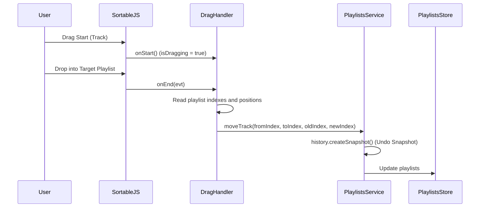

# Deep Dive: Feature Components

This document provides a comprehensive analysis of the feature-specific UI components located in `public/js/components/`.

## 1. Blend Components (`components/blend/`)

The Blend system is the core "Wizard" for creating playlists. It uses a stepwise approach (Series -> Recipe -> Ingredients).

| Component | Responsibility | Dependencies | State Management |
| :--- | :--- | :--- | :--- |
| **`BlendSeriesSelector.js`** | Step 1: Selection of entity type (only Albums is available; Artists, Genres and Tracks are disabled) and specific Series to blend. Features a sophisticated cascade thumbnail display. | `AlbumCascade`, `OptimizedAlbumLoader`, `AlbumSeriesStore` | Manages `selectedEntity` and `selectedSeries`. Implements `preloadAllThumbnails()` for non-blocking UI updates. `selectById(seriesId)` (F63) chooses the series the menu was opened from (`/blend?seriesId=<id>`, read by `BlendingMenuView.mount`); the series cards answer the keyboard (`role="button"`, `aria-pressed`, Enter and Space). |
| **`BlendRecipeCard.js`** | Step 2: Recipe (Algorithm) selection. Renders visual cards for strategies like 'Balanced Cascade', 'Round Robin', etc. | `Icons`, `algorithms/index.js` (`getAllAlgorithms`) | Pure rendering of provided algorithms. Handles selection events. |
| **`BlendIngredientsPanel.js`** | Step 3: Configuration. Dynamic form that shows/hides fields (Duration, Output Mode, Ranking Source) based on the selected Recipe's capabilities. | `Icons` | Complex configuration object `{ duration, outputMode, groupingStrategy, rankingType, discoveryMode }`. Normalizes config for service layer via `getConfig()`. |

### Key Patterns
*   **Wizard State**: Each component handles a specific stage of the `BlendingMenuView`.
*   **Dynamic Configuration**: `BlendIngredientsPanel` uses a static `ALGORITHM_RECIPES` map to toggle UI controls based on the selected algorithm, ensuring users only see relevant options.
*   **Thumbnail Caching**: `BlendSeriesSelector` implements an aggressive preload strategy (`preloadAllThumbnails`) to fetch album art for series visualization without blocking the UI.
*   **Album loading** (F56, on the branch `fix/f56-screens-load-through-the-service`, not yet published): when the person generates, `controllers/BlendingController.js` asks the album load (`albumAsks.albumsOf`) for the albums of the series, naming the sources the recipe reads. Albums the albums screen already loaded, or that the browser keeps, are not asked again; the rest goes through the same queue. The progress reads "Loading albums: i of n..." and then "Waiting for the ratings of i of n albums...". The blend goes on with the albums that are ready and a warning says which were left out and which source is missing; it stops only when no album is ready. Leaving the screen drops the ask.

---

## 2. Playlists Components (`components/playlists/`)

These components handle the visualization, management, and export of generated playlists.

| Component | Responsibility | Dependencies | key Features |
| :--- | :--- | :--- | :--- |
| **`PlaylistGrid.js`** | High-level container for rendering a grid of `PlaylistCard`s. | `TrackRow`, `Icons` | Responsive grid layout (1/2/3 cols). Handles "Batch Name" formatting logic (e.g., "1. Batch Name - Playlist Title"). |
| **`PlaylistsGridRenderer.js`** | Stateless rendering logic for the entire Playlists View. Decouples structure from state. | `PlaylistGrid`, `RegeneratePanel` | Renders Empty States, Initial Settings Form, Export Toolbar, and the main Grid. Pure functional rendering. |
| **`RegeneratePanel.js`** | Collapsible panel allowing users to "Re-roll" specific playlists or the entire batch with new settings. | `BlendRecipeCard`, `BlendIngredientsPanel` | reuses the Blend wizard components in a condensed, collapsible inline inspector pane. |
| **`PlaylistExportToolbar.js`** | Floating/Fixed toolbar for high-level actions (Save, Export to Spotify/Apple). | `Component` | Visual status indicator ("Ready to Export") and action buttons. No module imports it today; the export section of the playlists screen is drawn by `PlaylistsGridRenderer`. |
| **`SavedPlaylistsController.js`** | Business logic for the "Saved Playlists" view (History). | `SeriesRepository`, `PlaylistRepository`, `OptimizedAlbumLoader`, `PlaylistsService`, stores | Groups playlists by "Batch", handles lazy loading of series thumbnails, and manages Delete/Edit workflows. |
| **`TrackItem.js`** | Visual row for a single track. | `Icons` | **Smart Badging**: Left badge = Primary Ranking (used for sort), Right badge = Secondary. Supports drag handles. Only re-exported by `playlists/index.js`; `PlaylistGrid` draws its rows with `ui/TrackRow.js`. |
| **`PlaylistsDragBoard.js`** | Kanban-style board for dragging tracks *between* playlists. | `Component`, `SeriesDragDrop` | Renders playlists as columns. No module imports it today; the playlists screen uses `PlaylistGrid` + `PlaylistsDragHandler`. |
*   **PlaylistsDragHandler.js**: Headless logic controller for Drag & Drop operations, used by `PlaylistsView`. Manages `Sortable` instances and commits the move through `PlaylistsService.moveTrack`, which takes a history snapshot and updates `PlaylistsStore`.

### Drag & Drop Sequence

### Key Patterns
*   **Renderer Pattern**: `PlaylistsGridRenderer` separates markup generation from the View's life-cycle, making the large `PlaylistsView.js` more manageable.
*   **Component Reuse**: `RegeneratePanel` directly imports `BlendRecipeCard` and `BlendIngredientsPanel`, ensuring that the "Reconfigure" UI matches the "Create" UI exactly.
*   **Dual Ranking Visualization**: `TrackItem.js` (and `ui/TrackRow.js`, the one in use) dynamically swaps the position of "Spotify" and "Acclaim" badges based on which metric was used to generate the playlist.

---

## 3. Inventory Components (`components/inventory/`)

Components for managing the user's collection of albums.

| Component | Responsibility | Dependencies | Notes |
| :--- | :--- | :--- | :--- |
| **`InventoryGrid.js`** | Grid component for inventory data. | `SeriesGridRenderer` | Effectively a wrapper around `SeriesGridRenderer`, adapting it for Inventory data. Handles event delegation for item clicks. No module imports it today: `InventoryView` draws with `views/renderers/InventoryGridRenderer.js`. |

> **Note**: Several inventory-specific components (`InventoryItemCard`, `InventoryStats`) appear to have been deprecated or merged into generic components like `Card` and `SeriesStats` to reduce duplication.

---

## 4. Series Components (`components/series/`)

Components for managing Album Series (the core organizational unit).

| Component | Responsibility | Dependencies | State Management |
| :--- | :--- | :--- | :--- |
| **`SeriesGridRenderer.js`** | Universal renderer for Album lists/grids. | `AlbumsGridRenderer`, `AlbumsScopedRenderer` | **Hybrid Pattern**: Delegates to legacy production renderers (`AlbumsGridRenderer`) while providing a modern Class-based Component API. Supports both `GRID` and `LIST` layouts. In the grid of all the series, a series draws its first 12 albums and the "Load N more albums" button, unless its id is in `props.expandedSeriesIds` (v5.0, F49); `focusAlbum(seriesId, index)` puts the focus on one album. |
| **`SeriesHeader.js`** | Standardized page header. | `Breadcrumb`, `Icons` | Renders Title, Breadcrumbs, and the primary "Blend" action button (if albums exist). |
| **`ui/FilterToolbar.js`** (not in `series/`) | Control bar with Search, Filters (Artist/Year/Source), and View Toggles. `series/SeriesToolbar.js` no longer exists. | - | Created by `views/helpers/SeriesComponentFactory.js`; see `12_Frontend_Components_Core.md`. |
| **`SeriesFilterBar.js`** | Simplified version of the toolbar (legacy). | `Component` | Basic search and sort inputs. No module imports it today. |
| **`SeriesEditModal.js`** | Modal for editing a Series (Name, adding/removing albums). | `album-picker/AlbumPickerPanel`, `BaseModal`, `SeriesService`, `models/albumQuery.js`, `models/seriesDraft.js` | Keeps a local list of "Album Queries" until "Save Changes". Adding albums is the one album picker (F57), the same as the Home's; what the modal does with a pick is `addAlbum`. Saving has one state (`models/seriesDraft.js`): the button is busy and disabled while the write is on its way, a failure is said inside the modal and the list stays as the person left it. |
| **`SeriesEventHandler.js`** | Headless behavior controller. | `DialogService`, `AlbumsStore`, `SeriesService`, `UserRankModal`, `InventoryAddModal`, `ViewAlbumModal` | Implements the **Command Pattern** via Event Delegation. Intercepts clicks on `[data-action]` elements (`edit-series`, `delete-series`, `retry-series`, `load-more-series`, `view-modal`, `add-to-inventory`, `remove-album`, `rank-album`, `refetch-metadata`) and triggers store actions/modals. `load-more-series` only reports to the `onShowAllAlbums` it was given. For `rank-album` it opens `UserRankModal` and passes the result to the `onSaveRanking` it was given; the saving is done by `SeriesController.saveRanking`. |
| **`SeriesDragDrop.js`** | SortableJS wrapper for Series grids. | `Component`, `window.Sortable` | Enables reordering of albums within a series. Only imported by `PlaylistsDragBoard.js`, which itself is not in use. |
| **`SeriesModals.js`** | Edit and delete dialogs of a series. | `DialogService`, `SeriesEditModal`, `SeriesService` | Used through `views/helpers/SeriesModalsManager.js`. |
| **`SeriesEmptyState.js`** | Empty state of the albums screen. | `SafeDOM`, `Icons` | Used by `views/helpers/SeriesViewUpdater.js`. |

### Key Patterns
*   **Event Delegation**: `SeriesEventHandler` allows unrelated components (like a grid card rendered by a functional renderer) to trigger complex actions (deletions, modals) without passing callbacks down the entire tree.
*   **One album picker**: the series edit does not search the catalog by itself. It embeds `components/album-picker/AlbumPickerPanel.js`, a frame of `AlbumPickerController` (see `14_Frontend_Components_Feature_Map.md`); `series/ArtistScanner.js` was removed in F57.
*   **Legacy Wrapping**: `SeriesGridRenderer` is a "Bridge" component. It wraps the older, functional renderers (`renderAlbumsGrid`) to make them usable within the newer class-based Component architecture.

## Missing / Deprecated Components
The following components were in the original plan but found to be missing or superseded:
*   `InventoryItemCard.js` / `SeriesCard.js` -> Replaced by generic `Card.js` or functional renderers.
*   `series/AlbumCard.js` -> Replaced by `Card.js` (Universal Card).
*   `series/SeriesStats.js` -> Likely integrated into `SeriesHeader` or Dashboard.
*   `series/SeriesToolbar.js` -> Replaced by `ui/FilterToolbar.js`.
