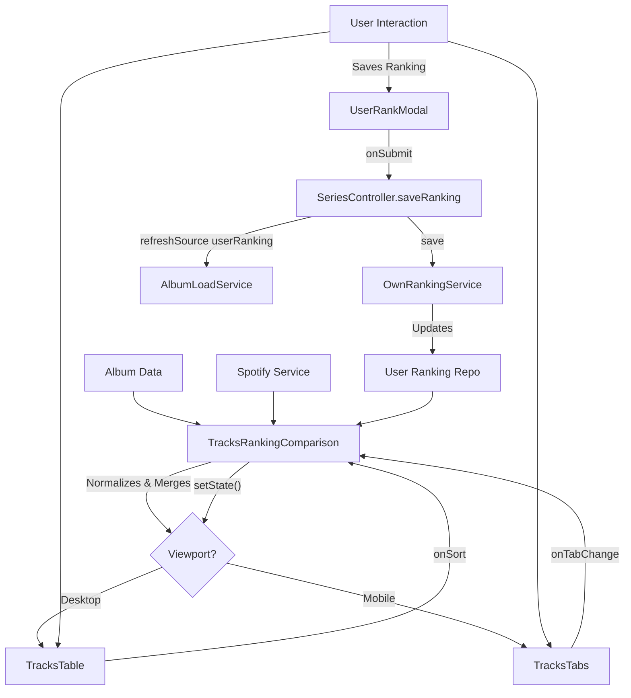

# Deep Dive: Search, Ranking & Home Components

This document audits the components responsible for the core "Discovery" loop: Searching for artists, filtering their discography, selecting albums, and analyzing track rankings.

## 1. Search & Discovery System

Located in `components/album-picker/` and `components/home/`, these components manage the user's initial interaction with the application.

> **v4.0 notes.** The artist field of the Home (`#artistScanInput`) is drawn once by `HomeView` and `HomeController` only listens for Enter and for the Scan button, and asks the album picker: nothing redraws it while the person types. The album queries of a new series are built by `toAlbumQuery` (`models/albumQuery.js`), the same function the series edit modal uses, so the stored text is always plain (UAT-180).

| Component | Role | Architecture & Patterns |
| :--- | :--- | :--- |
| **`album-picker/AlbumPickerController.js`** | **The one album picker** (F57): search an artist, see the albums by type, pick some. Used by the Home and by the series edit modal. | • **State Management**: Owns the scan state (`this.scan`, rules in `models/scanState.js`) and the filters (`this.filters`, rules in `models/albumPicker.js`); the screen is drawn from the state through a view port (`drawScan`, `drawFilters`, `drawAlbums`). • **Logic**: "Newest -> Oldest" by default; one scan at a time; late answers change nothing. • **Integration**: asks `albumSearchService.scanArtist` and nothing else; knows no screen: what a screen does with a pick comes in as `onPick`. |
| **`album-picker/AlbumPickerPanel.js`** | **The picker as one block**, inside the series edit modal. | • A frame only: field, Scan button, status line, filter buttons, cards; every click asks the controller. |
| **`album-picker/pickerParts.js`** | **Drawn parts** shared by the two frames. | • `createFilterButton` / `drawFilterButton` (active state with the "Flame Gradient", count), `drawScanButton`, `createScanPanel` (idle, scanning, empty, failed with "Try again"). |
| **`StagingAreaController.js`** | **Selection Manager**. Manages the "Stack" of albums waiting to be turned into a playlist. | • **SortableJS**: Integrates 3rd-party lib for drag-and-drop reordering. • **State Sync**: Manually synchronizes the internal `selectedAlbums` array with DOM changes on drag end. |

---

## 2. Ranking Comparison System

Located in `components/ranking/`, this is one of the most complex UI features, allowing users to compare "Original Tracklist" vs "Critical Acclaim" vs "Spotify Popularity".

### Architecture: Smart Container vs Dumb Presenters

The ranking system strictly follows the Container/Presenter pattern.

#### The Container: `TracksRankingComparison.js`
*   **Responsibility**: Data Normalization & State.
*   **Key Logic**:
    *   **Enrichment**: Merges sparse local track data with rich metadata (Spotify Popularity, BEA Rankings) on the fly.
    *   **Normalization**: Maps tracks by name/fuzzy-match to handle slight spelling differences between services.
    *   **Responsive Switching**: Mounts both `TracksTable` (Desktop) and `TracksTabs` (Mobile); CSS classes (`hidden md:block` / `md:hidden`) decide which one is visible.

#### The Presenters

| Component | Viewport | Details |
| :--- | :--- | :--- |
| **`TracksRankingComparison.js`** | **Universal** | **Smart Container**. Handling logic and state management for the comparison view. It calls no API: the state of the album's Spotify popularity comes in as a prop and asking again goes out through a callback, to the album load (F69). |
| **`TracksTabs.js`** | **Mobile** | • **Adaptive UI**: Instead of squeezing columns, it uses Tabs to toggle the *context*. • **Tab 1 (Original)**: Shows standard track numbers. • **Tab 2 (Acclaim)**: Highlights critical ranking badges. • **Tab 3 (Spotify)**: Visualizes popularity bars next to track names. |
| **`UserRankModal.js`** | **Universal** | • **Interactive State**: Glass-morphism modal for drag-and-drop ranking. • **SortableJS**: Powers the reordering logic. • **Persistence** (v4.0): it does not save. It hands the ranking to `onSubmit(rankings) => Promise<boolean>`, given by whoever opened it, stays open when the save is refused, and calls `onSave` after closing. On the albums screen the chain is `SeriesEventHandler` → `SeriesView` → `SeriesController.saveRanking` → `OwnRankingService`. • **Text**: names are drawn as text nodes, with no HTML escaping (an "&" used to show as `&amp;`). |

### Updated `TracksTable.js` (Sprint 20 & 22.6)
*   **Columns**: Position, Title, **My Rank** (User), Rank (BEA), Popularity (Spotify), Duration.
*   **Decoupling Logic**: Ratings (★88) are now displayed independently of ranking badges (#5). A track can be rated without being ranked in the top chart.
*   **Stats Header**: Displays Average Acclaim, Spotify Popularity, and **My Average** (User) statistics at the top.
*   **Evidence Tooltips (Sprint 23)**: Hovering the star rating reveals full provenance (e.g., `BestEverAlbums: 90 | Spotify: 80`).

### No celular (meu ranking)
Até 767 px de largura (`isPhone()`); a tela de computador não muda. As regras estão em `docs/specs/behavior.md` § No celular e as telas em `docs/specs/info-arch.md` § O celular (F76).

*   **Janela própria.** `UserRankModal` desenha o celular por `components/ranking/rankWindowPhone.js`: barra com «‹ Back», «My ranking» e «↶ Reset»; faixas com o título inteiro; «Save ranking» sempre à vista no pé.
*   **Para mover uma faixa:** tocar nela e usar «Up», «Down» ou «Move to…» (uma folha com os números), e «Done» para soltar; ou arrastar pela alça. Um leitor de tela ouve a posição nova.
*   **Reset e sair.** «Reset» tem «Undo» por 5 segundos. «Back» com a ordem mudada e não salva abre a folha «Discard changes?» («Keep editing» ou «Discard»).

### Data Flow Diagram

