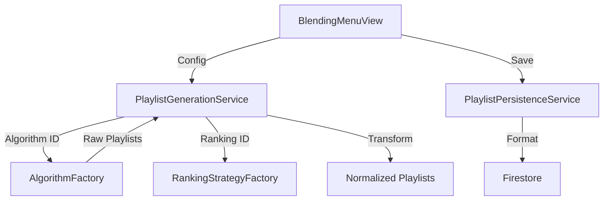
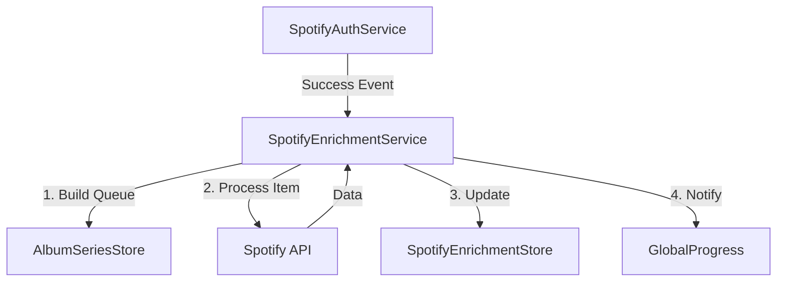

# Deep Dive: Client Services & Adapters

This document audits the service layer located in `public/js/services/`. This layer houses the core business logic, API integrations, and background processing mechanisms of the frontend.

## 1. Core Services Architecture

The application uses a mix of **Singleton Classes**, **Functional Modules**, and **Facade Patterns** to manage complexity.

| Service | Pattern | Responsibility |
| :--- | :--- | :--- |
| **`PlaylistGenerationService`** | **Logic Engine** | The "Brain" of the app. Orchestrates algorithms (`createAlgorithm`) and ranking strategies (`createRankingStrategy`) to produce `Playlist[]` objects from raw `Album[]` data. Pure logic, no side effects. |
| **`PlaylistsService`** [REFAC] | **State Orchestrator** | **Thin Orchestrator**. Delegates logic to `PlaylistHistoryService` (Undo/Redo) and `StorageService` (Persistence). Manages `playlistsStore` state updates. Owns the save rule (`saveCurrentBatch`: one save at a time, the series of the playlists on screen, an atomic replace through `PlaylistRepository.replaceBatch`) and the browser draft of unsaved playlists (`watchStore`, `restoreDraft`) since v5.0 (F60). |
| **`SeriesService`** [REFAC] | **Context Provider** | **Thin Orchestrator**. Delegates logic to `UserSyncService` (Auth Migration) and `StorageService` (Persistence). Manages `albumSeriesStore`. Implements **Surgical Cache Injection** (Sprint 21.5) to prevent UI flashes. **Refetch Metadata**: Orchestrates on-demand re-enrichment of albums via `enrichAlbumMetadata`. **Persistence (Sprint 23)**: Ensures enriched data (including Ranking Evidence) is persisted to Firestore and synchronized with the frontend `AlbumCache`. **Adding and removing an album** (F55, slice 2): `addAlbumToSeries` and `removeAlbumFromSeries` ask the one identity rule which query of the series is the album (`alreadyAskedFor`, `indexOfQueryFor` in `models/askedAlbum.js`); a text query is no longer matched by "it contains the title and the artist". |
| **`AlbumLoadService`** (v4.0) | **Owner of the album load** | `services/albums/`. Loads the albums of the series on screen: generations (only the current load writes), reconciliation on every open, find then enrich, retry of what failed, and `refreshSource(albumId, source)`: one enrichment source of one album asked again, after whatever is still running for that album, publishing a new album (used when the person saves a ranking). Receives its sources and the cache by injection. |
| **`OwnRankingService`** (v4.0) | **Owner of the person's rankings on the client** | `services/ranking/`. `save(album, rankings)` writes through the ranking repository and adds the album to the list; `ensureLoaded()` reads the list of ranked albums once per person, shared by whoever asks while it runs, and tries again after a failure. Its ports are injected (`ownRanking.js` puts it together), so it imports nothing. |
| **`SeriesFactsService`** (v4.0) | **Feature Service** | `services/series/`. Writes into each series what the load learned about its albums (year, which sources have data), only the difference, once the series has finished loading. Since F55 slice 2 it is also the one writer of the corrected Apple Music id: when the album asked for was found under another id than the stored one (`metadata.replacedSourceId`), the same write carries the new `appleMusicId` and, when the query stores them, the cover and the year of the loaded album. A failed write is reported and tried again on the next pass; it never fails the load. |
| **`PlaylistPersistenceService`** | **Repository Wrapper** | Handles the **CRUD** lifecycle of generated playlists. Manages batch overwrites, Series synchronization, and interacts with `PlaylistRepository`/`Firestore`. |
| **`SeriesFilterService`** | **Functional Module** | A collection of **pure functions** (`filterAlbums`, `getUniqueArtists`) used by `SeriesView` and wrapped by `FilterUtils.js`. Provides core logic for complex UI filtering. |
| **`SavedPlaylistsFilterService`** [NEW] | **Functional Module** | Provides filtering logic for Saved Playlists (Series/Batch names) using `FilterUtils`. |
| **`StorageService`** [NEW] | **Infrastructure** | Centralized `localStorage` wrapper with error handling and namespacing. Used by all services for local persistence. |
| **`PlaylistHistoryService`** [NEW] | **Feature Service** | Manages the Undo/Redo stack and snapshot versioning for playlists. Pure logic, injected into `PlaylistsService`. |
| **`UserSyncService`** [NEW] | **Feature Service** | Handles complexity of migrating Guest data to User account upon authentication. Injected into `SeriesService`. |
| **`BEAEnrichmentHelper`** [NEW] | **Helper Module** | Encapsulates BestEverAlbums enrichment logic (fetching, parsing scores) to keep `SeriesService` clean. |
| **`DialogService`** | **Singleton** | Manages global modal state. Provides a simple imperative API (`.alert()`, `.confirm()`, `.prompt()`) over the declarative `BaseModal` system. |

---

## 2. API Integrations & Adapters

### Apple Music (MusicKit)
The integration follows a **Facade Pattern** to hide the complexity of the Apple SDK.

*   **`MusicKitService.js`**: The main entry point. It delegates actual work to sub-modules (`musicKitAuth`, `musicKitCatalog`, `musicKitLibrary`) but exposes a unified API surface to the rest of the app.
*   **`MusicKitSearchAdapter.js`**: An **Adapter** that makes the Apple Music Catalog search compatible with the generic `Autocomplete` component interface. It normalizes Apple's JSON response into the app's standard `{ id, title, artist, coverUrl }` format.

### Spotify
*   **`SpotifyAuthService.js`**: Implements **PKCE** (Proof Key for Code Exchange) flow for secure client-side authentication. Manages token lifecycle (storage, refresh).
*   **`SpotifyEnrichmentService.js`**: A **Background Worker**. It manages a queue of albums to enrich with Spotify data (Popularity, Spotify ID).
    *   **Rate Limiting**: Enforces a strict delay (100ms) between requests to respect API limits.
    *   **Reactivity**: Uses a subscription model (`subscribe()`, `notify()`) to broadcast progress to the UI without coupling.

---

## 3. Data Loading & Optimization

| Component | Strategy | Details |
| :--- | :--- | :--- |
| **`OptimizedAlbumLoader.js`** | **Web Worker** | Offloads large dataset search (30k+ albums) to a background thread (`search.worker.js`). Uses **uFuzzy** for high-performance fuzzy matching during autocomplete. `findAlbum(artist, album)` (the cover of an album that came without one) reads up to 20 rows and returns only the row that is the album asked for, by the one identity rule (`shared/albumIdentity.js`); no row passes: `null`. Before F55 it fell back to the first row. |
| **`DataSyncService.js`** | **Migration** | A utility service for migrating data between contexts (e.g., Guest -> Authenticated user), ensuring inventory integrity during transition. |

### Legacy Notes
*   **`AlbumLoader.js`**: Retained as a fallback mechanism. It parses the legacy generic CSV dataset if the optimized JSON payload fails to load.

## 4. Key Data Flows

### Playlist Generation Loop

### Background Enrichment

## Counting the albums that are not the album asked for (`services/albums/albumIdentityAudit.js`) - v5.0 (F55, slices 1 and 2)

**Purpose**: a READ-ONLY count of how many albums of the signed-in person's series are wrong today (issue UAT-184), to be run before and after the identity rule is published.

*   **`auditAlbumIdentity({ series, shownFor })`**: pure. For each query of each series it asks `shownFor(query, series)` for the album the app has for it and compares the two by the one identity rule. It returns `{ rows, summary }`; each row is `{ series, asked, shown, verdict, reason, storedAppleId }`, with `verdict` one of `same`, `different`, `not-loaded` (the app keeps no album for that query). Since slice 2 an album a load accepted by the rule's second tier is `same` with the reason `title-before-subtitle`; the same title kept with nothing saying a load accepted it is `different` with that reason.
*   **`countWrongAlbums()`** (in `albumLoading.js`, the composition file) gives it the real sources: the series in `albumSeriesStore`, the album of each query from the load of this session (`albumLoadStore`) or, failing that, from what the browser keeps (`AlbumCacheAdapter.peek`).
*   **It writes nothing and asks no source**: `peek` (new in `CacheManager`, `MemoryCache`, `IndexedDBCache` and `AlbumCacheAdapter`) reads without promoting a record to memory and without removing an expired one.
*   **How to run it**: in the browser console, signed in and with the series loaded (Home or the albums screen): `await albumIdentityAudit()`. It prints the table and the totals and returns both. An album never loaded on this browser shows as `not-loaded`: open "All Series" first for a full count.
*   **Tests**: `test/services/albums/albumIdentityAudit.test.js`.

