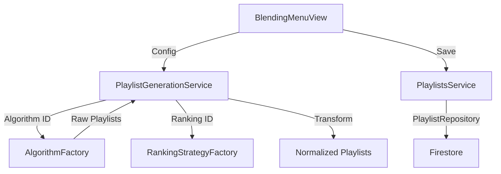
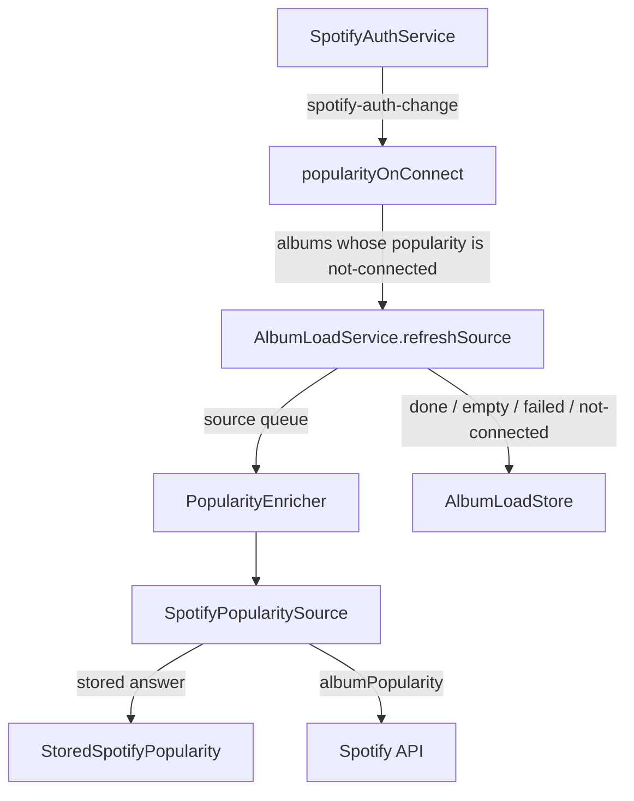

# Deep Dive: Client Services & Adapters

This document audits the service layer located in `public/js/services/`. This layer houses the core business logic, API integrations, and background processing mechanisms of the frontend.

## 1. Core Services Architecture

The application uses a mix of **Singleton Classes**, **Functional Modules**, and **Facade Patterns** to manage complexity.

| Service | Pattern | Responsibility |
| :--- | :--- | :--- |
| **`PlaylistGenerationService`** | **Logic Engine** | The "Brain" of the app. Orchestrates algorithms (`createAlgorithm`) and ranking strategies (`createRankingStrategy`) to produce `Playlist[]` objects from raw `Album[]` data. Pure logic, no side effects. |
| **`PlaylistsService`** [REFAC] | **State Orchestrator** | **Thin Orchestrator**. Delegates logic to `PlaylistHistoryService` (Undo/Redo) and `StorageService` (Persistence). Manages `playlistsStore` state updates. Owns the save rule (`saveCurrentBatch`: one save at a time, the series of the playlists on screen, an atomic replace through `PlaylistRepository.replaceBatch`) and the browser draft of unsaved playlists (`watchStore`, `restoreDraft`) since v5.0 (F60). Put together in **`playlists/playlistsWiring.js`** (F58, second slice; UAT-19): `getPlaylistsService()` takes no argument and gives the one service, made the first time it is asked for with the database, the cache and who is signed in. Controllers and components ask it and import neither `app.js`, the login nor a repository: a save with no `userId` goes to the person signed in, and `findBatch(seriesId, batchName)` reads the saved batch the edit screen opens. |
| **`SeriesService`** [REFAC] | **Context Provider** | **Thin Orchestrator**. Delegates logic to `UserSyncService` (Auth Migration) and `StorageService` (Persistence). Manages `albumSeriesStore`. Since F56 (on its branch) it loads no album: the surgical injection (Sprint 21.5) and `refetchAlbumMetadata` are gone, and whoever shows a series asks the album load, which reconciles it. **Adding and removing an album** (F55, slice 2): `addAlbumToSeries` and `removeAlbumFromSeries` ask the one identity rule which query of the series is the album (`alreadyAskedFor`, `indexOfQueryFor` in `models/askedAlbum.js`); a text query is no longer matched by "it contains the title and the artist". |
| **`AlbumLoadService`** (v4.0) | **Owner of the album load** | `services/albums/`. Loads the albums of the series on screen: generations (only the current load writes), reconciliation on every open, find then enrich, retry of what failed, and `refreshSource(albumId, source)`: one enrichment source of one album asked again, after whatever is still running for that album, publishing a new album (used when the person saves a ranking). Receives its sources and the cache by injection. |
| **`OwnRankingService`** (v4.0) | **Owner of the person's rankings on the client** | `services/ranking/`. `save(album, rankings)` writes through the ranking repository and adds the album to the list; `ensureLoaded()` reads the list of ranked albums once per person, shared by whoever asks while it runs, and tries again after a failure. Its ports are injected (`ownRanking.js` puts it together), so it imports nothing. |
| **`SeriesFactsService`** (v4.0) | **Feature Service** | `services/series/`. Writes into each series what the load learned about its albums (year, which sources have data), only the difference, once the series has finished loading. Since F55 slice 2 it is also the one writer of the corrected Apple Music id: when the album asked for was found under another id than the stored one (`metadata.replacedSourceId`), the same write carries the new `appleMusicId` and, when the query stores them, the cover and the year of the loaded album. A failed write is reported and tried again on the next pass; it never fails the load. |
| **`PlaylistPersistenceService`** | **Repository Wrapper** | Removed in F65: no module imported it. The playlists are saved by `PlaylistsService` through `PlaylistRepository` (F60). |
| **`SeriesFilterService`** | **Functional Module** | Removed in F65: no module imported it. The filters of the albums screen are pure rules in `models/seriesFilter.js`. |
| **`SavedPlaylistsFilterService`** [NEW] | **Functional Module** | Provides filtering logic for Saved Playlists (Series/Batch names) using `FilterUtils`. |
| **`SavedPlaylistsReader`** (v5.0, F61) | **Owner of the saved playlists read** | `services/playlists/`. `load({ fresh })` reads the series once and then the playlists of each series, up to 8 at a time with a 15 s deadline (`TaskQueue`), and publishes each series to `SavedPlaylistsStore` as its answer arrives (`loading`, `ready`, `empty`, `failed`). A generation per load and a ticket per series: only the latest ask writes. `refreshSeries(id)` reads one series; `removeBatch` and `removeAll` cost one read and one atomic write. What was read stays on the list while it is read again. It imports only the queue and the rules of `models/savedPlaylists.js`; the database arrives through the `source` port (`adapters/RepositoryPlaylistsSource.js`) and the wiring is in `savedPlaylistsReading.js`. |
| **`StorageService`** [NEW] | **Infrastructure** | Centralized `localStorage` wrapper with error handling and namespacing. Used by all services for local persistence. |
| **`PlaylistHistoryService`** [NEW] | **Feature Service** | Manages the Undo/Redo stack and snapshot versioning for playlists (50 steps). Pure logic, injected into `PlaylistsService`, which decides which set the history is of: it starts at the set as it came to the screen and starts again when another set comes (F62). The screen has the two buttons since F62. |
| **`SpotifyExportService`** (F62) | **Export orchestrator** | Renews an expired access, matches the tracks, creates and fills the playlists (merge or separate) and answers with a report: `created` (each with its address), `incomplete`, `empty`, `notCreated`, `failure` (`reconnect`, `rate-limit`, `error`). Never ends in silence. |
| **`AppleMusicExportService`** (F62) | **Export orchestrator** | Authorizes, makes the folder of the series, creates one playlist per playlist and answers with a report (`created`, `failed` with the reason, `empty`, `notFound`, `folder`, `failure`); `appleExportMessages(report)` is what the person is told. |
| **`exportLedger`** (F62) | **Session memory** | `services/export/`. What this session already sent to Spotify or Apple Music (service, name, tracks in order -> the id given), so exporting again creates no second copy. In memory: a reload of the page clears it. |
| **`UserSyncService`** [NEW] | **Feature Service** | Handles complexity of migrating Guest data to User account upon authentication. Injected into `SeriesService`. |
| **`BEAEnrichmentHelper`** [NEW] | **Helper Module** | Encapsulates BestEverAlbums enrichment logic (fetching, parsing scores) to keep `SeriesService` clean. |
| **`DialogService`** | **Singleton** | Manages global modal state. Provides a simple imperative API (`.alert()`, `.confirm()`, `.prompt()`) over the declarative `BaseModal` system. One dialog at a time; Escape, or another dialog taking its place, answers the pending one as cancelled (`false` for `confirm`, `null` for `prompt`: F63; before, the caller waited for ever). |

---

## 2. API Integrations & Adapters

### Apple Music (MusicKit)
The integration follows a **Facade Pattern** to hide the complexity of the Apple SDK.

*   **`MusicKitService.js`**: The main entry point. It delegates actual work to sub-modules (`musicKitAuth`, `musicKitCatalog`, `musicKitLibrary`) but exposes a unified API surface to the rest of the app.
*   **`MusicKitSearchAdapter.js`**: An **Adapter** that makes the Apple Music Catalog search compatible with the generic `Autocomplete` component interface. It normalizes Apple's JSON response into the app's standard `{ id, title, artist, coverUrl }` format. *(removed in F65: `MusicKitSearchAdapter.js`)*

### Spotify
*   **`SpotifyAuthService.js`**: Implements **PKCE** (Proof Key for Code Exchange) flow for secure client-side authentication. Manages token lifecycle (storage, refresh). `renewAccess()` renews now when Spotify refused the access; renewals asked at the same time share one request (F62). `SpotifyService._fetch` uses it: a 401 renews once and repeats the call, then throws `SpotifyReconnectError`; a 429 throws `SpotifyRateLimitError`, or is waited for (`Retry-After` up to 30 s) by the export calls (`services/spotify/spotifyErrors.js`). `hasSession()` (F69) says whether Spotify can be asked without the person: the access is in its time, or it can still be renewed; false is "not connected".
*   **`albums/adapters/spotifyPopularitySource.js`** (v5.0, F69): the **one path** that asks for the Spotify popularity of an album, behind `PopularityEnricher`. `read(album)` answers `found` (from what the app already holds, `spotify/StoredSpotifyPopularity.js`, or from `SpotifyService.albumPopularity`), `not_found` (with the reason and the version of the identity rule) or `not_connected` (no session, or a session that ended: `SpotifyReconnectError`), and throws on a failure. A 429 with `Retry-After` up to 30 s is thrown with `hold` (`HoldReason.SPOTIFY_BUSY`), so the load holds the popularity and asks again; Spotify is not asked again before the time it gave. Its dependencies are given (store, client, session, clock).
*   **`spotify/StoredSpotifyPopularity.js`** (v5.0, F58 second slice; UAT-18): what the app holds of an earlier answer of Spotify about an album. It is the `store` the popularity source is given: `get(artist, title)` answers the stored data when it is still trusted (30 days, the format, a Spotify id: `SpotifyEnrichmentRepository.isValid`) or `null`, also when the database cannot be read; `save(artist, title, data)` writes it and throws when it could not. It holds no state: the answers are in the Firestore collection `spotify_enrichment`. Put together in **`spotify/spotifyPopularityWiring.js`** (the repository, the database, a cache manager of its own). It was `stores/SpotifyEnrichmentStore.js`, a "store" that imported Firestore; the documents and their address did not change.
*   **`albums/popularityOnConnect.js`** (v5.0, F69): on `spotify-auth-change`, when there is a session, asks `albumLoadService.refreshSource(albumId, 'popularity')` for the albums on screen whose popularity is `not-connected`. It replaces the background worker `SpotifyEnrichmentService.js`, which looped over the album queries of every series outside the load queue, and was removed.

---

## 3. Data Loading & Optimization

| Component | Strategy | Details |
| :--- | :--- | :--- |
| **`OptimizedAlbumLoader.js`** | **Web Worker** | Offloads large dataset search (30k+ albums) to a background thread (`search.worker.js`). Uses **uFuzzy** for high-performance fuzzy matching during autocomplete. `findAlbum(artist, album)` (the cover of an album that came without one) reads up to 20 rows and returns only the row that is the album asked for, by the one identity rule (`shared/albumIdentity.js`); no row passes: `null`. Before F55 it fell back to the first row. |
| **`DataSyncService.js`** | **Migration** | A utility service for migrating data between contexts (e.g., Guest -> Authenticated user), ensuring inventory integrity during transition. |

### Legacy Notes
*   **`AlbumLoader.js`**: Retained as a fallback mechanism. It parses the legacy generic CSV dataset if the optimized JSON payload fails to load.

## 4. Key Data Flows

### Playlist Generation Loop

### Popularity when Spotify connects (v5.0, F69)

## Counting the albums that are not the album asked for (`services/albums/albumIdentityAudit.js`) - v5.0 (F55, slices 1 and 2)

**Purpose**: a READ-ONLY count of how many albums of the signed-in person's series are wrong today (issue UAT-184), to be run before and after the identity rule is published.

*   **`auditAlbumIdentity({ series, shownFor })`**: pure. For each query of each series it asks `shownFor(query, series)` for the album the app has for it and compares the two by the one identity rule. It returns `{ rows, summary }`; each row is `{ series, asked, shown, verdict, reason, storedAppleId }`, with `verdict` one of `same`, `different`, `not-loaded` (the app keeps no album for that query). Since slice 2 an album a load accepted by the rule's second tier is `same` with the reason `title-before-subtitle`; the same title kept with nothing saying a load accepted it is `different` with that reason.
*   **`countWrongAlbums()`** (in `albumLoading.js`, the composition file) gives it the real sources: the series in `albumSeriesStore`, the album of each query from the load of this session (`albumLoadStore`) or, failing that, from what the browser keeps (`AlbumCacheAdapter.peek`).
*   **It writes nothing and asks no source**: `peek` (new in `CacheManager`, `MemoryCache`, `IndexedDBCache` and `AlbumCacheAdapter`) reads without promoting a record to memory and without removing an expired one.
*   **How to run it**: in the browser console, signed in and with the series loaded (Home or the albums screen): `await albumIdentityAudit()`. It prints the table and the totals and returns both. An album never loaded on this browser shows as `not-loaded`: open "All Series" first for a full count.
*   **Tests**: `test/services/albums/albumIdentityAudit.test.js`.

