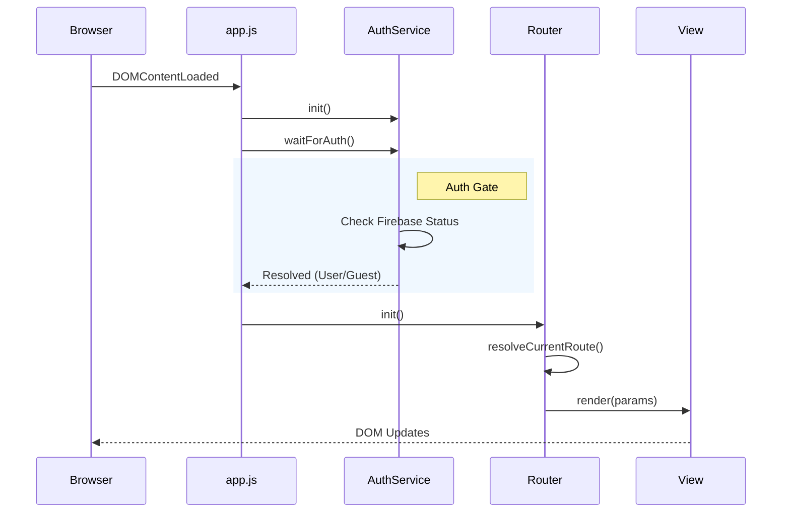

# Frontend JavaScript Root Analysis

## 1. Bootstrap: `public/js/app.js`
**Status**: `[ACTIVE]`
**Type**: Application Entry Point

### Logic
-   **Initialization**: `bootstrap()` function called on `DOMContentLoaded`.
-   **Auth Gate**: Waits for `AuthService.waitForAuth()` before handling routes (critical for protected views).
-   **UI Setup**: Initializes `TopNav` and `Footer` immediately (independent of auth).
-   **Event Listeners**:
    -   `spotify-auth-success`: Triggers background enrichment via `SpotifyEnrichmentService`.
-   **Router**: Registers all application routes (`/home`, `/albums`, `/playlists`, etc.).

### Boot Sequence Diagram

---

## 2. Router: `public/js/router.js`
**Status**: `[ACTIVE]`
**Type**: Client-Side Router

### Logic
-   **Mechanism**: History API (`pushState`, `popstate` event).
-   **Features**:
    -   **Navigation Hooks**: `beforeNavigate` and `afterNavigate`. `beforeNavigate(hook)` returns a function that removes the hook; the hooks are asked on `navigate()` and, since v5.0 (F60), on the browser's back and forward too (`handleHistoryMove`): when a hook refuses, the address of the screen the person stays on is put back. `views/playlists/unsavedChangesGuard.js` uses them to ask before leaving the playlists screen with unsaved changes (and listens to `beforeunload` for closing or reloading the tab).
    -   **Unknown address**: goes to `/home` once; with no `/home` route it stops (it used to call itself until the stack overflowed).
    -   **SafeDOM Support**: Renders Views that return DOM Nodes (recommended) or HTML strings (legacy).
    -   **Phantom Click Prevention**: Logic to avoid duplicate navigation or accidental clicks during renders.
    -   **One owner of the screen at a time** (F67): each `renderView` call has an identity (`renderRun`). When two route changes run at the same time (a route whose factory navigates and returns `null`, as `/callback`, `/album-series` and `/series`; two navigations in the same turn; a slow view that the person leaves), only the newest draws in `#app`, mounts and shows a failure, and the view that is mounted is the one that call created. Before, such a redirect left the destination drawn and never mounted: no button answered until the page was loaded again.
    -   **Error Handling**: Catches render errors and displays a fallback UI in `#app` (only for the route change that still owns the screen).

---

## 3. Client API: `public/js/api/client.js`
**Status**: `[ACTIVE]`
**Type**: API Client

### Logic
-   **Server calls**: `requestRatings` (`POST /api/enrich-album`, track ratings) and `_fetchAlbumFromAPI` (`POST /api/generate`, the second source of an album, which uses paid AI). Both are reached only by the album load, through its ports (`services/albums/albumLoading.js`).
-   **When `POST /api/generate` is asked again** (v4.0, F48): only after a failure that may pass, which is no answer from the network or a 5xx. Up to 2 new attempts, with a wait that doubles (1 s, 2 s, ceiling 8 s) and a draw that shortens it by up to half (`utils/retry.js`, `retryWithBackoff`). A 4xx (400, 402, 404, 429) is an answer and is never asked again. Each call has a deadline of 90 s; a call that passed it is not asked again either, because the paid work may still be running on the server.
-   **The error that comes up is the real one**: an `ApiError` with `kind` (`http`, `network`, `timeout`) and, when the server answered, `status`. The album load (`CatalogAdapter`) still ends such an album as "not found", and now logs the reason.
-   **`fetchAlbum`, `fetchMultipleAlbums`, `BEAenrichAlbum`**: removed by F56 (on the branch `fix/f56-screens-load-through-the-service`, not yet published). The Blending Menu and the playlist edit mode ask the album load (`albumAsks.albumsOf`), and nothing else called them. No controller, view or component imports this client (`test/architecture/screensLoadThroughTheService.test.js`).
-   **`generatePlaylists`** (`POST /api/playlists`): has no caller.
-   **Config**: `window.__api_base` or same-origin `/api`.

---

## 4. Firebase: `public/js/firebase-init.js`
**Status**: `[ACTIVE]`
**Type**: Infrastructure

### Logic
-   **SDK**: Uses Firebase v9 Modular SDK (`firebase/app`, `firebase/auth`, `firebase/firestore`).
-   **Config**: Reads from `window.__firebase_config` (injected by build/env) or falls back to placeholders.
-   **Exports**: `app`, `auth`, `db` instances.
