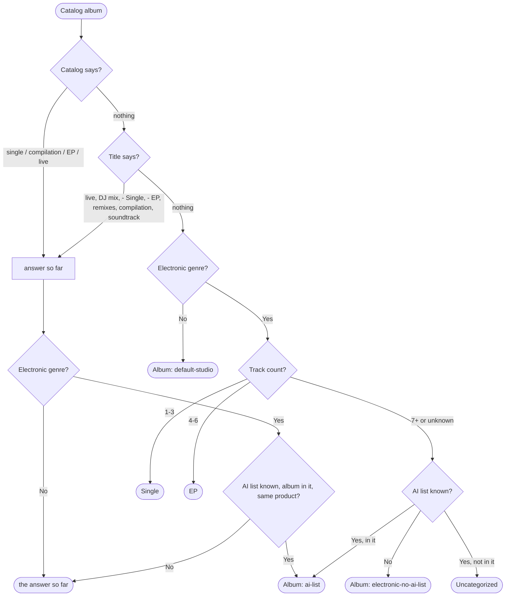

# Deep Dive: Album Search & Classification Engine (Batch 11)

This document covers the **Search Pipeline** and the sophisticated **Classification System** used to distinguish "Studio Albums" from Singles, EPs, and Compilations, particularly for Electronic Music. Sections 2 and 3 were rewritten in F57: the chain of strategy classes was replaced by one pure classifier.

## 1. Album Search Service (`public/js/services/album-search/AlbumSearchService.js`)
*   **Role**: The orchestrator for finding albums via the Apple Music API.
*   **Architecture**: Implements a Multi-Strategy Search.
    *   **Strategy 1**: Direct Search using Normalized Artist Name.
    *   **Fallback**: If the best match has confidence <= 0.8, tries "Alternative Artist Names" (e.g. `Anjunabeats` vs `Anjunabeats Worldwide`).
    *   **Two entry points**: `search(artist, albumTitle, options)` for one album (used by the bulk paste of Home) and `scanArtist(artistName)` for the artist scan of Home (F67: the catalog with a deadline of 15 s; the albums classified first without the AI list, and `reclassified`, a promise of the albums classified again when the list arrives). Since F57 `scanArtist` is the only scan: the series edit uses it too, through the one album picker, and `getArtistDiscography` was removed. Only `components/album-picker/AlbumPickerController.js` calls it, and only this service calls `getArtistAlbums` (`test/architecture/oneAlbumPicker.test.js`).
    *   **Scoring**: Uses `ScoreCalculator` to sort results.
*   **Integration**: Connects `MusicKitService` (Raw API) with `models/albumType.js` (`classifyAlbum`, the one classifier). Each album of a scan carries `type` and `typeReason`. Variants are grouped by a title key that keeps the letters of any alphabet.

## 2. The Classifier (`public/js/models/albumType.js`)
*   **Shape**: one pure function, `classifyAlbum(album, { aiList })`, that returns `{ type, reason }`. It reads the album it is given and the AI list it is given; it asks nothing and remembers nothing. `wantsAiList(album)` tells the service whether the paid AI list is evidence for an album (it is, for an electronic genre).
*   **Types** (`AlbumType`): `Album`, `EP`, `Single`, `Live`, `Compilation`, `Uncategorized` (unknown).
*   **Reasons** (`TypeReason`, a closed list): `catalog-type`, `catalog-live`, `catalog-single`, `catalog-compilation`, `title-live`, `title-dj-mix`, `title-single`, `title-ep`, `title-remix`, `title-compilation`, `title-soundtrack`, `electronic-track-count`, `ai-list`, `electronic-not-in-ai-list`, `electronic-no-ai-list`, `default-studio`.
*   **The rules, in order** - the first that answers wins:
    1.  **What the catalog says**: its type field (`albumType`: ep, single, compilation), its live trait (`contentTraits`), `isSingle`, `isCompilation`.
    2.  **What the title says**: live ("Live at", "Live from", "(Live …)", "Unplugged", "In Concert", "Live in" at the start of the title or of a part of it), DJ mix ("DJ Mix", "Mixed by", …; the names of DJ-mix series such as "Cream" or "A State of Trance 550" count only for an electronic album), "- Single", "- EP", remixes, compilation ("Best of", "Greatest Hits", "Anthology", …; "Collection", "Essential", "The Complete" and "Classics" only outside an edition note in brackets), soundtrack, and last the loose words "EP" and "Single".
    3.  **Electronic only - the track count**: up to 3 tracks a Single, up to 6 an EP.
    4.  **Electronic only - the AI list**, when it is known and not empty: an album in it is a studio album (this rescues an album the catalog flagged as a compilation or a single, never one decided by the track count, and never a title with a word of another product - single, EP, remix, mix, live, vol, club… - that the listed title does not have); a full-length album that is not in it is `Uncategorized`.
    5.  **Otherwise a studio album** (`default-studio`, or `electronic-no-ai-list` for an electronic album whose list is not known).
*   **The genre never makes an album unknown.** It only says whether the AI list is evidence. Before F57 there were two definitions of "electronic" - a wide one that matched pieces of words (so "Hardcore Rap" was electronic because it contains "hardcore") and a narrow one - and an album only the wide one called electronic left the funnel with no answer: that is why "To Pimp a Butterfly" and "good kid, m.A.A.d city" showed under "?" (UAT-185). Now there is one definition, by whole genre name (or a whole side of a "/", as in "Jungle/Drum'n'bass").
*   **Words are matched whole**: "Everybody Scream" is not a DJ mix for containing "cream", "Violin Concerto" is not "in concert".
*   **Matching the AI list**: the same title once notes in brackets, edition words and punctuation are gone, or every word of the listed title present in the album title with no number left over ("Hello World 1" is not "Hello World").

### Flowchart

## 3. Strategies Deep Dive

### Score Calculator (`ScoreCalculator.js`)
*   **Algorithm**: Weighted Average of Levenshtein Distance.
*   **Weights**: Title (60%), Artist (40%).
*   **Penalties**: Applies penalties for "Deluxe" (0.15) and "Live" (0.4) unless the query itself asks for them. A "Compilation" penalty (0.3) is declared in the weights but the scoring does not apply it.

### Removed in F57
`AlbumTypeClassifier.js`, the folder `classification/` (`AppleMetadataStrategy`, `TitleKeywordStrategy`, `GenreGateStrategy`, `RemixTracksStrategy`, `TrackCountStrategy`, `AIWhitelistStrategy`, `TypeSanityCheckStrategy`, `ElectronicGenreDetector`), `EditionFilter.js` and `types.js`. The remix-track rule was not carried over: the scan does not ask the catalog for track names, so it never ran. The rule written for one series of one artist ("Hello World N") became the general rule about a number left over.

## 4. Key Takeaways for Synthesis
*   **One classifier, one scan**: no screen classifies or scans by itself; a fitness test fails when a second path appears.
*   **Every answer has a reason**: `typeReason` says which rule decided, which makes a wrong answer traceable to one rule.
*   **Modularity**: a new rule is one function in `models/albumType.js`, put in its place in the order, with its reason in `TypeReason` and its test in `test/models/albumType.test.js`.
