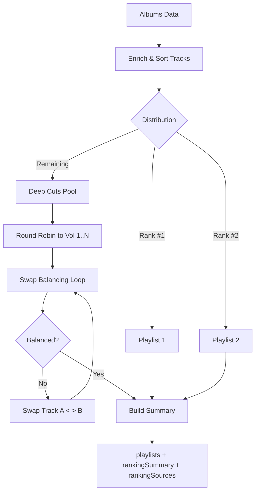

# Shared Code Analysis

> **Deep Dive Enrichment**: This document details the platform-agnostic business logic shared between Server and Frontend (if applicable), focusing on the Core Curation Engine.

## 1. Utilities: `shared/normalize.js`
**Status**: `[ACTIVE]`
**Type**: Utility / String Manipulation

**Purpose**: Provides standard canonicalization for fuzzy matching of track titles and artist names.

*   **Logic Trace**:
    1.  **Input**: Raw string (e.g., "Money (2023 Remaster)").
    2.  **Transformations**:
        *   Lowercase.
        *   Remove parentheticals `(...)`, `[...]`, `{...}`.
        *   Remove trailing dash suffixes that contain `remaster` or `mix` (e.g., `- 2011 Remaster`, `- 2023 Mix`).
        *   Remove all non-alphanumeric characters (punctuation).
        *   Collapse whitespace.
    3.  **Output**: Clean token string (e.g., "money").
*   **Consumers**: imported (dynamic `import()`) by `server/lib/ranking.js`, `server/lib/fetchRanking.js` and `server/routes/debug.js`, and by `shared/curation.js`.

---

## 2. Core Logic: `shared/curation.js` (The Curation Engine)
**Status**: `[ACTIVE]`
**Type**: Domain Logic / Algorithm
**Dependencies**: `normalize.js`

**Purpose**: The curation engine behind the server endpoint `POST /api/playlists`. Takes enriched albums and distributes tracks into balanced playlists (Greatest Hits, Deep Cuts). Entry point: `curateAlbums(albums, opts)`, which creates a `CurationEngine` and calls `curate`.

> The only importer is `server/routes/playlists.js`. The blend screen in the browser does not use this file; it uses the algorithms in `public/js/algorithms/` (see `18_Frontend_Logic_Core.md`).

### 2.1 Class `CurationEngine`

#### A. Track Enrichment (`enrichTracks`)
*   **Goal**: Merge multiple data sources onto the Track object before curation.
*   **Logic Trace**:
    1.  **Index Creation**: Builds maps for `Consolidated`, `BestEver`, and `Acclaim` data using `normalizeKey`.
    2.  **Resolution (Per Track)**:
        *   **Rating**: Checks `rating` > `Consolidated.rating` > `BestEver.rating` > `Acclaim.rating`.
        *   **Score**: Checks `acclaimScore` > `normalizedScore` > `Consolidated.normalizedScore` > the rating.
        *   **Rank**: Checks `acclaimRank` > `rank` > `Consolidated.finalPosition` > index (1-based).
    3.  **Sorting**:
        *   Sorts tracks by `Rating (desc)` -> `Score (desc)` -> `Rank (asc)`.
    4.  **Assignment**: Assigns a new `acclaimRank` (1..N) based on this final sort order to ensure "Rank #1" is truly the highest valued track.

#### B. Playlist Distribution (`curate`)
*   **Goal**: Distribute tracks into buckets.
*   **Logic Trace**:
    1.  **P1 (Greatest Hits Vol. 1)**: Takes the first track in acclaim order from EVERY album.
    2.  **P2 (Greatest Hits Vol. 2)**: Takes the second track in acclaim order from EVERY album.
    3.  **Deep Cuts**:
        *   Collects all remaining tracks.
        *   Calculates `TotalDuration`.
        *   Determines `N` playlists needed (`ceil(Total / TargetDuration)`, at least 1).
        *   **Round Robin Distribution**: Groups the remaining tracks by album and deals them, one album at a time, into the `N` playlists to ensure even spread of albums across volumes.
    4.  **Fill Heuristic** (runs before the Deep Cuts are built): If P1/P2 are shorter than the target, takes the best remaining tracks to fill them up, preferring albums not yet in that playlist.

#### C. Balancing Algorithm (`runFase4SwapBalancing`)
*   **Goal**: Ensure all playlists (P1 and P2 included) are close to `TargetDuration` (e.g., 45m).
*   **Logic Trace**:
    1.  **Detection**: Identifies `pOver` (Longest) and `pUnder` (Shortest).
    2.  **Check**: If both are within tolerance (`FLEXIBILITY = 7m`), stop.
    3.  **Swap Search**:
        *   Iterates every track in `pOver` vs every track in `pUnder`.
        *   **Constraint** (`isSwapValid`): the rank #1 track never leaves P1 and the rank #2 track never leaves P2; the last track of an album in a playlist can only be swapped for a track of the same album.
        *   **Optimization**: Finds the pair `(tOver, tUnder)` that minimizes the duration gap.
    4.  **Execute**: Performs swap and repeats (Max 100 iterations).

### 2.2 Visual Logic Flow

---

## 3. Service: `shared/services/AuthService.js`
**Status**: `[ACTIVE]`
**Type**: Service / Singleton (`authService`)

Wraps Firebase Auth for the browser: `signInWithGoogle()`, `signInWithApple()`, `logout()`, `onAuthStateChange(callback)`. The auth instance is read lazily (`getAuth()` on first use). Imported by `public/js/stores/UserStore.js`, `public/js/components/LoginModal.js`, `public/js/components/TopNav.js` and `public/js/components/navigation/AuthNav.js`.

---

## 3. The album identity rule: `shared/albumIdentity.js` - v5.0 (F55, slice 1)
**Status**: `[ACTIVE]` on the branch `fix/f55-one-album-identity-rule` (2026-11-19); not yet published.
**Type**: Domain rule, pure (it imports nothing).

**Purpose**: the ONE answer to "is this the album that was asked for?" (issue UAT-184). The app imports it through `public/js/models/askedAlbum.js`; the server loads it through `server/lib/albumIdentity.js` (dynamic `import()`, as it does for `normalize.js`).

*   **What it exports**:
    *   `compareAlbumIdentity(asked, candidate)` -> `{ verdict: 'same' | 'different', same, reason }`. Both sides are `{ artist, title, year? }`. `reason` is one of `exact-title`, `edition-of-title`, `artist-and-title-in-one-text`, `title-missing`, `title-mismatch`, `artist-mismatch`.
    *   `pickAlbum(asked, candidates, read)` -> `{ found, candidate, index, verdict }`. `read` turns a candidate of the source into `{ artist, title, year? }` (or a list of readings). No candidate passes: `found: false`. There is no "closest album".
    *   `sameArtist(a, b)`, for a source that lists artists; `albumFromLabel(label)`, for a label written "Title by Artist".
*   **The rule**:
    1.  The **title** must match on its own, whole. One title containing the other is not a match ("Core" is not "Core Memories").
    2.  The **artist** must match. A query with no artist is decided by the title alone.
    3.  The **year** never rejects (a reissue carries another year); it only orders the candidates that passed.
    4.  Order among those that pass: the exact title, then an edition of it, then the year nearest to the year asked for, then the order the source gave.
*   **Normalization**: accents out, lower case, apostrophes out, "&" read as "and", other punctuation as a word break, a leading "The" dropped, "Volume" as "Vol" and "Part" as "Pt"; the words are joined, so "AC/DC" is "ACDC". In an artist, "+" is "and" and the "and" between names is dropped. Roman and arabic numbers are not made equal ("IV" is not "4").
*   **Edition notes** are dropped before comparing: a group in `()`, `[]` or `{}` that is one year alone, one platform tag alone ("Live", "EP", "Single", "Explicit", "Clean") or has an edition word (deluxe, edition, remaster, expanded, anniversary, version, reissue, bonus, mono, stereo, mix, collector, legacy; "Ed." as the last word); and a subtitle after ":" or " - " under the same test.
*   **The subtitle decision**: a subtitle that is not an edition note is part of the title, in both directions. "Brighten the Corners: Nicene Creedence Ed." is "Brighten the Corners"; "The Wall: Live in Berlin" is not "The Wall".
*   **Known cost**: an album whose catalog title carries a qualifier that is not an edition ("Weezer (Blue Album)", "(Original Motion Picture Soundtrack)") is not found from the bare title.
*   **Tests**: `test/shared/albumIdentity.test.js` (the rule), `test/architecture/albumIdentityRule.test.js` (every call site asks it).
