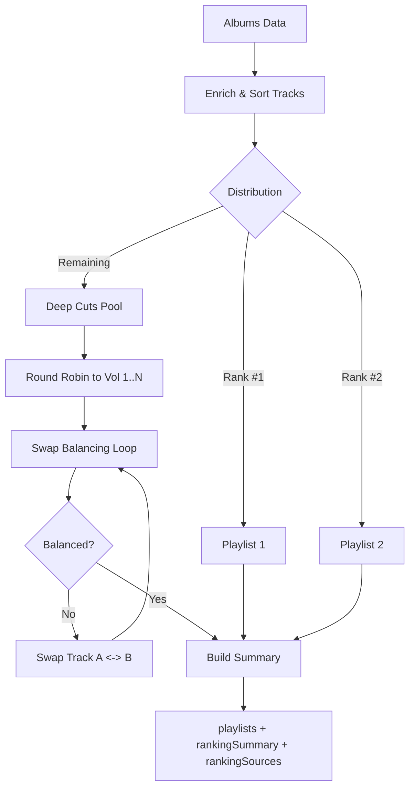

# Shared Code Analysis

> **Deep Dive Enrichment**: This document details the platform-agnostic business logic shared between Server and Frontend (if applicable), focusing on the Core Curation Engine.

## 1. Utilities: `shared/normalize.js`
**Status**: `[ACTIVE]`
**Type**: Utility / String Manipulation

**Purpose**: Provides standard canonicalization for fuzzy matching of track titles and artist names.

*   **Logic Trace**:
    1.  **Input**: Raw string (e.g., "Money (2023 Remaster)").
    2.  **Transformations**:
        *   Lowercase.
        *   Remove parentheticals `(...)`, `[...]`, `{...}`.
        *   Remove trailing dash suffixes that contain `remaster` or `mix` (e.g., `- 2011 Remaster`, `- 2023 Mix`).
        *   Remove all non-alphanumeric characters (punctuation).
        *   Collapse whitespace.
    3.  **Output**: Clean token string (e.g., "money").
*   **Consumers**: imported (dynamic `import()`) by `server/lib/ranking.js`, `server/lib/fetchRanking.js` and `server/routes/debug.js`, and by `shared/curation.js`.

---

## 2. Core Logic: `shared/curation.js` (The Curation Engine)
**Status**: `[ACTIVE]`
**Type**: Domain Logic / Algorithm
**Dependencies**: `normalize.js`

**Purpose**: The curation engine behind the server endpoint `POST /api/playlists`. Takes enriched albums and distributes tracks into balanced playlists (Greatest Hits, Deep Cuts). Entry point: `curateAlbums(albums, opts)`, which creates a `CurationEngine` and calls `curate`.

> The only importer is `server/routes/playlists.js`. The blend screen in the browser does not use this file; it uses the algorithms in `public/js/algorithms/` (see `18_Frontend_Logic_Core.md`).

### 2.1 Class `CurationEngine`

#### A. Track Enrichment (`enrichTracks`)
*   **Goal**: Merge multiple data sources onto the Track object before curation.
*   **Logic Trace**:
    1.  **Index Creation**: Builds maps for `Consolidated`, `BestEver`, and `Acclaim` data using `normalizeKey`.
    2.  **Resolution (Per Track)**:
        *   **Rating**: Checks `rating` > `Consolidated.rating` > `BestEver.rating` > `Acclaim.rating`.
        *   **Score**: Checks `acclaimScore` > `normalizedScore` > `Consolidated.normalizedScore` > the rating.
        *   **Rank**: Checks `acclaimRank` > `rank` > `Consolidated.finalPosition` > index (1-based).
    3.  **Sorting**:
        *   Sorts tracks by `Rating (desc)` -> `Score (desc)` -> `Rank (asc)`.
    4.  **Assignment**: Assigns a new `acclaimRank` (1..N) based on this final sort order to ensure "Rank #1" is truly the highest valued track.

#### B. Playlist Distribution (`curate`)
*   **Goal**: Distribute tracks into buckets.
*   **Logic Trace**:
    1.  **P1 (Greatest Hits Vol. 1)**: Takes the first track in acclaim order from EVERY album.
    2.  **P2 (Greatest Hits Vol. 2)**: Takes the second track in acclaim order from EVERY album.
    3.  **Deep Cuts**:
        *   Collects all remaining tracks.
        *   Calculates `TotalDuration`.
        *   Determines `N` playlists needed (`ceil(Total / TargetDuration)`, at least 1).
        *   **Round Robin Distribution**: Groups the remaining tracks by album and deals them, one album at a time, into the `N` playlists to ensure even spread of albums across volumes.
    4.  **Fill Heuristic** (runs before the Deep Cuts are built): If P1/P2 are shorter than the target, takes the best remaining tracks to fill them up, preferring albums not yet in that playlist.

#### C. Balancing Algorithm (`runFase4SwapBalancing`)
*   **Goal**: Ensure all playlists (P1 and P2 included) are close to `TargetDuration` (e.g., 45m).
*   **Logic Trace**:
    1.  **Detection**: Identifies `pOver` (Longest) and `pUnder` (Shortest).
    2.  **Check**: If both are within tolerance (`FLEXIBILITY = 7m`), stop.
    3.  **Swap Search**:
        *   Iterates every track in `pOver` vs every track in `pUnder`.
        *   **Constraint** (`isSwapValid`): the rank #1 track never leaves P1 and the rank #2 track never leaves P2; the last track of an album in a playlist can only be swapped for a track of the same album.
        *   **Optimization**: Finds the pair `(tOver, tUnder)` that minimizes the duration gap.
    4.  **Execute**: Performs swap and repeats (Max 100 iterations).

### 2.2 Visual Logic Flow

---

## 3. Service: `shared/services/AuthService.js`
**Status**: `[ACTIVE]`
**Type**: Service / Singleton (`authService`)

Wraps Firebase Auth for the browser: `signInWithGoogle()`, `signInWithApple()`, `logout()`, `onAuthStateChange(callback)`. The auth instance is read lazily (`getAuth()` on first use). Imported by `public/js/stores/UserStore.js`, `public/js/components/LoginModal.js`, `public/js/components/TopNav.js` and `public/js/components/navigation/AuthNav.js`.

---

## 3. The album identity rule: `shared/albumIdentity.js` - v5.0 (F55; reviewed in F68)
**Status**: `[ACTIVE]`. F55 (slices 1 and 2) is published (2026-11-19). The review of F68 is on the branch `fix/f68-album-identity-rules-reviewed` (2026-11-19); not yet published.
**Type**: Domain rule, pure (it imports nothing).

**Purpose**: the ONE answer to "is this the album that was asked for?" (issues UAT-184, UAT-205). The app imports it through `public/js/models/askedAlbum.js`; the server loads it through `server/lib/albumIdentity.js` (dynamic `import()`, as it does for `normalize.js`). The file reads top to bottom, in the order a comparison runs: normalization, the artist, the title (edition notes, first tier, second tier), one comparison, the choice among candidates, the readers of source labels, the search texts. Its header has the table of every reason with a real example, "How to add a rule" and where a rule for one genre would plug in.

*   **What it exports**:
    *   `compareAlbumIdentity(asked, candidate)` -> `{ verdict: 'same' | 'same-if-alone' | 'different', same, reason }`. Both sides are `{ artist, title, year? }`. `same` is true only for the verdict `same`. `reason` is one of `Reason`: `exact-title`, `edition-of-title`, `artist-and-title-in-one-text` (first tier); `title-before-subtitle`, `title-without-parentheses`, `title-in-parentheses`, `title-with-artist-name`, `title-written-otherwise` (second tier); `title-missing`, `title-mismatch`, `artist-mismatch`.
    *   `pickAlbum(asked, candidates, read)` -> `{ found, candidate, index, verdict }`. `read` turns a candidate of the source into `{ artist, title, year? }` (or a list of readings). No candidate passes: `found: false`. There is no "closest album". The verdict of a found album is always `same`; its reason says how it was accepted.
    *   `compareKeptAlbum(asked, kept)`: the same question for an album that is KEPT (a cache record, the album on screen), which has no candidates beside it. `kept` is `{ artist, title, identityReason? }`; the second tier is believed only when `identityReason` is the reason a pick left on the album.
    *   `compareOnlyAnswer(asked, answered)`: for a source that answers ONE album to a direct question (the AI search); the second tier applies.
    *   `sameArtist(a, b)`, for a source that lists artists; `albumFromLabel(label)` and `artistNamesFromLabel(label)`, for a label written "Title by Artist" or "Artist (US)".
    *   `titleWithoutEditionNotes(title)` and `titlesToSearch(asked)`: the title to SEND to a search. There is no other title cleaner in the app or in the server.
    *   The lists the rule is made of, as data: `ARTIST_EQUIVALENCES`, `SECOND_TIER_RULES`, `KNOWN_WRITINGS`, and `REASONS_EXPLAINED` (every reason with what it says and one real example; the tests run each row).
    *   `IDENTITY_RULE_VERSION` (2): bumped whenever a change can turn a "not found" into a found album. The server stamps its `not_found` with it and the browser's record is believed only while it is the app's version (see `AlbumCacheAdapter`).
*   **The artist** (`ARTIST_EQUIVALENCES`): two names are the same artist when they are the same words once normalized (what joins the names, "&", "and", "+", ",", and a leading "The" do not count: "Robert Plant & The Strange Sensation" is "Robert Plant And The Strange Sensation"), or the same names in another order ("Robert Plant & Jimmy Page" is "Jimmy Page & Robert Plant"). A longer or shorter name is another artist ("Page & Plant", "James Brown And His Famous Flames").
*   **The first tier** ("it is the album", `same`): the titles match WHOLE, as written or once the edition notes are dropped, and the artist is the same. One title containing the other is not a match ("Core" is not "Core Memories"). The year never rejects; it only orders the candidates that passed.
*   **The second tier** ("it is the album only if the source has nothing better", `same-if-alone`): a list of named rules (`SECOND_TIER_RULES`), each one way a source writes the album asked for with another title, each with a real example. One direction only: the title asked for is the short one. Never for a query with no artist.

    | Reason | Asked for | The source has |
    |---|---|---|
    | `title-before-subtitle` | "No Quarter" | "No Quarter: Jimmy Page And Robert Plant Unledded" |
    | `title-without-parentheses` | "In the Court of the Crimson King" | "In The Court Of The Crimson King (An Observation By King Crimson)" |
    | `title-in-parentheses` | "Led Zeppelin IV" | "Untitled (Led Zeppelin IV)" |
    | `title-with-artist-name` | James Brown, "Live At The Apollo" | "James Brown Live At The Apollo" |
    | `title-written-otherwise` | Frank Ocean, "Blonde" | "Blond" (a fact listed in `KNOWN_WRITINGS`, per artist) |

    Only `pickAlbum` turns it into `same`: when no candidate passed the first tier and every second-tier candidate is ONE album (the same title once the edition notes are dropped). Two different albums ("Greatest Hits: 1970-2002" and "Greatest Hits: Vol 2"; the three "Weezer (… Album)") is "not found". In the file there is one door (`acceptedAlone`), called by `pickAlbum` and `compareKeptAlbum`.
*   **Order among the candidates that pass**: the first tier before the second, the exact title, then an edition of it, then the year nearest to the year asked for, then the order the source gave.
*   **Normalization**: accents out, lower case, apostrophes out, "&" read as "and", other punctuation as a word break, a leading "The" dropped, "Volume" as "Vol" and "Part" as "Pt"; the words are joined, so "AC/DC" is "ACDC". Letters are not swapped ("Blonde" is not "Blond") and roman and arabic numbers are not made equal ("IV" is not "4").
*   **Edition notes** are dropped before comparing: a group in `()`, `[]` or `{}` that is one year alone, one platform tag alone ("Live", "EP", "Single", "Explicit", "Clean") or has an edition word (deluxe, edition, remaster, expanded, anniversary, version, reissue, bonus, mono, stereo, mix, collector, legacy; "Ed." as the last word); and a subtitle after ":" or " - " under the same test. "Brighten the Corners: Nicene Creedence Ed." is "Brighten the Corners".
*   **Known costs**: a long title asked for never accepts the short album, so a reissue with another name is "not found" where the source only has the original ("More Balls to Picasso", "Unreal Unearth: Unheard"); a title that differs by a letter needs an entry in `KNOWN_WRITINGS`; a second-tier album that is alone in what a source listed is accepted, flagged, even when it is a neighbour ("Hotel California" asked for, only "Hotel California (Live at the Forum '76)" listed).
*   **Tests**: `test/shared/albumIdentity.test.js` (the behaviours of F55), `test/shared/albumIdentityRules.test.js` (every reason, equivalence and second-tier rule with its example and the nearest album it refuses), `test/server/ratingsSourceSweep.test.js` (the 16 albums of the sweep of 2026-11-19 against the saved answers of the source), `test/models/askedAlbumOtherSources.test.js`, `test/architecture/albumIdentityRule.test.js` (every call site asks it; the tiers cannot be bypassed; the lists and the version move together).
