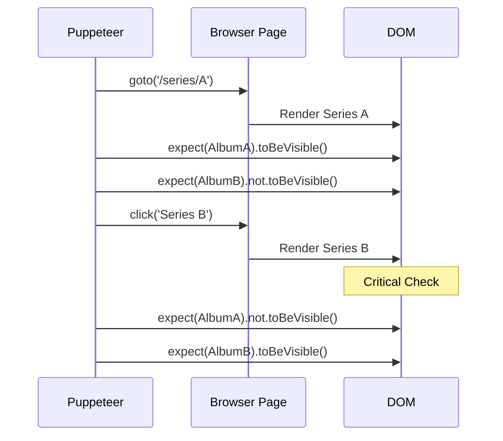

# Deep Dive: Application Test Suite (Batch 13)

This document audits the contents of the `test/` directory, which contains the **Verification Layer** of the application.

> **Correction**: Previous analysis incorrectly stated tests were missing (looked in `tests/` instead of `test/`). The suite is actually **Active and Modern**, using **Vitest** for unit tests and a custom Puppeteer setup for E2E.

## 1. Overview
The test suite is structured into clear layers, mirroring the application architecture.

| Layer | Framework | Location | Focus |
| :--- | :--- | :--- | :--- |
| **End-to-End (E2E)** | Puppeteer | `test/e2e/` | Browser automation, smoke tests, critical user flows. |
| **Unit (Stores)** | Vitest | `test/stores/` | State management logic, subscriptions, mutations. |
| **Unit (Views)** | Vitest | `test/views/` | Component rendering, event handling, store interaction (mocked). |
| **Unit (Services)** | Vitest | `test/services/` | Business logic, API adapters, Auth logic. |
| **Algorithms** | Vitest | `test/algorithms/` | Core logic verification (TopN, sorting, mixins). |
| **Unit (Models)** | Vitest | `test/models/` | Pure rules: album load state, paging, series filter, own ranking, text. |
| **Architecture** | Vitest | `test/architecture/` | Import boundaries of the album loading, of the own ranking and of the saved playlists read (`savedPlaylistsBoundaries.test.js`, v5.0, F61). |
| **Other unit folders** | Vitest | `test/api/`, `test/cache/`, `test/components/`, `test/controllers/`, `test/ranking/`, `test/repositories/`, `test/transformers/`, `test/utils/` | One folder per layer of `public/js/`. |
| **Server** | Node scripts | `server/test/` | Run by `npm test` inside `server/` (not by Vitest). |
| **Helpers** | Vitest | `test/helpers/` | `fakeFirestore.js` (v5.0, F60): an in-memory double of `firebase/firestore` with atomic batches, a network turn per call, and `failNext` / `holdNext` to make a write fail or stay in the air. The save, series-delete and restore tests look at what is left in the database through it. Since F61 it also counts reads: `fake.reads()` lists every read in order, `fake.maxReadsAtOnce()` says how many were in the air together, and `failNext('read', error, { path })` fails the read of one path. `test/services/playlists/SavedPlaylistsReader.reads.test.js` uses them as the fitness test of the saved playlists read (1 + N reads, 8 at once, 7 waits for 47 series). |

**How they run**: `npm test` runs Vitest (`vitest.config.js`: `jsdom`, `test/**/*.test.js`, `test/e2e/**` excluded). The E2E layer has its own runner, `npm run test:e2e` (`test/e2e/run-all.js`), against a running app; its `BASE_URL` defaults to `http://127.0.0.1:5010`.

---

## 2. Test Components Deep Dive

### End-to-End (E2E) Layer
*   **Setup**: `setup.js` handles browser launching and page creation. `helpers.js` provides navigation utilities.
*   **Smoke Test (`smoke.test.js`)**:
    *   Verifies core app visibility: Title, Header, Logo, Navigation Links.
    *   Navigates to critical routes (`/albums`, `/blend`, `/inventory`).
    *   **Revamped (Sprint 19)**: Updated to match V3 Navigation Logic (`/home` redirection).
*   **Blending Wizard (`blending-wizard.test.js`)**:
    *   **Golden Path**: Automates the V3 Blending flow: Select Series -> Configure Ingredients -> Generate Playlist.
    *   Verifies the full "Creation Pipeline".
*   **Legacy Regressions (`issue-*.test.js`)**:
    *   Cover historical bugs (#15 Ghost Albums, #16 View Toggle, #19 Series Switching, #21 Sticky Playlists).
*   **Coverage**: High coverage of critical paths. `helpers.js` now supports the V3 "Initialize Load" workflow.

### Store Layer (`test/stores/`)
*   **Pattern**: Tests the **Public Interface** of stores (`add`, `remove`, `subscribe`, `getState`).
*   **Example (`albums.test.js`)**:
    *   Verifies that `addAlbum` correctly updates state.
    *   Ensures `subscribe` listeners are fired on changes.
    *   Checks for duplicate prevention logic.
*   **Value**: High. Ensures state management is predictable.

### View Layer (`test/views/`)
*   **Technique**: **Dependency Injection / Mocking**.
*   **Example (`ConsolidatedRankingView.test.js`)**:
    *   **Steps**:
        1.  Setup: Create 3 Albums (Series A, Series B, Series C).
        2.  Navigate: Go to Series A.
        3.  Assert: Only Album A is visible.
        4.  Navigate: Switch to Series B.
        5.  Assert: Only Album B is visible (Album A is gone).

### Ghost Test Sequence

        *   Filtering logic (`getFilteredTracks`).
        *   Sorting logic (`rank` vs `rating`).
        *   DOM updates (checking `querySelectorAll`).
*   **Value**: Critical for ensuring UI logic is decoupled from actual data sources.

### The album identity rule (F55, slices 1 and 2)
*   `test/shared/albumIdentity.test.js`: the rule itself, pair by pair ("Core" is not "Shangri-La Dee Da" nor "Core Memories"; editions; subtitles; self-titled and numbered titles; the year only orders) and, since slice 2, the second tier by candidate list ("No Quarter"; "The Wall" with and without "The Wall" itself; the two "Greatest Hits"; one direction only) and the kept album (`compareKeptAlbum`).
*   One file per place that accepts an album, each with doubles and no network: `test/services/albums/catalogIdentity.test.js` (Apple Music, the stored id), `test/api/clientIdentity.test.js` (the AI answer, the old Apple path), `test/services/spotify/SpotifyAlbumMatch.test.js`, `test/services/OptimizedAlbumLoader.identity.test.js`, `test/server/scraperIdentity.test.js` (BestEverAlbums, with answers in the shape the source gives), `test/server/spotifyAlbumIdentity.test.js`.
*   `test/services/albums/albumIdentityAudit.test.js`: the read-only count.
*   `test/architecture/albumIdentityRule.test.js`: a fitness function; it fails when a call site stops asking the rule or compares texts by itself. Since slice 2 it also fails when a call site names or grants the second tier, when a reader of the album caches or `SeriesService` stops asking the rule, and when a second path to write the corrected Apple Music id appears.
*   Slice 2: `test/services/series/SeriesFactsService.test.js` (the corrected id written once, with the facts), `test/services/albums/adapters.test.js` and `test/api/clientIdentity.test.js` (a kept album that is not the album asked for is dropped when read), `test/services/SeriesService.identity.test.js` (adding and removing an album), `test/components/ui/AlbumCardIdentityNote.test.js` (the line on the card).

### Service Layer (`test/services/`)
*   **Technique**: Mocking External Dependencies (Firebase).
*   **Example (`AuthService.test.js`)**:
    *   Mocks `firebase/auth` methods (`signInWithPopup`, `signOut`).
    *   Verifies that the service correctly calls the underlying SDK (Google and Apple providers, `signOut`, `onAuthStateChanged`) and that the auth instance is read lazily.

---

## 3. Analysis Verdict
*   **Status**: **Healthy / Active**.
*   **Tech Stack**: Modern (Vitest + Puppeteer).
*   **Gap**: ~Logic coverage for algorithms~ (Resolved: `topn.test.js` updated for Sprint 17.5). Remaining gap: E2E test reliability on local dev environments (timeouts).

## 4. Recommendations
1.  **Expand E2E**: Add a "Golden Path" test: *Login -> Select Series -> Generate Playlist -> Verify Output*.
2.  **Algorithm Tests**: Ensure `MJRPBalancedCascadeAlgorithm` has comprehensive edge-case testing (e.g., empty slots, missing ingredients).
