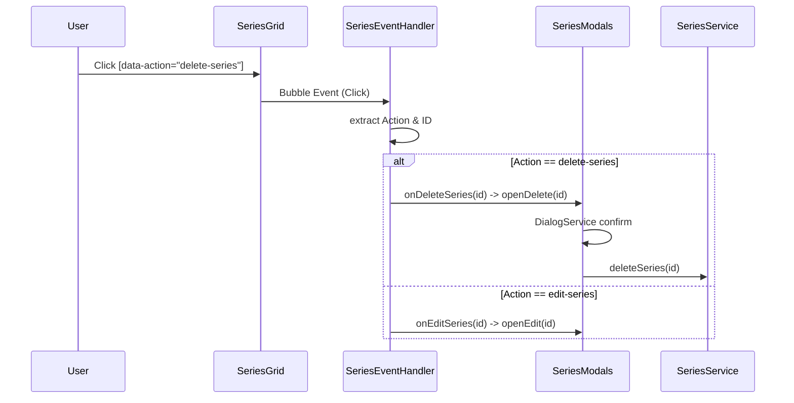

# Frontend Components Analysis (Complex Systems)

## Series & Navigation (`series/`, `navigation/`)
**Status**: `[ACTIVE]`

-   **`ui/FilterToolbar.js` & `series/SeriesFilterBar.js`**:
    -   **Role**: UI components for filtering albums/series.
    -   **Logic**: `FilterToolbar` (which replaced `series/SeriesToolbar.js`, a file that no longer exists) is the high-level container combining Search, Filter Dropdowns, and View Toggles. `SeriesFilterBar` is a smaller, older implementation that no module imports.
-   **`series/ArtistScanner.js`**: removed in F57. Adding albums in the series edit is the one album picker (`album-picker/AlbumPickerPanel.js`).
-   **`series/SeriesGridRenderer.js`**:
    -   **Role**: Adapter that delegates rendering to `AlbumsGridRenderer` and `AlbumsScopedRenderer`.
    -   **Pattern**: Supports both 'ALL' setup (grouped by series) and 'SINGLE' setup (flat grid). In the 'ALL' grid each series is cut at 12 albums, with the "Load N more albums" button, unless the view lists it in `expandedSeriesIds` (v5.0, F49).
-   **`series/SeriesEventHandler.js`**:
    -   **Role**: centralized event delegation for Series and album actions (`edit-series`, `delete-series`, `retry-series`, `load-more-series`, `view-modal`, `add-to-inventory`, `remove-album`, `rank-album`, `refetch-metadata`).
    -   **Logic**: Intercepts clicks, identifies actions via `data-action`, and delegates: series actions go to the callbacks it was given (`onEditSeries`, `onDeleteSeries`, `onRetrySeries`, `onShowAllAlbums`); album actions go to modals, `DialogService` or the callbacks (`onRefetchMetadata`, `onSaveRanking`).

### Command Delegation Flow

-   **`navigation/SeriesDropdown.js`**:
    -   **Role**: Top navigation dropdown for switching entity modes (Albums, Playlists, etc.).
    -   **Logic**: Checks `window.location.pathname` to highlight active route. An entity that is not there yet (By Artist, By Genre, By Track) is drawn with "Soon", `aria-disabled` and no address: it is not a link, so a click goes nowhere (F63).

## Playlists System (`playlists/`)
**Status**: `[ACTIVE]`

Detailed controller-view logic for the Playlists feature.

-   **`playlists/SavedPlaylistsController.js`**:
    -   **Role**: The brain of the Saved Playlists view (`SavedPlaylistsView`, routes `/playlist-series` and `/saved-playlists`).
    -   **Logic**: Since v5.0 (F61) it reads nothing itself: it asks `SavedPlaylistsReader` (`services/playlists/`) and hands the view what `SavedPlaylistsStore` holds. Grouping playlists into "Batches" by `batchName` (newest `savedAt` first) is a pure rule in `models/savedPlaylists.js`; batch deletion and the covers moved to the reader.
-   **`playlists/PlaylistsGridRenderer.js`**:
    -   **Role**: Static HTML generator for the playlist grid.
    -   **Logic**: Renders the `RegeneratePanel`, Empty States, and delegates the actual Grid rendering to `PlaylistGrid`.
-   **`playlists/PlaylistGrid.js`**:
    -   **Role**: Renders the responsive grid of `PlaylistCard`s containing `TrackRow`s.
-   **`playlists/PlaylistsDragBoard.js` & `PlaylistsDragHandler.js`**:
    -   **Role**: Drag-and-drop management.
    -   **Logic**: `DragBoard` provides a Kanban-style layout (horizontal columns), but no module imports it. `DragHandler`, used by `PlaylistsView`, wraps `SortableJS` to manage track movement between playlists (drag-and-drop across lists).
-   **`playlists/RegeneratePanel.js`**:
    -   **Role**: "Reconfigure" UI letting users change algorithms on an existing batch.
    -   **Reuse**: Reuses `BlendRecipeCard` and `BlendIngredientsPanel` from the Blend Wizard.

## Ranking System (`ranking/`)
**Status**: `[ACTIVE]`

-   **`ranking/TracksRankingComparison.js`**:
    -   **Role**: Smart container for comparing "Original Order", "Critic Rank" (BEA), and "Popularity" (Spotify).
    -   **Logic**: 
        -   Normalizes track data from multiple sources.
        -   Calculates averages (Avg Rank, Avg Popularity).
        -   Shows one line about the album's Spotify popularity from the state the album load gives (`models/popularityState.js`) and asks for it again through `popularity.onAsk`; it no longer talks to Spotify (F69).
-   **`ranking/TracksTable.js`**:
    -   **Role**: Desktop component for the comparison table.
    -   **Visuals**: Renders composite badges (Rank # + Stars) and Popularity Bars (Green progress bar).
