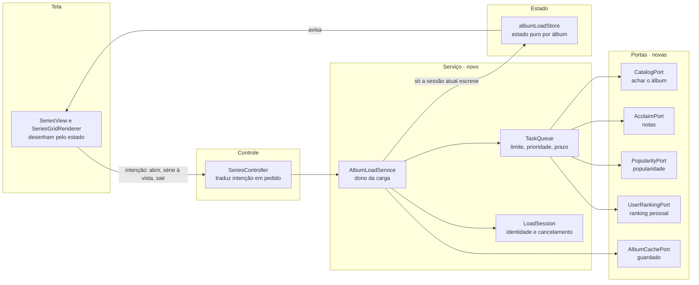
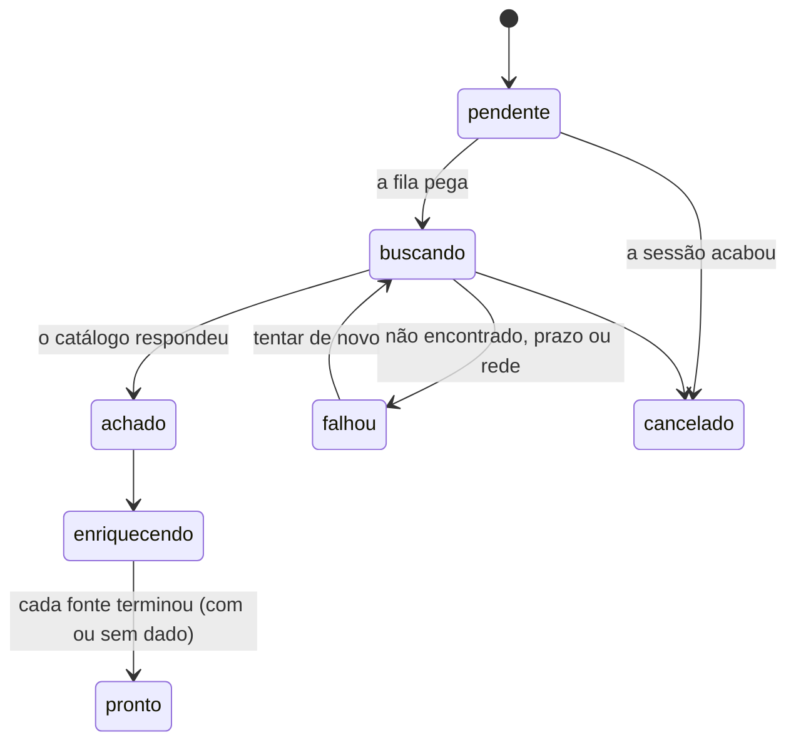
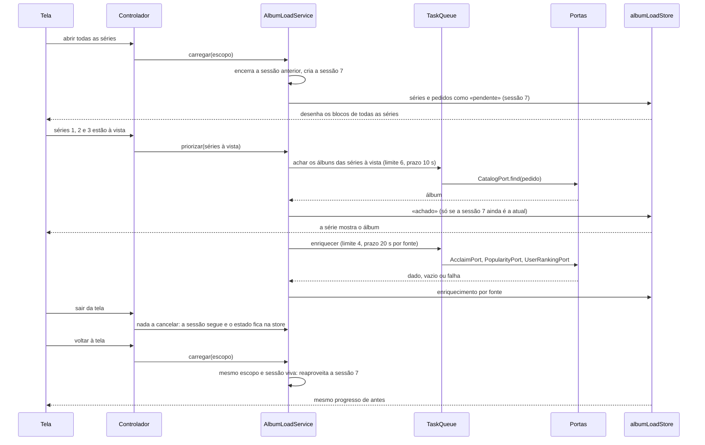
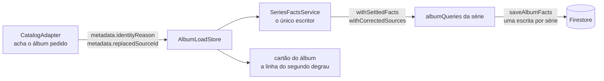
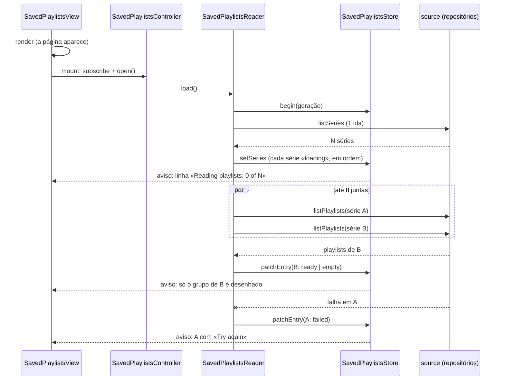

# Architecture: MJRP_AlbumsBalancedPlaylists_v0 (Album Blender v0)

> Escrito em 2026-10-28 (conform do harness) **do que o código é hoje**, não do ideal, e corrigido no mesmo dia depois da crítica independente (`reports/audits/2026-10-28-mjrpalbumblender-v0-architecture-audit.md`). Fontes: o manual do v0 (`docs/manual/01_System_Architecture.md` §1, §3, §5; `02`–`04`; `00_Deployment_and_Setup.md` §1–3), o mapa do código feito pelo V1 (`MJRPalbumblender-v1/reports/audits/2026-10-27-mjrpalbumblender-v1-project-bootstrap-report.md`, usado só para localizar) e a leitura direta do código, cujas linhas estão citadas. Onde o manual e o código discordam, vale o código.
> **Regras e código.** Este arquivo diz o que o código faz. Onde o código descumpre uma regra aprovada (constituição, `PRINCIPLES.md`, ADR), o texto traz a regra e, ao lado, **"Conserto:"** com o achado do relatório de auditoria que o registra; a regra continua valendo, e o código é que deve mudar. Não é uma lista de problemas (Art. III da constituição): é o ponteiro que impede ler a regra como se estivesse cumprida.
> Estado: **Draft** até o MJRP aprovar.

## System Overview
O Album Blender v0 monta playlists balanceadas a partir de **séries** de álbuns: o usuário cria uma série (artista ou lista curada), o app descobre os álbuns no Apple Music, busca a aclamação de cada faixa e o **Blending Menu** gera a playlist por uma **Recipe** (algoritmo de curadoria: `mjrp-balanced-cascade`, `top-n-popular`, `top-n-acclaimed`, `top-n-user`, registro em `public/js/algorithms/index.js:24-30`). A playlist pode ser editada, salva e exportada para o Spotify ou o Apple Music. Está **em produção**.

A forma é de **duas metades**: uma SPA em JavaScript puro, que roda no navegador, guarda o estado e fala direto com o Firestore, o Spotify e o Apple MusicKit; e um servidor Node/Express pequeno, no Cloud Run, que existe para o que o navegador não pode fazer: raspar o BestEverAlbums, chamar o Gemini com a chave guardada, e assinar o token de desenvolvedor do Apple MusicKit. **O servidor não acessa o Firestore** (nenhum import de Firebase em `server/`). Como não há servidor entre o navegador e o banco, **as regras do Firestore (`firestore.rules`) são a única autorização dos dados**.

## Component Map
Os nomes da coluna *Stack layer* são as camadas de `docs/specs/tech-stack.md`.

### Navegador (`public/`)
| Component | Responsibility | Stack layer |
|-----------|---------------|-------------|
| Casca da SPA e roteador (`public/index.html`, `js/app.js`, `js/router.js`) | arranque, as **18** rotas registradas por History API (`app.js:113-171`, 18 chamadas `router.register`), CSP e folhas de estilo (as do app e a do Tailwind, compilada junto com o site: `css/tailwind.css`) | Front |
| Views (`js/views/`) | desenham uma tela; assinam stores e delegam a ação ao controller | Front |
| Controllers (`js/controllers/`) | o "cérebro" de uma tela: recebe a entrada, chama Services, atualiza a store. Hoje `PlaylistsController.js:92-93, 312, 325, 334` instancia repositórios, e `SeriesController.js:22` e `BlendingController.js:22` usam `userRankingRepository` direto | Front |
| Componentes e renderizadores (`js/components/`, `js/views/renderers/`) | blocos de UI reutilizáveis (cartões, modais, assistente de Blend, navegação) | Front |
| Stores (`js/stores/`) | guardam o estado em memória e avisam quem assinou (Observer). **Regra: só estado** (ADR-0017). Hoje só `albumSeries.js` e `playlists.js` cumprem; `inventory.js`, `albums.js`, `SpotifyEnrichmentStore.js` e `UserStore.js` fazem I/O (repositório, cache, SDK do Firestore ou login). Conserto: achado 5 da auditoria | Front |
| Services (`js/services/`) | lógica de negócio e orquestração: séries, playlists, geração, persistência, exportação Spotify, autenticação, busca de álbuns (`services/album-search/`), MusicKit (`services/musickit/`), `services/infra/StorageService.js` (localStorage), `services/playlists/PlaylistHistoryService.js` (desfazer/refazer), `services/auth/UserSyncService.js` (migração de usuário) | Front |
| Algoritmos e ranking (`js/algorithms/`, `js/ranking/`, `js/transformers/`) | as Recipes de geração e as estratégias de ranking (Strategy). Não importam Firebase, DOM nem `localStorage` | Front |
| Repositories (`js/repositories/`) | **o adaptador declarado do Firestore**: um por fonte de dados, sobre `BaseRepository` (`repositories/BaseRepository.js`). Hoje o SDK do Firestore também é importado fora daqui (ver *Data Flow*) | Dados |
| Cache (`js/cache/`) | L1 memória + L2 IndexedDB `mjrp-cache` (`cache/CacheManager.js`) | Dados |
| Clientes externos (`js/api/client.js`, `services/SpotifyAuthService.js`, `services/musickit/`) | falam com `/api/*` (por `fetch`), com o Spotify (OAuth PKCE) e com o Apple MusicKit | Integrações externas |
| Worker de busca (`js/workers/search.worker.js`) | busca de autocompletar fora da thread principal, sobre `albums-autocomplete.json` | Front |

### Compartilhado (`shared/`)
| Component | Responsibility | Stack layer |
|-----------|---------------|-------------|
| Curadoria (`shared/curation.js`) | as regras de curadoria de playlist, executáveis nos dois lados | Linguagem |
| Normalização (`shared/normalize.js`) | limpeza de texto de título/artista | Linguagem |
| Identidade do álbum (`shared/albumIdentity.js`) | a regra única de «este é o álbum pedido» (F55), pura; o app a usa por `public/js/models/askedAlbum.js` e o servidor por `server/lib/albumIdentity.js`. Ver «Uma regra só para dizer que é o mesmo álbum», no fim deste arquivo | Linguagem |
| Autenticação de usuário (`shared/services/AuthService.js`) | login Google/Apple e saída, sobre `firebase/auth`; **só o navegador o usa** (`stores/UserStore.js` o importa por `@shared/`); o servidor não. Existe também outro `AuthService` em `public/js/services/AuthService.js` (login anônimo) | Dados |

### Servidor (`server/`, Cloud Run)
| Component | Responsibility | Stack layer |
|-----------|---------------|-------------|
| Entrada (`server/index.js`) | Express, CORS por `ALLOWED_ORIGIN`, saúde em `/_health` (`:87`), monta as rotas sob `/api` | Back |
| Rotas finas (`server/routes/`: `albums`, `playlists`, `ai`, `musickit`, `debug`) | recebem a requisição e chamam Services (`POST /api/enrich-album`, `/generate`, `/playlists`, `/ai/studio-albums`, `GET /musickit-token`, rotas de depuração) | Back |
| Services (`server/lib/services/`: `EnrichmentService`, `GenerationService`, `spotifyPopularity`) | a lógica de enriquecer e gerar | Back |
| Fachada de ranking (`server/lib/fetchRanking.js`, `lib/ranking.js`) | esconde raspagem + IA + fallbacks; consolida por Borda Count | Back |
| Raspador (`server/lib/scrapers/besteveralbums.js`) | lê as notas de faixa do BestEverAlbums | Back |
| Cliente de IA (`server/lib/aiClient.js`, `lib/prompts.js`, `config/prompts.json`) | chama o Gemini com prompts externalizados | Integrações externas |
| Validação (`server/lib/schema.js`, `server/schema/album.schema.json`) | valida o álbum com AJV | Back |
| Token do MusicKit (`server/services/MusicKitTokenService.js`) | assina o token de desenvolvedor (JWT ES256) | Integrações externas |

## Stack
As tecnologias, as versões e as decisões por trás delas moram em `docs/specs/tech-stack.md` - este arquivo aponta para lá, não as lista.

## Data Flow
```
Navegador (SPA)
  View -> Controller -> Service -> Repository --> Firestore   (direto; o servidor não participa)
                          |  \--> Store (estado; avisa as Views)
                          |  \--> Cache L1 memória / L2 IndexedDB / localStorage
                          +--> api/client.js --/api/*--> Firebase Hosting (rewrite) --> Cloud Run (server)
                          |                                     Rotas -> Services -> BestEverAlbums (raspa) / Gemini (REST)
                          +--> Spotify Web API (OAuth PKCE, token no localStorage)
                          +--> Apple MusicKit JS (token de desenvolvedor vem de /api/musickit-token)
```
O desenho acima é a **direção-alvo**; o que o código faz hoje está logo abaixo, em *Direção das dependências e fronteira do Firestore*.

1. **Criar a série.** Home -> "Scan Artist" no Apple Music -> montagem -> grava no Firestore só a lista de pedidos `albumQueries`, não os álbuns (Apêndice B §2 do mapa do V1).
2. **Carregar e enriquecer.** O cliente resolve cada pedido no Apple Music e pede `POST /api/enrich-album`; o servidor raspa o BestEverAlbums e devolve o ranking das faixas. A cascata completa só roda em `/generate`, o fallback legado: BestEverAlbums primeiro; o Spotify entra se o BestEverAlbums achar menos de 3 faixas com nota **e** menos de 40% das faixas conhecidas (`server/lib/fetchRanking.js:162-169`; o comentário do código diz "previously 50%"); depois o Gemini; depois Borda Count. O Spotify também enriquece pelo cliente, com cache global em `spotify_enrichment`.
3. **Gerar.** O assistente do Blending Menu (série -> Recipe -> ingredientes -> "Blend It!") roda a Recipe no navegador; o estado fica nas stores, o rascunho em `localStorage`.
4. **Salvar e exportar.** A playlist vai para o Firestore em `artifacts/mjrp-albums/users/{uid}/curator/data/series/{seriesId}/playlists` (`mjrp-albums` é um segmento de caminho fixo no código, não o projeto Firebase); a exportação para Spotify ou Apple Music sai do cliente.
5. **Identidade.** Firebase Auth com login anônimo automático para qualquer visitante (`public/js/services/AuthService.js:58`); os dados do usuário ficam sob o `uid`. O login com Google/Apple (`shared/services/AuthService.js:22`, `signInWithPopup`) troca de `uid`; os dados da sessão anônima ficam no `uid` antigo.
6. **Quando uma leitura do servidor falha.** O servidor responde **200 com resultado vazio**, não um erro: se o raspador falha, `/enrich-album` devolve `bestEverInfo: null` e notas nulas, igual ao álbum sem nota (`server/lib/services/EnrichmentService.js:27-33, 99-104`); `/ai/studio-albums` devolve `{ albums: [], error }` com 200 (`server/routes/ai.js:62-66`); sem `prompts.json`, `loadPrompts()` devolve `{}` com um aviso no log (`server/lib/prompts.js:6-22`). O cliente não distingue "sem dado" de "fonte fora do ar". Regra: sem falha silenciosa (`PRINCIPLES.md` §I.8). Conserto: achado 7 da auditoria.

### Direção das dependências e fronteira do Firestore
**Regras:** as dependências apontam para dentro, e o adaptador do Firestore é o Repository (`PRINCIPLES.md` §I.3; constituição, *Padrões com endereço*); a regra de negócio nasce como Service (ADR-0016); a Store só guarda estado e o Service a atualiza pelos setters (ADR-0017); trocar a fonte de dados é mexer num arquivo.

**O que o código faz hoje:**
- O núcleo está limpo: `algorithms/`, `models/`, `ranking/`, `transformers/` e `shared/curation.js` não importam Firebase, DOM nem `localStorage`.
- O SDK do Firestore é importado **fora de `repositories/`**: `public/js/services/PlaylistsService.js:17` (`writeBatch`, usado em `:243`), `public/js/stores/albums.js` (até a F48, de 2026-11-19, que levou a gravação para `repositories/SharedAlbumRepository.js` e tirou o Firestore da store) e `public/js/views/SaveAllView.js:5-6` (que carrega o SDK Firestore e Auth **11.6.1 pelo CDN `gstatic`**, enquanto o app usa o pacote npm 10.14.1: duas versões do SDK no mesmo app). Trocar a fonte de dados mexe em `BaseRepository`, nos 7 repositórios, nos 2 arquivos que restam, em `MigrationUtility` e em `firebase-init.js`, não em um. Viola `PRINCIPLES.md` §I.3 e a ADR-0017. Conserto: achado 1 da auditoria.
- O caminho "View -> Controller -> Service -> Repository" não vale sem exceção: `PlaylistsController` e `SeriesController` falam com `Repository` sem passar por Service; `views/SeriesView.js:16, 68` importa o `db` e o passa ao controller; `components/TopNav.js:8` e `stores/inventory.js:7` importam o `db` de `app.js` (que importa todas as Views, o que cria um ciclo `app.js <-> stores/inventory.js`). Viola `PRINCIPLES.md` §I.3 e a ADR-0016. Conserto: achado 4.

## Infrastructure
- Hosting: o **frontend** em Firebase Hosting, servindo `dist` (build do Vite); `firebase.json` reescreve `/api/**` para o serviço Cloud Run `mjrp-proxy` (região `southamerica-east1`) e o resto para `/index.html` (`firebase.json:3-20`). O **backend** em Cloud Run (`mjrp-proxy`, contêiner `node:24-slim`, `server/Dockerfile`, publicado por `npm run deploy:server`), acesso público.
- Database: **Firestore** do projeto Firebase **`mjrp-playlist-generator`**. O app o recebe de `public/js/firebase-config.js:3-10` (`window.__firebase_config`), carregado por `public/index.html:111` antes do `app.js` (`:112`); `.firebaserc`, `scripts/deploy-backend.sh` (`PROJECT_ID`) e o CORS padrão do servidor (`server/index.js:58`) apontam para o mesmo projeto. O bloco `mjrp-albums` de `public/js/firebase-init.js:6-13` é só o valor reserva, com chave de marcador (`API_KEY_PLACEHOLDER`): não funciona. `mjrp-albums` também é o `appId` fixo no caminho `artifacts/mjrp-albums/...` (`InventoryRepository.js:20`, `SeriesRepository.js:21`), uma constante de caminho. No navegador, IndexedDB `mjrp-cache` e `localStorage`. O backend não tem banco.
- **Quem pode ler e escrever o quê no Firestore** (`firestore.rules`, lido linha a linha; "autenticado" vale para qualquer visitante, porque o app faz login anônimo sozinho):

| Caminho | Quem lê e escreve (regra) | Quem escreve no código |
|---|---|---|
| `artifacts/{appId}/users/{uid}/curator/**` e `.../inventory/**` (`:8-13`) | só o dono (`uid`) | repositórios (o `PlaylistsService` grava pelo `PlaylistRepository` desde a F60) |
| `users/{uid}/series/**` (`:19-28`) | só o dono | ninguém além da migração legada |
| `users/{uid}/albumRankings/{albumId}` (`:32-35`) | **qualquer pessoa, até sem login** (`allow read, write: if true`; o comentário das linhas 33-34 diz "DEBUG ... mudar para `request.auth != null` antes do lançamento") | `UserRankingRepository` |
| `albums/{albumId}` (`:42-43`) | **qualquer autenticado**, inclusive anônimo, em qualquer documento; sem dono | `stores/albums.js` |
| `spotify_enrichment/{albumKey}` (`:49-51`) | **qualquer autenticado**, inclusive anônimo; cache global sem dono | `SpotifyEnrichmentRepository` |

Regra: a estabilidade da produção e os dados do usuário não ficam abertos a qualquer visitante (constituição, Art. V). Conserto: achado 2 da auditoria. **Nenhum pipeline do repositório publica `firestore.rules`**: `firebase.json` não tem bloco `firestore`, e `.github/workflows/ci-firebase.yml:73, 120` e `scripts/deploy-prod.sh` implantam só `--only hosting`; o que está em produção pode não ser este arquivo.
- Segredos: no Secret Manager do Google Cloud, injetados no Cloud Run (`AI_API_KEY`, `APPLE_TEAM_ID`, `APPLE_KEY_ID`, `APPLE_MUSIC_PRIVATE_KEY`); a ligação entre segredo e variável mora na configuração do serviço e está descrita em `docs/manual/00_Deployment_and_Setup.md` (seção 2.4); em desenvolvimento, `server/.env`.
- Implantação do **frontend**: `scripts/deploy-site.sh` (`npm run deploy:site`), da máquina do MJRP, com o login do Firebase CLI: exporta a `main` para uma pasta limpa, roda os testes, constrói com o `.env`, confere o que construiu, publica só o Hosting e confere produção (F64, 2026-11-19). A automação do GitHub (`.github/workflows/ci.yml`) só roda os testes; não publica.
- Implantação do **backend**: uma receita só, `scripts/deploy-server.sh` (`npm run deploy:server`): exporta a `main`, roda os testes, monta o contexto (`shared/` em `server/_shared_temp`, `config/` em `server/config`), sobe o servidor localmente para conferir, e publica com `gcloud run deploy --source server`, que constrói a imagem pelo `server/Dockerfile`. A segunda receita (`cloudbuild.yaml`), que não copiava `config/`, foi removida na F64. O script imprime a revisão que estava no ar e o comando para voltar a ela.
- CDN/Assets: o Tailwind não vem mais de CDN: é compilado junto com o site (`tailwind.config.js`, `public/css/tailwind.css`; [[ADR-0021]], F59). A fonte Syne vem do Google Fonts (`public/index.html`); o SDK do Apple MusicKit vem de `js-cdn.music.apple.com` (`services/musickit/MusicKitAuth.js:124`); o conjunto de álbuns do autocompletar é o arquivo estático `albums-autocomplete.json`.

## Constraints
- **Segurança e abuso.**
  - Segredos por variável de ambiente e Secret Manager, nunca no código (Constituição Art. V; `PRINCIPLES.md` §I.14). A chave do Gemini e a chave privada da Apple ficam só no servidor: por isso o servidor existe.
  - O acesso aos dados do usuário é o da tabela da seção *Infrastructure*, não "escopo por dono em tudo".
  - O backend é público: sem autenticação e sem limite de taxa em nenhuma rota; em produção o CORS aceita as origens de `ALLOWED_ORIGIN` (padrão `https://mjrp-playlist-generator.web.app`, `server/index.js:58-70`) **e** qualquer requisição sem cabeçalho `Origin` (`:66`). As rotas de depuração (`/api/debug/*`, `/api/list-models`) são montadas em qualquer ambiente (`server/index.js:134-136`); `GET /api/debug/files` lista qualquer pasta do contêiner por `?path=` (`server/routes/debug.js:98-104`). `POST /api/ai/studio-albums` concatena o `artistName` livre no prompt e chama o Gemini pago com a busca do Google ligada (`server/routes/ai.js:7-27`, `server/lib/aiClient.js:32`). Regra: estabilidade da produção (Art. V). Conserto: achados 9 e 10 da auditoria.
  - Tokens do Spotify (acesso e renovação) ficam no `localStorage` (`services/SpotifyAuthService.js:179-182`), com um CSP que libera script inline (`public/index.html:9`).
- **Dependências entre camadas.** A Dependency Rule e a fronteira do Firestore são as da seção *Direção das dependências*, com as exceções descritas ali. Rota e componente são orquestradores finos (ADR-0016).
- **Compartilhamento.** A lógica que roda nos dois lados mora em `/shared` (Constituição, *Technology Standards*); o contêiner a recebe copiada, por isso o `Dockerfile` espera `_shared_temp`. Em `shared/`, só `curation.js` e `normalize.js` são usados também pelo servidor; `shared/services/AuthService.js` é do navegador.
- **Estado do servidor.** Contêiner sem estado e escalável (Constituição, *Backend*).
- **Validação.** Regra: todo dado externo que entra no servidor é validado com AJV (Constituição, *Backend*).
- **Tempo.** O raspador tem prazo de 30 s por requisição (`server/lib/scrapers/besteveralbums.js:8-9`), sem retentativa nem cache; o Gemini, 60 s (`server/lib/aiClient.js:10`). O cliente refaz a chamada 2 vezes, com espera fixa de 1 s (`public/js/api/client.js:21-23`), inclusive `/generate`, que chama o Gemini.
- **Runtime.** Node.js 18 no contêiner e na CI (`server/Dockerfile:1`; `ci-firebase.yml:22, 55`), versão fora de suporte desde abril de 2025.
- **Desempenho e escala.** TBD: o v0 não declara alvo de latência nem de carga; é decisão de produto do MJRP, não do agente. O custo por chamada paga (Gemini, Firestore) também não está estimado.

## Carga da tela de álbuns — proposta

> **Profundidade:** leve — o risco mais alto é de complexidade e de regressão num fluxo que está em produção e sem nenhum teste; tudo roda no navegador, não cria infraestrutura nem muda o esquema do Firestore, e desfazer é reverter os ramos.
> **Página para ler:** não publicada (o MJRP leu o resumo na conversa) · **Crítica:** duas passadas independentes em 2026-11-19, as duas «pode seguir depois dos P0» (relatórios `2026-11-19-v0-albums-load-architecture-critique.md` e `…-critique-opus.md`, na pasta de notas das sessões); os P0 estão respondidos na seção 15 · **Estado:** proposta, em construção pela F45
> **Seções usadas:** 5 (tempo e falha entre as partes), 7 (chamadas externas no caminho principal), 9 (mexe em ADRs aceitas, numa store e no cache), 11 (o desenho só se mantém com um sensor), 12 (há três caminhos de custo diferente), 13 (uma decisão de dado é do MJRP) · **Fora:** 6 (nenhuma entidade nova nem dado remodelado; a única mudança de gravação está em 9 e em 13), 8 (nenhuma superfície nova exposta), 10 (nenhum custo novo; as leituras e gravações no Firestore caem) · **Vistas:** blocos (o que muda de dono), sequência (a carga e o cancelamento), estados (o ciclo de um álbum).

### 1. O que muda e por quê

Quem usa a tela de álbuns espera minutos olhando blocos cinza, vê séries sumirem ao sair e voltar no meio da carga e não é avisado quando um álbum falha (S-52; issues UAT-172 a UAT-177). Medido em 2026-11-19 com 20 séries e 80 álbuns: um álbum a cada 5 ou 6 segundos, 46 de 80 aos 4 min 40 s (`reports/evidence/F45-albums-load-in-parallel/`).

A causa não é uma linha: **ninguém é dono da carga**. O laço está em `api/client.js`, a decisão de quando parar em `SeriesController`, a regra do «pronto» em `stores/albums.js` e a regra do bloco cinza em `SeriesGridRenderer`, ligados por um único booleano que quatro pontos zeram. O MJRP pediu correção de arquitetura, não remendo (log, 2026-11-19). Esta proposta dá um dono à carga e um estado explícito a cada álbum, dentro das regras que o v0 já adotou (ADR-0016, ADR-0017, `PRINCIPLES.md` §I.2, §I.3, §I.5, §I.8).

### 2. Os direcionadores

- **Objetivo:** a pessoa confia no que a tela mostra: cada série termina num estado claro e as séries à vista aparecem em segundos.
- **Restrições:** JavaScript puro, sem framework (constituição, Art. II); a store só guarda estado (ADR-0017); a regra de negócio mora em Service (ADR-0016); o Firestore só atrás de Repository (`PRINCIPLES.md` §I.3); nada muda no servidor nem no esquema do Firestore nesta proposta; o raspador do BestEverAlbums não tem cache nem limite de ritmo (`arch.md`, *Constraints · Tempo*), então o cliente não pode multiplicar as chamadas sem teto.
- **Respostas do MJRP (2026-11-19):** o corte em 20 séries é acidente; série com álbum que falhou aparece com aviso; carga preguiçosa, só o que está à vista.

| Requisito de qualidade | Cenário (estímulo → resposta) | Medida |
|---|---|---|
| Tempo até ver | Abrir a tela com 20 séries e o guardado vazio → as séries à vista mostram os seus álbuns (capa, título, artista) | até 3 s (hoje: 8,5 s para o primeiro álbum, minutos para o resto) |
| Tempo até enriquecer | O mesmo cenário → notas e popularidade das séries à vista preenchidas | até 20 s, sem travar o que já aparece |
| Isolamento de falha | Uma chamada externa nunca responde → só aquele álbum fica «falhou», no prazo; os outros seguem | prazo de 10 s para achar o álbum e 20 s para cada enriquecimento |
| Estabilidade do estado | Sair da tela no meio da carga e voltar → o mesmo número de séries, o mesmo progresso | 0 série que some; 0 escrita de uma carga antiga no estado atual |
| Segunda visita | Reabrir a tela com tudo no guardado → sem chamada externa por álbum e sem gravação no Firestore | 0 chamadas de catálogo e de enriquecimento; 0 gravações |
| Teto de carga no servidor | Qualquer carga → chamadas simultâneas a `POST /api/enrich-album` | no máximo 4 |

### 3. Os riscos

| Risco (o que pode dar errado, por quê) | Tipo | Probabilidade | Impacto | Custo de desfazer | Seção que o reduz | Estado |
|---|---|---|---|---|---|---|
| Regressão num fluxo em produção sem nenhum teste (`SeriesController`, `api/client.js`, `albumCache`, `SeriesGridRenderer` não têm teste) | técnico | alta | alto | baixo (reverter o ramo) | 11, 4 (núcleo puro testável) | aberto |
| Duas cargas escrevem no mesmo estado (a antiga termina depois da nova) | técnico | alta (acontece hoje) | alto | baixo | 4 (sessão com identidade), 5 | aberto |
| Paralelismo sem teto derruba ou faz bloquear o raspador do BestEverAlbums (sem cache nem limite no servidor) | operação | média | alto | baixo (é um número) | 7 | aberto |
| O álbum aparece e as notas chegam depois: quem gera playlist antes do fim usa álbum sem nota | técnico | média | médio | médio | 4 (estado de enriquecimento visível), 5 | aberto |
| `/blend` e o modo edição de playlists têm laços de carga próprios e continuam divergindo do novo serviço | complexidade | alta | médio | médio | 9, 11 | aberto |
| O desenho volta a se espalhar (a tela ou a store voltam a importar Firestore ou a decidir carga) | complexidade | média | médio | baixo | 11 (função de aptidão) | aberto |
| Objeto do guardado mutado por quem o recebe (hoje a memória devolve a mesma referência) | dados | alta (acontece hoje) | médio | baixo | 4, 9 | aberto |
| Parar de gravar o álbum na coleção `albums` quebra algo que a lê | dados | baixa (nenhum leitor no código: `loadFromFirestore` não tem chamador) | médio | baixo (voltar a gravar) | 9, 13 | aberto |

### 4. O desenho



- **`AlbumLoadService`** (novo, `public/js/services/albums/`; Service, `DP-12`): o único dono da carga. Recebe «carregar este escopo» e «esta série ficou à vista», decide a ordem, e é o único que escreve o estado de carga. Substitui o laço de `api/client.js:241-288` e a parte de carga de `SeriesController.js:90-371`.
- **`LoadSession`** (novo; Correlation ID, `DP-29`): cada carga nasce com uma identidade e um sinal de cancelamento. Toda escrita no estado passa por `session.isCurrent()`; a sessão antiga termina sem tocar em nada. O sinal chega até as chamadas (`fetch` com `signal`), não só ao intervalo entre álbuns.
- **`TaskQueue`** (novo, `public/js/utils/`; núcleo puro, `DP-20`; Timeout, `DP-22`): fila com limite de tarefas simultâneas, prioridade (a série à vista passa à frente) e prazo por tarefa. Não conhece álbum, rede nem tela: recebe funções. É a peça mais testada.
- **Portas** (`DP-14`, com adaptadores `DP-07`): `CatalogPort` (hoje a Apple Music, com o servidor como segunda fonte), `AcclaimPort` (o `POST /api/enrich-album`), `PopularityPort` (Spotify), `UserRankingPort` (o repositório de ranking). O serviço recebe as portas por injeção (`DP-02`), o que permite testá-lo com dublês e trocar uma fonte mexendo num arquivo.
- **Achar separado de enriquecer:** a carga tem duas etapas. Achar o álbum (0,4 s na Apple) põe o álbum na tela. Cada enriquecimento é uma tarefa independente, com estado e prazo próprios; a falha de um não derruba o álbum nem os outros. Hoje as quatro coisas são uma chamada só, em série.
- **`albumLoadStore`** (novo, `public/js/stores/`; Store e Observer, `DP-05`, estado puro pela ADR-0017): guarda, por série e por pedido, o estado do álbum. O estado da série é **derivado** por função pura (`DP-20`), nunca guardado: uma fonte só (`PRINCIPLES.md` §I.5).
- **Resultado tipado** (`DP-19`): cada tarefa devolve `ok` ou `falhou` com motivo (`não encontrado`, `prazo`, `rede`, `cancelado`). «Falhou» é distinto de «vazio» em toda a cadeia.
- **Tela:** `SeriesGridRenderer` desenha cada série pelo estado derivado e avisa o controlador quando uma série entra na janela. Deixa de ler o booleano e de decidir carga. O redesenho passa a ser por série, não da grade inteira.
- **`SeriesController`:** fica fino (ADR-0016): traduz intenção da tela em pedido ao serviço, guarda filtros e ordenação. A inscrição nas stores passa a ser desfeita ao sair da tela (hoje acumula uma por visita, `SeriesController.js:67-68`).



Estado derivado da série: **carregando** (algum álbum pendente ou buscando), **completa**, **com falha** (ao menos um álbum falhou; a série fica na tela com o aviso e o «tentar de novo»), **vazia** (a série não tem pedidos). «Série oculta por filtro» é decisão do filtro, não do estado de carga.

**Dobra nomeada:** `AlbumLoadService` e o controlador continuam instâncias únicas criadas em `app.js` (o v0 não tem Composition Root, `DP-15`). Custo: os testes precisam criar a sua própria instância com dublês, o que o construtor por injeção já permite. Criar o Composition Root fica fora desta proposta.

### 5. Os fluxos



- **Trocar de escopo** (de todas as séries para uma série) encerra a sessão: o sinal aborta as chamadas em voo e nada da sessão antiga é escrito.
- **Voltar à mesma tela** não cria sessão nova se a anterior é do mesmo escopo e não terminou com erro: é o que impede a série que some.
- **Série fora da janela** fica «pendente» e só entra na fila quando a tela avisa que ela ficou à vista (a carga preguiçosa pedida pelo MJRP). Depois que as séries à vista terminam, a fila segue com as demais em prioridade baixa, na ordem em que aparecem na tela.
- **Quem gera playlist** (`/blend`) pede ao serviço os álbuns da série e espera o estado «pronto» dela, em vez de ter o seu próprio laço.

### 7. Falhas e prazos

| Chamada ou etapa | Prazo (timeout) | Retentativa | Se falhar, quem usa vê | Erro distinto de vazio? |
|---|---|---|---|---|
| Achar o álbum no catálogo (Apple Music) | 10 s | 1 vez, espera de 1 s com variação (`DP-23`) | o cartão do álbum com «não carregou» e a série «com falha»; botão de tentar de novo | sim: `não encontrado` × `prazo` × `rede` |
| Segunda fonte do álbum (`POST /api/generate`) | 30 s | nenhuma (a chamada usa IA paga) | o mesmo | sim |
| Notas (`POST /api/enrich-album`) | 20 s | 1 vez | o álbum fica na tela, com o selo «sem nota» e o motivo ao passar o mouse | sim: «a fonte não tem nota» × «a busca falhou» |
| Popularidade (Spotify) | 10 s | nenhuma | o álbum fica, sem o selo de popularidade | sim |
| Ranking pessoal (Firestore) | 10 s | nenhuma | o álbum fica, sem o ranking | sim |
| Leitura da lista de séries (Firestore) | 15 s | 1 vez | aviso na tela e botão de tentar de novo, em vez de tela vazia | sim |

- **Sobrecarga:** o teto é da fila, não de quem chama: 6 buscas de catálogo e 4 enriquecimentos por vez, somando todas as séries. Os números ficam num só lugar, com nome.
- **Guardado de falha:** um resultado «a fonte não tem nota» é guardado por 24 horas, não por 7 dias, para a falta de nota não grudar; uma falha de rede ou de prazo não é guardada.
- **Idempotência:** achar e enriquecer não escrevem em lugar nenhum além do guardado local; repetir é seguro.

### 9. Relação com o que já existe

- **ADR-0016 (lógica em Service) e ADR-0017 (store de estado puro): mantidas e aplicadas.** `stores/albums.js` hoje as contraria (tem regra de fusão, recusa de fantasma e acesso ao Firestore, `:78-143`, `:267-325`). A fusão de enriquecimento vai para o serviço; o acesso ao Firestore sai da store (issue UAT-14, neste trecho).
- **`stores/albums.js` continua** como a prateleira dos álbuns que as outras telas leem (`getAlbums`, `getAlbumsForSeries`, a «injeção cirúrgica» do `SeriesService`). Nesta proposta o serviço a alimenta pelos setters; o `albumLoadStore` guarda só o estado de carga. Juntar as duas é passo seguinte, não deste desenho.
- **`cache/albumCache.js` vira a implementação de `AlbumCachePort`**, com três mudanças: uma só função de chave (a de `AlbumIdentity`, hoje há cinco definições de «mesmo álbum»), devolve cópia em vez do objeto vivo (`MemoryCache.js:42`), e expõe a limpeza que o botão «Clear Cache» passa a chamar. O formato das entradas do IndexedDB não muda; a versão do guardado sobe para as entradas antigas serem refeitas em vez de lidas com a chave antiga.
- **Gravação do álbum na coleção `albums` a cada carga** (`SeriesController.js:367-370`): sai da carga. Ver a decisão 1 em 13.
- **`api/client.js`:** `fetchAlbum` e `fetchMultipleAlbums` deixam de ser o caminho da carga; o que é adaptador (Apple, servidor) vai para trás das portas. `BEAenrichAlbum` e `generatePlaylists` ficam.
- **Laços próprios de `/blend` e do modo edição** (`BlendingController.js:124-159`, `PlaylistsController.js:156-170`): passam a pedir ao serviço. É a última fatia, depois que a tela de álbuns provar o desenho.
- **Arquivos que a mudança toca:** novos em `services/albums/` (serviço, sessão, portas e adaptadores), `utils/TaskQueue.js`, `stores/albumLoad.js`; alterados `controllers/SeriesController.js`, `components/series/SeriesGridRenderer.js`, `views/SeriesView.js`, `views/helpers/SeriesViewUpdater.js`, `stores/albums.js`, `cache/albumCache.js`, `cache/MemoryCache.js`, `api/client.js`, `components/Footer.js`, `repositories/UserRankingRepository.js`; depois `controllers/BlendingController.js` e `controllers/PlaylistsController.js`.
- **Entrega em fatias, uma feature por fatia:** F45 (fila, sessão, serviço, achar separado de enriquecer, prioridade pelas séries à vista), F46 (estado por série na tela, aviso de falha, inscrições desfeitas), F48 (porta do guardado, nova tentativa, sem gravar à toa, «Clear Cache»), e por último os dois laços de `/blend` e do modo edição.

### 11. Complexidade e funções de aptidão

| Característica que mantém | Risco que protege | Checagem | Limite | Onde roda |
|---|---|---|---|---|
| O Firestore só atrás de Repository | o desenho voltar a se espalhar | teste que varre os `import` de `public/js/` atrás de `firebase/firestore` | 0 fora de `repositories/` nos arquivos que esta proposta toca; a lista dos que ainda violam (UAT-14) é explícita e só pode encolher | `npm test` |
| A store não decide nem busca | a regra de carga voltar para a store ou para a tela | o mesmo teste: `stores/albumLoad.js` e `stores/albums.js` não importam `services/`, `api/`, `repositories/` nem `cache/` | 0 | `npm test` |
| A tela não decide carga | o booleano único voltar | teste: `components/series/` e `views/` não importam `api/client.js` nem o serviço de carga, só o controlador | 0 | `npm test` |
| Só a sessão atual escreve | duas cargas no mesmo estado | teste de corrida do serviço com dublês: a sessão antiga resolve depois da nova e não muda o estado | 0 escritas da sessão antiga | `npm test` |
| Teto de chamadas simultâneas | derrubar o raspador | teste da fila: máximo em voo | 6 de catálogo, 4 de enriquecimento | `npm test` |
| A fila não conhece o domínio | a fila virar um segundo serviço | `utils/TaskQueue.js` sem nenhum `import` do projeto | 0 | `npm test` |

Cobertura que nasce junto: testes unitários da fila, das funções puras de estado e do serviço com dublês das portas; hoje esse fluxo não tem nenhum.

### 12. As opções

| Opção | A favor | Contra | Custo de mudar depois | Reversível? |
|---|---|---|---|---|
| A · Remendo: paralelizar o laço de `api/client.js` e pôr prazo | pequeno, entrega em horas | o booleano único, a carga sem dono, a série que some e a falha sem aviso continuam; cada conserto seguinte mexe nos mesmos quatro arquivos | alto: o próximo defeito do mesmo assunto recomeça do zero | sim |
| B · Serviço dono da carga, sessão, estado explícito, portas (esta proposta) | resolve os seis sintomas pela causa; fluxo testável; segue as ADRs do v0 | maior: cerca de 8 arquivos novos e 10 alterados, em fatias | baixo: cada fonte troca num adaptador, cada regra tem um endereço | sim, fatia a fatia |
| C · Levar a carga para o servidor (um pedido por série, com cache no servidor) | o navegador fica simples; o cache serve a todos os aparelhos | muda o servidor e a publicação, cria custo e estado no servidor, e a busca na Apple Music hoje depende do token no navegador | alto: é outra arquitetura | difícil |

**Recomendação:** B. O MJRP já recusou A («nao quero patches»). C só se justifica se a carga no navegador continuar lenta depois de B, e a medição dirá.

### 13. As decisões do humano

1. **A tela de álbuns para de gravar cada álbum na coleção `albums` do Firestore a cada carga?** Hoje toda carga regrava todos os álbuns numa coleção compartilhada, aberta a qualquer usuário autenticado, com o seu ranking pessoal dentro do documento (issue UAT-15), e nenhum ponto do app lê essa coleção de volta. Opções: (a) parar de gravar na carga e manter a gravação só no «Refetch Metadata»; (b) parar de gravar nos dois; (c) manter como está. Recomendação: (a) agora, porque tira as gravações repetidas sem mudar o que o «Refetch» promete; (b) fica para quando as regras do Firestore forem decididas (UAT-15, que é do MJRP).
2. **Quantas buscas de nota ao mesmo tempo o BestEverAlbums aguenta?** O servidor raspa o site a cada pedido, sem cache nem limite. Opções: 2, 4 ou 6 simultâneas. Recomendação: 4, medindo; se o site começar a recusar, o número desce num lugar só.

As demais escolhas (nomes, portas, a fila, os prazos) são técnicas e vão ao tech lead.

### 15. Emendas depois da crítica (2026-11-19 11:31)

Onde esta seção contradiz as seções 4, 5, 7 ou 9, vale esta.

1. **Uma store só é dona de «pedido → álbum».** `stores/albumLoad.js` guarda o estado e a referência do álbum de cada pedido. `stores/albums.js` deixa de ser escrita pelos controladores e pela tela: passa a ser uma leitura projetada da store de carga, mantendo a interface que as outras telas usam. Saem a chave `ALL_SERIES_VIEW` como lugar de escrita e a recusa de série inativa (`albums.js:82-88`).
2. **O guardado, o que e quando.** A chave é a do **pedido** (o nome resolvido não existe antes da busca). Guarda-se o álbum-base assim que é achado e, à parte, um registro por fonte de enriquecimento com o seu estado. Fonte sem registro é «pendente». Falha de rede ou de prazo nunca é guardada. Ao ler, o serviço enfileira só o que falta. A limpeza apaga só as chaves de álbum, não as de séries e rankings.
3. **A sessão é uma geração, e toda abertura reconcilia.** A cada `carregar`, o serviço compara os pedidos desejados (lidos da lista de séries) com as entradas que tem: pedido novo entra como pendente, pedido que saiu é removido, o resto fica. A geração só muda quando o escopo muda. Criar série, editar, adicionar ou remover álbum passam por essa reconciliação.
4. **Fatias revistas.** F45: fila, serviço, store única, achar separado de enriquecer, guardado por pedido, a grade desenhada pelo estado derivado de cada série, prioridade pela ordem de exibição. F46: observador de visibilidade por série em todos os layouts, aviso de falha com «tentar de novo», fim das inscrições acumuladas. F48: «Clear Cache», nova tentativa do servidor, fim da regravação no Firestore, cache do ranking pessoal. Depois: os laços de `/blend` e do modo edição.
5. **O álbum publicado não é mutado.** Cada enriquecimento produz um álbum novo e troca a referência na store; um teste congela o álbum publicado.
6. **Carga preguiçosa e filtros.** Com filtro, busca ou mistura ativos, o serviço carrega o escopo inteiro, para a lista de artistas e os filtros não mostrarem só o que já chegou.
7. **Cancelar é parar de esperar e descartar.** A Apple Music, o Firestore, o `import()` dinâmico e o servidor não abortam de fato; o que o desenho garante é que o resultado de uma geração antiga não é escrito.
8. **Paralelismo começa em 2 buscas de nota por vez**, não em 4: o número não foi medido, e o prazo no navegador não para a raspagem no servidor. Sobe medindo. Sem nova tentativa depois de prazo estourado.
9. **«Sem nota» × «a busca falhou» precisa do servidor.** O raspador engole o erro e `POST /api/enrich-album` responde 200 com notas vazias (`server/lib/scrapers/besteveralbums.js:506-508`, `server/lib/services/EnrichmentService.js:27-33`). Enquanto o servidor não devolver um campo de estado, o cliente trata resposta vazia como «sem nota» guardada por 1 hora. A mudança no servidor é fatia própria e só se prova publicando: cai a restrição «nada muda no servidor».
10. **Quem gera playlist lê só álbuns prontos**: um seletor «só prontos» na store, usado por `/blend`, ranking e playlists.

| Comportamento de hoje | Onde está | Novo dono | Fatia |
|---|---|---|---|
| Ler a lista de séries, com o corte em 20 | `SeriesService.js:134-162` | `SeriesService`, sem o corte | F47 |
| Montar os pedidos de cada série e cortar «Artista - Título» | `SeriesController.js:160-177`, `:211-221` | `AlbumLoadService` (reconciliação), com uma só função de leitura do pedido | F45 |
| Achar o álbum, validar a identidade, cair na segunda fonte | `api/client.js:45-165` | adaptador de catálogo atrás de `CatalogPort` | F45 |
| Reordenar as faixas pela nota | `api/client.js:133-142` | o enriquecimento de notas, que devolve o álbum novo já ordenado | F45 |
| Capa de reserva pelo catálogo local | `SeriesController.js:334-339` | adaptador de catálogo | F45 |
| Marcar a série dona (`seriesIds`) | `SeriesController.js:343-350` | a entrada da store já tem a série; `seriesIds` é projetado | F45 |
| Ranking pessoal ao carregar e ao reabrir | `SeriesController.js:352-363`, `:377-400` | fonte de enriquecimento `userRanking` | F45 |
| Ranking salvo pelo modal reflete na tela | `UserRankModal.js:107` | o modal pede ao serviço para refazer a fonte `userRanking` daquele álbum | F46 |
| «Refetch Metadata» e a sua gravação | `SeriesController.js:406-436`, `SeriesService.js:300-474` | o serviço refaz as fontes do álbum, ignorando o guardado | F48 |
| Injeção cirúrgica ao adicionar álbum | `SeriesService.js:234-290` | adicionar muda os pedidos; a reconciliação carrega só o novo | F46 |
| Remover álbum e apagar série | `SeriesService.js:120-131`, `:187-`; `SeriesEventHandler.js:233` | muda os pedidos; a reconciliação remove a entrada | F46 |
| Série nova que não aparece com a memória cheia | `SeriesController.js:118-137` | a reconciliação a cada abertura | F45 |
| Sincronizar a lista de séries em segundo plano | `SeriesController.js:633-642` | a reconciliação a cada abertura | F45 |
| Gravar o álbum na coleção `albums` a cada carga | `SeriesController.js:367-370` | sai da carga (decisão 1 da seção 13) | F48 |
| Barra de progresso global | `SeriesController.js:311` | o serviço liga e desliga em par | F45 |

### 16. Filtros, busca e paginação da tela de álbuns (2026-11-19 11:57)

Decisão do MJRP (2026-11-19): paginação por série na tela de álbuns, e os filtros respondem a partir do que está gravado na série («vamos fazer a opcao C»; «a opcao C imagino que tb necessite a revisao de arquitetura para nao virar patch»; série antiga: «preenche sozinho na primeira carga»). Feature F51; issue UAT-179 (o campo de busca perde o foco).

**O problema de desenho.** Hoje o filtro roda sobre os álbuns já carregados (`services/SeriesFilterService.js:20-`), a lista de artistas sai deles (`views/helpers/SeriesViewUpdater.js:97-100`), e a barra de filtros é refeita inteira a cada tecla (`components/ui/FilterToolbar.js:44`). Com paginação, «o que já carregou» deixa de ser «tudo», e o filtro passa a mentir.

**O desenho.**

1. **O pedido de álbum guarda os fatos que os filtros leem.** Cada item de `albumQueries` da série passa a ter, além de `artist`, `title`, `year`, `coverUrl` e `appleMusicId` (que 196 de 217 pedidos já têm), um bloco `facts`: `{ year, sources: { acclaim, popularity }, checkedAt }`. Fonte única: o `SeriesRepository` é o único que grava (`DP-01`). O ranking pessoal não entra: é do usuário, mora em `users/{uid}/albumRankings`, e o filtro «My Ranking» o lê de lá numa leitura só da coleção.
2. **Quem aprende não grava.** `AlbumLoadService` continua sem conhecer o Firestore. Quando um álbum termina de enriquecer, a store de carga já tem o fato; um serviço novo e pequeno, `SeriesFactsService` (`DP-12`), compara o que a carga aprendeu com o que a série tem e grava **só a diferença, em lote, uma vez por série, quando a série termina de carregar**. Série sem diferença não gera gravação. É assim que a série antiga se preenche sozinha na primeira carga.
3. **O filtro é uma função pura sobre os pedidos** (`DP-20`): `filterSeries(series, criteria)` devolve, por série, os pedidos que passam. Série, artista, busca e ano leem o pedido; fonte lê `facts.sources`; «pendente» é o pedido sem `facts`. A lista de artistas e as contagens saem da mesma função, de todas as séries. `SeriesFilterService.filterAlbums` (sobre álbuns carregados) sai da tela de álbuns.
4. **A tela pagina o resultado do filtro**, nunca o contrário: primeiro filtra todas as séries, depois corta a página. A página pede ao `AlbumLoadService` só as séries que mostra (o `load` já recebe a lista em ordem de tela; passa a receber a página). Trocar de página reconcilia: o que já carregou fica.
5. **A barra de filtros atualiza, não se refaz.** `FilterToolbar` passa a desenhar uma vez e a atualizar os valores dos controles; o campo de busca é o mesmo elemento do começo ao fim. Corrige a UAT-179 pela causa, na tela de álbuns e na de playlists guardadas, que usam o mesmo componente. A Home tem campo próprio, a conferir.
6. **A forma da paginação é escolha do MJRP**, sobre um protótipo com as duas: páginas numeradas, ou rolagem que carrega o lote seguinte ao chegar perto do fim. O desenho acima serve às duas: muda só quem pede a página seguinte.

| Risco | Tipo | Como o desenho o reduz |
|---|---|---|
| O fato gravado envelhece (o álbum ganhou nota depois) | dados | `checkedAt` no fato; a carga da série reescreve a diferença; o «Refetch» atualiza o fato do álbum |
| Gravação a cada visita de novo | custo | grava só a diferença, uma vez por série, e nada quando não há diferença; teste do serviço com o repositório dublê conta as gravações |
| Dois lugares dizendo se o álbum tem nota (o pedido e o álbum carregado) | dados | o álbum carregado manda; o pedido é uma cópia para filtrar, reescrita pela carga; a tela nunca edita `facts` |
| Série editada por dois aparelhos ao mesmo tempo perde o `facts` de um | dados | a gravação dos fatos lê a série e escreve só o campo `albumQueries` daquela série; aceito para um usuário só, registrado como limite |
| O filtro por fonte fica incompleto até a primeira carga de cada série | produto | a tela diz quantos pedidos ainda não foram conferidos; decisão do MJRP: sem migração |

**Funções de aptidão a mais:** o filtro não importa stores nem serviços; `components/` e `views/` não leem `facts` para escrever; `SeriesFactsService` é o único que chama a gravação de fatos no repositório.

**Fatia:** F51, depois da F46 (que entrega o observador de visibilidade de que a rolagem precisa). A mudança de dado (o bloco `facts` em `albumQueries`) vai para o `data-model.md` junto com o código.

### 17. O que foi construído, e onde difere do proposto (2026-11-19 12:42)

Construído nos ramos `fix/f45-albums-load-in-parallel`, `fix/f47-series-list-without-cut` e `fix/f51-album-filters-search-and-paging` (empilhados; ainda fora da `main`). Onde esta seção contradiz as anteriores, vale esta, porque descreve o código.

| Ponto | Proposto | Construído | Por quê |
|---|---|---|---|
| Buscas simultâneas no catálogo | 6 | 3 | com 6 a Apple Music respondeu 429 (medido) |
| Fontes rápidas (ranking pessoal, popularidade guardada) | na fila do catálogo | fila própria, 6 por vez | disputavam as vagas da busca e a carga de 217 álbuns ficou lenta (medido) |
| Notas simultâneas | 4, depois 2 | 4 | com 2, 217 álbuns levavam cerca de 10 minutos; com 4 o servidor responde em 7 s por busca em vez de 5 (medido) |
| Como achar o álbum | busca por nome | pela edição escolhida (`appleMusicId` do pedido), e por nome só quando ela não existe mais (404) ou o pedido é texto | 196 de 217 pedidos trazem a edição escolhida, que a carga antiga ignorava |
| Falha da Apple Music | cai na segunda fonte | nova tentativa com espera crescente; a segunda fonte (IA paga) só quando a Apple não tem o álbum | a segunda fonte custa, e em produção responde 402 |
| Aviso de álbum que não carregou | F46 | F45 | a grade desenhada pelo estado já o pedia |
| Observador de visibilidade por série | F46 | não construído | a paginação por série (F51) limita o que está na tela; a lista que cresce usa um sentinela no paginador |
| Ordem das fatias | F45, F46, F48, F51 | F45, F47, F51; F46 e F48 em parte | a F47 passou à frente quando o MJRP notou que via 20 de 45 séries |
| Escopo «uma série» × «todas» | gerações distintas | igual; trocar de página dentro de «todas» **reconcilia** na mesma geração e solta as séries que saíram da tela (voltam do guardado) | simples e suficiente para um usuário |
| Filtro «My Ranking» | uma leitura da coleção de rankings | igual, pela F46: ver a seção 18 | o ranking casa com o pedido por nome, e de forma exata depois de carregar |
| Aviso «N pedidos ainda não conferidos» no filtro por fonte | na tela | no paginador, pela F51: ver a seção 18 | fica junto da contagem de séries |
| `stores/albums.js` como estado puro | sai o Firestore da store | feito na F48: a store não importa o Firestore; a gravação do «Refetch» passa por `repositories/SharedAlbumRepository.js`, que deixa o ranking pessoal fora do documento compartilhado | a F48 fechou a fatia |
| Nova tentativa da segunda fonte (`POST /api/generate`) | nova tentativa com recuo | feito na F48: `utils/retry.js` (`DP-23`) e prazo de 90 s (`DP-22`) em `api/client.js`; só falha de rede ou 5xx; nunca 4xx nem prazo estourado; o erro traz o status (`ApiError`) | rota de IA paga, que hoje responde 402 |
| «Clear Cache» | limpa o guardado de álbuns | feito na F48: `services/albums/clearAlbumCaches.js` para a carga, limpa o `CacheManager` e as chaves `album_cache_v…`; o resto do `localStorage` fica | apagar tudo derrubava o login do Spotify |
| Cache do ranking pessoal | o ranking já lido não é pedido de novo | feito na F48: a instância do cache, validade de 1 hora, «sem ranking» também guardado, esquecido ao salvar e ao apagar | o ranking pode mudar noutro aparelho |
| «Refetch Metadata» pela fila da carga | pela fila | não construído: o «Refetch» ainda roda em `SeriesService.refetchAlbumMetadata`, fora da fila, e depois entrega o álbum à carga (`adoptAlbum`) | task aberta na F48 |
| ADR | depois da aprovação | não escrita | pendente |

**Funções de aptidão em `npm test`** (`test/architecture/albumLoadBoundaries.test.js`, 9 testes): a fila não importa nada do projeto; as regras de estado, filtro, paginação e fatos importam só outros modelos; a store de carga não importa serviço, API, repositório, cache nem Firestore; o serviço de carga e o de fatos só alcançam o exterior pelo que recebem; os adaptadores não importam Firestore, store nem tela; só o arquivo de composição liga a carga às fontes reais; a tela não importa o serviço de carga nem o cliente de API; o controlador não carrega álbum; e o Firestore fora de `repositories/` está numa lista de exceções conhecidas que só pode encolher: eram três, são duas desde a F48 (`services/PlaylistsService.js`, `views/SaveAllView.js`, issue UAT-14).

**Sem teste automático ainda:** `SeriesGridRenderer`; a prova dele é a conferência no navegador registrada em `reports/evidence/`. `SeriesController`, `Pager` e `FilterToolbar` ganharam teste (seção 18).

### 18. Fecho da F46 e pontas da F51 (2026-11-19 13:21)

Construído no ramo `fix/f46-albums-load-state`. Onde esta seção contradiz as anteriores, vale esta.

**O ranking pessoal ganhou dono no cliente.** `services/ranking/OwnRankingService.js` salva o ranking e mantém a lista de álbuns ranqueados, lida uma vez por pessoa (`ensureLoaded`), com as portas injetadas; `stores/ownRankings.js` guarda a lista e o seu estado, e o índice de busca é derivado. `services/ranking/ownRanking.js` é o único lugar novo que conhece o repositório. A tela e o controlador não falam com `UserRankingRepository`.

**O ranking salvo pelo modal reflete na tela.** `UserRankModal` só mostra e avisa (`onSubmit`); quem salva é `SeriesController.saveRanking`, que depois chama `AlbumLoadService.refreshSource(albumId, 'userRanking')`. O serviço marca a fonte como pendente, roda só ela e publica um álbum novo, em todas as séries que têm o álbum. O trabalho de cada álbum é encadeado na carga (`_runChain`). O pedido de reler uma fonte, porém, **não espera** as outras fontes do álbum (emenda de 2026-11-19 14:03, seção 19). A tela deixou de mutar o álbum publicado (seção 15, ponto 5).

**«My Ranking» sobre todas as séries.** O ranking é guardado sob o id do álbum carregado (`artista_título` em slug), com `artistName` e `albumTitle`; a série guarda o que foi pedido. `models/ownRanking.js` casa os dois por nome, escritos do mesmo jeito dos dois lados (sem caixa, sem acento, «&» como «and», sem pontuação, entidades HTML desfeitas, sem a nota de edição), e pelo id quando o ranking não tem os nomes. O que o nome não casa (o catálogo deu outro título ao álbum) casa de forma exata depois de o álbum carregar. O filtro puro (`filterSeries`) continua recebendo o conjunto de chaves; quem o monta é o controlador, só quando o filtro está ativo.

| Risco | Tipo | Como o desenho o reduz |
|---|---|---|
| O nome pedido e o nome carregado divergem além do que a regra cobre | dados | o álbum carregado com ranking entra no conjunto de forma exata; saída definitiva: gravar o id do álbum achado em `facts` (muda dado gravado: decisão do MJRP) |
| A lista de rankings envelhece depois de um ranking salvo | dados | o serviço que salva é o mesmo que mantém a lista: acrescenta o álbum sem ler de novo |
| A lista de outra pessoa fica na tela depois de trocar de conta | segurança | a lista é guardada com o id da pessoa; outra pessoa provoca nova leitura, e uma resposta que chega depois da troca é descartada |
| A fonte lenta em curso apaga o ranking recém-lido | concorrência | o trabalho por álbum é encadeado; teste do serviço com a fonte lenta presa |

**O controlador larga a tela que fechou.** `SeriesController` vive a sessão inteira e só desfazia as inscrições no começo da visita seguinte: entre uma visita e outra, com a carga em andamento, redesenhava a grade de uma tela que não existia mais. `SeriesView.destroy` chama `detachView`, que termina as inscrições; a carga segue no serviço, e a visita seguinte mostra o progresso.

**Pedidos ainda não conferidos.** Com o filtro por fonte ativo (`pending`, `acclaim`, `popularity`), `getPageView` conta os pedidos sem `facts` do escopo na tela (`countUnchecked`, `readsFacts`) e o paginador diz quantos são. Com uma série só na tela, o paginador mostra apenas esse aviso.

**Texto gravado com entidade HTML (UAT-180).** A regra: o texto é guardado e comparado limpo; escapar é do momento de desenhar um gabarito HTML, nunca do dado, e nunca de um nó de texto. `models/text.js` (`decodeEntities`) é a função pura; `parseAlbumQuery` e `queryKey` passam por ela, então o pedido gravado com «&amp;» e o pedido limpo têm a mesma chave; `CatalogAdapter.find` consulta os catálogos com `plainAlbumQuery`; a Home e a edição de série gravam o pedido por `toAlbumQuery`. A origem do «&amp;» não está no código de hoje. O banco não é reescrito: o dado é regravado limpo quando a série é editada. O nome da série é mostrado limpo na tela de álbuns (`SeriesController.getScreenSeries`) e na edição; o ponto único certo é a leitura da lista em `SeriesService.loadFromFirestore`, que fica para a F48, dona do arquivo.

**A busca das playlists guardadas (UAT-179).** `SavedPlaylistsView.update` refazia a página inteira a cada letra, com uma barra de filtros nova: o conserto da barra não bastava. A página passa a ser desenhada uma vez; depois só a lista muda e a barra é atualizada.

**Funções de aptidão a mais** (`test/architecture/ownRankingBoundaries.test.js`, 7 testes): as regras de texto e de ranking importam só outros modelos; o modal de ranking não importa repositório, serviço, store nem Firestore; o serviço de ranking não importa nada; a store de ranking só guarda estado; a tela das séries não alcança o repositório nem o serviço de ranking; o repositório de ranking só é importado onde os serviços são montados, com duas exceções conhecidas que só podem encolher (`controllers/BlendingController.js`, `services/SeriesService.js`); os arquivos que desenham com nó de texto ou repassam dado não chamam `escapeHtml`.

**Com teste automático agora:** `SeriesController` (15), `Pager` (19), `FilterToolbar` (9), `UserRankModal` (3), `SavedPlaylistsView` (3, a busca). `SeriesGridRenderer` segue sem teste.

**Não construído:** `facts.albumId`; a leitura limpa do nome da série para todas as telas; a opção «AI Enriched» do filtro por fonte, que nunca traz nada porque nenhum fato é gravado para ela; a ADR.

### 14. O que vai para o ADR

A preencher depois da crítica e da aprovação.

### 19. Cada fonte aplica a sua resposta sobre o álbum mais novo (2026-11-19 14:03)

**O defeito visto no navegador.** Com as notas ainda chegando (133 pedidos na fila lenta, depois de limpar o cache), o MJRP autorizou um teste de ranking em «Brothers In Arms». O ranking foi salvo, mas numa das séries o cartão não mudou: o pedido de reler o ranking ficou na fila daquele álbum, atrás da nota, que podia levar minutos.

**A causa.** Cada fonte devolvia o álbum inteiro, copiado do álbum que recebeu. Duas fontes ao mesmo tempo no mesmo álbum se apagariam, e por isso tudo era posto em fila por álbum, inclusive o que a pessoa acabou de fazer.

**O desenho.** A porta das fontes ganhou `apply`: `enrich(album) -> { status, album, apply }`, onde `apply(outro)` põe a mesma resposta numa cópia de outro álbum. Ao publicar, o `AlbumLoadService` confere se o álbum da prateleira ainda é o que a fonte recebeu; se outra fonte publicou um mais novo, aplica a resposta sobre esse. Duas regras saem daí:
- **Nenhuma fonte desfaz outra**, em qualquer ordem de chegada. A fila por álbum deixa de ser condição de correção; ela fica na carga só pela ordem de prioridade (ranking, popularidade, nota).
- **Só o último pedido de uma fonte para um álbum escreve** (`_asks`), a mesma regra das gerações, um nível abaixo. Uma leitura antiga do ranking que chegue depois da nova é descartada.

Com isso `refreshSource` roda numa fila própria por álbum e fonte e aparece na tela na hora, com a nota ainda a caminho. A popularidade reaplica lendo o que o primeiro pedido guardou (`applyEnrichmentToAlbum` consulta o guardado antes da rede).

**Testes:** `test/services/albums/AlbumLoadService.test.js` (o pedido não espera a fonte lenta e a resposta antiga não o desfaz; só o último pedido escreve) e `test/services/albums/adapters.test.js` (o `apply` de cada fonte). **No navegador:** `reports/evidence/F46-albums-load-state/F46-ranking-2026-11-19.json`.

## O servidor diz a verdade — proposta (F52)

> **Crítica separada em 2026-11-19 16:18: «não pode ir ainda».** Dois achados bloqueiam e seis pedem correção antes do código (`reports/audits/2026-11-19-mjrpalbumblender-v0-f52-proposal-critique.md`). As emendas estão na seção 11, que **vale sobre** o que as seções 2, 5 e 7 dizem.
>
> **Fatia 1 construída em 2026-11-19 17:33**, no ramo `fix/f52-server-tells-the-truth` (falta entrar na `main` e ser publicada); as fatias 2 a 4 não. O contrato como ficou está em `docs/manual/03_Backend_API_Layer.md` («The contract of an answer», «The table of the AI provider») e em `docs/manual/07_Frontend_Data_Infra.md`; as decisões tomadas na construção, em `docs/specs/features/F52-server-album-generation-back/plan.md`. Dos três pontos «ainda não verificados» da seção 11, dois foram vistos: uma aba antiga que recebe 502 na lista por IA lê lista vazia e classifica sem ela, como já fazia em qualquer falha; e o caminho de `SeriesService` que aplica as notas por conta própria passa pelo leitor novo (por `apiClient.BEAenrichAlbum`), com o significado antigo (o dado, ou `null` na falha). O prazo e o número de instâncias do Cloud Run seguem sem conferir.
>
> **Estado:** proposta, escrita em 2026-11-19 16:12 pelo implementador. Antes da fatia 1, nada daqui estava construído. Antes do código ela passa por uma crítica separada e pelo MJRP. Origem: issues UAT-181 e UAT-23; o cruzamento em `reports/audits/2026-11-19-mjrpalbumblender-v0-earlier-reports-vs-v5-plan.md` (respostas 1.4 e 1.5, seção F).

### 1. O problema, em uma frase

Quando o servidor não consegue uma resposta, ele diz ao app que **não há nada**, e o app acredita e guarda isso.

### 2. O que acontece hoje (lido no código em 2026-11-19)

| Onde | O que o servidor faz quando falha | O que o app conclui |
|---|---|---|
| Notas (`POST /api/enrich-album`, `server/lib/services/EnrichmentService.js`) | o raspador falha (rede, 429, prazo de 30 s), o erro é engolido num aviso de console e a resposta é **200** com as faixas sem nota | «este álbum não tem notas»: grava `empty` no guardado por 1 hora e, desde a F51, grava na série que a fonte «notas» não tem dado |
| Notas, álbum com página e zero notas casadas | 200 com o endereço da página | fica como `done`, com zero notas (`adapters/enrichers.js`) |
| Lista de álbuns de um artista por IA (`POST /api/ai/studio-albums`) | qualquer erro vira **200** com lista vazia | «a IA não conhece álbuns deste artista»: a Home classifica sem a lista |
| Álbum por IA (`POST /api/generate`) | repassa o erro cru do provedor, com o código dele (foi assim que o 402 de cobrança chegou ao app); o prazo é de 60 s | «não encontrado» ou erro genérico |
| Raspador (`server/lib/scrapers/besteveralbums.js`) | aceita o álbum quando um título **contém** o outro, nos dois sentidos | pode trazer as notas de outro álbum do mesmo artista |
| Qualquer rota de notas | nenhuma espera entre pedidos ao BestEverAlbums, nenhum tratamento de 429, nenhum guardado | 217 álbuns levam minutos, e cada «sem nota» é perguntado de novo a cada hora |

### 3. Direcionadores

- **Confiança:** uma falha nunca pode ser lida como «não existe». É a mesma regra que a tela de álbuns já segue para achar o álbum (v4.0); falta nas fontes de nota.
- **Custo:** as rotas de IA são pagas; pedir de novo o que já se sabe custa dinheiro e tempo.
- **Educação com a fonte:** o BestEverAlbums é raspado; pedidos sem intervalo e sem respeitar 429 arriscam bloqueio.
- **Um usuário só, hoje.** A solução tem de servir a esse tamanho sem inventar infraestrutura.

### 4. Riscos

| # | Risco | Tipo | Gravidade |
|---|---|---|---|
| R1 | Falha gravada como «sem dado» esconde notas que existem, por 1 hora no navegador e sem prazo na série | dados | alta |
| R2 | Notas de outro álbum aparecem como se fossem do álbum pedido | dados | alta |
| R3 | Um guardado no servidor, posto antes de acertar o raspador, congela respostas erradas | dados | alta |
| R4 | O erro cru do provedor de IA chega ao navegador (mensagens internas, e um dia pode trazer mais que isso) | segurança | média |
| R5 | Pedidos em rajada ao BestEverAlbums levam a bloqueio | operação | média |
| R6 | Mudar o formato da resposta quebra o app que está aberto numa aba antiga | operação | média |
| R7 | O contrato novo vira mais uma regra espalhada, em vez de uma só | complexidade | média |

### 5. O desenho proposto

**5.1 Um contrato de resultado, um só, para as rotas do servidor.** Toda rota responde num de três desfechos, e o app os distingue pelo código HTTP e por um campo:

| Desfecho | HTTP | Corpo | O app faz |
|---|---|---|---|
| Tem o dado | 200 | `{ data: … }` | usa e guarda |
| A fonte respondeu e **não tem** (álbum sem página, página sem notas, artista sem álbuns) | 200 | `{ data: …, outcome: 'not_found' \| 'no_ratings' }` | marca `empty`, e pode confiar por dias |
| **Não deu para saber** (fonte fora do ar, prazo, 429, erro interno) | 502, 504 ou 503 | `{ error: { code, retryable } }` com `code` de uma lista fechada | marca `failed`, mostra «tentar de novo», **não guarda** |

A lista fechada de `code`: `upstream_failed`, `upstream_timeout`, `upstream_busy`, `invalid_request`, `unauthorized`, `rate_limited`, `internal`. Nenhuma mensagem do provedor sai do servidor; ela vai para o log.

No servidor, um módulo só monta essas respostas (`server/lib/outcome.js`), e os serviços devolvem um resultado tipado em vez de engolir o erro. No app, um módulo só lê (`public/js/api/serverResult.js`), usado pelos adaptadores. Padrão DP-19 (resultado tipado), agora atravessando a rede.

**5.2 O raspador só aceita o álbum certo.** A regra de «é o mesmo álbum» sai do «um título contém o outro» para a regra única de identidade da F55 (título tem de bater por conta própria, depois de tirar sufixos de edição). Sem álbum que bata, o desfecho é `not_found`, nunca o vizinho.

**5.3 Guardar o que se sabe, no lugar certo.** A proposta **não** começa por um guardado no servidor:

- O app já guarda cada álbum por 7 dias. O que falta é ele poder confiar no «não tem»: com o contrato, `not_found` e `no_ratings` passam a valer dias em vez de 1 hora, porque deixam de se confundir com falha. Isso tira a maior parte das perguntas repetidas sem nenhuma peça nova.
- No servidor entra só o que é barato e certo: **um pedido por álbum de cada vez** (pedidos iguais simultâneos esperam o mesmo resultado) e uma memória curta por instância.
- Um guardado persistente no servidor (em banco) fica para depois de medir, se o tempo da primeira carga ainda incomodar. Ele pede credencial de banco no servidor e uma regra de validade; não se justifica antes do número.

**5.4 Uma fila educada para a fonte raspada.** O servidor passa a ser quem controla o ritmo com o BestEverAlbums: tantos pedidos por vez, intervalo mínimo, e 429 tratado com espera crescente (DP-23). O limite de 4 do app deixa de ser o controle; vira só o quanto o app pede.

**5.5 As fontes do lado do app seguem a mesma regra.** A popularidade do Spotify (token vencido, 401, 429) passa a terminar em `failed`, não em «sem dado».

### 6. Alternativas consideradas

| Alternativa | Por que não |
|---|---|
| Só trocar o texto do erro | não resolve R1: a falha continuaria gravada como «sem dado» |
| Guardado em banco no servidor desde já | R3 (congela erro do raspador) e infraestrutura nova para um usuário; pode entrar depois, medido |
| Sempre HTTP 200 com um campo de erro | esconde a falha de quem monitora e de qualquer ferramenta; o código HTTP é a primeira coisa que se olha |
| Deixar o raspador como está e conferir no app | o app não vê a página raspada; quem tem o dado para conferir é o servidor |
| Levar a carga inteira para o servidor | muda o desenho da v4.0 inteiro; vale reavaliar depois (o motivo antigo para recusar era falso, ver ADR-0019), não dentro desta feature |

### 7. Fatias, cada uma publicada sozinha

| Fatia | O que entrega | Publica |
|---|---|---|
| 1 | Contrato de resultado no servidor e no app; notas e lista de álbuns por IA param de responder 200 na falha; `/api/generate` sem erro cru. O app aceita o formato antigo e o novo (R6) | site, depois servidor |
| 2 | Raspador com a regra de identidade (depende da regra da F55, primeira fatia dela) | servidor |
| 3 | «Não tem» confiável por dias no app; um pedido por álbum de cada vez e fila educada no servidor | site e servidor |
| 4 | Popularidade do Spotify com falha como falha | site |
| 5 | Medir a primeira carga; decidir, com o número, se o guardado persistente entra | — |

A ordem cruza com a F55: a regra de identidade (F55, fatia 1) entra entre as fatias 1 e 2 daqui.

### 8. Como saber que funcionou

- Com o BestEverAlbums fora do ar (simulado em teste), `/api/enrich-album` responde 502 e o álbum aparece no app com a nota em «falhou», com «tentar de novo»; nada é gravado.
- Um álbum sem página na fonte responde 200 com `not_found`, e o app não pergunta de novo no dia seguinte.
- A lista de álbuns por IA com a IA fora do ar responde 502, e a Home diz que classificou sem a lista.
- Nenhuma resposta do servidor traz texto do provedor de IA.
- Para dois álbuns de nomes parecidos do mesmo artista, as notas são as do álbum pedido.
- Medido: quantos pedidos ao BestEverAlbums uma segunda visita faz (hoje: um por álbum «sem nota» a cada hora).

### 9. O que só o MJRP decide

1. **Por quantos dias confiar no «não tem».** Proposta: 7 dias para «álbum sem página» e para «página sem notas», com o «Refetch» do álbum furando o prazo.
2. **A ordem cruzada com a F55** (a regra de identidade entra no meio desta feature).
3. **Guardado persistente no servidor:** só depois de medir, como proposto, ou já.

### 10. O que esta proposta não sabe

- Quantos dos 217 álbuns hoje estão com notas de outro álbum, ou com «sem nota» que na verdade foi falha. Dá para contar na fatia 2.
- Como o BestEverAlbums responde a muitos pedidos (se manda 429, se bloqueia): não foi medido.
- O comportamento do servidor com mais de uma instância: a fila educada e a memória curta valem por instância.

### 11. Emendas depois da crítica (2026-11-19 16:18)

A crítica conferiu a proposta contra o código e achou dez pontos. A direção fica; o que muda:

1. **Onde a falha é engolida (corrige a seção 2).** Não é no serviço de notas: é dentro do raspador. `getRankingForAlbum` nunca lança (devolve um objeto com `error`), e as buscas têm `catch` vazios que transformam prazo e 429 em «não achei». Por isso a **fatia 1 inclui o raspador**: erro de rede ou de HTTP sobe como erro em todas as buscas; «não achei» só quando a fonte respondeu e nada bateu. Critério novo: com a busca da fonte fora do ar, a resposta é erro, nunca `not_found`.
2. **Erro do provedor de IA não vira 5xx às cegas (corrige 5.1).** O app repete todo 5xx até duas vezes. Uma tabela fechada diz, para cada resposta do provedor, o que o servidor devolve: cobrança (402), cota (429) e pedido inválido (4xx) saem com um status que a aba antiga **não** repete e com `retryable: false`; só falha passageira do provedor sai como 5xx com `retryable: true`. O app novo decide pelo campo `retryable`, nunca pelo status.
3. **`outcome` sempre presente (corrige a fatia 1).** O caso «tem o dado» responde `outcome: 'found'`. Um 200 sem `outcome` vem do servidor antigo e segue a regra de hoje: «sem nota» vale 1 hora, nunca dias.
4. **O que já está guardado errado é descartado antes de confiar por dias.** A fatia do raspador troca a versão do registro guardado no navegador, de modo que nota de álbum vizinho e «sem nota» que foi falha se refazem. A confiança começa em 24 horas para «álbum sem página» e 7 dias só para «página conferida, sem notas»; sobe depois de contar quantos estavam errados.
5. **O raspador tem cinco pontos de aceite, não um (corrige 5.2).** Além do «um título contém o outro»: aceita a página se o cabeçalho tem «by artista»; uma variação da busca procura só pelo artista; aceita sem artista; `fetchAlbumPage` aceita por título **ou** artista. A regra de identidade vale nos cinco. Teste novo: álbum ausente da fonte com o artista presente tem de dar `not_found`.
6. **Orçamento de tempo.** O app espera 20 s por fonte; o raspador usa 30 s por requisição e encadeia várias. O servidor passa a ter um orçamento total por álbum menor que o prazo do app (15 s, depois `upstream_timeout`), com prazo de 8 a 10 s por requisição. A espera da fila conta nesse orçamento.
7. **Um formato de erro, de verdade.** Hoje quatro lugares montam erro, cada um do seu jeito (o respondedor de erros, a porta de login, o limite por pessoa, as rotas). Todos passam pelo módulo novo na fatia 1. A tabela de 5.1 ganha as linhas 400, 401 e 429. No app, 401 e 429 **pausam a fila** (respeitando `Retry-After`) em vez de marcar cada álbum como falha. A rota de notas deixa de exigir a chave de IA que não usa. A lista de álbuns por IA deixa de devolver a mensagem do provedor (R4 vale para ela também).
8. **Fatos já gravados na série.** Um fato gravado antes da fatia do raspador vale como «desconhecido» e se refaz na próxima carga. E fica declarado: página com zero notas hoje conta como «tem notas»; com o contrato passa a «não tem», o que muda o filtro por fonte.
9. **A fila é por instância.** A promessa de «o servidor controla o ritmo» só vale com uma instância; a fatia que traz a fila fixa uma instância no Cloud Run como pré-condição, e o limite de 4 do app continua como segundo freio.
10. **Cortes.** A memória curta por instância sai da proposta até haver número. A popularidade do Spotify sai desta feature e vira item próprio (é do lado do app).

**Fatias, refeitas:**

| Fatia | O que entrega | Publica |
|---|---|---|
| 1 | Contrato com `outcome` sempre presente, um formato de erro só, tabela do provedor de IA; o raspador propaga falha; o app lê por `retryable` e pausa a fila em 401 e 429 | site, depois servidor |
| 2 | Regra de identidade nos cinco pontos de aceite do raspador (com a primeira fatia da F55); nova versão do registro guardado; fatos antigos como «desconhecido» | servidor e site |
| 3 | Orçamento de tempo por álbum; fila por instância com uma instância fixa; «não tem» confiável por 24 horas ou 7 dias | servidor e site |
| 4 | Medir a primeira carga e contar quantos álbuns estavam errados; decidir o guardado persistente com o número | — |

**Ainda não verificado:** o que uma aba antiga faz com um 502 na lista de álbuns por IA; o prazo e o número de instâncias configurados no Cloud Run; se o caminho de `SeriesService` que aplica as notas por conta própria passa pelo leitor novo.

## Uma regra só para dizer que é o mesmo álbum (F55) — fatia 1 em produção, fatia 2 construída

> **Estado:** a fatia 1 está em produção desde 2026-11-19 18:18 (site e servidor). A fatia 2 foi construída em 2026-11-19 no ramo `fix/f55-identity-slice-2`; ainda não entrou na `main` nem foi publicada, e falta a prova no navegador. Pela via rápida, sem proposta separada: o desenho estava dado pela issue UAT-184, pelo item 5.2 e pela emenda 5 da seção 11 de «O servidor diz a verdade», e pelo tema 3 do mapa `reports/audits/2026-11-19-mjrpalbumblender-v0-v5-map.md`. Os documentos da feature estão em `docs/specs/features/F55-the-album-asked-for-or-a-notice/`.

**O problema.** A série pedia «Stone Temple Pilots - Core» e a tela mostrava «Shangri-La Dee Da». A pergunta «este é o álbum pedido?» era respondida em cinco lugares, cada um do seu jeito, quase todos por «um texto contém o outro» ou por uma nota de semelhança em que o artista certo bastava.

**O desenho.** Uma regra, num módulo puro, usado pelo app e pelo servidor:

- **A regra:** `shared/albumIdentity.js`. `compareAlbumIdentity(pedido, candidato)` devolve um veredito tipado (`same` ou `different`, com o motivo); `pickAlbum(pedido, candidatos, leitor)` devolve o candidato que passa, ou nenhum. O título tem de bater por conta própria, inteiro; o artista tem de bater; o ano nunca reprova, só ordena os que passaram. Sem candidato que passe, o resultado é «não achei»: não existe «o mais parecido do artista».
- **O que sai antes de comparar:** acento, caixa, pontuação, «&» e «and», o «The» do começo, e as notas de edição (entre parênteses ou colchetes, ou depois de «:» ou « - »), reconhecidas por um vocabulário fechado.
- **A decisão do subtítulo:** o que vem depois de «:» ou « - » só sai se for nota de edição. «Brighten the Corners: Nicene Creedence Ed.» é «Brighten the Corners»; «The Wall: Live in Berlin» não é «The Wall» no primeiro degrau, e só chega a ele pelo segundo (abaixo).
- **Do lado do app:** `public/js/models/askedAlbum.js` lê a consulta guardada (o pedido) e o que cada fonte devolve (o candidato) nos mesmos três campos. Cada lugar adapta e pergunta; nenhum compara texto.
- **Do lado do servidor:** `server/lib/albumIdentity.js` carrega a regra (o servidor é CommonJS e a regra é módulo ES, como já acontece com `shared/normalize.js`).

**Os lugares, antes e depois:**

| Lugar | Antes | Depois |
|---|---|---|
| Catálogo da Apple Music (`adapters/CatalogAdapter.js`, e o caminho antigo em `api/client.js`) | o primeiro resultado, com uma nota de 0 a 1 em que o artista certo bastava; o identificador guardado valia sem conferência | a regra escolhe entre os resultados; o álbum do identificador guardado é conferido, e se for outro o álbum é buscado pelo nome (o resultado diz qual identificador não foi usado) |
| Spotify no app (`services/SpotifyService.js`) | um título contém o outro; sem acerto, o primeiro resultado | três buscas só listam candidatos; a regra aceita um ou nenhum |
| Spotify no servidor (`server/lib/services/spotifyPopularity.js`) | o primeiro resultado da busca, sem conferir | idem |
| BestEverAlbums (`server/lib/scrapers/besteveralbums.js`) | cinco pontos de aceite por «contém», por título **ou** artista; a busca em HTML pegava o primeiro link | os cinco pontos leem o rótulo, a página ou o link em `{ title, artist }` e perguntam à regra |
| Dados locais de capa (`services/OptimizedAlbumLoader.js`) | o título contém o pedido; sem acerto, a primeira linha | a regra, ou nada |
| Resposta da busca por IA (`api/client.js`) | aceita como vinha | conferida pela regra; outro álbum vira «o servidor não tem» |

**Função de aptidão:** `test/architecture/albumIdentityRule.test.js` falha se um desses lugares deixar de perguntar à regra, voltar a comparar texto por conta própria ou guardar um «primeiro resultado» para o caso de nada bater.

**Contar o que está errado hoje:** `services/albums/albumIdentityAudit.js`, só leitura, rodável pelo console (`await albumIdentityAudit()`).

### Fatia 2: o segundo degrau, o identificador gravado, o guardado conferido

**O segundo degrau (decisão do MJRP, 2026-11-19: «o no quarter é um edge case, vamos tratá-lo com afrouxamento»).** A série pede «Jimmy Page & Robert Plant - No Quarter» e o catálogo só tem «No Quarter: Jimmy Page & Robert Plant Unledded». A regra tem dois degraus, e o segundo nunca disputa com o primeiro:

- **Primeiro degrau, «é o álbum»:** o que a fatia 1 fez. `compareAlbumIdentity` responde `same`.
- **Segundo degrau, «é o álbum, se a fonte não tiver nada melhor»:** o título PEDIDO é o título do candidato antes de um separador de subtítulo («:» ou « - »), com o mesmo artista. `compareAlbumIdentity` responde `same-if-alone`, com `same: false` e o motivo `title-before-subtitle`: uma comparação sozinha não sabe o que mais a fonte tem. Só num sentido (o pedido é o curto) e nunca para uma consulta sem artista.
- **Quem transforma o segundo degrau em «igual»:** só o `pickAlbum`, que vê todos os candidatos. Se algum passou no primeiro degrau, a escolha é entre esses. Senão, se os do segundo degrau são um álbum só (o mesmo título sem as notas de edição), ele é escolhido, com o motivo `title-before-subtitle`. Dois álbuns diferentes é «não achei»: escolher entre eles é da pessoa (F57).
- **Um álbum guardado não tem candidatos ao lado:** `compareKeptAlbum` acredita no segundo degrau só quando o álbum traz o motivo que a escolha deixou nele.

| Pedido | Candidatos | Resultado |
|---|---|---|
| «The Wall» | «The Wall», «The Wall: Live in Berlin» | «The Wall» (`exact-title`), em qualquer ordem |
| «The Wall» | «The Wall: Live in Berlin» | ele, com `title-before-subtitle` |
| «The Wall: Live in Berlin» | «The Wall» | não achei |
| «Greatest Hits» | «Greatest Hits: 1970-2002», «Greatest Hits: Vol 2» | não achei |
| «No Quarter» | «Walking Into Clarksdale», «No Quarter: Jimmy Page & Robert Plant Unledded» | o segundo, com `title-before-subtitle` |
| «Core» | «Core Memories», «Shangri-La Dee Da» | não achei |

**Onde o segundo degrau vale, e onde não.** Vale onde a regra recebe a lista inteira de uma fonte: a busca da Apple (`CatalogAdapter`, `api/client.js`), o Spotify (app e servidor), as sugestões e a página do artista no raspador, os dados locais. Não vale onde só há um candidato à vista, porque um candidato sozinho é sempre «o único»: o identificador guardado (`CatalogAdapter._detailsOfChosen`: se leva ao título com subtítulo, a busca por nome decide), a resposta da IA (`api/client.js`) e a página que o raspador confere sozinha (`pageIsTheAlbum`; a busca em HTML abre uma página por vez e para na primeira que aceita). No raspador e no Spotify cada resposta de busca é uma lista, julgada na ordem das buscas que já existia.

**O que o álbum carregado diz.** `metadata.identityReason` (o motivo da regra pelo qual foi aceito) e, quando o identificador guardado não foi o usado, `metadata.replacedSourceId`. O cartão do álbum aceito pelo segundo degrau mostra uma linha (`identityNotice`, em `models/askedAlbum.js`); a contagem só-leitura o conta como igual, com o motivo.

**Um escritor para o identificador corrigido.** O `SeriesFactsService` já era o único escritor do que a carga aprende sobre a série (os `facts`, seção 16). Na mesma passada e na mesma escrita, uma vez por série terminada, ele grava o `appleMusicId` sob o qual o álbum foi achado e, só se a consulta os guarda, a capa e o ano do álbum carregado (`withCorrectedSource` em `models/albumQuery.js`; `withCorrectedSources` em `models/albumFacts.js`; `SeriesRepository.saveAlbumFacts`). O artista e o título pedidos nunca mudam. A escrita não espera os fatos, e a falha dela é avisada e tentada de novo na passada seguinte: a carga não depende dela. O álbum do segundo degrau também tem o identificador gravado; como esse identificador não é obedecido sozinho, a busca por nome continua decidindo a cada carga sem guardado.



**O guardado conferido na leitura.** O registro de álbum no navegador é por consulta e vale 7 dias, então os álbuns trocados da época em que «o artista certo bastava» continuavam na tela. Em vez de uma nova versão do registro (que descartaria todos os álbuns e todas as notas guardadas), cada leitura pergunta à regra se o registro ainda é o álbum pedido: `AlbumCacheAdapter.get` (a carga; memória e IndexedDB) e `APIClient._keptAlbumAskedFor` (o caminho antigo do blend e das playlists; memória, IndexedDB e o localStorage antigo). O que não passa é esquecido e buscado de novo. Na primeira carga depois de publicar, só os álbuns trocados são refeitos.

**Adicionar e remover álbum de uma série.** O `SeriesService` casava a consulta em texto por «contém». Agora pergunta à regra (`indexOfQueryFor`, `alreadyAskedFor`): a consulta é o pedido, o álbum da tela é o candidato.

**Função de aptidão (fatia 2):** o mesmo arquivo falha quando um lugar nomeia o segundo degrau, compara o tipo do veredito ou entrega ao `pickAlbum` uma lista de um candidato só; quando um leitor do guardado ou o `SeriesService` deixam de perguntar à regra; e quando aparece outro arquivo que lê `replacedSourceId` ou chama `saveAlbumFacts`.

**O que fica fora:** escolher entre dois álbuns do segundo degrau (F57); o qualificador entre parênteses que não é edição («Weezer (Blue Album)»); a loja da Apple (3.17, 3.23); a revisão de todas as regras de identidade, para que continuem fáceis de entender e manter (F68).

**Riscos conhecidos:**
- *Álbum certo que deixa de ser achado.* Um título de catálogo com um qualificador que não é edição («Weezer (Blue Album)», «(Original Motion Picture Soundtrack)») não bate com o título sem ele. Atinge a consulta digitada à mão e a série antiga cujo título guardado difere do título do catálogo; a contagem só-leitura mostra quantos são antes de publicar.
- *Formato da fonte raspada.* O rótulo «Título by Artista» e o cabeçalho da página foram lidos da fonte em 2026-11-19; se a fonte mudar o formato, o raspador passa a responder «não achei» (nunca o vizinho).
- *A busca em HTML da fonte não devolveu nenhum link de álbum em 2026-11-19:* o caminho continua, conferido pela regra, mas na prática quem acha é a busca por sugestões.

**Não verificado:** nada disto foi visto num navegador nem contra o servidor publicado; as fontes reais só foram lidas para conhecer o formato (cinco leituras do BestEverAlbums). Quantos álbuns da conta do MJRP estão trocados: a contagem existe, falta rodá-la com o login dele.

## Leitura das playlists guardadas (F61) — construída no ramo

> Escrita em 2026-11-19, junto com o código, no ramo `fix/f61-saved-playlists-fast`. Conserta a UAT-186 (20 s para a lista aparecer). O diagnóstico, com arquivo e linha, está em `docs/specs/features/F61-saved-playlists-fast/plan.md`. Não foi vista num navegador.

**O problema, em uma frase.** A tela lia as séries e depois as playlists de cada série, uma leitura esperando a outra (1 + N idas ao banco em fila), e só desenhava depois da última.

**O desenho.** O mesmo da carga dos álbuns (ADR-0016, ADR-0017, ADR-0019), no tamanho de uma leitura de documentos da própria pessoa:

- **Um dono:** `public/js/services/playlists/SavedPlaylistsReader.js`. A tela pede; ninguém mais lê a lista.
- **Estado explícito:** `public/js/stores/savedPlaylists.js` guarda o estado da lista (`idle`, `loading`, `ready`, `failed`) e uma entrada por série (`loading`, `ready`, `empty`, `failed`), trocada e nunca alterada. As regras (lotes, totais, ordem, capas) são funções puras em `public/js/models/savedPlaylists.js`.
- **Portas e adaptadores:** o leitor recebe `source` (`listSeries`, `listPlaylists`, `deletePlaylists`) e `covers` (`find`). `adapters/RepositoryPlaylistsSource.js` serve a primeira com `SeriesRepository` e `PlaylistRepository`; `savedPlaylistsReading.js` é a composição. O Firestore continua só nos repositórios.
- **Fila com limite e prazo:** `utils/TaskQueue.js`, 8 leituras juntas, 15 s cada (`READ_LIMITS`).
- **Identidade:** uma geração por carga e uma senha por série; só o último pedido escreve. Cancelar é parar de esperar e descartar a resposta.
- **O que já foi lido fica** na lista enquanto é relido (`refreshing`); uma resposta igual não troca nada, e a tela não redesenha.
- **Os dois apagamentos da tela passam pelo dono:** uma leitura, uma gravação atômica (`deleteMany`), e só aquela série muda.



**A conta.** Para N séries: 1 + N idas ao banco, como antes (as playlists moram debaixo de cada série, e a série não diz se tem alguma). O que muda é a espera: a página desenha sem esperar nenhuma; a lista de séries chega depois de 1; as primeiras séries, depois de 2; a lista inteira, depois de 1 + teto(N / 8). Para 47 séries, com o banco falso: 48 leituras, 8 no ar, 7 esperas (antes: 48 leituras, 1 no ar, 48 esperas, e nada na tela até a última).

**Funções de aptidão.** `test/services/playlists/SavedPlaylistsReader.reads.test.js` conta as leituras, as simultâneas e as esperas para 47 séries e falha se o limite for passado. `test/architecture/savedPlaylistsBoundaries.test.js` falha se a tela importar um repositório, se o leitor importar algo além da fila e das regras, ou se outro arquivo passar a conhecer o leitor.

**Alternativas.**
1. *Uma consulta por grupo de coleção* (`collectionGroup('playlists')`): uma ida para todas as playlists. Não cabe hoje: as regras em vigor só liberam o caminho debaixo de `artifacts/{appId}/users/{userId}/curator/`, e a consulta por grupo pede uma regra `match /{path=**}/playlists/{id}` e um índice de grupo; esta feature não publica regras nem índices.
2. *Um resumo das playlists gravado na série* (proposta, não feita): a tela desenharia com uma leitura só e leria as faixas ao abrir o lote. Pede migração. Está no plano da F61.
3. *Só trocar o `for` por `Promise.all`*: tiraria a fila, e deixaria o estado único, a tela esperando tudo, a releitura inteira a cada apagamento e a falha que derruba a tela.

**O que não faz.** Não muda o modelo de dados; não mexe na edição do lote, no blend nem no inventário; não cancela a leitura quando a pessoa sai da tela (ela termina por trás, com prazo, e a volta encontra a lista pronta).

**Não verificado.** O tempo no navegador, com a conta do MJRP; o limite de 8 leituras juntas contra o Firestore de produção.

- *O segundo degrau aceita um álbum que não é o pedido (fatia 2).* «Greatest Hits» pedido, e a fonte só com «Greatest Hits: Vol 2», carrega o volume 2, com a linha no cartão. A lista da Apple tem 5 resultados: «o único» é o único entre eles.
- *Notas e popularidade do álbum do segundo degrau (fatia 2).* As fontes são perguntadas com o título do álbum carregado, o comprido; se a fonte só tiver o curto, não casa (o degrau é num sentido só) e o álbum fica sem esse dado.

**Verificado e não verificado:** a fatia 1 foi provada no navegador com a conta do MJRP e em produção (`reports/evidence/F55/2026-11-19-slice-1-browser-proof.md`: 8 álbuns trocados em 227). A fatia 2 só foi provada em teste de unidade (1053 testes): nada dela foi visto num navegador, nem contra o catálogo, o Spotify ou a fonte de notas reais.
