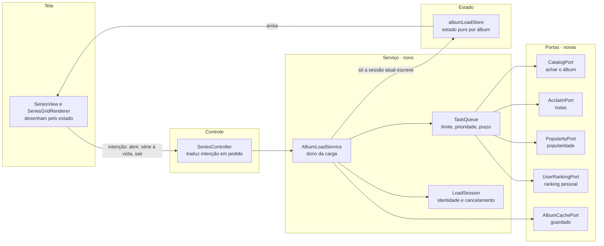
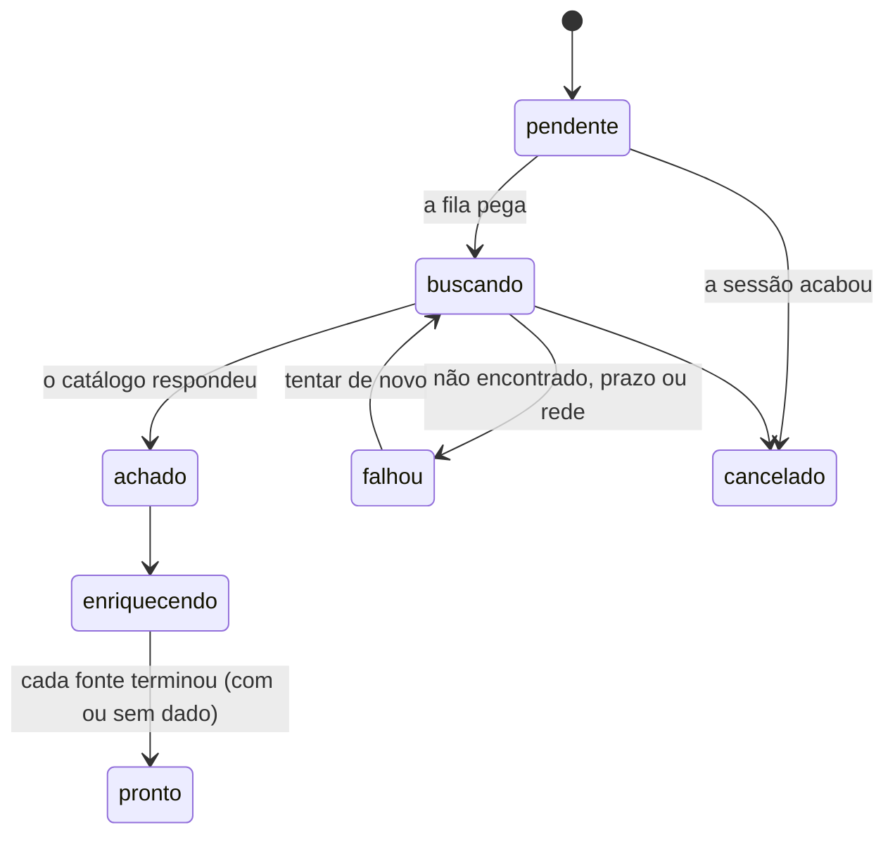
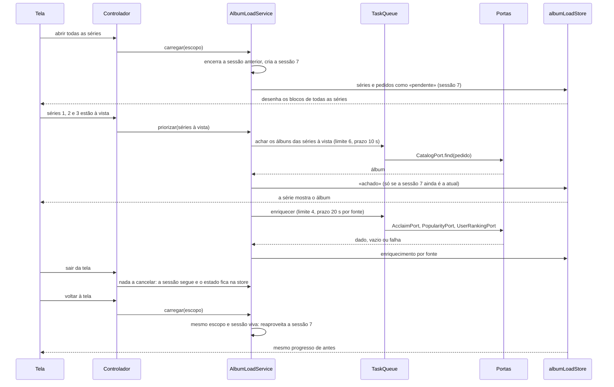

# Architecture: MJRP_AlbumsBalancedPlaylists_v0 (Album Blender v0)

> Escrito em 2026-10-28 (conform do harness) **do que o código é hoje**, não do ideal, e corrigido no mesmo dia depois da crítica independente (`reports/audits/2026-10-28-mjrpalbumblender-v0-architecture-audit.md`). Fontes: o manual do v0 (`docs/manual/01_System_Architecture.md` §1, §3, §5; `02`–`04`; `00_Deployment_and_Setup.md` §1–3), o mapa do código feito pelo V1 (`MJRPalbumblender-v1/reports/audits/2026-10-27-mjrpalbumblender-v1-project-bootstrap-report.md`, usado só para localizar) e a leitura direta do código, cujas linhas estão citadas. Onde o manual e o código discordam, vale o código.
> **Regras e código.** Este arquivo diz o que o código faz. Onde o código descumpre uma regra aprovada (constituição, `PRINCIPLES.md`, ADR), o texto traz a regra e, ao lado, **"Conserto:"** com o achado do relatório de auditoria que o registra; a regra continua valendo, e o código é que deve mudar. Não é uma lista de problemas (Art. III da constituição): é o ponteiro que impede ler a regra como se estivesse cumprida.
> Estado: **Draft** até o MJRP aprovar.

## System Overview
O Album Blender v0 monta playlists balanceadas a partir de **séries** de álbuns: o usuário cria uma série (artista ou lista curada), o app descobre os álbuns no Apple Music, busca a aclamação de cada faixa e o **Blending Menu** gera a playlist por uma **Recipe** (algoritmo de curadoria: `mjrp-balanced-cascade`, `top-n-popular`, `top-n-acclaimed`, `top-n-user`, registro em `public/js/algorithms/index.js:24-30`). A playlist pode ser editada, salva e exportada para o Spotify ou o Apple Music. Está **em produção**.

A forma é de **duas metades**: uma SPA em JavaScript puro, que roda no navegador, guarda o estado e fala direto com o Firestore, o Spotify e o Apple MusicKit; e um servidor Node/Express pequeno, no Cloud Run, que existe para o que o navegador não pode fazer: raspar o BestEverAlbums, chamar o Gemini com a chave guardada, e assinar o token de desenvolvedor do Apple MusicKit. **O servidor não acessa o Firestore** (nenhum import de Firebase em `server/`). Como não há servidor entre o navegador e o banco, **as regras do Firestore (`firestore.rules`) são a única autorização dos dados**.

## Component Map
Os nomes da coluna *Stack layer* são as camadas de `docs/specs/tech-stack.md`.

### Navegador (`public/`)
| Component | Responsibility | Stack layer |
|-----------|---------------|-------------|
| Casca da SPA e roteador (`public/index.html`, `js/app.js`, `js/router.js`) | arranque, as **18** rotas registradas por History API (`app.js:113-171`, 18 chamadas `router.register`), CSP e carga do Tailwind | Front |
| Views (`js/views/`) | desenham uma tela; assinam stores e delegam a ação ao controller | Front |
| Controllers (`js/controllers/`) | o "cérebro" de uma tela: recebe a entrada, chama Services, atualiza a store. Hoje `PlaylistsController.js:92-93, 312, 325, 334` instancia repositórios, e `SeriesController.js:22` e `BlendingController.js:22` usam `userRankingRepository` direto | Front |
| Componentes e renderizadores (`js/components/`, `js/views/renderers/`) | blocos de UI reutilizáveis (cartões, modais, assistente de Blend, navegação) | Front |
| Stores (`js/stores/`) | guardam o estado em memória e avisam quem assinou (Observer). **Regra: só estado** (ADR-0017). Hoje só `albumSeries.js` e `playlists.js` cumprem; `inventory.js`, `albums.js`, `SpotifyEnrichmentStore.js` e `UserStore.js` fazem I/O (repositório, cache, SDK do Firestore ou login). Conserto: achado 5 da auditoria | Front |
| Services (`js/services/`) | lógica de negócio e orquestração: séries, playlists, geração, persistência, exportação Spotify, autenticação, busca de álbuns (`services/album-search/`), MusicKit (`services/musickit/`), `services/infra/StorageService.js` (localStorage), `services/playlists/PlaylistHistoryService.js` (desfazer/refazer), `services/auth/UserSyncService.js` (migração de usuário) | Front |
| Algoritmos e ranking (`js/algorithms/`, `js/ranking/`, `js/transformers/`) | as Recipes de geração e as estratégias de ranking (Strategy). Não importam Firebase, DOM nem `localStorage` | Front |
| Repositories (`js/repositories/`) | **o adaptador declarado do Firestore**: um por fonte de dados, sobre `BaseRepository` (`repositories/BaseRepository.js`). Hoje o SDK do Firestore também é importado fora daqui (ver *Data Flow*) | Dados |
| Cache (`js/cache/`) | L1 memória + L2 IndexedDB `mjrp-cache` (`cache/CacheManager.js`) | Dados |
| Clientes externos (`js/api/client.js`, `services/SpotifyAuthService.js`, `services/musickit/`) | falam com `/api/*` (por `fetch`), com o Spotify (OAuth PKCE) e com o Apple MusicKit | Integrações externas |
| Worker de busca (`js/workers/search.worker.js`) | busca de autocompletar fora da thread principal, sobre `albums-autocomplete.json` | Front |

### Compartilhado (`shared/`)
| Component | Responsibility | Stack layer |
|-----------|---------------|-------------|
| Curadoria (`shared/curation.js`) | as regras de curadoria de playlist, executáveis nos dois lados | Linguagem |
| Normalização (`shared/normalize.js`) | limpeza de texto de título/artista | Linguagem |
| Autenticação de usuário (`shared/services/AuthService.js`) | login Google/Apple e saída, sobre `firebase/auth`; **só o navegador o usa** (`stores/UserStore.js` o importa por `@shared/`); o servidor não. Existe também outro `AuthService` em `public/js/services/AuthService.js` (login anônimo) | Dados |

### Servidor (`server/`, Cloud Run)
| Component | Responsibility | Stack layer |
|-----------|---------------|-------------|
| Entrada (`server/index.js`) | Express, CORS por `ALLOWED_ORIGIN`, saúde em `/_health` (`:87`), monta as rotas sob `/api` | Back |
| Rotas finas (`server/routes/`: `albums`, `playlists`, `ai`, `musickit`, `debug`) | recebem a requisição e chamam Services (`POST /api/enrich-album`, `/generate`, `/playlists`, `/ai/studio-albums`, `GET /musickit-token`, rotas de depuração) | Back |
| Services (`server/lib/services/`: `EnrichmentService`, `GenerationService`, `spotifyPopularity`) | a lógica de enriquecer e gerar | Back |
| Fachada de ranking (`server/lib/fetchRanking.js`, `lib/ranking.js`) | esconde raspagem + IA + fallbacks; consolida por Borda Count | Back |
| Raspador (`server/lib/scrapers/besteveralbums.js`) | lê as notas de faixa do BestEverAlbums | Back |
| Cliente de IA (`server/lib/aiClient.js`, `lib/prompts.js`, `config/prompts.json`) | chama o Gemini com prompts externalizados | Integrações externas |
| Validação (`server/lib/schema.js`, `server/schema/album.schema.json`) | valida o álbum com AJV | Back |
| Token do MusicKit (`server/services/MusicKitTokenService.js`) | assina o token de desenvolvedor (JWT ES256) | Integrações externas |

## Stack
As tecnologias, as versões e as decisões por trás delas moram em `docs/specs/tech-stack.md` - este arquivo aponta para lá, não as lista.

## Data Flow
```
Navegador (SPA)
  View -> Controller -> Service -> Repository --> Firestore   (direto; o servidor não participa)
                          |  \--> Store (estado; avisa as Views)
                          |  \--> Cache L1 memória / L2 IndexedDB / localStorage
                          +--> api/client.js --/api/*--> Firebase Hosting (rewrite) --> Cloud Run (server)
                          |                                     Rotas -> Services -> BestEverAlbums (raspa) / Gemini (REST)
                          +--> Spotify Web API (OAuth PKCE, token no localStorage)
                          +--> Apple MusicKit JS (token de desenvolvedor vem de /api/musickit-token)
```
O desenho acima é a **direção-alvo**; o que o código faz hoje está logo abaixo, em *Direção das dependências e fronteira do Firestore*.

1. **Criar a série.** Home -> "Scan Artist" no Apple Music -> montagem -> grava no Firestore só a lista de pedidos `albumQueries`, não os álbuns (Apêndice B §2 do mapa do V1).
2. **Carregar e enriquecer.** O cliente resolve cada pedido no Apple Music e pede `POST /api/enrich-album`; o servidor raspa o BestEverAlbums e devolve o ranking das faixas. A cascata completa só roda em `/generate`, o fallback legado: BestEverAlbums primeiro; o Spotify entra se o BestEverAlbums achar menos de 3 faixas com nota **e** menos de 40% das faixas conhecidas (`server/lib/fetchRanking.js:162-169`; o comentário do código diz "previously 50%"); depois o Gemini; depois Borda Count. O Spotify também enriquece pelo cliente, com cache global em `spotify_enrichment`.
3. **Gerar.** O assistente do Blending Menu (série -> Recipe -> ingredientes -> "Blend It!") roda a Recipe no navegador; o estado fica nas stores, o rascunho em `localStorage`.
4. **Salvar e exportar.** A playlist vai para o Firestore em `artifacts/mjrp-albums/users/{uid}/curator/data/series/{seriesId}/playlists` (`mjrp-albums` é um segmento de caminho fixo no código, não o projeto Firebase); a exportação para Spotify ou Apple Music sai do cliente.
5. **Identidade.** Firebase Auth com login anônimo automático para qualquer visitante (`public/js/services/AuthService.js:58`); os dados do usuário ficam sob o `uid`. O login com Google/Apple (`shared/services/AuthService.js:22`, `signInWithPopup`) troca de `uid`; os dados da sessão anônima ficam no `uid` antigo.
6. **Quando uma leitura do servidor falha.** O servidor responde **200 com resultado vazio**, não um erro: se o raspador falha, `/enrich-album` devolve `bestEverInfo: null` e notas nulas, igual ao álbum sem nota (`server/lib/services/EnrichmentService.js:27-33, 99-104`); `/ai/studio-albums` devolve `{ albums: [], error }` com 200 (`server/routes/ai.js:62-66`); sem `prompts.json`, `loadPrompts()` devolve `{}` com um aviso no log (`server/lib/prompts.js:6-22`). O cliente não distingue "sem dado" de "fonte fora do ar". Regra: sem falha silenciosa (`PRINCIPLES.md` §I.8). Conserto: achado 7 da auditoria.

### Direção das dependências e fronteira do Firestore
**Regras:** as dependências apontam para dentro, e o adaptador do Firestore é o Repository (`PRINCIPLES.md` §I.3; constituição, *Padrões com endereço*); a regra de negócio nasce como Service (ADR-0016); a Store só guarda estado e o Service a atualiza pelos setters (ADR-0017); trocar a fonte de dados é mexer num arquivo.

**O que o código faz hoje:**
- O núcleo está limpo: `algorithms/`, `models/`, `ranking/`, `transformers/` e `shared/curation.js` não importam Firebase, DOM nem `localStorage`.
- O SDK do Firestore é importado **fora de `repositories/`**: `public/js/services/PlaylistsService.js:17` (`writeBatch`, usado em `:243`), `public/js/stores/albums.js:9` (`getDocs`/`setDoc`/`addDoc` em `:273, 312, 315`) e `public/js/views/SaveAllView.js:5-6` (que carrega o SDK Firestore e Auth **11.6.1 pelo CDN `gstatic`**, enquanto o app usa o pacote npm 10.14.1: duas versões do SDK no mesmo app). Trocar a fonte de dados mexe em `BaseRepository`, nos 6 repositórios, nesses 3 arquivos, em `MigrationUtility` e em `firebase-init.js`, não em um. Viola `PRINCIPLES.md` §I.3 e a ADR-0017. Conserto: achado 1 da auditoria.
- O caminho "View -> Controller -> Service -> Repository" não vale sem exceção: `PlaylistsController` e `SeriesController` falam com `Repository` sem passar por Service; `views/SeriesView.js:16, 68` importa o `db` e o passa ao controller; `components/TopNav.js:8` e `stores/inventory.js:7` importam o `db` de `app.js` (que importa todas as Views, o que cria um ciclo `app.js <-> stores/inventory.js`). Viola `PRINCIPLES.md` §I.3 e a ADR-0016. Conserto: achado 4.

## Infrastructure
- Hosting: o **frontend** em Firebase Hosting, servindo `dist` (build do Vite); `firebase.json` reescreve `/api/**` para o serviço Cloud Run `mjrp-proxy` (região `southamerica-east1`) e o resto para `/index.html` (`firebase.json:3-20`). O **backend** em Cloud Run (`mjrp-proxy`, contêiner `node:18-slim`, `server/Dockerfile`), acesso público (`cloudbuild.yaml`: `--allow-unauthenticated`).
- Database: **Firestore** do projeto Firebase **`mjrp-playlist-generator`**. O app o recebe de `public/js/firebase-config.js:3-10` (`window.__firebase_config`), carregado por `public/index.html:111` antes do `app.js` (`:112`); `.firebaserc`, `scripts/deploy-backend.sh` (`PROJECT_ID`) e o CORS padrão do servidor (`server/index.js:58`) apontam para o mesmo projeto. O bloco `mjrp-albums` de `public/js/firebase-init.js:6-13` é só o valor reserva, com chave de marcador (`API_KEY_PLACEHOLDER`): não funciona. `mjrp-albums` também é o `appId` fixo no caminho `artifacts/mjrp-albums/...` (`InventoryRepository.js:20`, `SeriesRepository.js:21`), uma constante de caminho. No navegador, IndexedDB `mjrp-cache` e `localStorage`. O backend não tem banco.
- **Quem pode ler e escrever o quê no Firestore** (`firestore.rules`, lido linha a linha; "autenticado" vale para qualquer visitante, porque o app faz login anônimo sozinho):

| Caminho | Quem lê e escreve (regra) | Quem escreve no código |
|---|---|---|
| `artifacts/{appId}/users/{uid}/curator/**` e `.../inventory/**` (`:8-13`) | só o dono (`uid`) | repositórios e `PlaylistsService.saveBatch` |
| `users/{uid}/series/**` (`:19-28`) | só o dono | ninguém além da migração legada |
| `users/{uid}/albumRankings/{albumId}` (`:32-35`) | **qualquer pessoa, até sem login** (`allow read, write: if true`; o comentário das linhas 33-34 diz "DEBUG ... mudar para `request.auth != null` antes do lançamento") | `UserRankingRepository` |
| `albums/{albumId}` (`:42-43`) | **qualquer autenticado**, inclusive anônimo, em qualquer documento; sem dono | `stores/albums.js` |
| `spotify_enrichment/{albumKey}` (`:49-51`) | **qualquer autenticado**, inclusive anônimo; cache global sem dono | `SpotifyEnrichmentRepository` |

Regra: a estabilidade da produção e os dados do usuário não ficam abertos a qualquer visitante (constituição, Art. V). Conserto: achado 2 da auditoria. **Nenhum pipeline do repositório publica `firestore.rules`**: `firebase.json` não tem bloco `firestore`, e `.github/workflows/ci-firebase.yml:73, 120` e `scripts/deploy-prod.sh` implantam só `--only hosting`; o que está em produção pode não ser este arquivo.
- Segredos: no Secret Manager do Google Cloud, injetados no Cloud Run (`AI_API_KEY`, `APPLE_TEAM_ID`, `APPLE_KEY_ID`, `APPLE_MUSIC_PRIVATE_KEY`; `cloudbuild.yaml`, `--set-secrets`); em desenvolvimento, `server/.env`.
- Implantação do **frontend**: GitHub Actions (`.github/workflows/ci-firebase.yml`: lint, testes e build, depois `firebase deploy --only hosting` em `main`, `v0.2` e tags `v*`; canal de pré-visualização em PR) ou `scripts/deploy-prod.sh` (que também copia `firebase-config.js` para `dist/js/`).
- Implantação do **backend**: existem **duas receitas que divergem**, e o repositório não diz qual gerou a produção atual. `cloudbuild.yaml` copia `shared/` para `server/_shared_temp` e constrói a imagem, mas **não copia `config/`** (o servidor procura `prompts.json` em `server/config/` ou em `<raiz>/config/`, `server/lib/prompts.js:4-5`) e **não grava o `package.json` com `"type": "module"`** em `_shared_temp`, de que o `import()` dinâmico de `shared/*.js` precisa (`server/routes/playlists.js:23`, `server/lib/ranking.js:8`, `server/lib/fetchRanking.js:13`). `scripts/deploy-backend.sh` faz as duas coisas (`:27-33`) e usa `gcloud run deploy --source server`. A CI não implanta o backend. Regra: uma fonte da verdade (`PRINCIPLES.md` §I.5). Conserto: achado 12.
- CDN/Assets: Tailwind pelo CDN `cdn.tailwindcss.com`, com `tailwind.config` inline em `public/index.html:23`, e fonte Syne pelo Google Fonts (`:12, 15-17`); o SDK do Apple MusicKit vem de `js-cdn.music.apple.com` (`services/musickit/MusicKitAuth.js:124`); o conjunto de álbuns do autocompletar é o arquivo estático `albums-autocomplete.json`.

## Constraints
- **Segurança e abuso.**
  - Segredos por variável de ambiente e Secret Manager, nunca no código (Constituição Art. V; `PRINCIPLES.md` §I.14). A chave do Gemini e a chave privada da Apple ficam só no servidor: por isso o servidor existe.
  - O acesso aos dados do usuário é o da tabela da seção *Infrastructure*, não "escopo por dono em tudo".
  - O backend é público: sem autenticação e sem limite de taxa em nenhuma rota; em produção o CORS aceita as origens de `ALLOWED_ORIGIN` (padrão `https://mjrp-playlist-generator.web.app`, `server/index.js:58-70`) **e** qualquer requisição sem cabeçalho `Origin` (`:66`). As rotas de depuração (`/api/debug/*`, `/api/list-models`) são montadas em qualquer ambiente (`server/index.js:134-136`); `GET /api/debug/files` lista qualquer pasta do contêiner por `?path=` (`server/routes/debug.js:98-104`). `POST /api/ai/studio-albums` concatena o `artistName` livre no prompt e chama o Gemini pago com a busca do Google ligada (`server/routes/ai.js:7-27`, `server/lib/aiClient.js:32`). Regra: estabilidade da produção (Art. V). Conserto: achados 9 e 10 da auditoria.
  - Tokens do Spotify (acesso e renovação) ficam no `localStorage` (`services/SpotifyAuthService.js:179-182`), com um CSP que libera script inline (`public/index.html:9`).
- **Dependências entre camadas.** A Dependency Rule e a fronteira do Firestore são as da seção *Direção das dependências*, com as exceções descritas ali. Rota e componente são orquestradores finos (ADR-0016).
- **Compartilhamento.** A lógica que roda nos dois lados mora em `/shared` (Constituição, *Technology Standards*); o contêiner a recebe copiada, por isso o `Dockerfile` espera `_shared_temp`. Em `shared/`, só `curation.js` e `normalize.js` são usados também pelo servidor; `shared/services/AuthService.js` é do navegador.
- **Estado do servidor.** Contêiner sem estado e escalável (Constituição, *Backend*).
- **Validação.** Regra: todo dado externo que entra no servidor é validado com AJV (Constituição, *Backend*).
- **Tempo.** O raspador tem prazo de 30 s por requisição (`server/lib/scrapers/besteveralbums.js:8-9`), sem retentativa nem cache; o Gemini, 60 s (`server/lib/aiClient.js:10`). O cliente refaz a chamada 2 vezes, com espera fixa de 1 s (`public/js/api/client.js:21-23`), inclusive `/generate`, que chama o Gemini.
- **Runtime.** Node.js 18 no contêiner e na CI (`server/Dockerfile:1`; `ci-firebase.yml:22, 55`), versão fora de suporte desde abril de 2025.
- **Desempenho e escala.** TBD: o v0 não declara alvo de latência nem de carga; é decisão de produto do MJRP, não do agente. O custo por chamada paga (Gemini, Firestore) também não está estimado.

## Carga da tela de álbuns — proposta

> **Profundidade:** leve — o risco mais alto é de complexidade e de regressão num fluxo que está em produção e sem nenhum teste; tudo roda no navegador, não cria infraestrutura nem muda o esquema do Firestore, e desfazer é reverter os ramos.
> **Página para ler:** não publicada (o MJRP leu o resumo na conversa) · **Crítica:** duas passadas independentes em 2026-11-19, as duas «pode seguir depois dos P0» (relatórios `2026-11-19-v0-albums-load-architecture-critique.md` e `…-critique-opus.md`, na pasta de notas das sessões); os P0 estão respondidos na seção 15 · **Estado:** proposta, em construção pela F45
> **Seções usadas:** 5 (tempo e falha entre as partes), 7 (chamadas externas no caminho principal), 9 (mexe em ADRs aceitas, numa store e no cache), 11 (o desenho só se mantém com um sensor), 12 (há três caminhos de custo diferente), 13 (uma decisão de dado é do MJRP) · **Fora:** 6 (nenhuma entidade nova nem dado remodelado; a única mudança de gravação está em 9 e em 13), 8 (nenhuma superfície nova exposta), 10 (nenhum custo novo; as leituras e gravações no Firestore caem) · **Vistas:** blocos (o que muda de dono), sequência (a carga e o cancelamento), estados (o ciclo de um álbum).

### 1. O que muda e por quê

Quem usa a tela de álbuns espera minutos olhando blocos cinza, vê séries sumirem ao sair e voltar no meio da carga e não é avisado quando um álbum falha (S-52; issues UAT-172 a UAT-177). Medido em 2026-11-19 com 20 séries e 80 álbuns: um álbum a cada 5 ou 6 segundos, 46 de 80 aos 4 min 40 s (`reports/evidence/F45-albums-load-in-parallel/`).

A causa não é uma linha: **ninguém é dono da carga**. O laço está em `api/client.js`, a decisão de quando parar em `SeriesController`, a regra do «pronto» em `stores/albums.js` e a regra do bloco cinza em `SeriesGridRenderer`, ligados por um único booleano que quatro pontos zeram. O MJRP pediu correção de arquitetura, não remendo (log, 2026-11-19). Esta proposta dá um dono à carga e um estado explícito a cada álbum, dentro das regras que o v0 já adotou (ADR-0016, ADR-0017, `PRINCIPLES.md` §I.2, §I.3, §I.5, §I.8).

### 2. Os direcionadores

- **Objetivo:** a pessoa confia no que a tela mostra: cada série termina num estado claro e as séries à vista aparecem em segundos.
- **Restrições:** JavaScript puro, sem framework (constituição, Art. II); a store só guarda estado (ADR-0017); a regra de negócio mora em Service (ADR-0016); o Firestore só atrás de Repository (`PRINCIPLES.md` §I.3); nada muda no servidor nem no esquema do Firestore nesta proposta; o raspador do BestEverAlbums não tem cache nem limite de ritmo (`arch.md`, *Constraints · Tempo*), então o cliente não pode multiplicar as chamadas sem teto.
- **Respostas do MJRP (2026-11-19):** o corte em 20 séries é acidente; série com álbum que falhou aparece com aviso; carga preguiçosa, só o que está à vista.

| Requisito de qualidade | Cenário (estímulo → resposta) | Medida |
|---|---|---|
| Tempo até ver | Abrir a tela com 20 séries e o guardado vazio → as séries à vista mostram os seus álbuns (capa, título, artista) | até 3 s (hoje: 8,5 s para o primeiro álbum, minutos para o resto) |
| Tempo até enriquecer | O mesmo cenário → notas e popularidade das séries à vista preenchidas | até 20 s, sem travar o que já aparece |
| Isolamento de falha | Uma chamada externa nunca responde → só aquele álbum fica «falhou», no prazo; os outros seguem | prazo de 10 s para achar o álbum e 20 s para cada enriquecimento |
| Estabilidade do estado | Sair da tela no meio da carga e voltar → o mesmo número de séries, o mesmo progresso | 0 série que some; 0 escrita de uma carga antiga no estado atual |
| Segunda visita | Reabrir a tela com tudo no guardado → sem chamada externa por álbum e sem gravação no Firestore | 0 chamadas de catálogo e de enriquecimento; 0 gravações |
| Teto de carga no servidor | Qualquer carga → chamadas simultâneas a `POST /api/enrich-album` | no máximo 4 |

### 3. Os riscos

| Risco (o que pode dar errado, por quê) | Tipo | Probabilidade | Impacto | Custo de desfazer | Seção que o reduz | Estado |
|---|---|---|---|---|---|---|
| Regressão num fluxo em produção sem nenhum teste (`SeriesController`, `api/client.js`, `albumCache`, `SeriesGridRenderer` não têm teste) | técnico | alta | alto | baixo (reverter o ramo) | 11, 4 (núcleo puro testável) | aberto |
| Duas cargas escrevem no mesmo estado (a antiga termina depois da nova) | técnico | alta (acontece hoje) | alto | baixo | 4 (sessão com identidade), 5 | aberto |
| Paralelismo sem teto derruba ou faz bloquear o raspador do BestEverAlbums (sem cache nem limite no servidor) | operação | média | alto | baixo (é um número) | 7 | aberto |
| O álbum aparece e as notas chegam depois: quem gera playlist antes do fim usa álbum sem nota | técnico | média | médio | médio | 4 (estado de enriquecimento visível), 5 | aberto |
| `/blend` e o modo edição de playlists têm laços de carga próprios e continuam divergindo do novo serviço | complexidade | alta | médio | médio | 9, 11 | aberto |
| O desenho volta a se espalhar (a tela ou a store voltam a importar Firestore ou a decidir carga) | complexidade | média | médio | baixo | 11 (função de aptidão) | aberto |
| Objeto do guardado mutado por quem o recebe (hoje a memória devolve a mesma referência) | dados | alta (acontece hoje) | médio | baixo | 4, 9 | aberto |
| Parar de gravar o álbum na coleção `albums` quebra algo que a lê | dados | baixa (nenhum leitor no código: `loadFromFirestore` não tem chamador) | médio | baixo (voltar a gravar) | 9, 13 | aberto |

### 4. O desenho



- **`AlbumLoadService`** (novo, `public/js/services/albums/`; Service, `DP-12`): o único dono da carga. Recebe «carregar este escopo» e «esta série ficou à vista», decide a ordem, e é o único que escreve o estado de carga. Substitui o laço de `api/client.js:241-288` e a parte de carga de `SeriesController.js:90-371`.
- **`LoadSession`** (novo; Correlation ID, `DP-29`): cada carga nasce com uma identidade e um sinal de cancelamento. Toda escrita no estado passa por `session.isCurrent()`; a sessão antiga termina sem tocar em nada. O sinal chega até as chamadas (`fetch` com `signal`), não só ao intervalo entre álbuns.
- **`TaskQueue`** (novo, `public/js/utils/`; núcleo puro, `DP-20`; Timeout, `DP-22`): fila com limite de tarefas simultâneas, prioridade (a série à vista passa à frente) e prazo por tarefa. Não conhece álbum, rede nem tela: recebe funções. É a peça mais testada.
- **Portas** (`DP-14`, com adaptadores `DP-07`): `CatalogPort` (hoje a Apple Music, com o servidor como segunda fonte), `AcclaimPort` (o `POST /api/enrich-album`), `PopularityPort` (Spotify), `UserRankingPort` (o repositório de ranking). O serviço recebe as portas por injeção (`DP-02`), o que permite testá-lo com dublês e trocar uma fonte mexendo num arquivo.
- **Achar separado de enriquecer:** a carga tem duas etapas. Achar o álbum (0,4 s na Apple) põe o álbum na tela. Cada enriquecimento é uma tarefa independente, com estado e prazo próprios; a falha de um não derruba o álbum nem os outros. Hoje as quatro coisas são uma chamada só, em série.
- **`albumLoadStore`** (novo, `public/js/stores/`; Store e Observer, `DP-05`, estado puro pela ADR-0017): guarda, por série e por pedido, o estado do álbum. O estado da série é **derivado** por função pura (`DP-20`), nunca guardado: uma fonte só (`PRINCIPLES.md` §I.5).
- **Resultado tipado** (`DP-19`): cada tarefa devolve `ok` ou `falhou` com motivo (`não encontrado`, `prazo`, `rede`, `cancelado`). «Falhou» é distinto de «vazio» em toda a cadeia.
- **Tela:** `SeriesGridRenderer` desenha cada série pelo estado derivado e avisa o controlador quando uma série entra na janela. Deixa de ler o booleano e de decidir carga. O redesenho passa a ser por série, não da grade inteira.
- **`SeriesController`:** fica fino (ADR-0016): traduz intenção da tela em pedido ao serviço, guarda filtros e ordenação. A inscrição nas stores passa a ser desfeita ao sair da tela (hoje acumula uma por visita, `SeriesController.js:67-68`).



Estado derivado da série: **carregando** (algum álbum pendente ou buscando), **completa**, **com falha** (ao menos um álbum falhou; a série fica na tela com o aviso e o «tentar de novo»), **vazia** (a série não tem pedidos). «Série oculta por filtro» é decisão do filtro, não do estado de carga.

**Dobra nomeada:** `AlbumLoadService` e o controlador continuam instâncias únicas criadas em `app.js` (o v0 não tem Composition Root, `DP-15`). Custo: os testes precisam criar a sua própria instância com dublês, o que o construtor por injeção já permite. Criar o Composition Root fica fora desta proposta.

### 5. Os fluxos



- **Trocar de escopo** (de todas as séries para uma série) encerra a sessão: o sinal aborta as chamadas em voo e nada da sessão antiga é escrito.
- **Voltar à mesma tela** não cria sessão nova se a anterior é do mesmo escopo e não terminou com erro: é o que impede a série que some.
- **Série fora da janela** fica «pendente» e só entra na fila quando a tela avisa que ela ficou à vista (a carga preguiçosa pedida pelo MJRP). Depois que as séries à vista terminam, a fila segue com as demais em prioridade baixa, na ordem em que aparecem na tela.
- **Quem gera playlist** (`/blend`) pede ao serviço os álbuns da série e espera o estado «pronto» dela, em vez de ter o seu próprio laço.

### 7. Falhas e prazos

| Chamada ou etapa | Prazo (timeout) | Retentativa | Se falhar, quem usa vê | Erro distinto de vazio? |
|---|---|---|---|---|
| Achar o álbum no catálogo (Apple Music) | 10 s | 1 vez, espera de 1 s com variação (`DP-23`) | o cartão do álbum com «não carregou» e a série «com falha»; botão de tentar de novo | sim: `não encontrado` × `prazo` × `rede` |
| Segunda fonte do álbum (`POST /api/generate`) | 30 s | nenhuma (a chamada usa IA paga) | o mesmo | sim |
| Notas (`POST /api/enrich-album`) | 20 s | 1 vez | o álbum fica na tela, com o selo «sem nota» e o motivo ao passar o mouse | sim: «a fonte não tem nota» × «a busca falhou» |
| Popularidade (Spotify) | 10 s | nenhuma | o álbum fica, sem o selo de popularidade | sim |
| Ranking pessoal (Firestore) | 10 s | nenhuma | o álbum fica, sem o ranking | sim |
| Leitura da lista de séries (Firestore) | 15 s | 1 vez | aviso na tela e botão de tentar de novo, em vez de tela vazia | sim |

- **Sobrecarga:** o teto é da fila, não de quem chama: 6 buscas de catálogo e 4 enriquecimentos por vez, somando todas as séries. Os números ficam num só lugar, com nome.
- **Guardado de falha:** um resultado «a fonte não tem nota» é guardado por 24 horas, não por 7 dias, para a falta de nota não grudar; uma falha de rede ou de prazo não é guardada.
- **Idempotência:** achar e enriquecer não escrevem em lugar nenhum além do guardado local; repetir é seguro.

### 9. Relação com o que já existe

- **ADR-0016 (lógica em Service) e ADR-0017 (store de estado puro): mantidas e aplicadas.** `stores/albums.js` hoje as contraria (tem regra de fusão, recusa de fantasma e acesso ao Firestore, `:78-143`, `:267-325`). A fusão de enriquecimento vai para o serviço; o acesso ao Firestore sai da store (issue UAT-14, neste trecho).
- **`stores/albums.js` continua** como a prateleira dos álbuns que as outras telas leem (`getAlbums`, `getAlbumsForSeries`, a «injeção cirúrgica» do `SeriesService`). Nesta proposta o serviço a alimenta pelos setters; o `albumLoadStore` guarda só o estado de carga. Juntar as duas é passo seguinte, não deste desenho.
- **`cache/albumCache.js` vira a implementação de `AlbumCachePort`**, com três mudanças: uma só função de chave (a de `AlbumIdentity`, hoje há cinco definições de «mesmo álbum»), devolve cópia em vez do objeto vivo (`MemoryCache.js:42`), e expõe a limpeza que o botão «Clear Cache» passa a chamar. O formato das entradas do IndexedDB não muda; a versão do guardado sobe para as entradas antigas serem refeitas em vez de lidas com a chave antiga.
- **Gravação do álbum na coleção `albums` a cada carga** (`SeriesController.js:367-370`): sai da carga. Ver a decisão 1 em 13.
- **`api/client.js`:** `fetchAlbum` e `fetchMultipleAlbums` deixam de ser o caminho da carga; o que é adaptador (Apple, servidor) vai para trás das portas. `BEAenrichAlbum` e `generatePlaylists` ficam.
- **Laços próprios de `/blend` e do modo edição** (`BlendingController.js:124-159`, `PlaylistsController.js:156-170`): passam a pedir ao serviço. É a última fatia, depois que a tela de álbuns provar o desenho.
- **Arquivos que a mudança toca:** novos em `services/albums/` (serviço, sessão, portas e adaptadores), `utils/TaskQueue.js`, `stores/albumLoad.js`; alterados `controllers/SeriesController.js`, `components/series/SeriesGridRenderer.js`, `views/SeriesView.js`, `views/helpers/SeriesViewUpdater.js`, `stores/albums.js`, `cache/albumCache.js`, `cache/MemoryCache.js`, `api/client.js`, `components/Footer.js`, `repositories/UserRankingRepository.js`; depois `controllers/BlendingController.js` e `controllers/PlaylistsController.js`.
- **Entrega em fatias, uma feature por fatia:** F45 (fila, sessão, serviço, achar separado de enriquecer, prioridade pelas séries à vista), F46 (estado por série na tela, aviso de falha, inscrições desfeitas), F48 (porta do guardado, nova tentativa, sem gravar à toa, «Clear Cache»), e por último os dois laços de `/blend` e do modo edição.

### 11. Complexidade e funções de aptidão

| Característica que mantém | Risco que protege | Checagem | Limite | Onde roda |
|---|---|---|---|---|
| O Firestore só atrás de Repository | o desenho voltar a se espalhar | teste que varre os `import` de `public/js/` atrás de `firebase/firestore` | 0 fora de `repositories/` nos arquivos que esta proposta toca; a lista dos que ainda violam (UAT-14) é explícita e só pode encolher | `npm test` |
| A store não decide nem busca | a regra de carga voltar para a store ou para a tela | o mesmo teste: `stores/albumLoad.js` e `stores/albums.js` não importam `services/`, `api/`, `repositories/` nem `cache/` | 0 | `npm test` |
| A tela não decide carga | o booleano único voltar | teste: `components/series/` e `views/` não importam `api/client.js` nem o serviço de carga, só o controlador | 0 | `npm test` |
| Só a sessão atual escreve | duas cargas no mesmo estado | teste de corrida do serviço com dublês: a sessão antiga resolve depois da nova e não muda o estado | 0 escritas da sessão antiga | `npm test` |
| Teto de chamadas simultâneas | derrubar o raspador | teste da fila: máximo em voo | 6 de catálogo, 4 de enriquecimento | `npm test` |
| A fila não conhece o domínio | a fila virar um segundo serviço | `utils/TaskQueue.js` sem nenhum `import` do projeto | 0 | `npm test` |

Cobertura que nasce junto: testes unitários da fila, das funções puras de estado e do serviço com dublês das portas; hoje esse fluxo não tem nenhum.

### 12. As opções

| Opção | A favor | Contra | Custo de mudar depois | Reversível? |
|---|---|---|---|---|
| A · Remendo: paralelizar o laço de `api/client.js` e pôr prazo | pequeno, entrega em horas | o booleano único, a carga sem dono, a série que some e a falha sem aviso continuam; cada conserto seguinte mexe nos mesmos quatro arquivos | alto: o próximo defeito do mesmo assunto recomeça do zero | sim |
| B · Serviço dono da carga, sessão, estado explícito, portas (esta proposta) | resolve os seis sintomas pela causa; fluxo testável; segue as ADRs do v0 | maior: cerca de 8 arquivos novos e 10 alterados, em fatias | baixo: cada fonte troca num adaptador, cada regra tem um endereço | sim, fatia a fatia |
| C · Levar a carga para o servidor (um pedido por série, com cache no servidor) | o navegador fica simples; o cache serve a todos os aparelhos | muda o servidor e a publicação, cria custo e estado no servidor, e a busca na Apple Music hoje depende do token no navegador | alto: é outra arquitetura | difícil |

**Recomendação:** B. O MJRP já recusou A («nao quero patches»). C só se justifica se a carga no navegador continuar lenta depois de B, e a medição dirá.

### 13. As decisões do humano

1. **A tela de álbuns para de gravar cada álbum na coleção `albums` do Firestore a cada carga?** Hoje toda carga regrava todos os álbuns numa coleção compartilhada, aberta a qualquer usuário autenticado, com o seu ranking pessoal dentro do documento (issue UAT-15), e nenhum ponto do app lê essa coleção de volta. Opções: (a) parar de gravar na carga e manter a gravação só no «Refetch Metadata»; (b) parar de gravar nos dois; (c) manter como está. Recomendação: (a) agora, porque tira as gravações repetidas sem mudar o que o «Refetch» promete; (b) fica para quando as regras do Firestore forem decididas (UAT-15, que é do MJRP).
2. **Quantas buscas de nota ao mesmo tempo o BestEverAlbums aguenta?** O servidor raspa o site a cada pedido, sem cache nem limite. Opções: 2, 4 ou 6 simultâneas. Recomendação: 4, medindo; se o site começar a recusar, o número desce num lugar só.

As demais escolhas (nomes, portas, a fila, os prazos) são técnicas e vão ao tech lead.

### 15. Emendas depois da crítica (2026-11-19 11:31)

Onde esta seção contradiz as seções 4, 5, 7 ou 9, vale esta.

1. **Uma store só é dona de «pedido → álbum».** `stores/albumLoad.js` guarda o estado e a referência do álbum de cada pedido. `stores/albums.js` deixa de ser escrita pelos controladores e pela tela: passa a ser uma leitura projetada da store de carga, mantendo a interface que as outras telas usam. Saem a chave `ALL_SERIES_VIEW` como lugar de escrita e a recusa de série inativa (`albums.js:82-88`).
2. **O guardado, o que e quando.** A chave é a do **pedido** (o nome resolvido não existe antes da busca). Guarda-se o álbum-base assim que é achado e, à parte, um registro por fonte de enriquecimento com o seu estado. Fonte sem registro é «pendente». Falha de rede ou de prazo nunca é guardada. Ao ler, o serviço enfileira só o que falta. A limpeza apaga só as chaves de álbum, não as de séries e rankings.
3. **A sessão é uma geração, e toda abertura reconcilia.** A cada `carregar`, o serviço compara os pedidos desejados (lidos da lista de séries) com as entradas que tem: pedido novo entra como pendente, pedido que saiu é removido, o resto fica. A geração só muda quando o escopo muda. Criar série, editar, adicionar ou remover álbum passam por essa reconciliação.
4. **Fatias revistas.** F45: fila, serviço, store única, achar separado de enriquecer, guardado por pedido, a grade desenhada pelo estado derivado de cada série, prioridade pela ordem de exibição. F46: observador de visibilidade por série em todos os layouts, aviso de falha com «tentar de novo», fim das inscrições acumuladas. F48: «Clear Cache», nova tentativa do servidor, fim da regravação no Firestore, cache do ranking pessoal. Depois: os laços de `/blend` e do modo edição.
5. **O álbum publicado não é mutado.** Cada enriquecimento produz um álbum novo e troca a referência na store; um teste congela o álbum publicado.
6. **Carga preguiçosa e filtros.** Com filtro, busca ou mistura ativos, o serviço carrega o escopo inteiro, para a lista de artistas e os filtros não mostrarem só o que já chegou.
7. **Cancelar é parar de esperar e descartar.** A Apple Music, o Firestore, o `import()` dinâmico e o servidor não abortam de fato; o que o desenho garante é que o resultado de uma geração antiga não é escrito.
8. **Paralelismo começa em 2 buscas de nota por vez**, não em 4: o número não foi medido, e o prazo no navegador não para a raspagem no servidor. Sobe medindo. Sem nova tentativa depois de prazo estourado.
9. **«Sem nota» × «a busca falhou» precisa do servidor.** O raspador engole o erro e `POST /api/enrich-album` responde 200 com notas vazias (`server/lib/scrapers/besteveralbums.js:506-508`, `server/lib/services/EnrichmentService.js:27-33`). Enquanto o servidor não devolver um campo de estado, o cliente trata resposta vazia como «sem nota» guardada por 1 hora. A mudança no servidor é fatia própria e só se prova publicando: cai a restrição «nada muda no servidor».
10. **Quem gera playlist lê só álbuns prontos**: um seletor «só prontos» na store, usado por `/blend`, ranking e playlists.

| Comportamento de hoje | Onde está | Novo dono | Fatia |
|---|---|---|---|
| Ler a lista de séries, com o corte em 20 | `SeriesService.js:134-162` | `SeriesService`, sem o corte | F47 |
| Montar os pedidos de cada série e cortar «Artista - Título» | `SeriesController.js:160-177`, `:211-221` | `AlbumLoadService` (reconciliação), com uma só função de leitura do pedido | F45 |
| Achar o álbum, validar a identidade, cair na segunda fonte | `api/client.js:45-165` | adaptador de catálogo atrás de `CatalogPort` | F45 |
| Reordenar as faixas pela nota | `api/client.js:133-142` | o enriquecimento de notas, que devolve o álbum novo já ordenado | F45 |
| Capa de reserva pelo catálogo local | `SeriesController.js:334-339` | adaptador de catálogo | F45 |
| Marcar a série dona (`seriesIds`) | `SeriesController.js:343-350` | a entrada da store já tem a série; `seriesIds` é projetado | F45 |
| Ranking pessoal ao carregar e ao reabrir | `SeriesController.js:352-363`, `:377-400` | fonte de enriquecimento `userRanking` | F45 |
| Ranking salvo pelo modal reflete na tela | `UserRankModal.js:107` | o modal pede ao serviço para refazer a fonte `userRanking` daquele álbum | F46 |
| «Refetch Metadata» e a sua gravação | `SeriesController.js:406-436`, `SeriesService.js:300-474` | o serviço refaz as fontes do álbum, ignorando o guardado | F48 |
| Injeção cirúrgica ao adicionar álbum | `SeriesService.js:234-290` | adicionar muda os pedidos; a reconciliação carrega só o novo | F46 |
| Remover álbum e apagar série | `SeriesService.js:120-131`, `:187-`; `SeriesEventHandler.js:233` | muda os pedidos; a reconciliação remove a entrada | F46 |
| Série nova que não aparece com a memória cheia | `SeriesController.js:118-137` | a reconciliação a cada abertura | F45 |
| Sincronizar a lista de séries em segundo plano | `SeriesController.js:633-642` | a reconciliação a cada abertura | F45 |
| Gravar o álbum na coleção `albums` a cada carga | `SeriesController.js:367-370` | sai da carga (decisão 1 da seção 13) | F48 |
| Barra de progresso global | `SeriesController.js:311` | o serviço liga e desliga em par | F45 |

### 16. Filtros, busca e paginação da tela de álbuns (2026-11-19 11:57)

Decisão do MJRP (2026-11-19): paginação por série na tela de álbuns, e os filtros respondem a partir do que está gravado na série («vamos fazer a opcao C»; «a opcao C imagino que tb necessite a revisao de arquitetura para nao virar patch»; série antiga: «preenche sozinho na primeira carga»). Feature F51; issue UAT-179 (o campo de busca perde o foco).

**O problema de desenho.** Hoje o filtro roda sobre os álbuns já carregados (`services/SeriesFilterService.js:20-`), a lista de artistas sai deles (`views/helpers/SeriesViewUpdater.js:97-100`), e a barra de filtros é refeita inteira a cada tecla (`components/ui/FilterToolbar.js:44`). Com paginação, «o que já carregou» deixa de ser «tudo», e o filtro passa a mentir.

**O desenho.**

1. **O pedido de álbum guarda os fatos que os filtros leem.** Cada item de `albumQueries` da série passa a ter, além de `artist`, `title`, `year`, `coverUrl` e `appleMusicId` (que 196 de 217 pedidos já têm), um bloco `facts`: `{ year, sources: { acclaim, popularity }, checkedAt }`. Fonte única: o `SeriesRepository` é o único que grava (`DP-01`). O ranking pessoal não entra: é do usuário, mora em `users/{uid}/albumRankings`, e o filtro «My Ranking» o lê de lá numa leitura só da coleção.
2. **Quem aprende não grava.** `AlbumLoadService` continua sem conhecer o Firestore. Quando um álbum termina de enriquecer, a store de carga já tem o fato; um serviço novo e pequeno, `SeriesFactsService` (`DP-12`), compara o que a carga aprendeu com o que a série tem e grava **só a diferença, em lote, uma vez por série, quando a série termina de carregar**. Série sem diferença não gera gravação. É assim que a série antiga se preenche sozinha na primeira carga.
3. **O filtro é uma função pura sobre os pedidos** (`DP-20`): `filterSeries(series, criteria)` devolve, por série, os pedidos que passam. Série, artista, busca e ano leem o pedido; fonte lê `facts.sources`; «pendente» é o pedido sem `facts`. A lista de artistas e as contagens saem da mesma função, de todas as séries. `SeriesFilterService.filterAlbums` (sobre álbuns carregados) sai da tela de álbuns.
4. **A tela pagina o resultado do filtro**, nunca o contrário: primeiro filtra todas as séries, depois corta a página. A página pede ao `AlbumLoadService` só as séries que mostra (o `load` já recebe a lista em ordem de tela; passa a receber a página). Trocar de página reconcilia: o que já carregou fica.
5. **A barra de filtros atualiza, não se refaz.** `FilterToolbar` passa a desenhar uma vez e a atualizar os valores dos controles; o campo de busca é o mesmo elemento do começo ao fim. Corrige a UAT-179 pela causa, na tela de álbuns e na de playlists guardadas, que usam o mesmo componente. A Home tem campo próprio, a conferir.
6. **A forma da paginação é escolha do MJRP**, sobre um protótipo com as duas: páginas numeradas, ou rolagem que carrega o lote seguinte ao chegar perto do fim. O desenho acima serve às duas: muda só quem pede a página seguinte.

| Risco | Tipo | Como o desenho o reduz |
|---|---|---|
| O fato gravado envelhece (o álbum ganhou nota depois) | dados | `checkedAt` no fato; a carga da série reescreve a diferença; o «Refetch» atualiza o fato do álbum |
| Gravação a cada visita de novo | custo | grava só a diferença, uma vez por série, e nada quando não há diferença; teste do serviço com o repositório dublê conta as gravações |
| Dois lugares dizendo se o álbum tem nota (o pedido e o álbum carregado) | dados | o álbum carregado manda; o pedido é uma cópia para filtrar, reescrita pela carga; a tela nunca edita `facts` |
| Série editada por dois aparelhos ao mesmo tempo perde o `facts` de um | dados | a gravação dos fatos lê a série e escreve só o campo `albumQueries` daquela série; aceito para um usuário só, registrado como limite |
| O filtro por fonte fica incompleto até a primeira carga de cada série | produto | a tela diz quantos pedidos ainda não foram conferidos; decisão do MJRP: sem migração |

**Funções de aptidão a mais:** o filtro não importa stores nem serviços; `components/` e `views/` não leem `facts` para escrever; `SeriesFactsService` é o único que chama a gravação de fatos no repositório.

**Fatia:** F51, depois da F46 (que entrega o observador de visibilidade de que a rolagem precisa). A mudança de dado (o bloco `facts` em `albumQueries`) vai para o `data-model.md` junto com o código.

### 17. O que foi construído, e onde difere do proposto (2026-11-19 12:42)

Construído nos ramos `fix/f45-albums-load-in-parallel`, `fix/f47-series-list-without-cut` e `fix/f51-album-filters-search-and-paging` (empilhados; ainda fora da `main`). Onde esta seção contradiz as anteriores, vale esta, porque descreve o código.

| Ponto | Proposto | Construído | Por quê |
|---|---|---|---|
| Buscas simultâneas no catálogo | 6 | 3 | com 6 a Apple Music respondeu 429 (medido) |
| Fontes rápidas (ranking pessoal, popularidade guardada) | na fila do catálogo | fila própria, 6 por vez | disputavam as vagas da busca e a carga de 217 álbuns ficou lenta (medido) |
| Notas simultâneas | 4, depois 2 | 4 | com 2, 217 álbuns levavam cerca de 10 minutos; com 4 o servidor responde em 7 s por busca em vez de 5 (medido) |
| Como achar o álbum | busca por nome | pela edição escolhida (`appleMusicId` do pedido), e por nome só quando ela não existe mais (404) ou o pedido é texto | 196 de 217 pedidos trazem a edição escolhida, que a carga antiga ignorava |
| Falha da Apple Music | cai na segunda fonte | nova tentativa com espera crescente; a segunda fonte (IA paga) só quando a Apple não tem o álbum | a segunda fonte custa, e em produção responde 402 |
| Aviso de álbum que não carregou | F46 | F45 | a grade desenhada pelo estado já o pedia |
| Observador de visibilidade por série | F46 | não construído | a paginação por série (F51) limita o que está na tela; a lista que cresce usa um sentinela no paginador |
| Ordem das fatias | F45, F46, F48, F51 | F45, F47, F51; F46 e F48 em parte | a F47 passou à frente quando o MJRP notou que via 20 de 45 séries |
| Escopo «uma série» × «todas» | gerações distintas | igual; trocar de página dentro de «todas» **reconcilia** na mesma geração e solta as séries que saíram da tela (voltam do guardado) | simples e suficiente para um usuário |
| Filtro «My Ranking» | uma leitura da coleção de rankings | só os álbuns carregados | não construído ainda |
| Aviso «N pedidos ainda não conferidos» no filtro por fonte | na tela | não construído (`countUnchecked` existe e não é usado) | fica para o fecho da F51 |
| `stores/albums.js` como estado puro | sai o Firestore da store | a store é preenchida por projeção, mas ainda guarda `saveToFirestore` e `loadFromFirestore`, usados pelo «Refetch» | F48 |
| ADR | depois da aprovação | não escrita | pendente |

**Funções de aptidão em `npm test`** (`test/architecture/albumLoadBoundaries.test.js`, 9 testes): a fila não importa nada do projeto; as regras de estado, filtro, paginação e fatos importam só outros modelos; a store de carga não importa serviço, API, repositório, cache nem Firestore; o serviço de carga e o de fatos só alcançam o exterior pelo que recebem; os adaptadores não importam Firestore, store nem tela; só o arquivo de composição liga a carga às fontes reais; a tela não importa o serviço de carga nem o cliente de API; o controlador não carrega álbum; e o Firestore fora de `repositories/` está numa lista de três exceções conhecidas (`services/PlaylistsService.js`, `stores/albums.js`, `views/SaveAllView.js`, issue UAT-14) que só pode encolher.

**Sem teste automático ainda:** `SeriesController`, `SeriesGridRenderer`, `Pager` e `FilterToolbar`; a prova deles é a conferência no navegador registrada em `reports/evidence/`.

### 14. O que vai para o ADR

A preencher depois da crítica e da aprovação.
