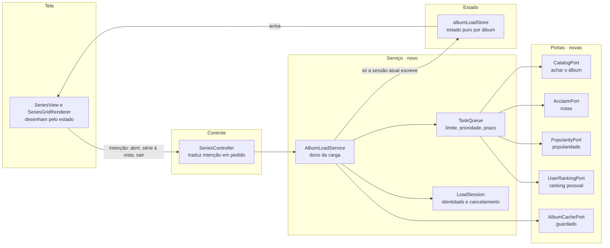
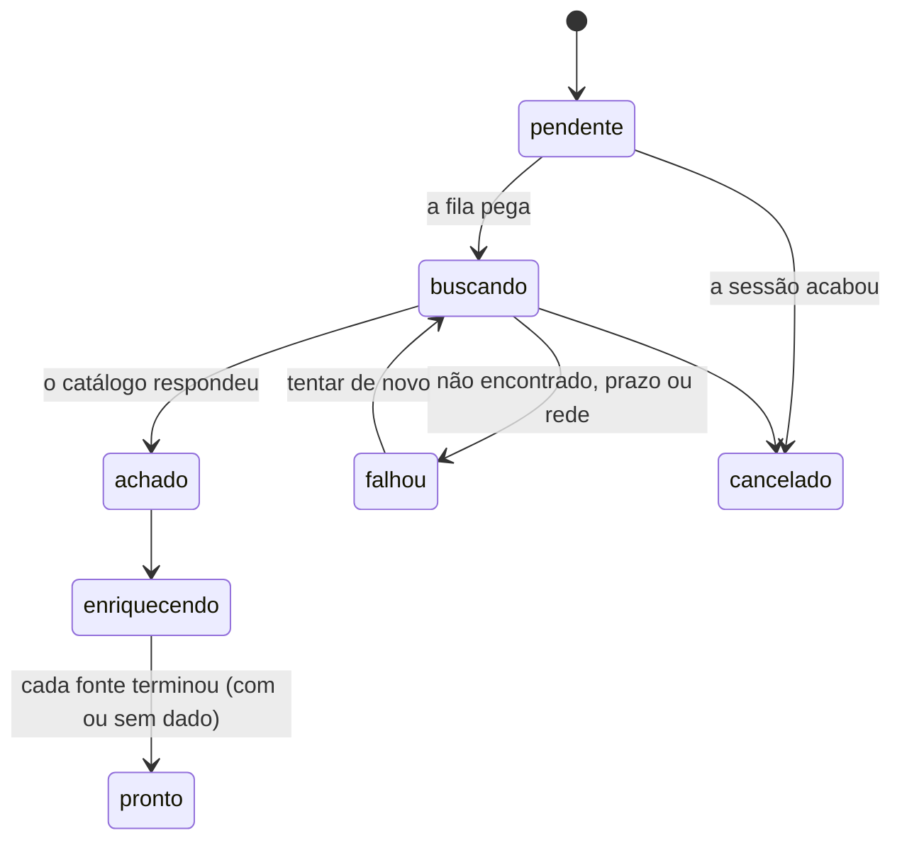
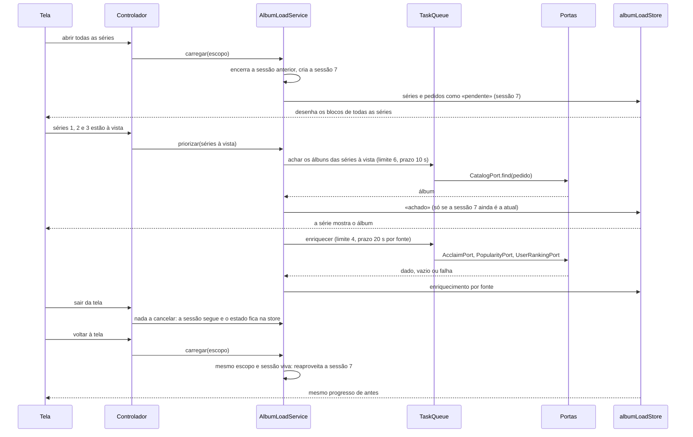
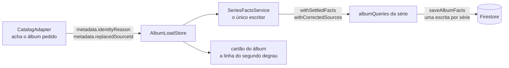
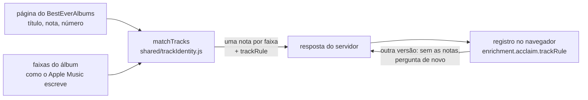
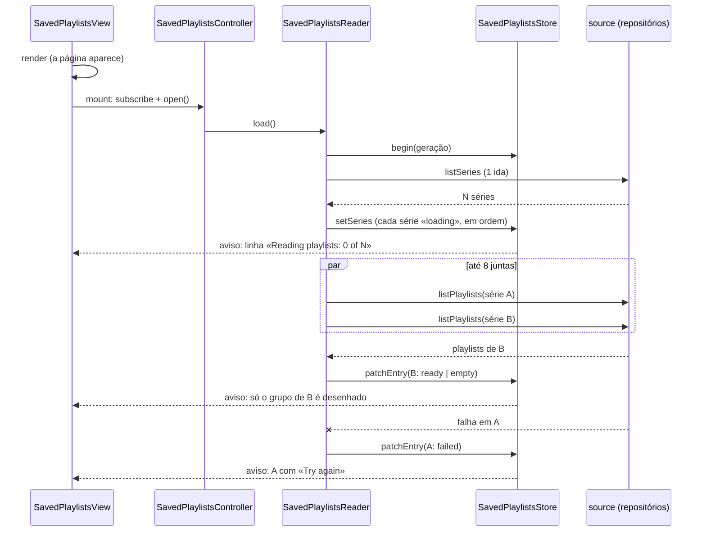

# Architecture: MJRP_AlbumsBalancedPlaylists_v0 (Album Blender v0)

> Escrito em 2026-10-28 (conform do harness) **do que o código é hoje**, não do ideal, e corrigido no mesmo dia depois da crítica independente (`reports/audits/2026-10-28-mjrpalbumblender-v0-architecture-audit.md`). Fontes: o manual do v0 (`docs/manual/01_System_Architecture.md` §1, §3, §5; `02`–`04`; `00_Deployment_and_Setup.md` §1–3), o mapa do código feito pelo V1 (`MJRPalbumblender-v1/reports/audits/2026-10-27-mjrpalbumblender-v1-project-bootstrap-report.md`, usado só para localizar) e a leitura direta do código, cujas linhas estão citadas. Onde o manual e o código discordam, vale o código.
> **Regras e código.** Este arquivo diz o que o código faz. Onde o código descumpre uma regra aprovada (constituição, `PRINCIPLES.md`, ADR), o texto traz a regra e, ao lado, **"Conserto:"** com o achado do relatório de auditoria que o registra; a regra continua valendo, e o código é que deve mudar. Não é uma lista de problemas: é o ponteiro que impede ler a regra como se estivesse cumprida.
> Estado: **Draft** até o MJRP aprovar.

## System Overview
O Album Blender v0 monta playlists balanceadas a partir de **séries** de álbuns: o usuário cria uma série (artista ou lista curada), o app descobre os álbuns no Apple Music, busca a aclamação de cada faixa e o **Blending Menu** gera a playlist por uma **Recipe** (algoritmo de curadoria: `mjrp-balanced-cascade`, `top-n-popular`, `top-n-acclaimed`, `top-n-user`, registro em `public/js/algorithms/index.js:24-30`). A playlist pode ser editada, salva e exportada para o Spotify ou o Apple Music. Está **em produção**.

A forma é de **duas metades**: uma SPA em JavaScript puro, que roda no navegador, guarda o estado e fala direto com o Firestore, o Spotify e o Apple MusicKit; e um servidor Node/Express pequeno, no Cloud Run, que existe para o que o navegador não pode fazer: raspar o BestEverAlbums, chamar o Gemini com a chave guardada, e assinar o token de desenvolvedor do Apple MusicKit. **O servidor não acessa o Firestore** (nenhum import de Firebase em `server/`). Como não há servidor entre o navegador e o banco, **as regras do Firestore (`firestore.rules`) são a única autorização dos dados**.

## Component Map
Os nomes da coluna *Stack layer* são as camadas de `docs/specs/tech-stack.md`.

### Navegador (`public/`)
| Component | Responsibility | Stack layer |
|-----------|---------------|-------------|
| Casca da SPA e roteador (`public/index.html`, `js/app.js`, `js/router.js`) | arranque, as **15** rotas registradas por History API (15 chamadas `router.register` no `app.js`; eram 18 até a F65, que retirou `/ranking/:albumId`, `/consolidated-ranking` e `/save-all`), CSP e folhas de estilo (as do app e a do Tailwind, compilada junto com o site: `css/tailwind.css`) | Front |
| Views (`js/views/`) | desenham uma tela; assinam stores e delegam a ação ao controller | Front |
| Controllers (`js/controllers/`) | o "cérebro" de uma tela: recebe a entrada, chama Services, atualiza a store. Hoje `PlaylistsController.js:92-93, 312, 325, 334` instancia repositórios, e `SeriesController.js:22` e `BlendingController.js:22` usam `userRankingRepository` direto | Front |
| Componentes e renderizadores (`js/components/`, `js/views/renderers/`) | blocos de UI reutilizáveis (cartões, modais, assistente de Blend, navegação) | Front |
| Stores (`js/stores/`) | guardam o estado em memória e avisam quem assinou (Observer). **Regra: só estado** (ADR-0017). Desde a segunda fatia da F58 (2026-11-19) **todas cumprem**: nenhum arquivo de `js/stores/` importa serviço, repositório, cache, API, Firebase ou o `app.js` (teste: `test/architecture/layerBoundaries.test.js`, lista vazia). A última a sair foi a «loja» do Spotify, que virou o serviço `services/spotify/StoredSpotifyPopularity.js`. Três passam de 150 linhas (`albumLoad.js` 214, `playlists.js` 169, `albums.js` 162) e são só estado, setters e seletores puros | Front |
| Services (`js/services/`) | lógica de negócio e orquestração: séries, playlists, geração, persistência, exportação Spotify, autenticação, busca de álbuns (`services/album-search/`), MusicKit (`services/musickit/`), `services/infra/StorageService.js` (localStorage), `services/playlists/PlaylistHistoryService.js` (desfazer/refazer), `services/auth/UserSyncService.js` (migração de usuário) | Front |
| Algoritmos e ranking (`js/algorithms/`, `js/ranking/`, `js/transformers/`) | as Recipes de geração e as estratégias de ranking (Strategy). Não importam Firebase, DOM nem `localStorage` | Front |
| Repositories (`js/repositories/`) | **o lado do site da costura dos dados** (F78, Ref-A): `firestoreStore.js` monta a «store» que os repositórios do núcleo recebem (o `db` e as funções do Firebase JS) e é o único arquivo do site, além de `firebase-init.js`, que importa `firebase/firestore`; `userRankings.js` é a instância única do ranking próprio. Os repositórios em si moram em `shared/data/` (ver *Compartilhado*) | Dados |
| Cache (`js/cache/`) | L1 memória + L2 IndexedDB `mjrp-cache` (`cache/CacheManager.js`) | Dados |
| Clientes externos (`js/api/client.js`, `services/SpotifyAuthService.js`, `services/musickit/`) | falam com `/api/*` (por `fetch`), com o Spotify (OAuth PKCE) e com o Apple MusicKit | Integrações externas |
| Worker de busca (`js/workers/search.worker.js`) | busca de autocompletar fora da thread principal, sobre `albums-autocomplete.json` | Front |
| Página de entrada (`public/splash.html`, `public/splash/`; F80) | a raiz do site (e o `/home`) para todos, com ou sem conta: HTML estático legível sem script, o caixote em CSS e em 3D (three.js do CDN, só no computador com WebGL), o fio, o fogo; a leitura pura «há conta neste navegador?» (`splash/gate.js`, `hasAccount`, sem redirecionar nada); as capas num arquivo com dois conjuntos (`splash/covers.js`). Não importa nada do app | Front |
| Medição do uso (`js/services/usage/`: `track.js`, `usageSwitch.js`, `usageWiring.js`, `memoryAdapter.js`, `posthogAdapter.js`) | a porta única de eventos de uso e o adaptador trocável atrás dela; o PostHog é carregado só com a medição ligada (F77). Ver «A medição do uso: a porta e o adaptador» | Integrações externas |

### Compartilhado (`shared/`)
| Component | Responsibility | Stack layer |
|-----------|---------------|-------------|
| Curadoria (`shared/curation.js`) | retirada na F65 (2026-11-19): nenhum cliente chamava `POST /api/playlists`, a única rota que a usava; as playlists são geradas no navegador, pelos algoritmos de `js/algorithms/` | — |
| Identidade da faixa (`shared/trackIdentity.js`) | a regra única de «esta faixa do álbum é a faixa que a fonte lista» (F74), pura, em degraus com nome, e a distribuição de uma nota para uma faixa (`matchTracks`); o app a usa por `public/js/models/sameTrack.js` e o servidor por `server/lib/trackIdentity.js`. Ver «Uma regra só para dizer que é a mesma faixa». `shared/normalize.js` (`normalizeKey`), que ocupava este lugar, saiu com ela | Linguagem |
| Identidade do álbum (`shared/albumIdentity.js`) | a regra única de «este é o álbum pedido» (F55, revista na F68), pura, em listas de regras com nome; o app a usa por `public/js/models/askedAlbum.js` e o servidor por `server/lib/albumIdentity.js`. Ver «Uma regra só para dizer que é o mesmo álbum», no fim deste arquivo | Linguagem |
| Eventos de uso (`shared/usageEvents.js`) | a lista fechada do que o app pode medir: nome de cada evento e, para cada propriedade, uma contagem ou um valor de conjunto fechado (F77); pura, sem import; o site a usa por `services/usage/track.js` e o app de celular (F78) é para usar a mesma | Linguagem |
| Plataforma (`shared/platform/`) | o único lugar do núcleo que pode depender do motor (F78): `newId.js` (a porta do id: `newId()` e `setIdSource(fn)`; cada lado liga a sua fonte uma vez, no começo) e `text.js` (`normalizeText`, as tabelas de Unicode do motor, que as duas regras de identidade usam) | Linguagem |
| Dados (`shared/data/`) | os repositórios (F78, Ref-A, REQ-09): `BaseRepository`, `SeriesRepository`, `PlaylistRepository`, `InventoryRepository`, `UserRankingRepository`, `SpotifyEnrichmentRepository`. Sabem os caminhos e o formato dos documentos e não importam Firestore: recebem uma store (`store.js`: o `db` e as 13 funções que chamam, com os nomes e argumentos do SDK modular do Firebase JS). `schemaVersion.js` é a regra da versão dos documentos (nunca desce). Ver «Os repositórios no núcleo: a store e a versão» | Dados |
| Autenticação de usuário | saiu do núcleo na F78 (REQ-08): é o login do navegador sobre `firebase/auth`, agora `public/js/services/auth/signIn.js`. Existe também outro `AuthService` em `public/js/services/AuthService.js` (login anônimo) | — |

### Servidor (`server/`, Cloud Run)
| Component | Responsibility | Stack layer |
|-----------|---------------|-------------|
| Entrada (`server/index.js`) | Express, CORS por `ALLOWED_ORIGIN`, saúde em `/_health` (`:87`), monta as rotas sob `/api` | Back |
| Rotas finas (`server/routes/`: `albums`, `ai`, `musickit`, `debug`) | recebem a requisição e chamam Services (`POST /api/enrich-album`, `/generate`, `/ai/studio-albums`, `GET /musickit-token`, rotas de depuração) | Back |
| Services (`server/lib/services/`: `EnrichmentService`, `GenerationService`, `spotifyPopularity`) | a lógica de enriquecer e gerar | Back |
| Fachada de ranking (`server/lib/fetchRanking.js`, `lib/ranking.js`) | esconde raspagem + IA + fallbacks; consolida por Borda Count | Back |
| Raspador (`server/lib/scrapers/besteveralbums.js`) | lê as notas de faixa do BestEverAlbums | Back |
| Fonte de valor (`server/lib/valueSources/`: `discogsSource`, `discogsParse`, `valueSwitch`; `lib/services/valueService.js`, `exchangeRates.js`; `routes/values.js`) | o preço que o Discogs sugere para a edição em CD mais comum de um álbum, atrás de um interruptor, e o câmbio do dia (F75): `POST /api/album-value`, `GET /api/value-sources`, `GET /api/exchange-rates` | Integrações externas |
| Cliente de IA (`server/lib/aiClient.js`, `lib/prompts.js`, `config/prompts.json`) | chama o Gemini com prompts externalizados | Integrações externas |
| Validação (`server/lib/schema.js`, `server/schema/album.schema.json`) | valida o álbum com AJV | Back |
| Token do MusicKit (`server/services/MusicKitTokenService.js`) | assina o token de desenvolvedor (JWT ES256) | Integrações externas |

## Stack
As tecnologias, as versões e as decisões por trás delas moram em `docs/specs/tech-stack.md` - este arquivo aponta para lá, não as lista.

## Data Flow
```
Navegador (SPA)
  View -> Controller -> Service -> Repository --> Firestore   (direto; o servidor não participa)
                          |  \--> Store (estado; avisa as Views)
                          |  \--> Cache L1 memória / L2 IndexedDB / localStorage
                          +--> api/client.js --/api/*--> Firebase Hosting (rewrite) --> Cloud Run (server)
                          |                                     Rotas -> Services -> BestEverAlbums (raspa) / Gemini (REST)
                          +--> Spotify Web API (OAuth PKCE, token no localStorage)
                          +--> Apple MusicKit JS (token de desenvolvedor vem de /api/musickit-token)
```
O desenho acima é a **direção-alvo**; o que o código faz hoje está logo abaixo, em *Direção das dependências e fronteira do Firestore*.

1. **Criar a série.** Home -> "Scan Artist" no Apple Music -> montagem -> grava no Firestore só a lista de pedidos `albumQueries`, não os álbuns (Apêndice B §2 do mapa do V1).
2. **Carregar e enriquecer.** O cliente resolve cada pedido no Apple Music e pede `POST /api/enrich-album`; o servidor raspa o BestEverAlbums e devolve o ranking das faixas. A cascata completa só roda em `/generate`, o fallback legado: BestEverAlbums primeiro; o Spotify entra se o BestEverAlbums achar menos de 3 faixas com nota **e** menos de 40% das faixas conhecidas (`server/lib/fetchRanking.js:162-169`; o comentário do código diz "previously 50%"); depois o Gemini; depois Borda Count. O Spotify também enriquece pelo cliente, com cache global em `spotify_enrichment`.
3. **Gerar.** O assistente do Blending Menu (série -> Recipe -> ingredientes -> "Blend It!") roda a Recipe no navegador; o estado fica nas stores, o rascunho em `localStorage`.
4. **Salvar e exportar.** A playlist vai para o Firestore em `artifacts/mjrp-albums/users/{uid}/curator/data/series/{seriesId}/playlists` (`mjrp-albums` é um segmento de caminho fixo no código, não o projeto Firebase); a exportação para Spotify ou Apple Music sai do cliente.
5. **Identidade.** Firebase Auth com login anônimo automático para qualquer visitante (`public/js/services/AuthService.js:58`); os dados do usuário ficam sob o `uid`. O login com Google/Apple (`shared/services/AuthService.js:22`, `signInWithPopup`) troca de `uid`; os dados da sessão anônima ficam no `uid` antigo.
6. **Quando uma leitura do servidor falha.** O servidor responde **200 com resultado vazio**, não um erro: se o raspador falha, `/enrich-album` devolve `bestEverInfo: null` e notas nulas, igual ao álbum sem nota (`server/lib/services/EnrichmentService.js:27-33, 99-104`); `/ai/studio-albums` devolve `{ albums: [], error }` com 200 (`server/routes/ai.js:62-66`); sem `prompts.json`, `loadPrompts()` devolve `{}` com um aviso no log (`server/lib/prompts.js:6-22`). O cliente não distingue "sem dado" de "fonte fora do ar". Regra: sem falha silenciosa (`PRINCIPLES.md` §I.8). Conserto: achado 7 da auditoria.

### Direção das dependências e fronteira do Firestore
**Regras:** as dependências apontam para dentro, e o adaptador do Firestore é o Repository (`PRINCIPLES.md` §I.3; constituição, *Padrões com endereço*); a regra de negócio nasce como Service (ADR-0016); a Store só guarda estado e o Service a atualiza pelos setters (ADR-0017); trocar a fonte de dados é mexer num arquivo.

**O que o código faz hoje:**
- O núcleo está limpo: `algorithms/`, `models/`, `ranking/` e `transformers/` não importam Firebase, DOM nem `localStorage`.
- O SDK do Firestore **não é mais importado fora de `repositories/`** e de `firebase-init.js` (desde a F58, 2026-11-19; UAT-14). O caminho até aqui: `services/PlaylistsService.js` saiu na F60 (o `writeBatch` foi para `PlaylistRepository`), `stores/albums.js` na F48 (`repositories/SharedAlbumRepository.js`) e `views/SaveAllView.js` na F58: ela carregava o SDK Firestore e Auth **11.6.1 pelo CDN `gstatic`** (um segundo Firebase, sem app iniciado), e passou a receber da rota (`app.js`) o `MigrationUtility` feito com o Firestore único do app. O app tem um Firebase só, o do pacote npm. Desde a Ref-A da F78 (2026-11-20) os repositórios moram em `shared/data/` e não importam Firestore: trocar o SDK é trocar a store (`public/js/repositories/firestoreStore.js` no site; a do React Native Firebase no app), não os repositórios. Teste: `test/architecture/firestoreBehindRepositories.test.js` (nenhum `import` de endereço em `public/js`; o Firestore só nos repositórios e em `firebase-init.js`; nenhuma chamada à API do Firestore fora dos repositórios).
- O caminho "View -> Controller -> Service -> Repository" **vale sem exceção para o que o teste mede**, desde a segunda fatia da F58 (2026-11-19; UAT-18 e UAT-19): as três listas de exceções de `test/architecture/layerBoundaries.test.js` estão **vazias** e só podem continuar assim. Nenhuma loja importa serviço, repositório, cache, API, Firebase ou o `app.js`; nenhuma tela, componente ou controlador importa repositório ou Firebase, nem lê `auth.currentUser`; **nada importa o `app.js`, que não exporta mais nada**. O app não tem raiz de composição: cada assunto tem um arquivo que monta o serviço com as fontes de verdade, e é o único que conhece o banco e o login daquele assunto: `services/albums/albumLoading.js` (a carga), `services/inventory/inventoryWiring.js` (o inventário), `services/auth/userSession.js` (o login), `services/playlists/savedPlaylistsReading.js` (a leitura das playlists guardadas), `services/playlists/playlistsWiring.js` (as playlists da tela: o `PlaylistsService` recebe ali o banco, o cache e quem está na conta, e `PlaylistsController`, `BlendingController`, `PlaylistsDragHandler`, `SavedPlaylistsController` e `PlaylistsView` pedem a ele) e `services/spotify/spotifyPopularityWiring.js` (o que o app guarda das respostas do Spotify). O caminho até aqui: na primeira fatia, `views/SeriesView.js`, `components/series/SeriesEventHandler.js` e `components/TopNav.js` deixaram o banco, `stores/inventory.js` e `stores/UserStore.js` viraram estado puro e o ciclo `app.js <-> stores/inventory.js` acabou; a F65 removeu `PlaylistsDragDrop` e `PlaylistPersistenceService`, sem uso; na segunda fatia, o `PlaylistsController` deixou de criar o seu `PlaylistRepository` (pede `PlaylistsService.findBatch`), os quatro arquivos que pegavam `db` e `auth` do `app.js` deixaram de importá-lo, e `stores/SpotifyEnrichmentStore.js` deixou de existir. O que o teste **não** mede: um controlador que alcança um repositório por dentro de um serviço (`getSeriesService(...).repository`), e os serviços que importam lojas; ficam como estão.

## Infrastructure
- Hosting: o **frontend** em Firebase Hosting, servindo `dist` (build do Vite); `firebase.json` reescreve `/api/**` para o serviço Cloud Run `mjrp-proxy` (região `southamerica-east1`) e o resto para `/app.html`, o app; a raiz `/` é o arquivo `dist/index.html`, a página de entrada (F80, seção «A raiz do site: duas páginas no build»). O **backend** em Cloud Run (`mjrp-proxy`, contêiner `node:24-slim`, `server/Dockerfile`, publicado por `npm run deploy:server`), acesso público.
- Database: **Firestore** do projeto Firebase **`mjrp-playlist-generator`**. O app o recebe de `public/js/firebase-config.js:3-10` (`window.__firebase_config`), carregado por `public/index.html:111` antes do `app.js` (`:112`); `.firebaserc`, `scripts/deploy-backend.sh` (`PROJECT_ID`) e o CORS padrão do servidor (`server/index.js:58`) apontam para o mesmo projeto. O bloco `mjrp-albums` de `public/js/firebase-init.js:6-13` é só o valor reserva, com chave de marcador (`API_KEY_PLACEHOLDER`): não funciona. `mjrp-albums` também é o `appId` fixo no caminho `artifacts/mjrp-albums/...` (`InventoryRepository.js:20`, `SeriesRepository.js:21`), uma constante de caminho. No navegador, IndexedDB `mjrp-cache` e `localStorage`. O backend não tem banco. (Os repositórios citados moram em `shared/data/` desde a F78.)
- **Quem pode ler e escrever o quê no Firestore** (`firestore.rules`, lido linha a linha; "autenticado" vale para qualquer visitante, porque o app faz login anônimo sozinho):

| Caminho | Quem lê e escreve (regra) | Quem escreve no código |
|---|---|---|
| `artifacts/{appId}/users/{uid}/curator/**` e `.../inventory/**` | só o dono (`uid`); no arquivo do repositório, desde a F78, `update` também pede `keepsSchemaVersion()` (ainda não publicado) | repositórios (o `PlaylistsService` grava pelo `PlaylistRepository` desde a F60) |
| `users/{uid}/series/**` (`:19-28`) | só o dono | ninguém: a migração legada, único uso, saiu na F65. As três regras podem ser fechadas (o `firestore.rules` é do MJRP) |
| `users/{uid}/albumRankings/{albumId}` | só o dono no arquivo do repositório desde a F59 (o que está em produção, segundo o comentário do arquivo, também); `update` pede `keepsSchemaVersion()` desde a F78 (ainda não publicado) | `UserRankingRepository` |
| `albums/{albumId}` (`:42-43`) | **qualquer autenticado**, inclusive anônimo, em qualquer documento; sem dono | ninguém: o «Refetch» deixou de gravar aqui na F56 e o `SharedAlbumRepository` saiu na F65. A regra pode ser fechada (o `firestore.rules` é do MJRP) |
| `spotify_enrichment/{albumKey}` | **qualquer autenticado**, inclusive anônimo; cache global sem dono; `update` pede `keepsSchemaVersion()` desde a F78 (ainda não publicado) | `SpotifyEnrichmentRepository` |

Regra: a estabilidade da produção e os dados do usuário não ficam abertos a qualquer visitante (constituição v2.0.0, artigo V, itens 12 e 13). Conserto: achado 2 da auditoria. **Nenhum pipeline do repositório publica `firestore.rules`**: `firebase.json` não tem bloco `firestore`, e `.github/workflows/ci-firebase.yml:73, 120` e `scripts/deploy-prod.sh` implantam só `--only hosting`; o que está em produção pode não ser este arquivo.
- Segredos: no Secret Manager do Google Cloud, injetados no Cloud Run (`AI_API_KEY`, `APPLE_TEAM_ID`, `APPLE_KEY_ID`, `APPLE_MUSIC_PRIVATE_KEY`); a ligação entre segredo e variável mora na configuração do serviço e está descrita em `docs/manual/00_Deployment_and_Setup.md` (seção 2.4); em desenvolvimento, `server/.env`.
- Implantação do **frontend**: `scripts/deploy-site.sh` (`npm run deploy:site`), da máquina do MJRP, com o login do Firebase CLI: exporta a `main` para uma pasta limpa, roda os testes, constrói com o `.env`, confere o que construiu, publica só o Hosting e confere produção (F64, 2026-11-19). A automação do GitHub (`.github/workflows/ci.yml`) só roda os testes; não publica.
- Implantação do **backend**: uma receita só, `scripts/deploy-server.sh` (`npm run deploy:server`): exporta a `main`, roda os testes, monta o contexto (`shared/` em `server/_shared_temp`, `config/` em `server/config`), sobe o servidor localmente para conferir, e publica com `gcloud run deploy --source server`, que constrói a imagem pelo `server/Dockerfile`. A segunda receita (`cloudbuild.yaml`), que não copiava `config/`, foi removida na F64. O script imprime a revisão que estava no ar e o comando para voltar a ela.
- CDN/Assets: o Tailwind não vem mais de CDN: é compilado junto com o site (`tailwind.config.js`, `public/css/tailwind.css`; [[ADR-0021]], F59). A fonte Syne vem do Google Fonts (`public/index.html`); o SDK do Apple MusicKit vem de `js-cdn.music.apple.com` (`services/musickit/MusicKitAuth.js:124`); o conjunto de álbuns do autocompletar é o arquivo estático `albums-autocomplete.json`.

## Delivery strategy

**Status: proposal by the agent, 2026-11-21 13:25, awaiting the MJRP's approval.** Written from what the repository shows (the scripts `scripts/deploy-site.sh` and `scripts/deploy-server.sh`, `.github/workflows/ci.yml`, `firebase.json`, the Infrastructure section above, ADR-0020 and the contract). What the repository does not show is written «not checked».

| Question | Answer |
|---|---|
| **Which branches exist** | `main` (local, the truth that gets deployed); `claude/fNN-…`, `feat/fNN-…`, `fix/fNN-…` (one per feature, cut from `main`, the commit hook refuses other names); `wip/…` (conform and similar work, accepted by the hook). Merges into `main` go through `merge_train.py` by the orchestrator. |
| **What makes a preview** | Nothing automatic: no workflow builds a preview and no Firebase preview channel is used in the repository. A person sees a change by running the site locally (`npx vite`, or `vite preview` on `dist/`). Firebase Hosting preview channels: not checked (no channel is created by any script; whether one exists in the console was not read). |
| **What goes to production** | Only `main`. The site (Firebase Hosting, project `mjrp-playlist-generator`) by `npm run deploy:site`; the server (Cloud Run `mjrp-proxy`) by `npm run deploy:server`. The two are published apart, so a problem has one cause. `firestore.rules` is not published by either script (see Infrastructure). |
| **Who sends each one** | The MJRP, from his machine, with his Firebase and Google Cloud logins; the push stays his. CI only runs the tests and deploys nothing (`.github/workflows/ci.yml`: lint and `vitest run` on every push and pull request). |
| **What is checked at each step** | Before the branch merges: the project's lint and tests (`npm run lint`, `npm test -- --run`), and for a screen the independent visual recheck (`sensors.visual`). Before a deploy, each script exports `main` to a clean folder, runs the tests, builds, and checks what it built; the server script also starts the built server locally. After the deploy, each script checks production (the live main script answers a script, not a page). |
| **How to go back** | Site: Firebase console, Hosting, release history, pick the previous release and «Rollback» (printed by `deploy-site.sh`). Server: `gcloud run` traffic to the previous revision, which `deploy-server.sh` prints before it deploys; the service stays pinned to it until released (ADR-0020). The MJRP does it. Data in Firestore is not rolled back by either. |
| **Does the preview use production's credentials and data?** | There is no preview, so nothing to share. A local run reads `server/.env` and the same Firebase project and Firestore as production (the app config points to `mjrp-playlist-generator`): a local run touches real data. Whether a separate Firebase project for tests exists: not checked. |

**Proposal (F87, awaiting the MJRP's approval):** a preview before production through a Firebase Hosting preview channel: `npm run deploy:preview` (`scripts/deploy-preview.sh`, same checks as `deploy-site.sh`, ending in `firebase hosting:channel:deploy staging --expires 7d`; `--branch <local branch>` publishes a branch that has not reached `main` yet, so work is validated before `main`; production, `deploy-site.sh`, accepts only `main`). It shares production's data, login and server, so nothing in it may write a Discogs price to Firestore; the row «What makes a preview» above changes only if he approves.

**Proposal (F87, awaiting the MJRP's approval): the preview shares production's server.** In production the server accepts the origins of `ALLOWED_ORIGIN` and the preview channels of its own Hosting site (`https://<site>--<channel>-<hash>.web.app`, `server/lib/corsOrigin.js`); the server must be published (`npm run deploy:server`) for a preview to call it.

What waits for the MJRP: confirming or adjusting this table. If he confirms, the Status line becomes «confirmed by the MJRP» with the date. If he does not, it stays a proposal and the harness's default holds: nothing is sent without him.

## Constraints
- **Segurança e abuso.**
  - Segredos por variável de ambiente e Secret Manager, nunca no código (constituição v2.0.0, artigo V, item 7; `PRINCIPLES.md` §I.14). A chave do Gemini e a chave privada da Apple ficam só no servidor: por isso o servidor existe.
  - O acesso aos dados do usuário é o da tabela da seção *Infrastructure*, não "escopo por dono em tudo".
  - Quem pode chamar o quê (F59): as rotas pagas (`/api/generate`, `/api/ai`) respondem só a quem entrou com conta, e as custosas (`/api/enrich-album`, `/api/value-sources`, `/api/exchange-rates`) a quem entrou, cada uma com limite por pessoa por hora (padrões 60 e 900; `PAID_CALLS_PER_HOUR`, `COSTLY_CALLS_PER_HOUR`); `/api/album-value` só a quem tem conta, com limite próprio (`VALUE_CALLS_PER_HOUR`, F75) (`server/index.js:121-131`, `server/lib/auth/guards.js`). As rotas de depuração (`/api/debug/*`, `/api/list-models`) ficam desligadas até `ENABLE_DEBUG_ROUTES=true` (`server/index.js:148-152`, `server/lib/debugGate.js`). As rotas do MusicKit (`/api/musickit-token`, `/api/musickit-status`) seguem sem login. Em produção o CORS aceita as origens de `ALLOWED_ORIGIN` (padrão `https://mjrp-playlist-generator.web.app`, `server/index.js:58-74`) **e** qualquer requisição sem cabeçalho `Origin` (`:66`). Regra: constituição v2.0.0, artigo V, item 11 (`test/server/authGuard.test.js`, `test/server/debugGate.test.js`).
  - Tokens do Spotify (acesso e renovação) ficam no `localStorage` (`services/SpotifyAuthService.js:179-182`), com um CSP que libera script inline (`public/index.html:9`).
- **Dependências entre camadas.** A Dependency Rule e a fronteira do Firestore são as da seção *Direção das dependências*, com as exceções descritas ali. Rota e componente são orquestradores finos (ADR-0016).
- **Compartilhamento.** A lógica que roda nos dois lados mora em `/shared` (constituição v2.0.0, artigo II); o contêiner a recebe copiada, por isso o `Dockerfile` espera `_shared_temp`. Em `shared/`, `albumIdentity.js` e `trackIdentity.js` são usados também pelo servidor (o `curation.js` saiu na F65); o login do navegador saiu de `shared/` na F78. A casa do núcleo e as suas regras estão em «O núcleo compartilhado: casa, porta do id e corpo dourado (F78)».
- **Estado do servidor.** Contêiner sem estado e escalável (constituição v2.0.0, artigo II).
- **Validação.** Regra: todo dado externo que entra no servidor é validado com AJV (constituição v2.0.0, artigo II).
- **Tempo.** O raspador tem prazo de 30 s por requisição (`server/lib/scrapers/besteveralbums.js:8-9`), sem retentativa nem cache; o Gemini, 60 s (`server/lib/aiClient.js:10`). O cliente refaz a chamada 2 vezes, com espera fixa de 1 s (`public/js/api/client.js:21-23`), inclusive `/generate`, que chama o Gemini.
- **Runtime.** Node.js 18 no contêiner e na CI (`server/Dockerfile:1`; `ci-firebase.yml:22, 55`), versão fora de suporte desde abril de 2025.
- **Desempenho e escala.** TBD: o v0 não declara alvo de latência nem de carga; é decisão de produto do MJRP, não do agente. O custo por chamada paga (Gemini, Firestore) também não está estimado.

## O núcleo compartilhado: casa, porta do id e corpo dourado (F78)

Primeira fatia de código da F78 (ramo `feat/f78-core-foundations`, 2026-11-20): o site continua igual; o núcleo ganha casa e sensor antes do app existir. Desenho: `design/proposals/f78-app-architecture/architecture-proposal.md`, § 4.7 e § 11.

- **A casa.** `shared/` é um pacote de espaço de trabalho do npm: `shared/package.json` (`@album-blender/shared`, privado, módulo ES, **sem dependência**) e `"workspaces": ["shared"]` no `package.json` da raiz; o `npm ci` liga `node_modules/@album-blender/shared` a `shared/`. O site continua chegando pelo apelido `@shared` do Vite e do Vitest; o servidor continua recebendo `shared/` copiado no deploy (`server/_shared_temp`, com um `package.json` `{"type": "module"}` escrito por cima do nosso). O app (`app/`, ainda não existe) é quem vai usar o pacote pelo nome.
- **A regra, com sensor** (`test/architecture/coreStaysPortable.test.js`, sem lista de exceções): nada em `shared/` cita global do navegador (`window`, `document`, `navigator`, `localStorage`, `indexedDB`, `fetch`, `MusicKit`, `globalThis`, `import.meta`); fora de `shared/platform/`, nada chama o que depende do motor (`crypto`, `Intl`, `toLocale…`, `localeCompare`, `.normalize(`, `URLSearchParams`, `structuredClone`); nenhum `import` sai de `shared/` (site, servidor, Node, Firebase, React, Expo, PostHog, qualquer pacote); as regras não importam `shared/data/`. O `test/architecture/appAndSiteApart.test.js` confere que `public/` não importa `app/`; as checagens de `app/` (não importar `public/`, nenhuma pasta `models`, `algorithms`, `ranking`, `repositories`) passam vazias enquanto `app/` não existe e começam a valer quando ele aparecer, sem mudar o teste. Os testes de `test/shared/` rodam duas vezes: com jsdom e, no projeto `core-node` do `vitest.workspace.js`, em Node puro.
- **A porta do id** (`shared/platform/newId.js`). As regras pedem `newId()`; cada lado entrega a fonte uma vez, no começo: o site com o `crypto.randomUUID` do navegador (`public/js/services/platform/platformWiring.js`, o primeiro módulo que o `app.js` carrega), os testes com o do Node (`test/setup.js`), o app com o seu (`expo-crypto`). Sem fonte ligada, `newId()` dá erro dizendo o que ligar: o núcleo não procura global sozinho. `Track` e `TrackTransformer` usam a porta. O servidor não cria faixa e não liga nada.
- **O corpo dourado** (`test/fixtures/golden-core/`, `scripts/golden-core.mjs`). Entradas: as que os testes do núcleo passam às regras (gravadas pelo spike S1), 28 álbuns públicos de catálogo e álbuns feitos à mão (vazios, empates, acentos, escritas não latinas, faixas sem `id`); nenhum dado do dono. Uma saída de referência, a das regras de hoje no Node: `reference/output.jsonl.gz`, uma linha por caso, e `reference/cases.tsv`, o id e o hash de cada caso. O `test/architecture/goldenCoreUnchanged.test.js` refaz a saída a cada suíte. **Uma saída mudada quer dizer que uma regra mudou o que entrega**: se a mudança é a pretendida, `node scripts/golden-core.mjs --write` grava a referência nova e o diff do `cases.tsv` mostra, no commit, quais casos mudaram, para revisão; se não é, é regressão. `node scripts/golden-core.mjs --hermes` roda o mesmo corpo no Hermes do React Native (opcional, fora da suíte; precisa do motor do spike): em 2026-11-20, 3.343 de 3.343 iguais, do código-fonte e do bytecode.

### Os repositórios no núcleo: a store e a versão (F78, Ref-A, REQ-09 e REQ-10)

Segunda fatia de código da F78 (ramo `feat/f78-ref-a-repositories-in-the-core`, 2026-11-20). O site lê e grava como antes: as mesmas chamadas, com as mesmas cargas, na mesma ordem (`test/repositories/writeSequence.test.js` compara com o registro gravado na `main` antes da mudança, `test/fixtures/repositories/write-sequence.json`).

- **Onde moram.** `BaseRepository` e os cinco repositórios estão em `shared/data/`. O site os importa por `@shared/data/…` nos lugares que já os montavam: `services/SeriesService.js`, `services/PlaylistsService.js`, `services/playlists/adapters/RepositoryPlaylistsSource.js`, `services/inventory/inventoryWiring.js`, `services/spotify/spotifyPopularityWiring.js`; o ranking próprio, por `public/js/repositories/userRankings.js` (a instância única, que antes nascia no fim do arquivo do repositório com o `db` de `firebase-init.js`). Os testes de `test/repositories/` rodam também no projeto `core-node`, sem navegador.
- **A store (a porta dos dados).** Cada repositório recebe no construtor, no lugar do `db`, uma store: `{ db, collection, doc, getDoc, getDocs, setDoc, updateDoc, deleteDoc, query, where, orderBy, limit, writeBatch, serverTimestamp }`, com os nomes e os argumentos do SDK modular do Firebase JS (`shared/data/store.js`, que recusa uma store incompleta ao montar o repositório). O site a monta em `public/js/repositories/firestoreStore.js` com `firestoreStore(db)`; o app vai montar a sua com o React Native Firebase. `runTransaction` não está na store: nenhum repositório o chama hoje; entra com a Ref-B.
- **A versão dos documentos nunca desce.** `_schemaVersion` diz em que forma o documento foi gravado (hoje, 1 em todos). Só `BaseRepository.save` carimba a versão num documento que pode existir (playlists, ao salvar um lote; o cache do Spotify): grava o maior entre a versão de quem escreve e a do documento como quem escreve o leu (`shared/data/schemaVersion.js`). `create` e `createMany` carimbam documentos novos; `update`, `updateMany`, `saveAlbumFacts` e o `saveRanking` (que grava com `merge`) não tocam no campo. No servidor, `firestore.rules` recusa um `update` que rebaixe a versão nos quatro caminhos dos repositórios: vale para todo escritor, inclusive o site de hoje, quando estiver publicado (é do MJRP: `firebase deploy --only firestore:rules`).
- **Sensores.** `coreStaysPortable` (nenhum `firebase/*` em `shared/`), `firestoreBehindRepositories` (os repositórios estão em `shared/data/`; em `public/js/repositories/` só `firestoreStore.js` importa o SDK; nenhum repositório chama o Firestore fora da store), `oldWriterKeepsNewFields` (um escritor velho não apaga campo novo nem rebaixa a versão, por entidade), `test/security/firestoreRules.test.js` (a regra da versão, lida como texto). Os sensores de camada (`layerBoundaries`, `albumLoadBoundaries`, `ownRankingBoundaries`, `savedPlaylistsBoundaries`) passam a enxergar `shared/data/` como repositório.
- **O que fica para a Ref-B.** Abrir só para leitura um documento de versão maior (regra 3 do § 6.2 da proposta) e a gravação de séries por transação; os casos abertos estão no `plan.md` da F78, § Technical Design.

### O app (`app/`): o esqueleto (F78, ADR-0022)

Terceira fatia de código da F78 (ramo `feat/f78-app-skeleton`, 2026-11-20). React Native com Expo (SDK 58, React Native 0.88.1), em TypeScript estrito, num espaço de trabalho da raiz ao lado de `shared/`; as regras ficam em `shared/` e nunca em `app/`. **Construído e provado só até onde uma máquina sem simulador prova:** compilador, testes de unidade e de componente (Jest), lint e o empacotamento do JavaScript pelo Metro (`expo export` para iOS e Android). Nenhuma tela foi vista num aparelho. **Atualização 2026-11-20 (ramo `feat/f78-first-simulator-run`):** o build de demonstração roda no simulador do iPhone («iPhone 17 Pro», iOS 26.5, Xcode 27.2) e o autoteste deu 3343 de 3343 no Hermes do app, com o id do expo-crypto (`reports/evidence/F78/2026-11-20-first-simulator-run.md`).

```
app/
  app.json  app.config.js  nativeBuild.js  react-native.config.js
  metro.config.js  jest.config.js  eslint.config.js  tsconfig.json
  ios/  android/    gerados pelo `expo prebuild` (geração nativa contínua): fora do git
  src/app/          as rotas (Expo Router): (tabs)/ com Home, Albums, Blend, Playlists, Inventory; sign-in; diagnostics
  src/screens/      as telas: Albums, Entrar, «Not in the app yet», o autoteste
  src/ui/           o tema e as peças de design-system.md § Celular
  src/platform/     a ligação da plataforma: expo-crypto no newId() do núcleo
  src/data/         a porta dos dados: a interface da store e as duas ligações; a lista de séries
  src/auth/         a porta da conta: o falso e a ligação nativa
  src/usage/        a porta do uso: desligado, em memória, PostHog
  src/selftest/     o autoteste do corpo dourado (sha256 em TypeScript)
  src/composition.ts  quem liga o quê: o modo de demonstração (padrão) ou EXPO_PUBLIC_DATA_MODE=firebase
```

**As três portas e as suas ligações:**

| Porta | Interface | Ligação provada aqui | Ligação real, não provada |
|---|---|---|---|
| Dados (store) | `app/src/data/store.ts`: o `db` e as 13 funções de `shared/data/store.js`, com os nomes e argumentos do Firestore modular; os repositórios de `shared/data/` a recebem como recebem a do site | `memoryStore.ts`: documentos por caminho, `where`/`orderBy`/`limit`, lote checado antes de aplicar, `serverTimestamp` com relógio; serve aos testes e ao modo de demonstração (três séries de álbuns públicos de catálogo) | `firebaseStore.ts`: as funções modulares de `@react-native-firebase/firestore` (rnfirebase.io/firestore/usage); o único arquivo que importa o pacote. Prova: spike S2 |
| Conta | `app/src/auth/authPort.ts`: `signIn('apple' \| 'google')`, `signOut`, `current`, `onChange`, `providers`; cancelar não é falha | `fakeAuth.ts` | `nativeAuth.ts`: Sign in with Apple e Google Sign-In dão a credencial, `signInWithCredential` do React Native Firebase Auth (rnfirebase.io/auth/social-auth). Precisa da conta da Apple, do registro do app no Firebase e do id de cliente web do Google. Prova: spike S2, TASK-19 |
| Uso | `app/src/usage/usage.ts`: `track(nome, propriedades)` pelo `describeEvent` de `shared/usageEvents.js` (a mesma lista fechada do site); nunca lança | o desligado (padrão, e sem chave) e o em memória | `posthogAdapter.ts`: `posthog-react-native`, nuvem europeia, só com `EXPO_PUBLIC_POSTHOG_KEY`. Prova: um evento chegando (TASK-28) |

**A plataforma.** `app/src/platform/wiring.ts` roda antes de qualquer tela (`app/src/app/_layout.tsx`) e entrega ao `newId()` o `randomUUID` do expo-crypto; nada mais global. O Metro resolve o núcleo pelo nome do pacote (`@album-blender/shared/…`) e pelo apelido do site (`@shared/…`, só porque as regras que o autoteste roda ainda moram em `public/js`), os dois para a mesma pasta: um módulo só, uma porta de id só (conferido no mapa de fontes de cada `expo export`).

**Os dois builds nativos.** Um interruptor só, `EXPO_PUBLIC_DATA_MODE`, decide o JavaScript (`src/composition.ts`) e o nativo (`app/nativeBuild.js`): `firebase` é o build com Firebase; qualquer outro valor, o de demonstração, o padrão. O de demonstração deixa fora do projeto nativo os cinco pacotes que pedem credencial (`@react-native-firebase/app`, `/auth`, `/firestore`, `@react-native-google-signin/google-signin`, `@invertase/react-native-apple-authentication`), sem arquivo de credencial falso, em três pontos: `app/app.config.js` tira os config plugins (sem `FirebaseApp.configure()` no AppDelegate, sem `GoogleService-Info.plist`, sem o URL scheme do Google) e o direito do Sign in with Apple; `app/react-native.config.js` desliga o autolink da metade React Native; e o `app.config.js` põe a mesma lista no `use_expo_modules!({ exclude: [...] })` do Podfile, porque o Google Sign-In traz também um adaptador Expo que o autolink do Expo acha sozinho. O JavaScript dos cinco continua no pacote do Metro e só roda no modo Firebase (o `require` preguiçoso do `composition.ts`); `firebaseStore.ts` continua o único arquivo que importa o Firestore nativo. `app/ios/` e `app/android/` não são commitados: o `expo prebuild` os refaz a partir de `app.json` e `app.config.js`. `npm run app:ios:demo` (`scripts/app-ios-demo.sh`) gera, constrói com o `xcodebuild`, instala e abre no simulador. Só no modo de demonstração, para rodar sem toque: os argumentos de lançamento `-demoSignIn apple` e `-demoRoute <rota>` (`src/demo/demoLaunch.tsx`, lidos pelo `Settings` do React Native nas preferências do app) e os links `albumblender://sign-in?as=apple` e `albumblender://diagnostics?run=1`.

**O autoteste (REQ-16).** `app/src/selftest/goldenSelfTest.ts` roda o corpo dourado no motor do app, com o id do aparelho, e compara cada caso com `test/fixtures/golden-core/reference/cases.tsv` (0,2 MB, empacotado como texto) pelo sha256 da linha; a referência inteira (33 MB de texto) não vai no app. As entradas (nove arquivos, ~0,75 MB) vão no pacote. A tela é escondida: toque longo no título de Albums, ou o link `albumblender://diagnostics` (com `?run=1`, roda ao abrir). Cada resultado vira também duas linhas de console que começam por `[golden-self-test]` (a contagem; o motor e um id de amostra), lidas no log do simulador ou no terminal do Metro.

**Sensores.** `test/architecture/appAndSiteApart.test.js` (lê todo arquivo do app; segue o que ele alcança fora de `app/`; só o autoteste chega a `public/`, pelo executor do corpo, nas pastas das regras, até as regras irem para `shared/`); `test/architecture/noSecretsInTheApp.test.js` com `scripts/app-bundle-scan.mjs` (nomes dos segredos do servidor e formas de chave, no código e nos pacotes); `app/eslint.config.js` (os pacotes nativos só nas suas ligações; nada de `public/` nem `server/`); `test/architecture/support/importGraph.js` (o que o app importa do núcleo conta como vivo).

**Provado no simulador do iPhone (2026-11-20):** o build nativo de demonstração para iOS; o expo-crypto nativo; o autoteste no Hermes do app (3343 de 3343); as telas de entrar, Albums, «Not in the app yet» e o autoteste, com as áreas seguras e a barra de abas. **Não provado (precisa de aparelho, licença ou conta):** as ligações reais das três portas e o build com Firebase; um iPhone de verdade; o Android inteiro; o build `Release`; o desempenho. **Não feito:** a guarda local e «Saved earlier»/«No connection» (REQ-13), a versão mínima (REQ-14), o roteiro Maestro.

## Carga da tela de álbuns — proposta

> **Profundidade:** leve — o risco mais alto é de complexidade e de regressão num fluxo que está em produção e sem nenhum teste; tudo roda no navegador, não cria infraestrutura nem muda o esquema do Firestore, e desfazer é reverter os ramos.
> **Página para ler:** não publicada (o MJRP leu o resumo na conversa) · **Crítica:** duas passadas independentes em 2026-11-19, as duas «pode seguir depois dos P0» (relatórios `2026-11-19-v0-albums-load-architecture-critique.md` e `…-critique-opus.md`, na pasta de notas das sessões); os P0 estão respondidos na seção 15 · **Estado:** proposta, em construção pela F45
> **Seções usadas:** 5 (tempo e falha entre as partes), 7 (chamadas externas no caminho principal), 9 (mexe em ADRs aceitas, numa store e no cache), 11 (o desenho só se mantém com um sensor), 12 (há três caminhos de custo diferente), 13 (uma decisão de dado é do MJRP) · **Fora:** 6 (nenhuma entidade nova nem dado remodelado; a única mudança de gravação está em 9 e em 13), 8 (nenhuma superfície nova exposta), 10 (nenhum custo novo; as leituras e gravações no Firestore caem) · **Vistas:** blocos (o que muda de dono), sequência (a carga e o cancelamento), estados (o ciclo de um álbum).

### 1. O que muda e por quê

Quem usa a tela de álbuns espera minutos olhando blocos cinza, vê séries sumirem ao sair e voltar no meio da carga e não é avisado quando um álbum falha (S-52; issues UAT-172 a UAT-177). Medido em 2026-11-19 com 20 séries e 80 álbuns: um álbum a cada 5 ou 6 segundos, 46 de 80 aos 4 min 40 s (`reports/evidence/F45-albums-load-in-parallel/`).

A causa não é uma linha: **ninguém é dono da carga**. O laço está em `api/client.js`, a decisão de quando parar em `SeriesController`, a regra do «pronto» em `stores/albums.js` e a regra do bloco cinza em `SeriesGridRenderer`, ligados por um único booleano que quatro pontos zeram. O MJRP pediu correção de arquitetura, não remendo (log, 2026-11-19). Esta proposta dá um dono à carga e um estado explícito a cada álbum, dentro das regras que o v0 já adotou (ADR-0016, ADR-0017, `PRINCIPLES.md` §I.2, §I.3, §I.5, §I.8).

### 2. Os direcionadores

- **Objetivo:** a pessoa confia no que a tela mostra: cada série termina num estado claro e as séries à vista aparecem em segundos.
- **Restrições:** JavaScript puro, sem framework (constituição, Art. II); a store só guarda estado (ADR-0017); a regra de negócio mora em Service (ADR-0016); o Firestore só atrás de Repository (`PRINCIPLES.md` §I.3); nada muda no servidor nem no esquema do Firestore nesta proposta; o raspador do BestEverAlbums não tem cache nem limite de ritmo (`arch.md`, *Constraints · Tempo*), então o cliente não pode multiplicar as chamadas sem teto.
- **Respostas do MJRP (2026-11-19):** o corte em 20 séries é acidente; série com álbum que falhou aparece com aviso; carga preguiçosa, só o que está à vista.

| Requisito de qualidade | Cenário (estímulo → resposta) | Medida |
|---|---|---|
| Tempo até ver | Abrir a tela com 20 séries e o guardado vazio → as séries à vista mostram os seus álbuns (capa, título, artista) | até 3 s (hoje: 8,5 s para o primeiro álbum, minutos para o resto) |
| Tempo até enriquecer | O mesmo cenário → notas e popularidade das séries à vista preenchidas | até 20 s, sem travar o que já aparece |
| Isolamento de falha | Uma chamada externa nunca responde → só aquele álbum fica «falhou», no prazo; os outros seguem | prazo de 10 s para achar o álbum e 20 s para cada enriquecimento |
| Estabilidade do estado | Sair da tela no meio da carga e voltar → o mesmo número de séries, o mesmo progresso | 0 série que some; 0 escrita de uma carga antiga no estado atual |
| Segunda visita | Reabrir a tela com tudo no guardado → sem chamada externa por álbum e sem gravação no Firestore | 0 chamadas de catálogo e de enriquecimento; 0 gravações |
| Teto de carga no servidor | Qualquer carga → chamadas simultâneas a `POST /api/enrich-album` | no máximo 4 |

### 3. Os riscos

| Risco (o que pode dar errado, por quê) | Tipo | Probabilidade | Impacto | Custo de desfazer | Seção que o reduz | Estado |
|---|---|---|---|---|---|---|
| Regressão num fluxo em produção sem nenhum teste (`SeriesController`, `api/client.js`, `albumCache`, `SeriesGridRenderer` não tinham teste quando o risco foi escrito; o `albumCache` saiu na F65) | técnico | alta | alto | baixo (reverter o ramo) | 11, 4 (núcleo puro testável) | aberto |
| Duas cargas escrevem no mesmo estado (a antiga termina depois da nova) | técnico | alta (acontece hoje) | alto | baixo | 4 (sessão com identidade), 5 | aberto |
| Paralelismo sem teto derruba ou faz bloquear o raspador do BestEverAlbums (sem cache nem limite no servidor) | operação | média | alto | baixo (é um número) | 7 | aberto |
| O álbum aparece e as notas chegam depois: quem gera playlist antes do fim usa álbum sem nota | técnico | média | médio | médio | 4 (estado de enriquecimento visível), 5 | aberto |
| `/blend` e o modo edição de playlists têm laços de carga próprios e continuam divergindo do novo serviço | complexidade | alta | médio | médio | 9, 11 | aberto |
| O desenho volta a se espalhar (a tela ou a store voltam a importar Firestore ou a decidir carga) | complexidade | média | médio | baixo | 11 (função de aptidão) | aberto |
| Objeto do guardado mutado por quem o recebe (hoje a memória devolve a mesma referência) | dados | alta (acontece hoje) | médio | baixo | 4, 9 | aberto |
| Parar de gravar o álbum na coleção `albums` quebra algo que a lê | dados | baixa (nenhum leitor no código: `loadFromFirestore` não tem chamador) | médio | baixo (voltar a gravar) | 9, 13 | aberto |

### 4. O desenho



- **`AlbumLoadService`** (novo, `public/js/services/albums/`; Service, `DP-12`): o único dono da carga. Recebe «carregar este escopo» e «esta série ficou à vista», decide a ordem, e é o único que escreve o estado de carga. Substitui o laço de `api/client.js:241-288` e a parte de carga de `SeriesController.js:90-371`.
- **`LoadSession`** (novo; Correlation ID, `DP-29`): cada carga nasce com uma identidade e um sinal de cancelamento. Toda escrita no estado passa por `session.isCurrent()`; a sessão antiga termina sem tocar em nada. O sinal chega até as chamadas (`fetch` com `signal`), não só ao intervalo entre álbuns.
- **`TaskQueue`** (novo, `public/js/utils/`; núcleo puro, `DP-20`; Timeout, `DP-22`): fila com limite de tarefas simultâneas, prioridade (a série à vista passa à frente) e prazo por tarefa. Não conhece álbum, rede nem tela: recebe funções. É a peça mais testada.
- **Portas** (`DP-14`, com adaptadores `DP-07`): `CatalogPort` (hoje a Apple Music, com o servidor como segunda fonte), `AcclaimPort` (o `POST /api/enrich-album`), `PopularityPort` (Spotify), `UserRankingPort` (o repositório de ranking). O serviço recebe as portas por injeção (`DP-02`), o que permite testá-lo com dublês e trocar uma fonte mexendo num arquivo.
- **Achar separado de enriquecer:** a carga tem duas etapas. Achar o álbum (0,4 s na Apple) põe o álbum na tela. Cada enriquecimento é uma tarefa independente, com estado e prazo próprios; a falha de um não derruba o álbum nem os outros. Hoje as quatro coisas são uma chamada só, em série.
- **`albumLoadStore`** (novo, `public/js/stores/`; Store e Observer, `DP-05`, estado puro pela ADR-0017): guarda, por série e por pedido, o estado do álbum. O estado da série é **derivado** por função pura (`DP-20`), nunca guardado: uma fonte só (`PRINCIPLES.md` §I.5).
- **Resultado tipado** (`DP-19`): cada tarefa devolve `ok` ou `falhou` com motivo (`não encontrado`, `prazo`, `rede`, `cancelado`). «Falhou» é distinto de «vazio» em toda a cadeia.
- **Tela:** `SeriesGridRenderer` desenha cada série pelo estado derivado e avisa o controlador quando uma série entra na janela. Deixa de ler o booleano e de decidir carga. O redesenho passa a ser por série, não da grade inteira.
- **`SeriesController`:** fica fino (ADR-0016): traduz intenção da tela em pedido ao serviço, guarda filtros e ordenação. A inscrição nas stores passa a ser desfeita ao sair da tela (hoje acumula uma por visita, `SeriesController.js:67-68`).



Estado derivado da série: **carregando** (algum álbum pendente ou buscando), **completa**, **com falha** (ao menos um álbum falhou; a série fica na tela com o aviso e o «tentar de novo»), **vazia** (a série não tem pedidos). «Série oculta por filtro» é decisão do filtro, não do estado de carga.

**Dobra nomeada:** `AlbumLoadService` e o controlador continuam instâncias únicas criadas em `app.js` (o v0 não tem Composition Root, `DP-15`). Custo: os testes precisam criar a sua própria instância com dublês, o que o construtor por injeção já permite. Criar o Composition Root fica fora desta proposta.

### 5. Os fluxos



- **Trocar de escopo** (de todas as séries para uma série) encerra a sessão: o sinal aborta as chamadas em voo e nada da sessão antiga é escrito.
- **Voltar à mesma tela** não cria sessão nova se a anterior é do mesmo escopo e não terminou com erro: é o que impede a série que some.
- **Série fora da janela** fica «pendente» e só entra na fila quando a tela avisa que ela ficou à vista (a carga preguiçosa pedida pelo MJRP). Depois que as séries à vista terminam, a fila segue com as demais em prioridade baixa, na ordem em que aparecem na tela.
- **Quem gera playlist** (`/blend`) pede ao serviço os álbuns da série e espera o estado «pronto» dela, em vez de ter o seu próprio laço.

### 7. Falhas e prazos

| Chamada ou etapa | Prazo (timeout) | Retentativa | Se falhar, quem usa vê | Erro distinto de vazio? |
|---|---|---|---|---|
| Achar o álbum no catálogo (Apple Music) | 10 s | 1 vez, espera de 1 s com variação (`DP-23`) | o cartão do álbum com «não carregou» e a série «com falha»; botão de tentar de novo | sim: `não encontrado` × `prazo` × `rede` |
| Segunda fonte do álbum (`POST /api/generate`) | 30 s | nenhuma (a chamada usa IA paga) | o mesmo | sim |
| Notas (`POST /api/enrich-album`) | 20 s | 1 vez | o álbum fica na tela, com o selo «sem nota» e o motivo ao passar o mouse | sim: «a fonte não tem nota» × «a busca falhou» |
| Popularidade (Spotify) | 10 s | nenhuma | o álbum fica, sem o selo de popularidade | sim |
| Ranking pessoal (Firestore) | 10 s | nenhuma | o álbum fica, sem o ranking | sim |
| Leitura da lista de séries (Firestore) | 15 s | 1 vez | aviso na tela e botão de tentar de novo, em vez de tela vazia | sim |

- **Sobrecarga:** o teto é da fila, não de quem chama: 6 buscas de catálogo e 4 enriquecimentos por vez, somando todas as séries. Os números ficam num só lugar, com nome.
- **Guardado de falha:** um resultado «a fonte não tem nota» é guardado por 24 horas, não por 7 dias, para a falta de nota não grudar; uma falha de rede ou de prazo não é guardada.
- **Idempotência:** achar e enriquecer não escrevem em lugar nenhum além do guardado local; repetir é seguro.

### 9. Relação com o que já existe

- **ADR-0016 (lógica em Service) e ADR-0017 (store de estado puro): mantidas e aplicadas.** `stores/albums.js` hoje as contraria (tem regra de fusão, recusa de fantasma e acesso ao Firestore, `:78-143`, `:267-325`). A fusão de enriquecimento vai para o serviço; o acesso ao Firestore sai da store (issue UAT-14, neste trecho).
- **`stores/albums.js` continua** como a prateleira dos álbuns que as outras telas leem (`getAlbums`, `getAlbumsForSeries`, a «injeção cirúrgica» do `SeriesService`). Nesta proposta o serviço a alimenta pelos setters; o `albumLoadStore` guarda só o estado de carga. Juntar as duas é passo seguinte, não deste desenho.
- **`cache/albumCache.js` vira a implementação de `AlbumCachePort`**, com três mudanças: uma só função de chave (a de `AlbumIdentity`, hoje há cinco definições de «mesmo álbum»), devolve cópia em vez do objeto vivo (`MemoryCache.js:42`), e expõe a limpeza que o botão «Clear Cache» passa a chamar. O formato das entradas do IndexedDB não muda; a versão do guardado sobe para as entradas antigas serem refeitas em vez de lidas com a chave antiga.
- **Gravação do álbum na coleção `albums` a cada carga** (`SeriesController.js:367-370`): sai da carga. Ver a decisão 1 em 13.
- **`api/client.js`:** `fetchAlbum` e `fetchMultipleAlbums` deixam de ser o caminho da carga; o que é adaptador (Apple, servidor) vai para trás das portas. `BEAenrichAlbum` e `generatePlaylists` ficam.
- **Laços próprios de `/blend` e do modo edição** (`BlendingController.js:124-159`, `PlaylistsController.js:156-170`): passam a pedir ao serviço. É a última fatia, depois que a tela de álbuns provar o desenho.
- **Arquivos que a mudança toca:** novos em `services/albums/` (serviço, sessão, portas e adaptadores), `utils/TaskQueue.js`, `stores/albumLoad.js`; alterados `controllers/SeriesController.js`, `components/series/SeriesGridRenderer.js`, `views/SeriesView.js`, `views/helpers/SeriesViewUpdater.js`, `stores/albums.js`, `cache/albumCache.js`, `cache/MemoryCache.js`, `api/client.js`, `components/Footer.js`, `repositories/UserRankingRepository.js`; depois `controllers/BlendingController.js` e `controllers/PlaylistsController.js`.
- **Entrega em fatias, uma feature por fatia:** F45 (fila, sessão, serviço, achar separado de enriquecer, prioridade pelas séries à vista), F46 (estado por série na tela, aviso de falha, inscrições desfeitas), F48 (porta do guardado, nova tentativa, sem gravar à toa, «Clear Cache»), e por último os dois laços de `/blend` e do modo edição.

### 11. Complexidade e funções de aptidão

| Característica que mantém | Risco que protege | Checagem | Limite | Onde roda |
|---|---|---|---|---|
| O Firestore só atrás de Repository | o desenho voltar a se espalhar | teste que varre os `import` de `public/js/` atrás de `firebase/firestore` | 0 fora de `repositories/` nos arquivos que esta proposta toca; a lista dos que ainda violam (UAT-14) é explícita e só pode encolher | `npm test` |
| A store não decide nem busca | a regra de carga voltar para a store ou para a tela | o mesmo teste: `stores/albumLoad.js` e `stores/albums.js` não importam `services/`, `api/`, `repositories/` nem `cache/` | 0 | `npm test` |
| A tela não decide carga | o booleano único voltar | teste: `components/series/` e `views/` não importam `api/client.js` nem o serviço de carga, só o controlador | 0 | `npm test` |
| Só a sessão atual escreve | duas cargas no mesmo estado | teste de corrida do serviço com dublês: a sessão antiga resolve depois da nova e não muda o estado | 0 escritas da sessão antiga | `npm test` |
| Teto de chamadas simultâneas | derrubar o raspador | teste da fila: máximo em voo | 6 de catálogo, 4 de enriquecimento | `npm test` |
| A fila não conhece o domínio | a fila virar um segundo serviço | `utils/TaskQueue.js` sem nenhum `import` do projeto | 0 | `npm test` |

Cobertura que nasce junto: testes unitários da fila, das funções puras de estado e do serviço com dublês das portas; hoje esse fluxo não tem nenhum.

**Desde a F58 (2026-11-19):** a lista dos que violavam a fronteira do Firestore zerou e o teste dela mora em `test/architecture/firestoreBehindRepositories.test.js`; o limite de complexidade de 10 virou teste (`test/architecture/complexityLimit.test.js`), sem exceção na carga. Ver a seção «O serviço de carga dentro do limite de complexidade (F58)», no fim deste arquivo.

### 12. As opções

| Opção | A favor | Contra | Custo de mudar depois | Reversível? |
|---|---|---|---|---|
| A · Remendo: paralelizar o laço de `api/client.js` e pôr prazo | pequeno, entrega em horas | o booleano único, a carga sem dono, a série que some e a falha sem aviso continuam; cada conserto seguinte mexe nos mesmos quatro arquivos | alto: o próximo defeito do mesmo assunto recomeça do zero | sim |
| B · Serviço dono da carga, sessão, estado explícito, portas (esta proposta) | resolve os seis sintomas pela causa; fluxo testável; segue as ADRs do v0 | maior: cerca de 8 arquivos novos e 10 alterados, em fatias | baixo: cada fonte troca num adaptador, cada regra tem um endereço | sim, fatia a fatia |
| C · Levar a carga para o servidor (um pedido por série, com cache no servidor) | o navegador fica simples; o cache serve a todos os aparelhos | muda o servidor e a publicação, cria custo e estado no servidor, e a busca na Apple Music hoje depende do token no navegador | alto: é outra arquitetura | difícil |

**Recomendação:** B. O MJRP já recusou A («nao quero patches»). C só se justifica se a carga no navegador continuar lenta depois de B, e a medição dirá.

### 13. As decisões do humano

1. **A tela de álbuns para de gravar cada álbum na coleção `albums` do Firestore a cada carga?** Hoje toda carga regrava todos os álbuns numa coleção compartilhada, aberta a qualquer usuário autenticado, com o seu ranking pessoal dentro do documento (issue UAT-15), e nenhum ponto do app lê essa coleção de volta. Opções: (a) parar de gravar na carga e manter a gravação só no «Refetch Metadata»; (b) parar de gravar nos dois; (c) manter como está. Recomendação: (a) agora, porque tira as gravações repetidas sem mudar o que o «Refetch» promete; (b) fica para quando as regras do Firestore forem decididas (UAT-15, que é do MJRP).
2. **Quantas buscas de nota ao mesmo tempo o BestEverAlbums aguenta?** O servidor raspa o site a cada pedido, sem cache nem limite. Opções: 2, 4 ou 6 simultâneas. Recomendação: 4, medindo; se o site começar a recusar, o número desce num lugar só.

As demais escolhas (nomes, portas, a fila, os prazos) são técnicas e vão ao tech lead.

### 15. Emendas depois da crítica (2026-11-19 11:31)

Onde esta seção contradiz as seções 4, 5, 7 ou 9, vale esta.

1. **Uma store só é dona de «pedido → álbum».** `stores/albumLoad.js` guarda o estado e a referência do álbum de cada pedido. `stores/albums.js` deixa de ser escrita pelos controladores e pela tela: passa a ser uma leitura projetada da store de carga, mantendo a interface que as outras telas usam. Saem a chave `ALL_SERIES_VIEW` como lugar de escrita e a recusa de série inativa (`albums.js:82-88`).
2. **O guardado, o que e quando.** A chave é a do **pedido** (o nome resolvido não existe antes da busca). Guarda-se o álbum-base assim que é achado e, à parte, um registro por fonte de enriquecimento com o seu estado. Fonte sem registro é «pendente». Falha de rede ou de prazo nunca é guardada. Ao ler, o serviço enfileira só o que falta. A limpeza apaga só as chaves de álbum, não as de séries e rankings.
3. **A sessão é uma geração, e toda abertura reconcilia.** A cada `carregar`, o serviço compara os pedidos desejados (lidos da lista de séries) com as entradas que tem: pedido novo entra como pendente, pedido que saiu é removido, o resto fica. A geração só muda quando o escopo muda. Criar série, editar, adicionar ou remover álbum passam por essa reconciliação.
4. **Fatias revistas.** F45: fila, serviço, store única, achar separado de enriquecer, guardado por pedido, a grade desenhada pelo estado derivado de cada série, prioridade pela ordem de exibição. F46: observador de visibilidade por série em todos os layouts, aviso de falha com «tentar de novo», fim das inscrições acumuladas. F48: «Clear Cache», nova tentativa do servidor, fim da regravação no Firestore, cache do ranking pessoal. Depois: os laços de `/blend` e do modo edição.
5. **O álbum publicado não é mutado.** Cada enriquecimento produz um álbum novo e troca a referência na store; um teste congela o álbum publicado.
6. **Carga preguiçosa e filtros.** Com filtro, busca ou mistura ativos, o serviço carrega o escopo inteiro, para a lista de artistas e os filtros não mostrarem só o que já chegou.
7. **Cancelar é parar de esperar e descartar.** A Apple Music, o Firestore, o `import()` dinâmico e o servidor não abortam de fato; o que o desenho garante é que o resultado de uma geração antiga não é escrito.
8. **Paralelismo começa em 2 buscas de nota por vez**, não em 4: o número não foi medido, e o prazo no navegador não para a raspagem no servidor. Sobe medindo. Sem nova tentativa depois de prazo estourado.
9. **«Sem nota» × «a busca falhou» precisa do servidor.** O raspador engole o erro e `POST /api/enrich-album` responde 200 com notas vazias (`server/lib/scrapers/besteveralbums.js:506-508`, `server/lib/services/EnrichmentService.js:27-33`). Enquanto o servidor não devolver um campo de estado, o cliente trata resposta vazia como «sem nota» guardada por 1 hora. A mudança no servidor é fatia própria e só se prova publicando: cai a restrição «nada muda no servidor».
10. **Quem gera playlist lê só álbuns prontos**: um seletor «só prontos» na store, usado por `/blend`, ranking e playlists.

| Comportamento de hoje | Onde está | Novo dono | Fatia |
|---|---|---|---|
| Ler a lista de séries, com o corte em 20 | `SeriesService.js:134-162` | `SeriesService`, sem o corte | F47 |
| Montar os pedidos de cada série e cortar «Artista - Título» | `SeriesController.js:160-177`, `:211-221` | `AlbumLoadService` (reconciliação), com uma só função de leitura do pedido | F45 |
| Achar o álbum, validar a identidade, cair na segunda fonte | `api/client.js:45-165` | adaptador de catálogo atrás de `CatalogPort` | F45 |
| Reordenar as faixas pela nota | `api/client.js:133-142` | o enriquecimento de notas, que devolve o álbum novo já ordenado | F45 |
| Capa de reserva pelo catálogo local | `SeriesController.js:334-339` | adaptador de catálogo | F45 |
| Marcar a série dona (`seriesIds`) | `SeriesController.js:343-350` | a entrada da store já tem a série; `seriesIds` é projetado | F45 |
| Ranking pessoal ao carregar e ao reabrir | `SeriesController.js:352-363`, `:377-400` | fonte de enriquecimento `userRanking` | F45 |
| Ranking salvo pelo modal reflete na tela | `UserRankModal.js:107` | o modal pede ao serviço para refazer a fonte `userRanking` daquele álbum | F46 |
| «Refetch Metadata» e a sua gravação | `SeriesController.js:406-436`, `SeriesService.js:300-474` | o serviço refaz as fontes do álbum, ignorando o guardado | F48 |
| Injeção cirúrgica ao adicionar álbum | `SeriesService.js:234-290` | adicionar muda os pedidos; a reconciliação carrega só o novo | F46 |
| Remover álbum e apagar série | `SeriesService.js:120-131`, `:187-`; `SeriesEventHandler.js:233` | muda os pedidos; a reconciliação remove a entrada | F46 |
| Série nova que não aparece com a memória cheia | `SeriesController.js:118-137` | a reconciliação a cada abertura | F45 |
| Sincronizar a lista de séries em segundo plano | `SeriesController.js:633-642` | a reconciliação a cada abertura | F45 |
| Gravar o álbum na coleção `albums` a cada carga | `SeriesController.js:367-370` | sai da carga (decisão 1 da seção 13) | F48 |
| Barra de progresso global | `SeriesController.js:311` | o serviço liga e desliga em par | F45 |

### 16. Filtros, busca e paginação da tela de álbuns (2026-11-19 11:57)

Decisão do MJRP (2026-11-19): paginação por série na tela de álbuns, e os filtros respondem a partir do que está gravado na série («vamos fazer a opcao C»; «a opcao C imagino que tb necessite a revisao de arquitetura para nao virar patch»; série antiga: «preenche sozinho na primeira carga»). Feature F51; issue UAT-179 (o campo de busca perde o foco).

**O problema de desenho.** Hoje o filtro roda sobre os álbuns já carregados (`services/SeriesFilterService.js:20-`), a lista de artistas sai deles (`views/helpers/SeriesViewUpdater.js:97-100`), e a barra de filtros é refeita inteira a cada tecla (`components/ui/FilterToolbar.js:44`). Com paginação, «o que já carregou» deixa de ser «tudo», e o filtro passa a mentir.

**O desenho.**

1. **O pedido de álbum guarda os fatos que os filtros leem.** Cada item de `albumQueries` da série passa a ter, além de `artist`, `title`, `year`, `coverUrl` e `appleMusicId` (que 196 de 217 pedidos já têm), um bloco `facts`: `{ year, sources: { acclaim, popularity }, checkedAt }`. Fonte única: o `SeriesRepository` é o único que grava (`DP-01`). O ranking pessoal não entra: é do usuário, mora em `users/{uid}/albumRankings`, e o filtro «My Ranking» o lê de lá numa leitura só da coleção.
2. **Quem aprende não grava.** `AlbumLoadService` continua sem conhecer o Firestore. Quando um álbum termina de enriquecer, a store de carga já tem o fato; um serviço novo e pequeno, `SeriesFactsService` (`DP-12`), compara o que a carga aprendeu com o que a série tem e grava **só a diferença, em lote, uma vez por série, quando a série termina de carregar**. Série sem diferença não gera gravação. É assim que a série antiga se preenche sozinha na primeira carga.
3. **O filtro é uma função pura sobre os pedidos** (`DP-20`): `filterSeries(series, criteria)` devolve, por série, os pedidos que passam. Série, artista, busca e ano leem o pedido; fonte lê `facts.sources`; «pendente» é o pedido sem `facts`. A lista de artistas e as contagens saem da mesma função, de todas as séries. `SeriesFilterService.filterAlbums` (sobre álbuns carregados) sai da tela de álbuns.
4. **A tela pagina o resultado do filtro**, nunca o contrário: primeiro filtra todas as séries, depois corta a página. A página pede ao `AlbumLoadService` só as séries que mostra (o `load` já recebe a lista em ordem de tela; passa a receber a página). Trocar de página reconcilia: o que já carregou fica.
5. **A barra de filtros atualiza, não se refaz.** `FilterToolbar` passa a desenhar uma vez e a atualizar os valores dos controles; o campo de busca é o mesmo elemento do começo ao fim. Corrige a UAT-179 pela causa, na tela de álbuns e na de playlists guardadas, que usam o mesmo componente. A Home tem campo próprio, a conferir.
6. **A forma da paginação é escolha do MJRP**, sobre um protótipo com as duas: páginas numeradas, ou rolagem que carrega o lote seguinte ao chegar perto do fim. O desenho acima serve às duas: muda só quem pede a página seguinte.

| Risco | Tipo | Como o desenho o reduz |
|---|---|---|
| O fato gravado envelhece (o álbum ganhou nota depois) | dados | `checkedAt` no fato; a carga da série reescreve a diferença; o «Refetch» atualiza o fato do álbum |
| Gravação a cada visita de novo | custo | grava só a diferença, uma vez por série, e nada quando não há diferença; teste do serviço com o repositório dublê conta as gravações |
| Dois lugares dizendo se o álbum tem nota (o pedido e o álbum carregado) | dados | o álbum carregado manda; o pedido é uma cópia para filtrar, reescrita pela carga; a tela nunca edita `facts` |
| Série editada por dois aparelhos ao mesmo tempo perde o `facts` de um | dados | a gravação dos fatos lê a série e escreve só o campo `albumQueries` daquela série; aceito para um usuário só, registrado como limite |
| O filtro por fonte fica incompleto até a primeira carga de cada série | produto | a tela diz quantos pedidos ainda não foram conferidos; decisão do MJRP: sem migração |

**Funções de aptidão a mais:** o filtro não importa stores nem serviços; `components/` e `views/` não leem `facts` para escrever; `SeriesFactsService` é o único que chama a gravação de fatos no repositório.

**Fatia:** F51, depois da F46 (que entrega o observador de visibilidade de que a rolagem precisa). A mudança de dado (o bloco `facts` em `albumQueries`) vai para o `data-model.md` junto com o código.

### 17. O que foi construído, e onde difere do proposto (2026-11-19 12:42)

Construído nos ramos `fix/f45-albums-load-in-parallel`, `fix/f47-series-list-without-cut` e `fix/f51-album-filters-search-and-paging` (empilhados; ainda fora da `main`). Onde esta seção contradiz as anteriores, vale esta, porque descreve o código.

| Ponto | Proposto | Construído | Por quê |
|---|---|---|---|
| Buscas simultâneas no catálogo | 6 | 3 | com 6 a Apple Music respondeu 429 (medido) |
| Fontes rápidas (ranking pessoal, popularidade guardada) | na fila do catálogo | fila própria, 6 por vez | disputavam as vagas da busca e a carga de 217 álbuns ficou lenta (medido) |
| Notas simultâneas | 4, depois 2 | 4 | com 2, 217 álbuns levavam cerca de 10 minutos; com 4 o servidor responde em 7 s por busca em vez de 5 (medido) |
| Como achar o álbum | busca por nome | pela edição escolhida (`appleMusicId` do pedido), e por nome só quando ela não existe mais (404) ou o pedido é texto | 196 de 217 pedidos trazem a edição escolhida, que a carga antiga ignorava |
| Falha da Apple Music | cai na segunda fonte | nova tentativa com espera crescente; a segunda fonte (IA paga) só quando a Apple não tem o álbum | a segunda fonte custa, e em produção responde 402 |
| Aviso de álbum que não carregou | F46 | F45 | a grade desenhada pelo estado já o pedia |
| Observador de visibilidade por série | F46 | não construído | a paginação por série (F51) limita o que está na tela; a lista que cresce usa um sentinela no paginador |
| Ordem das fatias | F45, F46, F48, F51 | F45, F47, F51; F46 e F48 em parte | a F47 passou à frente quando o MJRP notou que via 20 de 45 séries |
| Escopo «uma série» × «todas» | gerações distintas | igual; trocar de página dentro de «todas» **reconcilia** na mesma geração e solta as séries que saíram da tela (voltam do guardado) | simples e suficiente para um usuário |
| Filtro «My Ranking» | uma leitura da coleção de rankings | igual, pela F46: ver a seção 18 | o ranking casa com o pedido por nome, e de forma exata depois de carregar |
| Aviso «N pedidos ainda não conferidos» no filtro por fonte | na tela | no paginador, pela F51: ver a seção 18 | fica junto da contagem de séries |
| `stores/albums.js` como estado puro | sai o Firestore da store | feito na F48: a store não importa o Firestore; a gravação do «Refetch» passava por `repositories/SharedAlbumRepository.js`, que deixava o ranking pessoal fora do documento compartilhado; desde a F56 o «Refetch» não grava na coleção compartilhada, e o repositório saiu na F65 | a F48 fechou a fatia |
| Nova tentativa da segunda fonte (`POST /api/generate`) | nova tentativa com recuo | feito na F48: `utils/retry.js` (`DP-23`) e prazo de 90 s (`DP-22`) em `api/client.js`; só falha de rede ou 5xx; nunca 4xx nem prazo estourado; o erro traz o status (`ApiError`) | rota de IA paga, que hoje responde 402 |
| «Clear Cache» | limpa o guardado de álbuns | feito na F48: `services/albums/clearAlbumCaches.js` para a carga, limpa o `CacheManager` e as chaves `album_cache_v…`; o resto do `localStorage` fica | apagar tudo derrubava o login do Spotify |
| Cache do ranking pessoal | o ranking já lido não é pedido de novo | feito na F48: a instância do cache, validade de 1 hora, «sem ranking» também guardado, esquecido ao salvar e ao apagar | o ranking pode mudar noutro aparelho |
| «Refetch Metadata» pela fila da carga | pela fila | feito na F56 (no ramo): `AlbumLoadService.reloadAlbum`; `SeriesService.refetchAlbumMetadata` e `adoptAlbum` não existem mais | ver a seção «Toda tela pede os álbuns ao serviço de carga (F56)» |
| ADR | depois da aprovação | não escrita | pendente |

**Funções de aptidão em `npm test`** (`test/architecture/albumLoadBoundaries.test.js`, 9 testes): a fila não importa nada do projeto; as regras de estado, filtro, paginação e fatos importam só outros modelos; a store de carga não importa serviço, API, repositório, cache nem Firestore; o serviço de carga e o de fatos só alcançam o exterior pelo que recebem; os adaptadores não importam Firestore, store nem tela; só o arquivo de composição liga a carga às fontes reais; a tela não importa o serviço de carga nem o cliente de API; o controlador não carrega álbum; e o Firestore fora de `repositories/` está numa lista de exceções conhecidas que só pode encolher: eram três, são duas desde a F48 (`services/PlaylistsService.js`, `views/SaveAllView.js`, issue UAT-14).

**Sem teste automático ainda:** `SeriesGridRenderer`; a prova dele é a conferência no navegador registrada em `reports/evidence/`. `SeriesController`, `Pager` e `FilterToolbar` ganharam teste (seção 18).

### 18. Fecho da F46 e pontas da F51 (2026-11-19 13:21)

Construído no ramo `fix/f46-albums-load-state`. Onde esta seção contradiz as anteriores, vale esta.

**O ranking pessoal ganhou dono no cliente.** `services/ranking/OwnRankingService.js` salva o ranking e mantém a lista de álbuns ranqueados, lida uma vez por pessoa (`ensureLoaded`), com as portas injetadas; `stores/ownRankings.js` guarda a lista e o seu estado, e o índice de busca é derivado. `services/ranking/ownRanking.js` é o único lugar novo que conhece o repositório. A tela e o controlador não falam com `UserRankingRepository`.

**O ranking salvo pelo modal reflete na tela.** `UserRankModal` só mostra e avisa (`onSubmit`); quem salva é `SeriesController.saveRanking`, que depois chama `AlbumLoadService.refreshSource(albumId, 'userRanking')`. O serviço marca a fonte como pendente, roda só ela e publica um álbum novo, em todas as séries que têm o álbum. O trabalho de cada álbum é encadeado na carga (`_runChain`). O pedido de reler uma fonte, porém, **não espera** as outras fontes do álbum (emenda de 2026-11-19 14:03, seção 19). A tela deixou de mutar o álbum publicado (seção 15, ponto 5).

**«My Ranking» sobre todas as séries.** O ranking é guardado sob o id do álbum carregado (`artista_título` em slug), com `artistName` e `albumTitle`; a série guarda o que foi pedido. `models/ownRanking.js` casa os dois por nome, escritos do mesmo jeito dos dois lados (sem caixa, sem acento, «&» como «and», sem pontuação, entidades HTML desfeitas, sem a nota de edição), e pelo id quando o ranking não tem os nomes. O que o nome não casa (o catálogo deu outro título ao álbum) casa de forma exata depois de o álbum carregar. O filtro puro (`filterSeries`) continua recebendo o conjunto de chaves; quem o monta é o controlador, só quando o filtro está ativo.

| Risco | Tipo | Como o desenho o reduz |
|---|---|---|
| O nome pedido e o nome carregado divergem além do que a regra cobre | dados | o álbum carregado com ranking entra no conjunto de forma exata; saída definitiva: gravar o id do álbum achado em `facts` (muda dado gravado: decisão do MJRP) |
| A lista de rankings envelhece depois de um ranking salvo | dados | o serviço que salva é o mesmo que mantém a lista: acrescenta o álbum sem ler de novo |
| A lista de outra pessoa fica na tela depois de trocar de conta | segurança | a lista é guardada com o id da pessoa; outra pessoa provoca nova leitura, e uma resposta que chega depois da troca é descartada |
| A fonte lenta em curso apaga o ranking recém-lido | concorrência | o trabalho por álbum é encadeado; teste do serviço com a fonte lenta presa |

**O controlador larga a tela que fechou.** `SeriesController` vive a sessão inteira e só desfazia as inscrições no começo da visita seguinte: entre uma visita e outra, com a carga em andamento, redesenhava a grade de uma tela que não existia mais. `SeriesView.destroy` chama `detachView`, que termina as inscrições; a carga segue no serviço, e a visita seguinte mostra o progresso.

**Pedidos ainda não conferidos.** Com o filtro por fonte ativo (`pending`, `acclaim`, `popularity`), `getPageView` conta os pedidos sem `facts` do escopo na tela (`countUnchecked`, `readsFacts`) e o paginador diz quantos são. Com uma série só na tela, o paginador mostra apenas esse aviso.

**Texto gravado com entidade HTML (UAT-180).** A regra: o texto é guardado e comparado limpo; escapar é do momento de desenhar um gabarito HTML, nunca do dado, e nunca de um nó de texto. `models/text.js` (`decodeEntities`) é a função pura; `parseAlbumQuery` e `queryKey` passam por ela, então o pedido gravado com «&amp;» e o pedido limpo têm a mesma chave; `CatalogAdapter.find` consulta os catálogos com `plainAlbumQuery`; a Home e a edição de série gravam o pedido por `toAlbumQuery`. A origem do «&amp;» não está no código de hoje. O banco não é reescrito: o dado é regravado limpo quando a série é editada. O nome da série é mostrado limpo na tela de álbuns (`SeriesController.getScreenSeries`) e na edição; o ponto único certo é a leitura da lista em `SeriesService.loadFromFirestore`, que fica para a F48, dona do arquivo.

**A busca das playlists guardadas (UAT-179).** `SavedPlaylistsView.update` refazia a página inteira a cada letra, com uma barra de filtros nova: o conserto da barra não bastava. A página passa a ser desenhada uma vez; depois só a lista muda e a barra é atualizada.

**Funções de aptidão a mais** (`test/architecture/ownRankingBoundaries.test.js`, 7 testes): as regras de texto e de ranking importam só outros modelos; o modal de ranking não importa repositório, serviço, store nem Firestore; o serviço de ranking não importa nada; a store de ranking só guarda estado; a tela das séries não alcança o repositório nem o serviço de ranking; o repositório de ranking só é importado onde os serviços são montados, com duas exceções conhecidas que só podem encolher (`controllers/BlendingController.js`, `services/SeriesService.js`); os arquivos que desenham com nó de texto ou repassam dado não chamam `escapeHtml`.

**Com teste automático agora:** `SeriesController` (15), `Pager` (19), `FilterToolbar` (9), `UserRankModal` (3), `SavedPlaylistsView` (3, a busca). `SeriesGridRenderer` segue sem teste.

**Não construído:** `facts.albumId`; a leitura limpa do nome da série para todas as telas; a opção «AI Enriched» do filtro por fonte, que nunca traz nada porque nenhum fato é gravado para ela; a ADR.

### 14. O que vai para o ADR

A preencher depois da crítica e da aprovação.

### 19. Cada fonte aplica a sua resposta sobre o álbum mais novo (2026-11-19 14:03)

**O defeito visto no navegador.** Com as notas ainda chegando (133 pedidos na fila lenta, depois de limpar o cache), o MJRP autorizou um teste de ranking em «Brothers In Arms». O ranking foi salvo, mas numa das séries o cartão não mudou: o pedido de reler o ranking ficou na fila daquele álbum, atrás da nota, que podia levar minutos.

**A causa.** Cada fonte devolvia o álbum inteiro, copiado do álbum que recebeu. Duas fontes ao mesmo tempo no mesmo álbum se apagariam, e por isso tudo era posto em fila por álbum, inclusive o que a pessoa acabou de fazer.

**O desenho.** A porta das fontes ganhou `apply`: `enrich(album) -> { status, album, apply }`, onde `apply(outro)` põe a mesma resposta numa cópia de outro álbum. Ao publicar, o `AlbumLoadService` confere se o álbum da prateleira ainda é o que a fonte recebeu; se outra fonte publicou um mais novo, aplica a resposta sobre esse. Duas regras saem daí:
- **Nenhuma fonte desfaz outra**, em qualquer ordem de chegada. A fila por álbum deixa de ser condição de correção; ela fica na carga só pela ordem de prioridade (ranking, popularidade, nota).
- **Só o último pedido de uma fonte para um álbum escreve** (`_asks`), a mesma regra das gerações, um nível abaixo. Uma leitura antiga do ranking que chegue depois da nova é descartada.

Com isso `refreshSource` roda numa fila própria por álbum e fonte e aparece na tela na hora, com a nota ainda a caminho. A popularidade reaplica lendo o que o primeiro pedido guardou (`applyEnrichmentToAlbum` consulta o guardado antes da rede).

**Testes:** `test/services/albums/AlbumLoadService.test.js` (o pedido não espera a fonte lenta e a resposta antiga não o desfaz; só o último pedido escreve) e `test/services/albums/adapters.test.js` (o `apply` de cada fonte). **No navegador:** `reports/evidence/F46-albums-load-state/F46-ranking-2026-11-19.json`.

## O servidor diz a verdade — proposta (F52)

> **Crítica separada em 2026-11-19 16:18: «não pode ir ainda».** Dois achados bloqueiam e seis pedem correção antes do código (`reports/audits/2026-11-19-mjrpalbumblender-v0-f52-proposal-critique.md`). As emendas estão na seção 11, que **vale sobre** o que as seções 2, 5 e 7 dizem.
>
> **Fatia 1 construída em 2026-11-19 17:33**, no ramo `fix/f52-server-tells-the-truth` (falta entrar na `main` e ser publicada); as fatias 2 a 4 não. O contrato como ficou está em `docs/manual/03_Backend_API_Layer.md` («The contract of an answer», «The table of the AI provider») e em `docs/manual/07_Frontend_Data_Infra.md`; as decisões tomadas na construção, em `docs/specs/features/F52-server-album-generation-back/plan.md`. Dos três pontos «ainda não verificados» da seção 11, dois foram vistos: uma aba antiga que recebe 502 na lista por IA lê lista vazia e classifica sem ela, como já fazia em qualquer falha; e o caminho de `SeriesService` que aplica as notas por conta própria passa pelo leitor novo (por `apiClient.BEAenrichAlbum`), com o significado antigo (o dado, ou `null` na falha). O prazo e o número de instâncias do Cloud Run seguem sem conferir.
>
> **Fatias 3 e 4 construídas em 2026-11-19 19:32**, no ramo `fix/f52-slices-3-4` (falta entrar na `main` e ser publicado); a fatia 2 foi entregue pela F55. O que foi construído, onde a seção 11 mudou o pedido e o que fica aberto estão na seção 12.
>
> **Estado:** proposta, escrita em 2026-11-19 16:12 pelo implementador. Antes da fatia 1, nada daqui estava construído. Antes do código ela passa por uma crítica separada e pelo MJRP. Origem: issues UAT-181 e UAT-23; o cruzamento em `reports/audits/2026-11-19-mjrpalbumblender-v0-earlier-reports-vs-v5-plan.md` (respostas 1.4 e 1.5, seção F).

### 1. O problema, em uma frase

Quando o servidor não consegue uma resposta, ele diz ao app que **não há nada**, e o app acredita e guarda isso.

### 2. O que acontece hoje (lido no código em 2026-11-19)

| Onde | O que o servidor faz quando falha | O que o app conclui |
|---|---|---|
| Notas (`POST /api/enrich-album`, `server/lib/services/EnrichmentService.js`) | o raspador falha (rede, 429, prazo de 30 s), o erro é engolido num aviso de console e a resposta é **200** com as faixas sem nota | «este álbum não tem notas»: grava `empty` no guardado por 1 hora e, desde a F51, grava na série que a fonte «notas» não tem dado |
| Notas, álbum com página e zero notas casadas | 200 com o endereço da página | fica como `done`, com zero notas (`adapters/enrichers.js`) |
| Lista de álbuns de um artista por IA (`POST /api/ai/studio-albums`) | qualquer erro vira **200** com lista vazia | «a IA não conhece álbuns deste artista»: a Home classifica sem a lista |
| Álbum por IA (`POST /api/generate`) | repassa o erro cru do provedor, com o código dele (foi assim que o 402 de cobrança chegou ao app); o prazo é de 60 s | «não encontrado» ou erro genérico |
| Raspador (`server/lib/scrapers/besteveralbums.js`) | aceita o álbum quando um título **contém** o outro, nos dois sentidos | pode trazer as notas de outro álbum do mesmo artista |
| Qualquer rota de notas | nenhuma espera entre pedidos ao BestEverAlbums, nenhum tratamento de 429, nenhum guardado | 217 álbuns levam minutos, e cada «sem nota» é perguntado de novo a cada hora |

### 3. Direcionadores

- **Confiança:** uma falha nunca pode ser lida como «não existe». É a mesma regra que a tela de álbuns já segue para achar o álbum (v4.0); falta nas fontes de nota.
- **Custo:** as rotas de IA são pagas; pedir de novo o que já se sabe custa dinheiro e tempo.
- **Educação com a fonte:** o BestEverAlbums é raspado; pedidos sem intervalo e sem respeitar 429 arriscam bloqueio.
- **Um usuário só, hoje.** A solução tem de servir a esse tamanho sem inventar infraestrutura.

### 4. Riscos

| # | Risco | Tipo | Gravidade |
|---|---|---|---|
| R1 | Falha gravada como «sem dado» esconde notas que existem, por 1 hora no navegador e sem prazo na série | dados | alta |
| R2 | Notas de outro álbum aparecem como se fossem do álbum pedido | dados | alta |
| R3 | Um guardado no servidor, posto antes de acertar o raspador, congela respostas erradas | dados | alta |
| R4 | O erro cru do provedor de IA chega ao navegador (mensagens internas, e um dia pode trazer mais que isso) | segurança | média |
| R5 | Pedidos em rajada ao BestEverAlbums levam a bloqueio | operação | média |
| R6 | Mudar o formato da resposta quebra o app que está aberto numa aba antiga | operação | média |
| R7 | O contrato novo vira mais uma regra espalhada, em vez de uma só | complexidade | média |

### 5. O desenho proposto

**5.1 Um contrato de resultado, um só, para as rotas do servidor.** Toda rota responde num de três desfechos, e o app os distingue pelo código HTTP e por um campo:

| Desfecho | HTTP | Corpo | O app faz |
|---|---|---|---|
| Tem o dado | 200 | `{ data: … }` | usa e guarda |
| A fonte respondeu e **não tem** (álbum sem página, página sem notas, artista sem álbuns) | 200 | `{ data: …, outcome: 'not_found' \| 'no_ratings' }` | marca `empty`, e pode confiar por dias |
| **Não deu para saber** (fonte fora do ar, prazo, 429, erro interno) | 502, 504 ou 503 | `{ error: { code, retryable } }` com `code` de uma lista fechada | marca `failed`, mostra «tentar de novo», **não guarda** |

A lista fechada de `code`: `upstream_failed`, `upstream_timeout`, `upstream_busy`, `invalid_request`, `unauthorized`, `rate_limited`, `internal`. Nenhuma mensagem do provedor sai do servidor; ela vai para o log.

No servidor, um módulo só monta essas respostas (`server/lib/outcome.js`), e os serviços devolvem um resultado tipado em vez de engolir o erro. No app, um módulo só lê (`public/js/api/serverResult.js`), usado pelos adaptadores. Padrão DP-19 (resultado tipado), agora atravessando a rede.

**5.2 O raspador só aceita o álbum certo.** A regra de «é o mesmo álbum» sai do «um título contém o outro» para a regra única de identidade da F55 (título tem de bater por conta própria, depois de tirar sufixos de edição). Sem álbum que bata, o desfecho é `not_found`, nunca o vizinho.

**5.3 Guardar o que se sabe, no lugar certo.** A proposta **não** começa por um guardado no servidor:

- O app já guarda cada álbum por 7 dias. O que falta é ele poder confiar no «não tem»: com o contrato, `not_found` e `no_ratings` passam a valer dias em vez de 1 hora, porque deixam de se confundir com falha. Isso tira a maior parte das perguntas repetidas sem nenhuma peça nova.
- No servidor entra só o que é barato e certo: **um pedido por álbum de cada vez** (pedidos iguais simultâneos esperam o mesmo resultado) e uma memória curta por instância.
- Um guardado persistente no servidor (em banco) fica para depois de medir, se o tempo da primeira carga ainda incomodar. Ele pede credencial de banco no servidor e uma regra de validade; não se justifica antes do número.

**5.4 Uma fila educada para a fonte raspada.** O servidor passa a ser quem controla o ritmo com o BestEverAlbums: tantos pedidos por vez, intervalo mínimo, e 429 tratado com espera crescente (DP-23). O limite de 4 do app deixa de ser o controle; vira só o quanto o app pede.

**5.5 As fontes do lado do app seguem a mesma regra.** A popularidade do Spotify (token vencido, 401, 429) passa a terminar em `failed`, não em «sem dado».

### 6. Alternativas consideradas

| Alternativa | Por que não |
|---|---|
| Só trocar o texto do erro | não resolve R1: a falha continuaria gravada como «sem dado» |
| Guardado em banco no servidor desde já | R3 (congela erro do raspador) e infraestrutura nova para um usuário; pode entrar depois, medido |
| Sempre HTTP 200 com um campo de erro | esconde a falha de quem monitora e de qualquer ferramenta; o código HTTP é a primeira coisa que se olha |
| Deixar o raspador como está e conferir no app | o app não vê a página raspada; quem tem o dado para conferir é o servidor |
| Levar a carga inteira para o servidor | muda o desenho da v4.0 inteiro; vale reavaliar depois (o motivo antigo para recusar era falso, ver ADR-0019), não dentro desta feature |

### 7. Fatias, cada uma publicada sozinha

| Fatia | O que entrega | Publica |
|---|---|---|
| 1 | Contrato de resultado no servidor e no app; notas e lista de álbuns por IA param de responder 200 na falha; `/api/generate` sem erro cru. O app aceita o formato antigo e o novo (R6) | site, depois servidor |
| 2 | Raspador com a regra de identidade (depende da regra da F55, primeira fatia dela) | servidor |
| 3 | «Não tem» confiável por dias no app; um pedido por álbum de cada vez e fila educada no servidor | site e servidor |
| 4 | Popularidade do Spotify com falha como falha | site |
| 5 | Medir a primeira carga; decidir, com o número, se o guardado persistente entra | — |

A ordem cruza com a F55: a regra de identidade (F55, fatia 1) entra entre as fatias 1 e 2 daqui.

### 8. Como saber que funcionou

- Com o BestEverAlbums fora do ar (simulado em teste), `/api/enrich-album` responde 502 e o álbum aparece no app com a nota em «falhou», com «tentar de novo»; nada é gravado.
- Um álbum sem página na fonte responde 200 com `not_found`, e o app não pergunta de novo no dia seguinte.
- A lista de álbuns por IA com a IA fora do ar responde 502, e a Home diz que classificou sem a lista.
- Nenhuma resposta do servidor traz texto do provedor de IA.
- Para dois álbuns de nomes parecidos do mesmo artista, as notas são as do álbum pedido.
- Medido: quantos pedidos ao BestEverAlbums uma segunda visita faz (hoje: um por álbum «sem nota» a cada hora).

### 9. O que só o MJRP decide

1. **Por quantos dias confiar no «não tem».** Proposta: 7 dias para «álbum sem página» e para «página sem notas», com o «Refetch» do álbum furando o prazo.
2. **A ordem cruzada com a F55** (a regra de identidade entra no meio desta feature).
3. **Guardado persistente no servidor:** só depois de medir, como proposto, ou já.

### 10. O que esta proposta não sabe

- Quantos dos 217 álbuns hoje estão com notas de outro álbum, ou com «sem nota» que na verdade foi falha. Dá para contar na fatia 2.
- Como o BestEverAlbums responde a muitos pedidos (se manda 429, se bloqueia): não foi medido.
- O comportamento do servidor com mais de uma instância: a fila educada e a memória curta valem por instância.

### 11. Emendas depois da crítica (2026-11-19 16:18)

A crítica conferiu a proposta contra o código e achou dez pontos. A direção fica; o que muda:

1. **Onde a falha é engolida (corrige a seção 2).** Não é no serviço de notas: é dentro do raspador. `getRankingForAlbum` nunca lança (devolve um objeto com `error`), e as buscas têm `catch` vazios que transformam prazo e 429 em «não achei». Por isso a **fatia 1 inclui o raspador**: erro de rede ou de HTTP sobe como erro em todas as buscas; «não achei» só quando a fonte respondeu e nada bateu. Critério novo: com a busca da fonte fora do ar, a resposta é erro, nunca `not_found`.
2. **Erro do provedor de IA não vira 5xx às cegas (corrige 5.1).** O app repete todo 5xx até duas vezes. Uma tabela fechada diz, para cada resposta do provedor, o que o servidor devolve: cobrança (402), cota (429) e pedido inválido (4xx) saem com um status que a aba antiga **não** repete e com `retryable: false`; só falha passageira do provedor sai como 5xx com `retryable: true`. O app novo decide pelo campo `retryable`, nunca pelo status.
3. **`outcome` sempre presente (corrige a fatia 1).** O caso «tem o dado» responde `outcome: 'found'`. Um 200 sem `outcome` vem do servidor antigo e segue a regra de hoje: «sem nota» vale 1 hora, nunca dias.
4. **O que já está guardado errado é descartado antes de confiar por dias.** A fatia do raspador troca a versão do registro guardado no navegador, de modo que nota de álbum vizinho e «sem nota» que foi falha se refazem. A confiança começa em 24 horas para «álbum sem página» e 7 dias só para «página conferida, sem notas»; sobe depois de contar quantos estavam errados.
5. **O raspador tem cinco pontos de aceite, não um (corrige 5.2).** Além do «um título contém o outro»: aceita a página se o cabeçalho tem «by artista»; uma variação da busca procura só pelo artista; aceita sem artista; `fetchAlbumPage` aceita por título **ou** artista. A regra de identidade vale nos cinco. Teste novo: álbum ausente da fonte com o artista presente tem de dar `not_found`.
6. **Orçamento de tempo.** O app espera 20 s por fonte; o raspador usa 30 s por requisição e encadeia várias. O servidor passa a ter um orçamento total por álbum menor que o prazo do app (15 s, depois `upstream_timeout`), com prazo de 8 a 10 s por requisição. A espera da fila conta nesse orçamento.
7. **Um formato de erro, de verdade.** Hoje quatro lugares montam erro, cada um do seu jeito (o respondedor de erros, a porta de login, o limite por pessoa, as rotas). Todos passam pelo módulo novo na fatia 1. A tabela de 5.1 ganha as linhas 400, 401 e 429. No app, 401 e 429 **pausam a fila** (respeitando `Retry-After`) em vez de marcar cada álbum como falha. A rota de notas deixa de exigir a chave de IA que não usa. A lista de álbuns por IA deixa de devolver a mensagem do provedor (R4 vale para ela também).
8. **Fatos já gravados na série.** Um fato gravado antes da fatia do raspador vale como «desconhecido» e se refaz na próxima carga. E fica declarado: página com zero notas hoje conta como «tem notas»; com o contrato passa a «não tem», o que muda o filtro por fonte.
9. **A fila é por instância.** A promessa de «o servidor controla o ritmo» só vale com uma instância; a fatia que traz a fila fixa uma instância no Cloud Run como pré-condição, e o limite de 4 do app continua como segundo freio.
10. **Cortes.** A memória curta por instância sai da proposta até haver número. A popularidade do Spotify sai desta feature e vira item próprio (é do lado do app).

**Fatias, refeitas:**

| Fatia | O que entrega | Publica |
|---|---|---|
| 1 | Contrato com `outcome` sempre presente, um formato de erro só, tabela do provedor de IA; o raspador propaga falha; o app lê por `retryable` e pausa a fila em 401 e 429 | site, depois servidor |
| 2 | Regra de identidade nos cinco pontos de aceite do raspador (com a primeira fatia da F55); nova versão do registro guardado; fatos antigos como «desconhecido» | servidor e site |
| 3 | Orçamento de tempo por álbum; fila por instância com uma instância fixa; «não tem» confiável por 24 horas ou 7 dias | servidor e site |
| 4 | Medir a primeira carga e contar quantos álbuns estavam errados; decidir o guardado persistente com o número | — |

**Ainda não verificado:** o que uma aba antiga faz com um 502 na lista de álbuns por IA; o prazo e o número de instâncias configurados no Cloud Run; se o caminho de `SeriesService` que aplica as notas por conta própria passa pelo leitor novo.

### 12. O que as fatias 3 e 4 construíram, e o que fica aberto (2026-11-19 19:32)

**Construído** (ramo `fix/f52-slices-3-4`; os detalhes em `docs/manual/03_Backend_API_Layer.md`, «Time and pace of the ratings route», e no `plan.md` da feature):

| Peça | Onde | O que faz |
|---|---|---|
| Fila educada (DP-23) | `server/lib/politeQueue.js`, usada pelo `getPage` único do raspador | 2 requisições por vez à fonte, 250 ms entre inícios; no 429 e no 503 ninguém começa até a espera acabar (o `Retry-After` da fonte, ou 1 s dobrando até 30 s); o mesmo pedido é repetido até 3 vezes; nunca espera além do prazo do pedido |
| Orçamento de tempo (DP-22) | `server/lib/timeBudget.js`, `EnrichmentService` | 15 s por álbum (o app espera 20 s), 8 s por requisição à fonte; a espera na fila conta; no fim do prazo a resposta é `upstream_timeout` |
| Um pedido por álbum de cada vez | `server/lib/inFlight.js`, `EnrichmentService` | pedidos iguais simultâneos dividem uma busca; cada um casa as suas faixas; nada fica guardado depois |
| «Não tem» com motivo | `adapters/enrichers.js`, `AlbumCacheAdapter` (`EMPTY_TRUST`) | `not_found` vale 24 horas, e só enquanto a versão da regra de identidade que o decidiu for a do app (F68); `no_ratings` vale 7 dias, «vazio» sem motivo (servidor antigo) vale 1 hora; falha nunca é guardada |
| Fonte ocupada segura a carga | `api/serverResult.js`, `AlbumLoadService` | 503 `upstream_busy` com `Retry-After` pausa a fila das notas até a hora dita, com um aviso; sem `Retry-After` é falha com «tentar de novo» |
| Medição | `server/routes/handlers/albums.js` | uma linha de log por pedido de notas: `how` (`source`, `joined`, `none`), `answer`, `ms`, `sourceRequests`; sem dado de pessoa nem de álbum |

**Onde a seção 11 valeu sobre o pedido da sessão:** confiança de 24 horas para «sem página» (o pedido dizia 7 dias para os dois casos); a memória curta por instância e a popularidade do Spotify não foram construídas (item 10).

**Tudo isso é por instância.** A fila, as esperas e a divisão de pedidos vivem na memória de um processo. A pré-condição da seção 11 (item 9), uma instância fixa no Cloud Run, é configuração do serviço: quem publica a aplica; o script de publicação não define instâncias. O limite de 4 do app segue como segundo freio.

**Fica aberto:**
1. O número da primeira carga em produção (soma de `sourceRequests`, quantos `upstream_timeout`) e, com ele, a decisão do MJRP sobre o guardado persistente no servidor.
2. Os números escolhidos sem medir a fonte (ritmo, esperas, orçamento, prazos de confiança): decididos pelo agente, revisáveis.
3. A popularidade do Spotify com falha como falha: feita na F69 (seção «A popularidade do Spotify tem três desfechos (F69)», no fim deste arquivo). Até ela, falha, «não conectado» e «o Spotify não tem» terminavam os três em `empty`, e o «sem dado» ia para os fatos da série.
4. Os fatos antigos da série não viraram «desconhecido» (item 8): são reescritos a cada carga. Sobra o registro `done` com página e zero notas, de antes da fatia 1, que não se refaz sozinho.
5. `/api/generate` passa pela mesma fila e pelo prazo de 8 s por requisição à fonte, mas não tem orçamento total. (Feito na fatia 5: seção 13.)
6. O prazo e o número de instâncias configurados no Cloud Run seguem sem conferir.

### 13. Fatia 5: o caminho de `/api/generate` diz a verdade (2026-11-19 21:50)

O que sobrava da UAT-23 (ramo `fix/f52-slice-5-generate-path-tells-the-truth`; os detalhes em `docs/manual/02_Server_Structure.md`, seção 4.1, em `docs/manual/03_Backend_API_Layer.md`, «The album search says what happened to its ratings», e no `plan.md` da feature, «Fatia 5»).

**A esteira do ranking.** `fetchRankingForAlbum` era uma função de complexidade 139 com cinco saídas e quatro `catch` que seguiam em frente. Agora é uma esteira de fontes (padrão DP-19, resultado tipado, uma camada abaixo da rota):

```
fetchRanking.js (PIPELINE: a ordem declarada)
  acclaim     rankingSources/bestEverSource.js   sempre
  popularity  rankingSources/spotifySource.js    se a página não lista faixa ou tem poucas notas
  aiRanking   rankingSources/modelSource.js      se nenhuma das duas deu o ranking do álbum inteiro
      cada fonte -> um desfecho: found | not_found | no_ratings | not_configured | failed | not_asked
rankingSources/rankingPlan.js   decisões puras: que fonte ainda é precisa, que resposta vira o ranking
ranking.js                      consolidação pura (Borda), em passos pequenos
albumAnswer.js                  a resposta do álbum, em passos puros
```

Quem pergunta uma fonte é `askSource` (`rankingSources/sourceOutcome.js`): o que a fonte lança (falha de rede, prazo, 429, erro do provedor, defeito nosso dentro da fonte) vira `failed` com um código da lista fechada. Nenhuma fonte captura a própria falha, e a esteira não tem `catch`.

**O álbum e as notas são duas coisas.** O álbum decide o resultado do pedido (`found`, ou a falha do provedor pela tabela). As notas nunca derrubam o pedido: `data.ratings = { acclaim, popularity, aiRanking }` diz o desfecho de cada fonte, e é isso que separa «não tem nota» de «não deu para buscar». O que quebra dentro do servidor (prompt que falta, consolidação com defeito) é lançado e responde `internal`.

**Prompts e validador.** `loadPrompts` lança quando o arquivo falta ou não serve, e o servidor carrega os prompts ao subir: sem eles não sobe. O validador do álbum segue a mesma regra.

**Prazo e medição.** 75 s no total para `/api/generate` (o app espera 90 s), com o mesmo `timeBudget.js` das notas; uma linha de log `generate` por pedido, com o desfecho de cada fonte.

**Funções de aptidão novas.** `test/architecture/noSwallowedFailure.test.js` (nenhum `catch` vazio em `server/` fora de uma lista com motivo; nenhum `catch` que só escreve no log no caminho das duas rotas) e o limite de complexidade estendido a `server/` e `shared/` (`complexityLimit.test.js`: 14 funções do servidor na lista que só encolhe e nenhuma em `shared/`; eram 26 e 9, a fatia tirou 8 e a F65 removeu as outras 13 com os arquivos; o caminho reescrito sem exceção).

**Fica aberto:** o app usar `data.ratings` (hoje ignora); os `catch` das rotas `musickit` e de depuração, que seguem com formato próprio de erro; as 14 funções do servidor ainda acima de 10 (a leitura da resposta da IA em `normalize.js` é a maior, 34).

## Uma regra só para dizer que é o mesmo álbum (F55, revista na F68)

> **Estado:** a regra da F55 (fatias 1 e 2) está em produção desde 2026-11-19. A revisão da F68 foi construída em 2026-11-19 no ramo `fix/f68-album-identity-rules-reviewed`: ainda não entrou na `main` nem foi publicada, e falta rodar de novo, em produção, a varredura que a motivou. Esta seção descreve a regra como a F68 a deixa. Documentos: `docs/specs/features/F55-the-album-asked-for-or-a-notice/` e `docs/specs/features/F68-album-identity-rules-reviewed/`.

**O problema.** A série pedia «Stone Temple Pilots - Core» e a tela mostrava «Shangri-La Dee Da»: a pergunta «este é o álbum pedido?» era respondida em cinco lugares, cada um do seu jeito, quase todos por «um texto contém o outro». A F55 pôs uma regra só, exata. A varredura de 2026-11-19 mostrou o custo: a fonte de notas deixou de achar 16 dos 199 álbuns do MJRP, e o MJRP pediu a revisão de todas as regras, para que continuem fáceis de entender e de manter quando entrarem as seções por gênero.

**O desenho.** Um módulo puro, `shared/albumIdentity.js`, usado pelo app (`public/js/models/askedAlbum.js`, que lê a consulta guardada e o que cada fonte devolve nos mesmos três campos: artista, título, ano) e pelo servidor (`server/lib/albumIdentity.js`, que o carrega: o servidor é CommonJS e a regra é módulo ES). Cada lugar adapta os seus dados e pergunta; nenhum compara texto. O arquivo se lê de cima a baixo, na ordem em que uma comparação acontece:

| Seção do arquivo | O que tem | Como cresce |
|---|---|---|
| 1. Normalização | como um nome vira o texto comparado: sem acento, caixa e pontuação, «&» lido como «and», «Volume» = «Vol», sem o «The» do começo; as palavras juntas («AC/DC» = «ACDC»). Letra não se troca («Blonde» não é «Blond»), romano não é arábico | um lugar só |
| 2. O artista | `ARTIST_EQUIVALENCES`, lista de equivalências com nome, frase e exemplo: `same-words` (o que junta os nomes e o «The» não contam: «Robert Plant & The Strange Sensation» = «Robert Plant And The Strange Sensation») e `same-names-in-another-order` («Robert Plant & Jimmy Page» = «Jimmy Page & Robert Plant») | uma entrada na lista |
| 3. O título | as notas de edição que saem antes de tudo (vocabulário fechado, entre parênteses ou depois de «:» ou « - »); o primeiro degrau (`firstTier`); o segundo (`SECOND_TIER_RULES`, lista de regras com motivo, frase e exemplo real); as escritas conhecidas (`KNOWN_WRITINGS`) | uma entrada na lista certa |
| 4. Uma comparação | `compareAlbumIdentity`: o título, depois o artista; o ano nunca reprova. `REASONS_EXPLAINED`: todos os motivos, cada um com um exemplo que o teste roda | — |
| 5. A escolha | `pickAlbum` vê todos os candidatos de uma fonte; `compareKeptAlbum` e `compareOnlyAnswer` para o álbum guardado e para a fonte que responde um álbum só | — |
| 6. Rótulos das fontes | `albumFromLabel` («Título by Artista»), `artistNamesFromLabel` (a nota da fonte no artista: «Nirvana (US)», «Genesis (UK)») | — |
| 7. Textos de busca | `titleWithoutEditionNotes` e `titlesToSearch`: o título que se manda a uma fonte | — |

**Os dois degraus.** O segundo nunca disputa com o primeiro.

- **Primeiro degrau, «é o álbum»** (`same`): os títulos batem inteiros, como escritos (`exact-title`) ou tiradas as notas de edição (`edition-of-title`), e o artista é o mesmo. Uma consulta sem artista só tem este degrau; o texto dela pode ser «artista título» do candidato (`artist-and-title-in-one-text`). Um título conter o outro não é acerto.
- **Segundo degrau, «é o álbum, se a fonte não tiver nada melhor»** (`same-if-alone`, com `same: false`): uma comparação sozinha não sabe o que mais a fonte tem. Cada regra é um jeito, com nome, de uma fonte escrever o álbum pedido com outro título, sempre com o mesmo artista:

| Motivo | O que diz | Exemplo real (pedido → o que a fonte tem) |
|---|---|---|
| `title-before-subtitle` | o título pedido é o do candidato antes de «:» ou « - » | «No Quarter» → «No Quarter: Jimmy Page And Robert Plant Unledded» |
| `title-without-parentheses` | o título pedido é o do candidato sem o que ele traz entre parênteses, quando isso não é nota de edição nem número («(Vol. 2)») | «In the Court of the Crimson King» → «In The Court Of The Crimson King (An Observation By King Crimson)» |
| `title-in-parentheses` | o título pedido é o outro nome que o candidato traz entre parênteses ou colchetes | «Led Zeppelin IV» → «Untitled (Led Zeppelin IV)» |
| `title-with-artist-name` | o título do candidato é o nome do artista seguido do título pedido | James Brown «Live At The Apollo» → «James Brown Live At The Apollo» |
| `title-written-otherwise` | os dois títulos são duas escritas do mesmo álbum deste artista, listadas em `KNOWN_WRITINGS` | Frank Ocean «Blonde» → «Blond»; AC/DC «POWER UP» → «PWR/UP»; Joy Division «Substance 1977-1980» → «Substance» |

  Todas valem num sentido só: o pedido é o curto. «The Wall: Live in Berlin» pedido nunca aceita «The Wall»; por isso «More Balls to Picasso», «Unreal Unearth: Unheard» e «Before the Frost... Until the Freeze» seguem «não tem» na fonte de notas, que só tem o álbum de que cada um é outro lançamento.
- **Quem transforma o segundo degrau em «igual»:** só o `pickAlbum`. Se algum candidato passou no primeiro degrau, a escolha é entre esses. Senão, se os do segundo degrau são um álbum só (o mesmo título sem as notas de edição), ele é escolhido e o veredito leva o motivo da regra. Dois álbuns diferentes («Greatest Hits: 1970-2002» e «Greatest Hits: Vol 2»; os três «Weezer (… Album)») é «não achei»: escolher entre eles é da pessoa (F57). No arquivo há uma porta só (`acceptedAlone`), chamada pelo `pickAlbum` e pelo `compareKeptAlbum`.
- **Um álbum guardado não tem candidatos ao lado:** `compareKeptAlbum` acredita no segundo degrau só quando o álbum traz o motivo que a escolha deixou nele.

**As escritas conhecidas (`KNOWN_WRITINGS`).** O que nenhuma regra deriva sem errar em outro lugar é um fato numa lista, por artista, com onde foi visto: uma letra que muda («Blonde» / «Blond»), uma grafia da capa («POWER UP» / «PWR/UP»), o intervalo de anos de «Substance 1977-1980» (não virou regra geral: o «Greatest Hits 1970-2002» do Elton John não é o «Greatest Hits» dele). A lista também dá os títulos que se mandam à busca.

**Onde o segundo degrau vale, e onde não.** Vale onde a regra recebe a lista inteira de uma fonte: a busca da Apple (`CatalogAdapter`, `api/client.js`), o Spotify (app e servidor), as sugestões e a página do artista no raspador, os dados locais; e na resposta da busca por IA, que responde um álbum só a uma pergunta direta (`compareOnlyAnswer`). Não vale onde há um candidato tirado de uma lista que não está à vista: o identificador guardado (`CatalogAdapter._detailsOfChosen`: se leva a um título do segundo degrau, a busca por nome decide) e a página que o raspador confere sozinha (`pageIsTheAlbum`).

**Os lugares que perguntam à regra:**

| Lugar | Como pergunta |
|---|---|
| Catálogo da Apple Music (`adapters/CatalogAdapter.js`, e o caminho antigo em `api/client.js`) | a regra escolhe entre os resultados; o álbum do identificador guardado é conferido, e se for outro o álbum é buscado pelo nome |
| Spotify no app (`services/SpotifyService.js`) e no servidor (`server/lib/services/spotifyPopularity.js`) | três buscas só listam candidatos; a regra aceita um ou nenhum; o título sem notas de edição mandado à busca é o da regra |
| BestEverAlbums (`server/lib/scrapers/besteveralbums.js`) | cada tentativa de busca (abaixo) lê o rótulo, a página ou o link em `{ title, artist }` e pergunta à regra |
| Dados locais de capa (`services/OptimizedAlbumLoader.js`) | a regra, ou nada |
| Resposta da busca por IA (`api/client.js`) | conferida pela regra; outro álbum vira «o servidor não tem» |
| O álbum guardado no navegador (`adapters/AlbumCacheAdapter.js`, `APIClient._keptAlbumAskedFor`) | cada leitura pergunta se o registro ainda é o álbum pedido; o que não passa é esquecido e buscado de novo |
| Adicionar e remover álbum de uma série (`services/SeriesService.js`) | `indexOfQueryFor`, `alreadyAskedFor`: a consulta é o pedido, o álbum da tela é o candidato |
| A contagem só-leitura (`services/albums/albumIdentityAudit.js`, `await albumIdentityAudit()` no console) | conta, sem gravar, quantos álbuns não são o álbum pedido |
| O inventário (`models/inventoryFromSeries.js`, F71) | «este álbum já está no inventário?», para os álbuns das séries (`planSeriesAlbums`) e para o cartão de um álbum (`findInInventory`): o mesmo id do Apple Music, o mesmo id de álbum do app, ou `compareAlbumIdentity(...).same` (só o primeiro degrau; sem artista de um dos lados, os nomes não provam nada) |

**O texto da busca faz parte de achar o álbum.** A busca da fonte de notas (`suggest.php`) casa palavra por palavra: com uma palavra que o título dela não tem («(2007 Stereo Mix)», «1977-1980», «&» onde ela escreve «And») não lista nada. O raspador procura por tentativas ordenadas e nomeadas (`locateAlbum`), cada uma julgada pela regra, todas pela fila educada e dentro do prazo do pedido (`lib/politeQueue.js`, `lib/timeBudget.js`, sem mudança):

1. `artist-page`: os álbuns que a página do próprio artista lista (acha a página por `sameArtist`, então a ordem dos nomes não importa).
2. `artist-and-title`: «artista título», uma vez por título de `titlesToSearch` (o título sem notas de edição; depois as outras escritas conhecidas).
3. `title-alone`: só o título, para o artista que a fonte escreve de outro jeito.
4. `artist-alone`: o que a fonte sugere para o nome do artista (o mesmo pedido da tentativa 1, feito uma vez).
5. `html-search`: a busca em HTML, cada página aberta e conferida sozinha (só o primeiro degrau).

Um álbum que a fonte não tem custa a ela três textos de busca, a página do artista e a busca em HTML. Os dois limpadores de título que o app e o servidor tinham (`cleanTitle`), cada um com a sua lista de palavras de edição, saíram.

**O que o álbum carregado diz.** `metadata.identityReason` (o motivo da regra pelo qual foi aceito) e, quando o identificador guardado não foi o usado, `metadata.replacedSourceId`. O cartão do álbum aceito pelo segundo degrau mostra uma linha, uma frase por regra (`identityNotice`, em `models/askedAlbum.js`); a contagem só-leitura o conta como igual, com o motivo.

**Um escritor para o identificador corrigido.** O `SeriesFactsService` é o único escritor do que a carga aprende sobre a série (os `facts`, seção 16). Na mesma passada e na mesma escrita, uma vez por série terminada, ele grava o `appleMusicId` sob o qual o álbum foi achado e, só se a consulta os guarda, a capa e o ano do álbum carregado (`withCorrectedSource` em `models/albumQuery.js`; `withCorrectedSources` em `models/albumFacts.js`; `SeriesRepository.saveAlbumFacts`). O artista e o título pedidos nunca mudam. A falha da escrita é avisada e tentada de novo na passada seguinte: a carga não depende dela.



**O guardado e a versão da regra.** Duas coisas guardadas no navegador dependem da regra, e cada uma é conferida na leitura, sem trocar a versão do registro (o que descartaria todos os álbuns e todas as notas):

- *O álbum.* `AlbumCacheAdapter.get` e `APIClient._keptAlbumAskedFor` perguntam à regra se o registro ainda é o álbum pedido. Só o que não passa é refeito.
- *O «não tem» da fonte de notas.* É a regra do servidor que decide `not_found`, e a regra muda. O servidor carimba esse `not_found` com a versão da regra (`identityRule` nos dados da resposta; `IDENTITY_RULE_VERSION`, constante ao lado da regra, hoje 2); o `AcclaimEnricher` leva o carimbo junto do motivo, e o registro guardado (`enrichment.acclaim.rule`) só vale, pelas 24 horas de `EMPTY_TRUST`, enquanto essa for a versão do app. Um «não tem» decidido por outra versão, ou sem versão (registro de antes da F68, ou servidor de antes da F68), não é acreditado: a fonte é perguntada de novo. O `no_ratings` (a página foi lida e não tem nota) não depende da regra e segue com os seus 7 dias. Custo na primeira carga depois de publicar: um pedido de notas por álbum com «não tem» guardado (16 na conta do MJRP), pela fila lenta do app; os álbuns com notas não são tocados.

**Como acrescentar uma regra.** Uma equivalência de artista é uma entrada em `ARTIST_EQUIVALENCES`; um jeito de dois títulos serem o mesmo álbum é uma entrada em `SECOND_TIER_RULES` (o primeiro degrau é fechado: exato e edição); uma escrita que nenhuma regra deriva é uma entrada em `KNOWN_WRITINGS`; uma palavra de edição é uma palavra em `EDITION_WORDS`. Cada uma vem com: nome próprio em `Reason`, uma frase (`says`), um exemplo REAL (o que alguém pediu e o que uma fonte respondeu, com a resposta guardada em `test/fixtures/`), o teste do exemplo e do álbum mais próximo que ela tem de continuar recusando, o degrau (tudo que não é exato nem edição é segundo degrau: aceito só sozinho, e marcado no álbum), a linha na tabela do cabeçalho do arquivo e a frase em `identityNotice`. Depois sobe `IDENTITY_RULE_VERSION`. Uma regra não compara por «contém», não dá nota, não lê nada além dos dois álbuns que recebe e não responde `same`.

**Uma regra de um gênero (não construída).** Na música clássica o «artista» de um catálogo ora é o compositor, ora o intérprete, e o título leva a obra, o número e o tom. Uma regra assim entraria deste jeito: o pedido ganha um campo `genre`, preenchido pelo adaptador (`askedAlbum.js`); a entrada da lista ganha `onlyFor: ['classical']`; os dois laços que percorrem as listas (`sameArtist`, `secondTier`) pulam a entrada cujo `onlyFor` não inclui o gênero pedido. Vereditos, escolha, marca no álbum e aviso não mudam; a regra de gênero nunca substitui as gerais.

**Funções de aptidão** (`test/architecture/albumIdentityRule.test.js`). O teste falha quando: um dos lugares deixa de perguntar à regra, volta a comparar texto por conta própria ou guarda um «primeiro resultado»; um lugar nomeia o segundo degrau ou um dos motivos dele, compara o tipo do veredito ou entrega ao `pickAlbum` uma lista de um candidato só; o veredito `same` é construído fora do primeiro degrau e da porta `acceptedAlone`, ou a porta é chamada em outro ponto; uma regra do segundo degrau constrói veredito ou compara por «contém»; as listas da regra mudam sem a versão subir junto (o teste guarda as listas e a versão lado a lado); aparece um limpador de título próprio, ou o raspador corta título por conta própria; aparece outro arquivo que lê `replacedSourceId` ou chama `saveAlbumFacts`. A varredura de 2026-11-19 roda offline em `test/server/ratingsSourceSweep.test.js`, contra as respostas da fonte guardadas em `test/fixtures/besteveralbums/`.

**O que fica fora:** escolher entre dois álbuns do segundo degrau (F57); a loja da Apple (3.17, 3.23); a varredura das outras três fontes (o que a Apple e o Spotify listam para os mesmos álbuns não foi perguntado); o motivo da regra na resposta de notas (o servidor sabe por qual regra achou a página e não o manda ao app).

**Riscos conhecidos:**
- *Álbum vizinho aceito sozinho.* Se a fonte lista só «Hotel California (Live at the Forum '76)» para quem pediu «Hotel California», ele é aceito, com a linha no cartão. É a mesma troca já decidida para o subtítulo («The Wall» → «The Wall: Live in Berlin»).
- *«O único» é o único entre os que a fonte listou.* A busca da Apple devolve 5 resultados; «Greatest Hits» pedido, com só «Greatest Hits: Vol 2» entre eles, carrega o volume 2, com a linha no cartão.
- *Notas e popularidade do álbum do segundo degrau.* As fontes são perguntadas com o título do álbum carregado, o comprido; se a fonte só tiver o curto, não casa (o degrau é num sentido só) e o álbum fica sem esse dado.
- *A lista de escritas conhecidas é mantida à mão.* Cada álbum novo cuja diferença é uma letra precisa de uma entrada; a varredura mostra quais são.
- *Uma inconsistência que ficou:* um número depois de «:» ainda entra no segundo degrau («Greatest Hits» → «Greatest Hits: Vol 2», comportamento da F55 que os testes fixam), e o mesmo número entre parênteses não («Greatest Hits (Vol. 2)»).
- *Formato da fonte raspada.* O rótulo «Título by Artista» e o cabeçalho da página foram lidos da fonte em 2026-11-19; se a fonte mudar o formato, o raspador passa a responder «não achei» (nunca o vizinho).
- *A busca em HTML da fonte não devolveu nenhum link de álbum em 2026-11-19:* o caminho continua, conferido pela regra, mas na prática quem acha é a página do artista e a busca por sugestões.
- *Ordem de publicação.* O app novo com o servidor antigo não acredita em nenhum `not_found` (não vem carimbado) e pergunta de novo a cada carga, até o servidor novo entrar.

**Verificado e não verificado:** a F55 foi provada no navegador com a conta do MJRP e em produção (`reports/evidence/F55/`). A revisão da F68 não foi vista num navegador nem contra o servidor publicado. Da fonte de notas só as respostas de `suggest.php` foram lidas (56 pedidos em 2026-11-19); as páginas de artista e a busca em HTML não, então o teste offline prova que a busca por sugestões acha cada álbum, não por qual tentativa a produção o achará.

## Uma regra só para dizer que é a mesma faixa (F74) — construída no ramo

> **Estado:** construída em 2026-11-20 no ramo `fix/f74-track-ratings-reach-the-right-tracks`. Não entrou na `main`, o servidor não foi publicado e nada foi visto num navegador. Documentos: `docs/specs/features/F74-track-ratings-reach-the-right-tracks/`; medida em `reports/evidence/F74/2026-11-20-track-identity-measure.md`.

**O problema.** A nota de cada faixa vem do BestEverAlbums e é posta nas faixas do álbum comparando títulos. A comparação apagava tudo o que estava entre parênteses, dos dois lados. Em «In the Court of the Crimson King (Expanded Edition)» quatro das cinco faixas originais ficavam sem nota (a fonte escreve «21st Century Schizoid Man Including Mirrors», sem parênteses) e a extra «I Talk to the Wind (Duo Version)» levava o 90 da original ([[uat#^UAT-221]]). E a pergunta «esta faixa é aquela?» era respondida em nove lugares, cada um com a sua chave: `normalizeKey`, `toFuzzyCore`, `toCore`, «um título contém o outro», 40% das palavras em comum.

**O desenho.** Um módulo puro, `shared/trackIdentity.js`, no molde da regra do álbum: o app o usa por `public/js/models/sameTrack.js` e o servidor por `server/lib/trackIdentity.js` (a mesma ponte de `server/lib/albumIdentity.js`: o servidor é CommonJS, a regra é módulo ES, carregada no primeiro uso; a publicação já leva `shared/` inteiro). Cada lugar entrega as duas listas a `matchTracks(faixasDoÁlbum, entradasDaFonte)` e escreve o que ela responde; nenhum compara título. O arquivo se lê de cima a baixo:

| Seção do arquivo | O que tem | Como cresce |
|---|---|---|
| 1. O texto | como um título vira o texto comparado: sem acento, caixa e pontuação, «&» lido como «and», as palavras juntas («T.N.T.» = «TNT», «Sub-culture» = «Subculture»); o que é só jeito de escrever («Part One» = «Pt 1», o «The» do começo) e as escritas conhecidas (`KNOWN_WRITINGS`: «Foxey Lady» = «Foxy Lady») | uma entrada em `KNOWN_WRITINGS` |
| 2. As notas | o que o título traz entre parênteses ou depois de « - »; `DESCRIBING_NOTES`, os jeitos com nome de uma nota só descrever a mesma gravação: `mastering-or-placement` («(2011 Remaster)», «(Mono)», «(2019 Mix)», «(Album Version)», «(Bonus Track)»), `credit` («(feat. …)», «(… vs. …)»), `parts-of-the-song` («(Including …)») | uma entrada em `DESCRIBING_NOTES` |
| 3. Os degraus | `TIERS`, do mais forte ao mais fraco; `compareTrackTitles` para um par; `REASONS_EXPLAINED`, todos os motivos com exemplo real, que o teste roda | uma entrada em `TIERS`, no lugar da sua força |
| 4. A distribuição | `matchTracks`: uma entrada da fonte para uma faixa do álbum | — |

**Os degraus.**

| Motivo | O que diz | Exemplo real (a faixa do álbum → o que a fonte escreve) |
|---|---|---|
| `same-text` | o mesmo texto, lidos os parênteses como palavras | «21st Century Schizoid Man (Including "Mirrors")» → «21st Century Schizoid Man Including Mirrors» |
| `same-song-described` | a mesma música descrita ou escrita de outro jeito: sai a nota que só descreve; «Pt. 1» é «Part One» | «Larks' Tongues In Aspic, Pt. 1» → «Larks' Tongues In Aspic, Part One» |
| `same-place-one-word-apart` | o mesmo número de faixa, e um título é o outro com uma palavra a mais | faixa 5 «My Sarah» → faixa 5 «Sarah» |
| `medley-listed-shorter` | dois medleys, um listando só as primeiras músicas do outro | o medley de «Live At The Apollo (1962)» |
| `title-without-its-note` | um título é o outro sem a nota (ao vivo, versão, subtítulo); o mais fraco | «I'll Go Crazy (Live 1962)» → «I'll Go Crazy» |

Recusas: `another-recording` (o mesmo título com duas notas diferentes: «Lost Someone (Live 1962)» e «Lost Someone (Part 1)»), `title-mismatch`, `title-missing`. Não há «um contém o outro», nota nem limiar.

**Uma nota, uma faixa.** `matchTracks` percorre os degraus do mais forte ao mais fraco sobre o álbum inteiro. Quando duas faixas disputam a mesma entrada, ganha o degrau mais forte, depois a faixa que vem antes; a que perde fica sem nada. É isso que impede a extra de levar a nota da original: «I Talk to the Wind» pega a entrada pelo primeiro degrau, e para «I Talk to the Wind (Duo Version)», que só casaria pelo último, não sobra entrada. A faixa com a nota só recebe quando o álbum não tem a faixa sem ela (o disco ao vivo).

**O que mudou do esboço, pelos dados.** O esboço tinha um degrau «nunca é a mesma» para a faixa com marca de outra gravação. As 12 páginas lidas mostraram dois álbuns em que isso tiraria notas certas: todas as faixas de «Live At The Apollo (1962)» dizem «(Live 1962)» e a fonte as escreve sem; «Substance» (New Order) tem «The Perfect Kiss (Substance Edit)» e a fonte escreve «Perfect Kiss». A proteção passou do «nunca» para a ordem: o degrau mais fraco, numa distribuição de uma para uma. Por isso não existe lista de palavras de versão para os parênteses: toda nota que não só descreve é parte do que a faixa é. Entraram dois degraus que o esboço não tinha, pedidos por faixas reais: o do mesmo número de faixa e o do medley.

**A segunda fatia (versão 2, 2026-11-20, no ramo `fix/f74-track-titles-second-slice`; não publicada).** A primeira foi publicada e, em produção, Yes «Close to the Edge» caiu de 3 faixas com nota para 1. Quatro degraus entraram, cada um com o que aceita e o que recusa:

| Motivo | O que aceita | Exemplo real | O que recusa |
|---|---|---|---|
| `letters-starred-out` | palavras iguais, salvo as que um lado escreve com asteriscos, um por letra | «A N***a Witta Gun» → «A Nigga Witta Gun» | outro tamanho, outra letra à vista, outra palavra |
| `title-with-its-parts` | o mesmo título antes de «: »; as partes iguais sem a numeração, ou partes de um lado só | «Close to the Edge: I. The Solid Time of Change, II. …» → «Close To The Edge: The Solid Time Of Change / …»; «Supper's Ready (2007 Stereo Mix)» → «Supper's Ready: I. Lover's Leap / …» | «Close to the Edge of the World»; outras partes; um medley |
| `first-of-titles-listed-together` | um lado lista duas faixas com «/»; o outro é a primeira | «The Cinema Show» → «The Cinema Show / Aisle Of Plenty» | a segunda («Aisle of Plenty») |
| `title-in-its-brackets` | um título é a nota que o outro traz entre parênteses, duas palavras no mínimo; o mais fraco | «Bang a Gong (Get It On)» → «Get It On» | uma palavra só («(Live)»); parte da nota |

No segundo degrau entrou o que é só escrita: número por extenso («Fourth» = «4th», «Five» = «5»), «Pts.» = «Pt.», o romano depois de «Pt» numa sequência («Pts. II & III»), «A»/«An» no começo como o «The», «-in'» = «-ing» em palavras de seis letras ou mais, «a.k.a.». Duas escritas conhecidas a mais. O número da faixa do álbum passou a ser o que a faixa traz (`position`): o app pede as notas com a lista na ordem das notas, e o degrau do mesmo número lia o lugar na lista. O raspador deixou de pular títulos de uma letra e de cortar «2:» de «2:45 AM». Medida: `reports/evidence/F74/2026-11-20-track-identity-second-measure.md`.

**A página da edição (causa d).** A fonte tem duas páginas com o nome «High Voltage» do AC/DC: o disco australiano (8 faixas) e «High Voltage (International)» (9). A regra do álbum fica com a primeira, pelo nome, e 7 das 9 faixas do disco internacional ficavam sem nota. O raspador recebe agora as faixas do álbum (`getRankingForAlbum(título, artista, { tracks })`); quando a página aceita divide com o álbum menos da metade das faixas dela, ele lê as outras páginas de mesmo nome que a mesma busca listou (no máximo duas; `candidatesOfTheSameName`, função nova de `shared/albumIdentity.js`, que não aceita nada) e fica com a que divide mais faixas (`pageOfTheEdition`). Sem faixas, sem outra página de mesmo nome, ou com a página certa de primeira, nenhum pedido a mais é feito. O raspador também passou a guardar o número que a página dá a cada faixa (`trackNumber`).

**Os lugares que perguntam à regra:**

| Lugar | O que casa |
|---|---|
| `server/lib/services/EnrichmentService.js` (`POST /api/enrich-album`) | as notas da página com as faixas pedidas; a resposta leva `trackRule` |
| `server/lib/scrapers/besteveralbums.js` | quantas faixas do álbum cada página lista, para escolher a edição |
| `server/lib/ranking.js` | as menções de cada fonte com as faixas, fonte por fonte; saíram «um contém o outro» e os 40% de palavras |
| `server/lib/rankingSources/completeRanking.js`, `rankingPlan.js`, `server/lib/fetchRanking.js` | a página completada pela IA |
| `server/lib/albumAnswer.js`, `server/lib/services/GenerationService.js` | o ranking consolidado escrito nas faixas |
| `public/js/helpers/BEAEnrichmentHelper.js` | a resposta de notas escrita no álbum; uma linha sem nota tira a nota antiga da faixa |
| `public/js/helpers/SpotifyEnrichmentHelper.js` | a popularidade do Spotify (antes: «o mesmo título, ou um que contém o outro») |
| `public/js/models/albumAverages.js` (`mergedTracksOf`) | as duas ordens do mesmo álbum |
| `public/js/models/Album.js`, `public/js/ranking/UserRankingStrategy.js` | o ranking da própria pessoa |
| `public/js/ranking/BalancedRankingStrategy.js` | as listas que o álbum da busca por IA traz (o `TrackEnrichmentMixin`, que também as lia, saiu em 2026-11-20: nenhuma receita o usava; F78) |

Saíram, sem ninguém mais chamando: `shared/normalize.js` (`normalizeKey`), `public/js/utils/NormalizationUtils.js` (`toCore`), e de `server/lib/normalize.js` os quatro limpadores (`toCore`, `toFuzzyCore`, `normalizeFuzzy`, `normalizeArtist`). `TrackTransformer.calculateSpotifyRanks` deixou de usar o título para dar a posição: usa a própria faixa.

**O guardado e a versão da regra.** As notas que o navegador guarda foram postas nas faixas por uma versão da regra. O servidor carimba a resposta com ela (`trackRule` nos dados de `found` e de `no_ratings`; `TRACK_IDENTITY_RULE_VERSION`, 1 na primeira fatia, 2 na segunda); o `AcclaimEnricher` leva o carimbo, e o registro (`enrichment.acclaim.trackRule`) só vale enquanto for a versão do app. Um registro sem carimbo, ou com outro, não diz nada hoje: o `AlbumCacheAdapter` entrega o álbum sem as notas, sem a evidência e sem o endereço da página (o álbum com esse endereço se lê como «já tem as notas»), e a fonte é perguntada de novo, uma vez. O «não tem página» (`not_found`) não depende desta regra e segue como estava.



**Funções de aptidão** (`test/architecture/trackIdentityRule.test.js`). O teste falha quando: a regra importa alguma coisa; um dos lugares da tabela deixa de perguntar à regra; os nomes das chaves antigas voltam em qualquer arquivo do app, do servidor ou de `shared/`; um arquivo põe o título de uma faixa em minúsculas para comparar; os módulos antigos reaparecem; a lista de degraus, de notas que descrevem ou de escritas conhecidas muda sem a versão mudar.

**Riscos conhecidos:**
- *Ordem de publicação.* O app novo com o servidor antigo não acredita em nenhuma nota (não vem carimbada): mostra o álbum sem notas até a resposta chegar e pergunta de novo a cada carga, até o servidor novo entrar. Publicar o servidor primeiro.
- *A nota some antes de a nova chegar.* O álbum guardado de antes aparece sem notas pelos segundos da nova leitura; se a fonte falhar, fica sem notas até a próxima carga. Foi a escolha: uma nota decidida pela regra antiga pode estar na faixa errada.
- *Álbum da busca por IA.* Quando o caminho de `/api/generate` pôs a popularidade do Spotify no lugar da nota e a página do BestEverAlbums ficou como evidência, a segunda leitura troca essa popularidade pelas notas da página (poucas).
- *O mesmo número de faixa* vem da página; as fontes sem número (Spotify, IA) não usam esse degrau.
- *A edição escolhida pelas faixas* custa até dois pedidos a mais à fonte, só quando a primeira página é de outro disco.
- *As escritas conhecidas* são mantidas à mão.
- *As médias do inventário* são gravadas no item: mudam quando a pessoa usa «Update ratings».

**Verificado e não verificado:** a regra, os lugares que perguntam e a escolha da edição foram testados sem rede, com os títulos de 12 álbuns e as páginas da fonte lidas em 2026-11-20 (28 pedidos). O leitor do servidor foi rodado com o `cheerio` de verdade sobre a página guardada. Nada foi visto num navegador; o servidor não foi publicado; os outros álbuns do inventário não foram medidos.

## Leitura das playlists guardadas (F61) — construída no ramo

> Escrita em 2026-11-19, junto com o código, no ramo `fix/f61-saved-playlists-fast`. Conserta a UAT-186 (20 s para a lista aparecer). O diagnóstico, com arquivo e linha, está em `docs/specs/features/F61-saved-playlists-fast/plan.md`. Não foi vista num navegador.

**O problema, em uma frase.** A tela lia as séries e depois as playlists de cada série, uma leitura esperando a outra (1 + N idas ao banco em fila), e só desenhava depois da última.

**O desenho.** O mesmo da carga dos álbuns (ADR-0016, ADR-0017, ADR-0019), no tamanho de uma leitura de documentos da própria pessoa:

- **Um dono:** `public/js/services/playlists/SavedPlaylistsReader.js`. A tela pede; ninguém mais lê a lista.
- **Estado explícito:** `public/js/stores/savedPlaylists.js` guarda o estado da lista (`idle`, `loading`, `ready`, `failed`) e uma entrada por série (`loading`, `ready`, `empty`, `failed`), trocada e nunca alterada. As regras (lotes, totais, ordem, capas) são funções puras em `public/js/models/savedPlaylists.js`.
- **Portas e adaptadores:** o leitor recebe `source` (`listSeries`, `listPlaylists`, `deletePlaylists`) e `covers` (`find`). `adapters/RepositoryPlaylistsSource.js` serve a primeira com `SeriesRepository` e `PlaylistRepository`; `savedPlaylistsReading.js` é a composição. O Firestore continua só nos repositórios.
- **Fila com limite e prazo:** `utils/TaskQueue.js`, 8 leituras juntas, 15 s cada (`READ_LIMITS`).
- **Identidade:** uma geração por carga e uma senha por série; só o último pedido escreve. Cancelar é parar de esperar e descartar a resposta.
- **O que já foi lido fica** na lista enquanto é relido (`refreshing`); uma resposta igual não troca nada, e a tela não redesenha.
- **Os dois apagamentos da tela passam pelo dono:** uma leitura, uma gravação atômica (`deleteMany`), e só aquela série muda.



**A conta.** Para N séries: 1 + N idas ao banco, como antes (as playlists moram debaixo de cada série, e a série não diz se tem alguma). O que muda é a espera: a página desenha sem esperar nenhuma; a lista de séries chega depois de 1; as primeiras séries, depois de 2; a lista inteira, depois de 1 + teto(N / 8). Para 47 séries, com o banco falso: 48 leituras, 8 no ar, 7 esperas (antes: 48 leituras, 1 no ar, 48 esperas, e nada na tela até a última).

**Funções de aptidão.** `test/services/playlists/SavedPlaylistsReader.reads.test.js` conta as leituras, as simultâneas e as esperas para 47 séries e falha se o limite for passado. `test/architecture/savedPlaylistsBoundaries.test.js` falha se a tela importar um repositório, se o leitor importar algo além da fila e das regras, ou se outro arquivo passar a conhecer o leitor.

**Alternativas.**
1. *Uma consulta por grupo de coleção* (`collectionGroup('playlists')`): uma ida para todas as playlists. Não cabe hoje: as regras em vigor só liberam o caminho debaixo de `artifacts/{appId}/users/{userId}/curator/`, e a consulta por grupo pede uma regra `match /{path=**}/playlists/{id}` e um índice de grupo; esta feature não publica regras nem índices.
2. *Um resumo das playlists gravado na série* (proposta, não feita): a tela desenharia com uma leitura só e leria as faixas ao abrir o lote. Pede migração. Está no plano da F61.
3. *Só trocar o `for` por `Promise.all`*: tiraria a fila, e deixaria o estado único, a tela esperando tudo, a releitura inteira a cada apagamento e a falha que derruba a tela.

**O que não faz.** Não muda o modelo de dados; não mexe na edição do lote, no blend nem no inventário; não cancela a leitura quando a pessoa sai da tela (ela termina por trás, com prazo, e a volta encontra a lista pronta).

**Não verificado.** O tempo no navegador, com a conta do MJRP; o limite de 8 leituras juntas contra o Firestore de produção.
## Toda tela pede os álbuns ao serviço de carga (F56) — construída no ramo

> Escrita em 2026-11-19, junto com o código, no ramo `fix/f56-screens-load-through-the-service`. Conserta a UAT-189 e a UAT-191 e fecha a decisão 1 da ADR-0019. Os caminhos antigos, com arquivo e linha, estão em `docs/specs/features/F56-every-screen-loads-through-the-load-service/plan.md`. Não foi vista num navegador.

**O problema, em uma frase.** A tela de álbuns tinha um dono para a carga; o blend, a edição de playlists, o «Refetch» e o salvar da edição de uma série buscavam por conta própria, fora da fila, do estado e do guardado.

**A porta.** Uma só, para qualquer tela que não é a de álbuns: `albumAsks.albumsOf({ series, sources, signal, onProgress })` (`services/albums/AlbumAsks.js`, composto em `albumLoading.js`). Devolve sempre um resultado tipado (`models/albumAsk.js`): `albums` (os prontos, na ordem pedida), `bySeries`, `failed` (cada um com `reason`: `not-found`, `timeout`, `network`, `on-hold`), `missingSources` (a fonte pedida que não tem dado para um álbum pronto: `failed`, `empty` ou `waiting`), `total` e `aborted`. Nunca rejeita.

**Como entra na carga: junta-se à geração em vigor, não abre outra.** Decisão do agente, revisável. `AlbumLoadService.join(series)` põe a série como **convidada** no mesmo store e na mesma geração da tela de álbuns; `leave(seriesIds)` a solta.

| Pergunta | Resposta |
|---|---|
| Por que não um contexto separado por tela (outra instância, outro store)? | Duas instâncias dividindo as filas se cancelariam (`cancelAll` de uma geração derruba as tarefas da outra) e dividiriam a espera do servidor; sem dividir as filas, o limite de 3 buscas na Apple dobraria. E a mesma série carregando na tela e no blend seria buscada duas vezes. Juntando-se à geração, a série que a tela já tem **é** a resposta, e a que está a caminho é esperada, não repetida. |
| A tela de álbuns é cancelada ou zerada? | Não. `join` não chama `_startGeneration`; só reconcilia a série pedida. |
| E quando a tela de álbuns troca a sua lista (página, filtro)? | `setSeriesOrder` solta as séries que saíram da tela, menos as convidadas. |
| E quando começa outra geração (troca de escopo, «Refresh», «Clear Cache»)? | As entradas somem; o pedido percebe (`service.generation` mudou) e entra na geração nova. Depois de `stop()`, `join` começa uma geração limpa. |
| Quem espera passa na frente? | Sim: a fila tem `boost(grupo)`; as tarefas da série pedida, as que esperam e as que entrarem depois, correm antes do que a tela de álbuns ainda tem a carregar. |
| Fica carga que ninguém lê? | Não. Servido ou largado (`signal`), o pedido solta a série; se a tela de álbuns não a mostra, as entradas saem, o que esperava na fila nunca é pedido (`cancelGroup`) e o que estava no ar não é escrito nem guardado. Dois pedidos da mesma série dividem uma carga; o último a acabar a solta. |
| Como o trabalho largado não escreve por cima de um pedido novo? | Cada trabalho carrega um carimbo: a geração **e** quantas vezes o trabalho daquele álbum foi encerrado sozinho (`_stampOf`, `_endChain`). É a regra das gerações, um nível abaixo. Serve também ao «Refetch» e à troca de edição. |
| O que o blend espera? | As fontes que a receita lê (`models/recipeSources.js`), cada uma dentro do prazo de 20 s que o serviço já dá a uma fonte; as outras não. Com o servidor pedindo login ou espera, a fonte não é esperada, e um álbum ainda não achado depois do prazo de uma busca (45 s) sai como falha `on-hold`. |

**O que mais mudou.**
- **Salvar a edição de uma série** chama `requestLoad(false)`: `load()` reconcilia (o que entrou carrega, o que saiu sai, o resto fica). Antes pedia `fresh`, que abre geração e ignora o guardado para todas as séries. Uma outra edição do mesmo título (`appleMusicId` diferente) agora recomeça aquele álbum, buscando no catálogo e não no guardado (`reconcileEntry`, marca `fresh` na entrada); o identificador que a própria carga corrigiu (F55) não conta como troca.
- **«Refetch»** é `reloadAlbum(albumId)`: pela fila, com estado e falha própria. `adoptAlbum`, `SeriesService.refetchAlbumMetadata` e `injectAlbumsIntoViewCache` saíram.
- **A prateleira (`stores/albums.js`) tem um escritor de álbuns só**, a projeção; os métodos de pôr e tirar um álbum foram removidos. Ela guarda também as séries convidadas.
- **`api/client.js`** perdeu `fetchAlbum`, `fetchMultipleAlbums` e `BEAenrichAlbum`; só `albumLoading.js` o importa.

**Funções de aptidão** (`test/architecture/screensLoadThroughTheService.test.js`): nenhum controlador, tela ou componente importa o cliente da API, chama uma fonte de álbum ou de nota, nem faz laço sobre `albumQueries`; o blend e a edição pedem por `albumAsks.albumsOf`; só `AlbumAsks` usa `join` e `leave`; só a projeção escreve álbuns na prateleira; só o serviço escreve no store de carga.

**O que este desenho não resolve.** O pedido olha de novo a cada segundo, além de a cada mudança do store, porque a espera do servidor começa dentro de uma tarefa e não muda nenhuma entrada; um aviso de espera no store tiraria esse relógio (cabe na F58). `_holdFor` e `_enrichOne` seguem acima de 10 de complexidade (F58); nenhuma função nova passa de 10. `cache/albumCache.js` e `repositories/SharedAlbumRepository.js` ficaram sem quem os chame.

## Uma peça só para escolher álbuns e um classificador só (F57) — construída no ramo

> Escrita em 2026-11-19, junto com o código, no ramo `fix/f57-one-album-picker-and-one-classifier`. Conserta a UAT-185 e a parte de séries da UAT-193. O mapa dos dois fluxos antigos, com arquivo e linha, e a tabela de diferenças estão em `docs/specs/features/F57-one-album-picker-and-one-classifier/plan.md`. Não foi vista num navegador por quem implementou.

**O problema, em uma frase.** A Home e a janela de edição de série faziam a mesma tarefa (buscar um artista, ver os álbuns por tipo, escolher) com duas telas, dois caminhos de busca e duas listas de filtros, e o classificador tinha duas definições de «eletrônico» que deixavam um buraco: o álbum que só a lista larga chamava de eletrônico («Hardcore Rap» contém «hardcore») saía do funil sem resposta e caía em «?».

**As peças, de dentro para fora.**

| Peça | Arquivo | O que é | Quem pode usar |
|---|---|---|---|
| Classificador | `models/albumType.js` | Função pura `classifyAlbum(album, { aiList })` → `{ type, reason }`; seis tipos e uma lista fechada de motivos; `wantsAiList(album)` | só o serviço de busca |
| Regras da peça | `models/albumPicker.js` | Os seis filtros (nome, ordem, ícone), o estado dos filtros, a contagem, a ordem «mais novo primeiro», os selos do cartão | a peça e os dois quadros |
| Estado da busca | `models/scanState.js` (F67) | parada, buscando, resultados, vazio, falhou; geração por busca | só a peça muda |
| Busca do artista | `services/album-search/AlbumSearchService.js` `scanArtist` | O único caminho até `getArtistAlbums`: catálogo com prazo de 15 s, primeira classificação, lista da IA depois (uma instância para o app: a lista paga é pedida uma vez por artista) | só a peça |
| A peça | `components/album-picker/AlbumPickerController.js` | Dona do estado da busca e dos filtros; desenha por uma porta de três métodos (`drawScan`, `drawFilters`, `drawAlbums`) | os dois quadros |
| Partes desenhadas | `components/album-picker/pickerParts.js`, `views/renderers/DiscographyRenderer.js` | Botão Scan, botão de filtro, mensagem do painel com «Try again», cartão de álbum | os dois quadros |
| Quadro da Home | `controllers/HomeController.js` + `views/HomeView.js` | Põe as partes no layout da Home | — |
| Quadro da edição | `components/album-picker/AlbumPickerPanel.js`, dentro de `components/series/SeriesEditModal.js` | Põe as mesmas partes num bloco dentro da janela | — |

**A costura.** As duas telas diferem numa coisa só, e ela entra como `onPick(album)`: na Home, `stagingController.addAlbum` (o álbum vai para o conjunto da série nova); na edição, `SeriesEditModal.addAlbum` (o álbum entra na lista da série em edição). As duas viram a escolha na consulta que a série guarda pelo mesmo `toAlbumQuery` (`models/albumQuery.js`).

**A ordem das regras do classificador** (a primeira que responde vale): (1) o que o catálogo diz — campo de tipo, marca de ao vivo, `isSingle`, `isCompilation`; (2) o que o título diz — ao vivo, DJ mix, «- Single», «- EP», remixes, coletânea, trilha sonora, e as palavras soltas «EP» e «Single»; (3) só para gênero eletrônico, a quantidade de faixas (até 3, single; até 6, EP); (4) só para gênero eletrônico e com a lista da IA em mãos, a lista: o álbum que está nela é de estúdio (e é resgatado de um «compilação» ou «single» do catálogo, menos quando o título tem palavra de outro produto), o de duração cheia que não está é o único «não classificado»; (5) senão, álbum de estúdio. O gênero deixou de ser portão: só diz se a lista da IA é evidência. «Eletrônico» tem uma definição, por nome inteiro de gênero.

**Salvar a edição** tem um estado (`models/seriesDraft.js`: parado, salvando, falhou) e o rodapé e a mensagem da janela são desenhados dele.

**A busca de artista tem um estado e um dono (F67).** O estado vive em `models/scanState.js` como funções puras (parada, buscando, resultados, vazio, falhou) e só a peça (`AlbumPickerController`) o muda. Cada busca tem uma geração: a resposta de uma busca mais antiga, ou que chega depois de a busca terminar, não muda nada, e pedir outra busca enquanto uma corre não começa uma segunda. O catálogo tem prazo de 15 s (`CATALOG_DEADLINE_MS`) e o início do MusicKit tem prazo de 10 s (`MUSICKIT_INIT_DEADLINE_MS` em `services/musickit/MusicKitAuth.js`); passado o prazo o estado é «falhou», que nunca é o mesmo que «sem resultados», e a tentativa seguinte começa do zero. Os álbuns aparecem quando o catálogo responde e a lista da IA, pedida depois, só reclassifica. Fora da busca, a F67 também fez o roteador montar uma vez só o destino de duas mudanças de endereço que correm juntas (`router.js`; `test/router.overlap.test.js`).

**Funções de aptidão** (`test/architecture/oneAlbumPicker.test.js`): o classificador não importa nada e só o serviço de busca o chama; nenhum outro módulo lê `isSingle`, `isCompilation`, `contentTraits` ou `genreNames`, nem nomeia um tipo de álbum; só o serviço de busca chama `getArtistAlbums`; só a peça chama `scanArtist` e muda o estado da busca; a peça só é criada nos dois quadros e não importa tela nenhuma; só o `DiscographyRenderer` desenha o cartão; os arquivos antigos não existem.

**Alternativas.**
1. *Só consertar a lista de gêneros* (tirar «hardcore» ou igualar as duas listas): fecharia o caso do Kendrick Lamar e deixaria o buraco para o próximo gênero que só uma lista conhecesse, os dois caminhos de busca e as duas telas.
2. *Um componente de tela único, dono também do quadro* (campo, filtros e grade num bloco só, montado nas duas telas): é o passo que falta. Não foi feito porque a Home separa o campo (painel da esquerda) dos filtros e da grade (painel da direita) e trocar o layout dela sem navegador é arriscado; o que resta nos quadros é só posição.
3. *Manter as estratégias em classes e só reordená-las*: manteria o estado escondido (a lista da IA buscada de dentro da regra) e o resultado sem motivo.

**O que não faz.** Não mexe na busca de um álbum só (`AlbumSearchService.search`, a do «Bulk Paste»), que depende da regra de identidade (F68). Não escolhe entre edições do mesmo álbum (o agrupamento continua mostrando a primeira que o catálogo devolve). Não separa «participação em álbum de outro artista». Não toca em gerar e editar playlists (a outra metade da UAT-193, que é da F62).

**Não verificado.** Nada num navegador. Os campos `albumType` e `contentTraits`, que o classificador lê se vierem, não foram vistos numa resposta do catálogo. O comportamento com artistas eletrônicos reais e a lista da IA de verdade.

**O que este desenho não resolvia, e a F58 resolveu.** O pedido olhava de novo a cada segundo, além de a cada mudança do store, porque a espera do servidor começava dentro de uma tarefa e não mudava nenhuma entrada; `_holdFor` e `_enrichOne` estavam acima de 10 de complexidade. Desde a F58 a espera é estado do store e o relógio saiu (seção «O serviço de carga dentro do limite de complexidade (F58)»). `cache/albumCache.js` e `repositories/SharedAlbumRepository.js` ficaram sem quem os chame.

## O serviço de carga dentro do limite de complexidade (F58) — construída no ramo

> Ramo `fix/f58-load-service-within-the-limit`, 2026-11-19. Conserta a UAT-194 e, das dívidas de arquitetura de 2026-10-28, a UAT-14 inteira e o que da UAT-18 e da UAT-19 não está no código do blend e das playlists. Nenhum comportamento muda; o que muda é onde cada decisão mora.

**O limite.** Complexidade ciclomática de no máximo 10 por função, medida pela regra `complexity` do ESLint. Medido em 2026-11-19, antes: 136 funções acima de 10 em `public/js`, `shared` e `server`; na carga de álbuns, duas, as duas em `AlbumLoadService.js`: `_holdFor` (12) e `_enrichOne` (12). Depois: nenhuma na carga; 133 no total (a tabela está no `plan.md` da F58).

**Onde a espera mora agora.** A espera é o servidor do app dizendo «entre na conta» (401), «aguarde» (429) ou «a fonte de notas está ocupada» (503 com `Retry-After`): nada falhou, a carga espera.

| Peça | Arquivo | O que faz |
|---|---|---|
| As regras | `models/albumLoadHold.js` | funções puras: `holdAfter(espera, ouvido, agora)` diz o que a espera vira («entre na conta» ganha de «aguarde» e não tem fim próprio; «aguarde» estica até a hora mais tarde pedida e nunca encurta); `isNewsToThePerson`, `stopsServerQueue`, `resumesIn` dizem o que decorre da mudança |
| A espera em vigor | `services/albums/LoadHold.js` | colaborador do serviço: aplica as regras, publica cada mudança, pausa e retoma a fila que só fala com o servidor do app, encerra o «aguarde» na hora dada, avisa a pessoa uma vez por espera («entre na conta», uma vez por carga) e acrescenta tarefas às filas de modo que quem ouviu uma espera aguarda e pede de novo (`add`) |
| O estado | `stores/albumLoad.js` | `setHold({ reason, until } ou null)` / `getHold()`: a espera é estado do store, como as entradas; quem assinou o store é avisado quando ela começa e quando acaba |
| O dono | `services/albums/AlbumLoadService.js` | continua o único que escreve no store: entrega ao `LoadHold` a porta `publish`, que chama `store.setHold` |

**Como o `AlbumAsks` fica sabendo.** Pela assinatura do store, na hora. O relógio de 1 segundo saiu. A única coisa que só o tempo muda, um álbum retido por tanto tempo quanto uma busca pode levar ser dado como falho, tem um prazo próprio, armado só enquanto há espera (`holdWait` em `models/albumAsk.js` diz daqui a quanto olhar de novo).

**A parada também virou estado.** Ao tirar o relógio apareceu a segunda coisa que ele via: `stop()` («Clear Cache») aumentava a geração do serviço e não mudava nada no store, então um pedido em espera só percebia a parada no segundo seguinte. Agora `stop()` chama `store.stopGeneration()` (`isStopped()`), o store avisa e o pedido entra na carga limpa.

**O pedido por fonte.** `_enrichOne` decide se a fonte ainda precisa ser perguntada; `_askAndPublish` pergunta, aplica e publica; `_failSource` marca a falha. As regras saíram para funções puras em `models/albumSourceAsk.js`: `awaitsSource` (o álbum está na tela e a fonte ainda não respondeu), `overNewestAlbum` (a resposta é aplicada sobre o álbum mais novo: seção 19) e `sourceOutcome` (o que a resposta significa para a tela e para o guardado: `done`, ou `empty` com o motivo e a versão da regra de identidade). «Só o último pedido de uma fonte escreve» é `utils/LatestOnly.js`, que não conhece o projeto.

**As lojas de inventário e de usuário (UAT-18).** `stores/inventory.js` guarda os álbuns, o carregando e o erro, com setters (`reset`, `setLoading`, `setAlbums`, `setError`, `replaceAlbums`); `services/inventory/InventoryService.js` lê e grava pelo repositório que recebe (`createRepository`), segue a troca de pessoa e é o único que escreve nessa loja; `services/inventory/inventoryWiring.js` monta com o `InventoryRepository` de verdade. As estatísticas são regra pura (`models/inventoryStats.js`). `stores/UserStore.js` guarda quem está no app; `services/auth/UserSessionService.js` ouve o login e escreve na loja; `services/auth/userSession.js` monta e começa a ouvir, importado pelo `app.js` logo depois do Firebase.

**Funções de aptidão.**

| Característica que mantém | Checagem | Limite |
|---|---|---|
| Nenhuma função da carga passa de 10 | `test/architecture/complexityLimit.test.js`: a regra `complexity` do ESLint em `services/albums/`, `stores/albumLoad.js`, `utils/TaskQueue.js`, `utils/LatestOnly.js` e nos modelos da carga | 0 acima de 10 |
| O resto do app não piora | o mesmo teste, em `public/js` sem `vendor/`, contra `test/architecture/complexityAllowlist.js` (`{ 'arquivo:função': número }`) | a lista só diminui: função nova acima de 10, função que piorou e função consertada que ficou na lista reprovam |
| Um Firebase só, atrás dos repositórios | `test/architecture/firestoreBehindRepositories.test.js` | 0 |
| Loja só guarda estado; a tela não importa o banco nem o `app.js` | `test/architecture/layerBoundaries.test.js` | a lista do que resta (blend e playlists) só diminui |
| A espera e o pedido por fonte não saem para fora | `test/architecture/albumLoadBoundaries.test.js`: `LoadHold` e `AlbumAsks` só alcançam o que recebem; os modelos novos são puros; `LatestOnly` não importa nada | 0 |

**O que este desenho não resolve.** As 94 funções de `public/js` ainda acima de 10 (43 no código do blend, das playlists e da exportação, 10 na busca e classificação de álbuns, 3 na migração, 38 sem feature) e as 35 de `shared/` (9) e `server/` (26), que o teste não cobre; e as 4 de `public/js/vendor/`, código de terceiros. A tela de álbuns é redesenhada uma vez a mais quando uma espera começa e quando acaba, porque o store avisa: o desenho é o mesmo. O `SeriesController.init(db, view)` guarda um `db` que nunca lê; a `SeriesView` passa `null`.

## A popularidade do Spotify tem três desfechos (F69) — construída no ramo

> Escrita em 2026-11-19, junto com o código, no ramo `fix/f69-spotify-popularity-failure`. Conserta a UAT-206 e fecha o ponto que a proposta da F52 deixou de fora (seção 11, item 10). O diagnóstico, com arquivo, e a análise da UAT-28 estão em `docs/specs/features/F69-spotify-popularity-failure-is-failure/plan.md`. Não foi vista num navegador; o servidor não foi publicado.

**O problema, em uma frase.** A popularidade de um álbum terminava em `empty` sempre que o álbum voltava sem identificador do Spotify, e isso juntava «o Spotify não tem», «a consulta falhou» e «a pessoa não está conectada»; o `empty` era guardado por 1 hora e escrito na série como «não tem popularidade».

**Os três desfechos, e onde cada um é decidido.**

| Desfecho | Decidido em | Estado da fonte | Guardado no navegador | Fatos da série | O que a pessoa vê |
|---|---|---|---|---|---|
| O Spotify não tem o álbum | `SpotifyService.searchAlbum` (a regra única de identidade, `pickAlbum`), dito por `albumPopularity` como `{ found: false, reason: 'not_found' }` | `empty` | sim, com o motivo e a versão da regra: 24 horas (`EMPTY_TRUST.not_found`), e só enquanto a regra for a mesma | `popularity: false` | «Spotify has no popularity for this album.» com «Ask again»; no blend, «has none at the source» |
| A consulta falhou (rede, 5xx, 429 longo ou sem tempo) | o erro sobe como veio, de `SpotifyService._fetch` até `AlbumLoadService` | `failed` | nunca | sem chave (ou o valor que já se sabia) | «Spotify did not answer.» com «Try again»; no blend, «did not answer» |
| A pessoa não está conectada | `SpotifyPopularitySource.read`: sem sessão (`SpotifyAuthService.hasSession`), ou a sessão acabou durante o uso (`SpotifyReconnectError`) | `not-connected` (novo) | nunca | sem chave (ou o valor que já se sabia) | «Connect Spotify to see popularity.», em cinza e sem botão; no blend, «because Spotify is not connected» |

O que o Spotify já respondeu e o app guarda (`services/spotify/StoredSpotifyPopularity.js`, sobre a coleção `spotify_enrichment`) responde antes de tudo, conectado ou não: `done`.

**Um caminho só.** `PopularityEnricher` → `services/albums/adapters/spotifyPopularitySource.js` → `SpotifyService.albumPopularity`. O laço de fundo (`SpotifyEnrichmentService`, disparado por `spotify-auth-success`) saiu; o botão «Enrich Data» da comparação de faixas deixou de falar com o Spotify e pede pela carga (`refreshSource`); `refreshGrid` deixou de escrever dado do Spotify nos álbuns da carga. Função de aptidão: `test/architecture/spotifyPopularityOnePath.test.js`.

**«Não conectado» é estado da fonte, não espera.** A espera (`LoadHold`) é do que volta sozinho ou do login do app, e faz toda tela parar de esperar por fontes. «Não conectado ao Spotify» dura até a pessoa agir e é de uma fonte só: como estado, o álbum fica pronto e as notas não são afetadas. `sourceOutcome` (`models/albumSourceAsk.js`) devolve `note: null` para ele, e `_publishSource` só guarda quando há `note`.

**Ao conectar.** `services/albums/popularityOnConnect.js` ouve `spotify-auth-change` (o sinal da F50) e, havendo sessão, chama `refreshSource(albumId, 'popularity')` para os álbuns da tela em `not-connected`. Nenhum álbum é recarregado. As séries que não estão na tela são perguntadas quando carregam.

**O Spotify pede para esperar (429).** A fonte guarda a hora até a qual não pergunta de novo. Espera de até 30 s (`MAX_SPOTIFY_HOLD_MS`) sobe com `hold: { reason: 'spotify_busy' }`: a carga segura a popularidade, avisa uma vez e a retoma sozinha (o mesmo mecanismo da F52; a fila das notas não para). Acima disso, ou sem tempo dito, é falha. Decidido pelo agente, revisável: enquanto há espera nenhuma tela espera fonte alguma, e o Spotify pode pedir horas.

**Os fatos da série passam a ter uma resposta por fonte.** `facts.sources` só tem a chave da fonte que respondeu (`true` ou `false`); a que falhou ou não estava conectada mantém o valor que já se sabia, ou fica sem chave. Os fatos ganham `v: 2`. Antes, a falha de uma fonte segurava os fatos do álbum inteiro, e «não conectado» era escrito como `false`.

**O que já estava gravado errado.** Um `empty` de popularidade sem motivo no registro do navegador não vale (`ALWAYS_SAYS_WHY`): a fonte é perguntada uma vez. Um `popularity: false` em fatos sem `v` é lido como «não se sabe» (`knownSources`) e reescrito na próxima carga do álbum. Custo: uma gravação por série na primeira carga depois da F69, e uma consulta ao Spotify por álbum que estava em «sem dado» (nenhuma, se a pessoa não está conectada).

**O gêmeo do servidor.** `server/lib/services/spotifyPopularity.js` é alcançado por `POST /api/generate` (`GenerationService` → `fetchRankingForAlbum`, como fonte de reserva do ranking). Passou ao contrato da F52: `found`, `not_found` e `not_configured` são desfechos; a falha é `UpstreamError`. `fetchRanking.js` não mudou: segue para a fonte seguinte, e a falha agora é registrada como falha.

**O que este desenho não resolve.** O estado de cada fonte não aparece no cartão da vista compacta (o cartão nunca mostrou estado de fonte). Durante uma espera do Spotify, o blend diz «the server paused the load». `SpotifyAuthService._requestNewAccess` encerra a sessão em qualquer falha da renovação, a de rede incluída, e a pessoa passa a «não conectado». O dado em `SpotifyEnrichmentStore` de antes da regra única de identidade (F55) não é conferido. As chaves do Spotify seguem no `localStorage` (UAT-28: análise e proposta no plano da F69).

## O que nada usa saiu, e dois sensores que seguram isso (F65) — construída no ramo

> 2026-11-19, ramo `fix/f65-remove-what-nothing-uses`. O porquê, os números e a lista das classes de estilo estão em `docs/specs/features/F65-remove-what-nothing-uses/plan.md`.

**O que é código vivo.** Um arquivo de `public/js`, `shared` ou `server` é vivo quando uma entrada o alcança pelo grafo de importações. As entradas são duas: `public/index.html` (o site, a única página da build do Vite) e `server/index.js` (o servidor). Um arquivo que os scripts dos dois `package.json` ou os roteiros de `scripts/` passem a nomear vira entrada sozinho. Teste não conta como uso.

**O grafo.** `test/architecture/support/importGraph.js` lê o código sem rodá-lo: `import`, `export … from`, `import()`, `require()`, `new URL(…, import.meta.url)`, `new Worker(…)`, os sufixos do Vite (`?worker`), os apelidos (`@`, `@shared`…), o `<script src>` e o `<link href>` da página e o `@import` do CSS. Uma importação com nome montado em tempo de execução não pode ser seguida, e por isso é recusada.

**Os dois sensores, em `npx vitest run`:**
- `test/architecture/noDeadModules.test.js`: todo módulo das três pastas e toda folha de `public/css` são alcançados; nenhum arquivo alcançado importa arquivo que não existe. Uma exceção escrita, com o motivo: `public/js/firebase-config.example.js`.
- `test/security/noSecretsInRepo.test.js`: nenhum arquivo de texto acompanhado pelo git traz credencial escrita. Diz arquivo, linha e regra, nunca o valor. Um valor público por desenho, com o motivo: a configuração web do Firebase.

**O que saiu.** Na casca: as rotas `/ranking/:albumId`, `/consolidated-ranking` e `/save-all`, com as telas `RankingView`, `ConsolidatedRankingView` e `SaveAllView`, a migração (`MigrationUtility`, `AlbumRepository`, o «Data Sync» do menu). No app: 38 módulos que nenhuma entrada alcançava (oito algoritmos antigos, `cache/albumCache.js`, `SharedAlbumRepository`, `Autocomplete`, `PlaylistPersistenceService`, geradores de SVG, componentes soltos). No servidor: `POST /api/playlists`, `shared/curation.js`, `server/scripts/`, `server/test/`. Fora do código do app: os geradores de dados de `scripts/`, as páginas de `public/` fora da build, `public/legacy/`, `test/e2e/`, `test/scripts/`, `tests/`.

**O que este desenho não resolve.** O grafo é por arquivo: uma função exportada que ninguém chama, dentro de um arquivo vivo, passa (uma passada aproximada achou quatro). Um método de classe sem uso também. O ESLint (`npx eslint .`) lê cada pasta como o que ela é desde a F65, mas ainda não é portão: restam 25 erros.

## A fonte de valor do Discogs e o seu interruptor (F75) — construída no ramo

> 2026-11-20, ramo `feat/f75-cd-prices-and-where-to-buy`. O porquê, as decisões do agente e o que não foi verificado estão em `docs/specs/features/F75-cd-prices-and-where-to-buy/plan.md`. **A chamada de preço nunca foi feita:** exige o token, que o agente não leu.

**O que é.** Uma fonte de valor, ao lado das fontes de notas (`server/lib/rankingSources/`) e no mesmo molde: responde um desfecho tipado, e uma falha de fora é lançada como `UpstreamError`, para «falhou» nunca ser lido como «não tem». O app pede o valor de um álbum por vez; o servidor acha a edição, pede o preço e responde. O token do Discogs mora só no servidor.

**Como a edição é escolhida.** A busca do Discogs só LISTA candidatos; quem diz qual é o álbum é a regra de identidade (`shared/albumIdentity.js`, `pickAlbum`), a mesma do resto do app. Não há segundo comparador, e `test/architecture/albumIdentityRule.test.js` cobra isso.

1. `GET /database/search?type=master&artist=…&release_title=…`: os masters, ordenados pelo número de pessoas que os têm; o título procurado é o da regra (`titlesToSearch`), e o rótulo «Artista - Título» é lido em cada « - ».
2. `GET /masters/{id}/versions?format=CD&per_page=100`: vale a versão com o maior `stats.community.in_collection`.
3. Sem master, ou master sem CD: `GET /database/search?type=release&format=CD&…`, e a regra escolhe de novo.
4. `GET /marketplace/price_suggestions/{release_id}`: os três estados («Mint (M)», «Near Mint (NM or M-)», «Very Good Plus (VG+)»), na moeda da conta. Com um dos três faltando, ou em moedas diferentes, o desfecho é `no_value`.

Quando o app já sabe a edição (`releaseId`, guardado no item), só o passo 4 acontece.

**O contrato de resposta ganhou três nomes** (`server/lib/outcome.js`, lidos no app por `api/serverResult.js`): os desfechos `no_value` (a fonte tem a edição, sem preço para ela) e `not_configured` (o servidor não está ligado a essa fonte, ou mandaram não perguntar: ela não foi consultada), e o código de erro `upstream_unauthorized` (502, não adianta pedir de novo: a fonte recusou a chave do próprio servidor). O limite de pedidos do Discogs (429) sai como `upstream_busy`, com `Retry-After`; a demora, como `upstream_timeout`; o resto, como `upstream_failed`.

**O ritmo.** Um pedido por vez ao Discogs e no máximo um a cada 1,1 s (`DISCOGS_PACE`), pela fila educada (`lib/politeQueue.js`), com 20 s por pedido do app (`lib/timeBudget.js`). A fila ganhou `pause(ms)`: quando o cabeçalho `X-Discogs-Ratelimit-Remaining` diz que sobra um pedido ou nenhum, ninguém começa antes de um minuto. Um 429 não é pedido de novo no servidor: vai ao app com a espera. **Um token só:** o limite nunca é contornado com uma segunda chave. A fila é por instância do servidor; o que segura o ritmo de verdade é a rodada do app, que pede um álbum por vez.

**O interruptor** (`lib/valueSources/valueSwitch.js`). A fonte está ligada só com `DISCOGS_TOKEN` presente E `DISCOGS_VALUES` diferente de `off`; as duas são lidas do ambiente a cada pedido, então desligar é mudar uma variável do serviço, sem publicar código. `DISCOGS_VALUES_FOR` (opcional) lista os ids das pessoas para quem a fonte fica ligada; um visitante nunca a tem ligada. `GET /api/value-sources` diz `{ discogs: 'on' | 'off' }` a quem pergunta, e `POST /api/album-value` responde `not_configured` com a fonte desligada, sem consultar o Discogs. O app pergunta uma vez, ao abrir o inventário; desligada, não mostra botão, valor nem aviso do Discogs.

**Quem pode pedir.** `POST /api/album-value` tem a sua porta (`guards.value`): pessoa com conta, sem visitante, como as rotas pagas, e com limite próprio (`VALUE_CALLS_PER_HOUR`, 900 por hora por pessoa), para a leitura de um inventário não gastar as chamadas das rotas da IA. O interruptor e o câmbio respondem a qualquer pessoa conectada (`guards.costly`).

**Onde o preço fica (mudado em 2026-11-21, decisão do MJRP; constituição VI.1; F75, REQ-14 a REQ-16).** A leitura do Discogs de um álbum fica no documento do item do inventário da pessoa, no campo `discogsReading`, com o momento da leitura, a edição e a origem; as regras do Firestore já fecham essa coleção ao dono, então não mudaram, e não há índice novo. O servidor continua sem guardar preço depois do pedido. O navegador guarda a leitura por seis horas só como guarda (`services/inventory/InventoryValueService.js`): «Update values» não pergunta de novo ao Discogs o álbum lido há menos de seis horas. A regra do valor (`models/inventoryValue.js`) mostra a leitura mais nova entre o item e o navegador, com a data, qualquer que seja a idade; o aviso «N albums are waiting for a value» conta só quem nunca teve leitura. A leitura é gravada por `InventoryRepository.setReadings`, em lotes de 25, ao fim de cada parte da rodada; a que só o navegador tem vai ao banco na rodada seguinte, não ao abrir a tela. *Antes (2026-11-20): nenhum preço do Discogs chegava ao Firestore e o modelo escondia a leitura com mais de seis horas; foi trocado porque o MJRP pediu os valores persistidos («quero os dados persistidos sim e o botão serviria para atualizar valores»), sabendo que os termos só foram lidos de segunda mão (`reports/research/2026-11-21-discogs-terms-on-storing-prices.md`). Aberto: um produto com outros usuários pede autorização escrita do Discogs.*

**O câmbio** (`lib/services/exchangeRates.js`). `GET /api/exchange-rates` lê `https://api.frankfurter.app/latest?from=USD&to=BRL,EUR,GBP` (taxas de referência, sem chave), guarda em memória pelo dia (UTC) e responde `found` ou a falha da fonte; uma falha não é guardada. O app guarda a resposta pelo dia.

**No navegador.** Uma regra pura diz o valor de um item (`models/inventoryValue.js`); outra, o que uma rodada faz com cada resposta (`models/inventoryValueRun.js`); o serviço (`InventoryValueService`) recebe a API, o cache e o serviço do inventário como portas; a parte do controlador que cuida dos valores (`controllers/InventoryValues.js`) é hospedada pelo `InventoryController`. Os links de compra saem de um módulo só (`models/buyLinks.js`).

**O que este desenho não resolve.** A lista de versões é lida só na primeira página (100 edições em CD, em ordem de lançamento): num master com mais edições, a escolhida é a mais colecionada entre as 100 primeiras. A rodada mora na aba: fechá-la a derruba. Com mais de uma instância do Cloud Run há mais de uma fila. E os termos proíbem usar o conteúdo para levar tráfego a outras lojas: o valor do Discogs aparece acima dos links da Amazon e da iMusic, por escolha do MJRP para um teste em uso pessoal; a saída é o interruptor.

**Emenda de 2026-11-20, depois da primeira rodada em produção.** O Discogs só dá a sugestão por estado a conta com as configurações de vendedor: a página de preço respondeu 404 «You must fill out your seller settings first.» a todo álbum. A fonte reconhece essa recusa e a diz dentro de uma resposta boa (`suggestions: 'seller_settings_missing'`), e lê no lugar o menor preço à venda da edição (`GET /marketplace/stats/{id}`): `found` com `kind: 'lowest_for_sale'`, `lowest` e `forSale`, ou `no_value` com `reason: 'none_for_sale'`. O servidor segue sem estado: o app que já sabe manda `prices: 'lowest'` e a página de preço não é pedida; sem a dica, a sugestão é tentada, e é assim que os três estados voltam. No navegador, a regra do valor conhece a base (`ValueBasis`), o serviço lembra a recusa por seis horas na memória da página e cada rodada nova tenta a sugestão no primeiro álbum. O detalhe e o que não foi verificado estão no `plan.md` da F75.

## A camada do celular (F76) — construída no ramo

> 2026-11-20. O porquê e as decisões estão em `docs/specs/features/F76-mobile-redesign/plan.md`; o guia de quem desenha uma tela, em `mobile-kit.md`; as medidas, em `docs/specs/design-system.md` § Celular.

**O que é.** O celular (a tela de até 767 px) é uma camada por cima do app, que não toca a tela de computador (REQ-12). Não há segundo app: as mesmas views, controllers e stores servem às duas telas; muda a casca, o CSS e algumas peças de tela que só existem no celular.

**A linha é uma só, escrita duas vezes.** No CSS é `@media (max-width: 767px)`; no código é `isPhone()` (`public/js/utils/isPhone.js`: `PHONE_QUERY`, `isPhone(win)`, `onPhoneChange(listener, win)`, por `matchMedia`; nunca se fareja o navegador). O teste de arquitetura `test/architecture/phoneStylesStayOnThePhone.test.js` lê o CSS com o `postcss`, confere que toda regra de `public/css/mobile.css` e de `public/css/mobile/*.css` está dentro dessa consulta e que a consulta é a mesma de `PHONE_QUERY`. Duas exceções, cada uma com contrato mais estreito: `mobile/screens.css` só traz as telas por `@import`, e `public/css/safe-area.css` tem uma regra só (tela de toque de até 500 px de altura, o celular deitado) que escreve apenas o tamanho das áreas seguras.

| Peça | Onde | O que faz |
|---|---|---|
| Quem é celular | `utils/isPhone.js` | a pergunta e o aviso de que a tela virou ou deixou de ser celular |
| Folha | `components/ui/Sheet.js` | `openSheet({ variant: 'full' ou 'bottom', title, content, footer, onClose })`; prende a página e o foco, `role="dialog"`, Esc, fechar de 44 px; fecha se a tela deixar de ser celular |
| Página presa | `utils/pageScrollLock.js`, `components/ui/windowsHoldThePage.js` | trava contada da rolagem (`body` em `position: fixed`), e um observador que prende a página também atrás das janelas antigas (`BaseModal`, janela do álbum, ranking, entrar) |
| Moldura | `components/navigation/PhoneShell.js` (com `PhoneMenu.js` e `phoneTabs.js`) | barra do topo, barra de baixo com os cinco destinos, menu em folha e «voltar ao topo»; `startPhoneShell` é chamado em `app.js`; `nameThisScreen(texto)` deixa uma tela dar um nome mais exato |
| Uma folha de estilo por tela | `public/css/mobile/<tela>.css` (`albums`, `album-window`, `ranking`, `playlists`, `home`, `blend`, `inventory`), mais `mobile.css` (a base) | cada tela mexe só no seu arquivo; carregados por `app.js` depois de todos os outros estilos |
| Peças de tela só do celular | `components/ui/AlbumPhoneCard.js`, `components/ui/FilterSheet.js`, `components/series/SeriesPhoneSheets.js`, `components/ranking/rankWindowPhone.js`, `components/playlists/PhonePlaylists.js`, `components/playlists/SavedPlaylistsPhone.js`, `components/home/HomePhoneChosen.js`, `components/blend/BlendSeriesPhonePicker.js`, `views/renderers/InventoryPhoneRow.js`, `views/renderers/InventoryPhoneTile.js`, `views/InventoryPhoneSheets.js` | o desenho do celular de cada tela; a regra de negócio continua no controller e no serviço de sempre |

**A regra de montagem.** O que é só do celular é montado só no celular, e tirado quando a tela deixa de ser celular: a view pergunta `isPhone()` antes de montar, ouve `onPhoneChange` e desmonta (guarda o `stop` em `this.subscriptions`). Marcação compartilhada só muda se desenhar igual a 768 px ou mais: uma classe nova sem regra fora da consulta de mídia pode; trocar a estrutura não. O que não pode ser montado de forma condicional leva `md:hidden`. Uma folha não tem estilo no computador: pergunta-se `isPhone()` antes de abrir.

**Direção das dependências.** As peças do celular são componentes e renderizadores (camada Front, como os de computador): chamam os mesmos controllers e serviços (`PlaylistsService.moveTrack`, `controller.deleteTrack`, `handleInitializeLoad`), nunca o Firestore. Uma ação nova no celular é uma ação que o computador já tinha, com outra casca; o que o celular acrescenta de regra (o «Undo» do «Reset» do ranking, a pergunta «Discard changes?», o nome exigido antes de criar a série) está em `docs/specs/behavior.md` § No celular.

**O que esta camada não prova.** O teste só segura o CSS; que a tela de computador desenha igual, só a comparação de capturas mostra (`reports/evidence/F76/`, a TASK-08). O que nunca foi visto num iPhone de verdade está em `plan.md` § Risks & Considerations.

## A medição do uso: a porta e o adaptador (F77)

> 2026-11-20, ramo `feat/f77-measure-how-the-app-is-used`. O porquê, as decisões do agente e o que não foi verificado estão em `docs/specs/features/F77-measure-how-the-app-is-used/plan.md`. **Nenhum evento foi mandado ao PostHog:** falta a chave do projeto, que é do MJRP.

**O que é.** Uma porta de eventos com nomes fixos e um adaptador trocável atrás dela, no molde das fontes do servidor (uma fonte por arquivo, um interruptor lido do ambiente) e da porta das rotas pagas do cliente (`api/paidRoutes.js`: uma regra num lugar só, e quem chama pergunta a ela).

```
serviço / controlador (depois da ação dar certo)
  -> services/usage/track.js  track(nome, propriedades)
       -> shared/usageEvents.js  describeEvent: nome conhecido? propriedades da lista, do tipo certo?
       -> o adaptador em uso:  nenhum (desligado) | memoryAdapter (depuração) | posthogAdapter (ligado)
```

**A lista** (`shared/usageEvents.js`) é a mesma para o site e para o app de celular. Uma propriedade só pode ser uma contagem ou um valor de um conjunto fechado; não existe propriedade de texto livre, então o nome de uma série, de uma playlist ou uma busca não têm onde ir.

**A porta** (`services/usage/track.js`) confere cada evento na lista e o entrega. Desligada, não faz nada; enquanto o adaptador carrega, até 100 eventos esperam; nunca lança erro e nunca espera nada. Fora de `services/usage/`, o app só importa `track.js`.

**O adaptador** (`services/usage/posthogAdapter.js`) é o único arquivo que importa `posthog-js` (build `module.no-external`: nenhum código é carregado de fora). A fiação o carrega por `import()`, só com a medição ligada: o pacote principal só nomeia o arquivo do pedaço. Opções: nada capturado sozinho (sem captura automática, sem página vista, sem gravação de sessão, mapa de calor, cliques mortos ou erros), nada gravado no navegador (`persistence: 'memory'`, `disable_persistence`), sem perfil de pessoa, sem referenciador nem parâmetros de campanha, sem pedido de flags, pesquisas ou experimentos; o `before_send` tira de cada evento o endereço da página. Nunca chama `identify`. O IP é tratado na configuração do projeto do PostHog, não no código (a opção `ip` não tem mais efeito).

**O interruptor** (`services/usage/usageSwitch.js`): ligado só com `VITE_POSTHOG_KEY` no build e nada desligando; desligam `VITE_USAGE_MEASUREMENT=off` (build) e `localStorage` `mjrp.usage` = `off` (um navegador, sem build). `mjrp.usage` = `debug` guarda os eventos em `window.__usageEvents` e não manda nada. O CSP (`public/index.html`, `connect-src`) aceita as duas nuvens do PostHog.

**Onde os eventos saem.** No serviço ou no controlador, depois da ação dar certo: séries (`SeriesService`), ranking (`OwnRankingService`, pela porta `measure` dada em `ownRanking.js`), gerar (`PlaylistGenerationService`), gravar (`PlaylistsService`), exportar (`SpotifyExportService`, `AppleMusicExportService`, `PlaylistsExport.handleExportJson`), inventário (`InventoryController`, `InventoryValues`, `InventoryService`), filtros (`SeriesController`, `InventoryController`, `SavedPlaylistsView`), entrar e sair (`LoginModal`, `AuthNav.signOut`, que são os únicos lugares onde o login responde). As peças do celular chamam esses mesmos serviços, então mandam os mesmos eventos. Dois eventos têm um lugar só, na fiação (`usageWiring.js`): a tela, depois do roteador, pelo nome da rota que casou (o roteador passa a rota às funções de depois da troca); e o link de compra, por um ouvinte na fase de captura, que lê as marcas `data-buy-store` e `data-buy-place` postas por `models/buyLinks.js` e não segura a navegação.

**Testes que seguram isso.** `test/architecture/usageBehindThePort.test.js`: só o adaptador importa a biblioteca ou nomeia o global dela; o adaptador só é carregado por `import()` da fiação; fora de `services/usage/` só se importa `track.js`; a lista só é lida pela porta; o CSP aceita as duas nuvens e nenhum script do PostHog. `test/shared/usageEvents.test.js` cobra que nenhuma propriedade aceita texto e que o módulo não usa API de navegador nem de servidor.

**O que este desenho não resolve.** O identificador anônimo vive o tempo da página: um funil que atravessa uma recarga se parte. Um host próprio do PostHog exige mudar o CSP. Medir para outras pessoas pede consentimento e política de privacidade antes (ver os riscos do `plan.md`).

## A raiz do site: duas páginas no build (F80)

**O que é.** O build do Vite tem duas entradas: `public/index.html`, o app (o nome do arquivo de origem não mudou), e `public/splash.html`, a página de entrada. O plugin `entryPage` (`scripts/entryPage.mjs`, ligado no `vite.config.js`) troca os nomes no `dist/` depois do build: o app vira `dist/app.html` e a página vira `dist/index.html`. O Firebase Hosting serve a raiz como arquivo exato (`dist/index.html`) e reescreve `/home` para `/index.html` (a mesma página, F85) e todo o resto — menos `/api/**` — para `/app.html` (`firebase.json`; a regra do `/home` vem antes do `**`). O roteador não tem tela de `/home` (F85); `/albums/<id>`, `/callback` e os demais endereços continuam abrindo o app.

**A raiz não decide mais (F85, MJRP 2026-11-21, UAT-239: «conta aberta sempre home qdo vc acessa o link principal do site, aí vc teria o botao para start»).** A raiz `/` mostra a página de entrada a todos; nenhum script do `<head>` redireciona, esconde a página (a classe `html.gate` acabou) ou espera. O plugin não escreve mais script na página. `public/splash/gate.js` ficou só com a leitura pura do que o Firebase Auth guarda no navegador — o IndexedDB `firebaseLocalStorageDb`, ou o `localStorage` `firebase:authUser:…` — e responde `hasAccount(window)` (uma conta é `isAnonymous: false`; o convidado que o `AuthService` cria não é): o próximo passo do desenho a usa para trocar o cabeçalho. O banco não é criado quando não existe (`indexedDB.databases()` e a criação abortada); qualquer dúvida, sem resposta em 600 ms ou erro responde falso.

**As opções e o porquê.** Quatro opções foram pesadas (`docs/specs/features/F80-splash-page-for-album-lovers/plan.md`): a página dentro do `index.html` do app (carregaria o app inteiro e piscaria para quem entrou), um redirecionamento do Firebase para `/welcome` (a página sairia da raiz), uma rota do roteador (sem script não haveria página; mexe no roteador que a F79 também mexe) e a escolhida, dois HTML com a raiz sendo a página. O arquivo do app não foi renomeado no código para não virar conflito com o trabalho em paralelo na Home (F79). Decidido pelo agente — revisável.

**Servidores locais.** No `npx vite` (desenvolvimento) o plugin responde a raiz com `splash.html`; o resto é o app, como sempre. No `vite preview` (o `dist/`) o plugin manda `/home` para `/index.html` (a página) e todo outro endereço sem extensão, menos a raiz e `/api`, para `/app.html`, como o Firebase. No `npx vite` o plugin responde também `/home` com `splash.html`. Se o app for chamado em `/home` mesmo assim, a rota sai para o navegador uma vez (`leaveToHome`, com a guarda de laço no `sessionStorage`).

**As capas.** `public/splash/covers.js` tem os dois conjuntos (`real`, as do protótipo aprovado, imagem no CDN da Apple `is1-ssl.mzstatic.com`; `fictional`, as da v1, desenhadas em SVG no próprio arquivo) e escreve o HTML delas; `VITE_SPLASH_COVERS=real` no build escolhe as reais, qualquer outro valor as fictícias (o padrão). Nenhuma imagem de capa real está no repositório por este trabalho.

**O 3D.** `public/splash/crate3d.js` importa o three.js 0.185.0 do jsDelivr por endereço completo (o Vite o deixa fora do build), só no computador, com WebGL, sem pedido de menos movimento, depois do `load`. O `package.json` não mudou.

**O «Sign in» da página.** Leva a `/start?signin` (era `/home?signin`; `/home` agora é a página de entrada, F85); o `app.js` chama `openSignInWhenAsked` (`components/navigation/signInFromLink.js`), que tira o `signin` do endereço e abre a janela de entrar para quem não entrou com conta.

**O que este desenho não resolve.** Quem entrou com conta precisa de um clique em «Open the app» para chegar a `/start` (a escolha do MJRP). Se uma versão maior do Firebase JS SDK mudar o formato do registro no IndexedDB, `hasAccount` falha aberta (responde falso). Os testes de arquitetura que leem `public/index.html` continuam lendo o app.

## Propostas em avaliação

**O Album Blender como app para iPhone e Android (F78).** Proposta de arquitetura guiada por risco, escrita em 2026-11-20, criticada por um agente separado, revisada e reconferida (as notas abertas estão no § 17 dela); ainda sem a aprovação do MJRP e sem ADR: `design/proposals/f78-app-architecture/architecture-proposal.md`. Recomenda React Native com Expo, com as regras do produto num núcleo em `shared/` usado pelo site, pelo app e pelo servidor, e pedaços nativos só onde a plataforma exige (o token do Apple Music). Revista no mesmo dia depois da crítica independente (`reports/audits/2026-11-20-mjrpalbumblender-v0-f78-architecture-critique.md`). Traz o inventário medido (116 de 257 arquivos de `public/js` não tocam o navegador; **quanto roda no app não está provado**: cerca de 34% das linhas depois de um conserto pequeno, cerca de 28% sem tocar em nada, 0% executado num aparelho), a refatoração do site que o núcleo pede (`SeriesService`, `PlaylistsService`, os repositórios), os riscos, as opções comparadas (Flutter, Swift e Kotlin, o site embrulhado), as funções de aptidão, as fatias e os spikes. Nada neste arquivo muda até a proposta ser aprovada pelo MJRP.

**As telas do site em React, tela a tela, com os idiomas (F83, com a F81).** Proposta de arquitetura guiada por risco, escrita em 2026-11-21, criticada por um agente separado (`reports/audits/2026-11-21-mjrpalbumblender-v0-f83-architecture-critique.md`: pode ir ao MJRP, 0 P0, 10 P1) e revista depois dela; a ADR-0023 está em «Proposed», à espera do MJRP: `design/proposals/f83-react-screens/architecture-proposal.md`. Recomenda a tela em React como mais uma «view» do roteador da casa, no mesmo `#app`; tudo o que fica debaixo da tela como está (controladores, stores, serviços, repositórios, `shared/`, o CSS e a camada do celular); os textos num dicionário por idioma em JavaScript puro, usado pelas telas antigas e pelas novas; o idioma pelo país de acesso (Firebase Hosting, a conferir) com a escolha da pessoa acima; e a migração em ondas (0 a 8), guardada por listas que só encolhem. Nada neste arquivo muda até a ADR ser aceita pelo MJRP.

**O conteúdo publicado do CMS (F82, com a F92 e a F93).** Proposta de arquitetura guiada por risco, escrita em 2026-11-22, criticada por um agente separado no mesmo dia (`reports/audits/2026-11-22-mjrpalbumblender-v0-cms-published-content-architecture-audit.md`: pode ir, 0 P0, 9 P1) e revista depois dela; sem a aprovação do MJRP e sem ADR: `design/proposals/f82-cms/architecture-proposal.md`. Recomenda o conteúdo em `published/*` no Firestore, só com o que difere do código, lido ao abrir sem esperar, com uma cópia no navegador que só desliga chaves, e validado chave por chave contra a reserva do código; gravado só por quem tem um documento em `cmsAdmins/{uid}` e login não anônimo; as chaves de features num registro único que só faz o `import()` com a chave ligada; as receitas de blocos interpretadas por uma função pura do núcleo. Nada neste arquivo muda até a ADR ser aceita.
