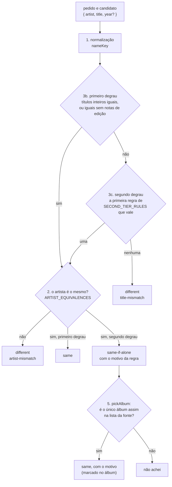
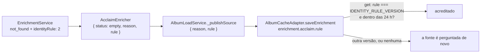

<!-- docs/specs/features/Fxx-slug/plan.md — HOW. No edge of its own in the graph: the trace to the REQs is the
     cross-check before approval. -->
# Plan — Feature F68: As regras de identidade de álbum revistas, fáceis de ler e de manter · Spec: [[spec]]
**Approved**: not a gate (via rápida; o MJRP julga)

## Architecture Approach
<!-- How it fits arch.md; components affected; what this plan refines in arch.md and data-model.md. -->
> Via rápida: este plano foi escrito depois do código, no ramo `fix/f68-album-identity-rules-reviewed`. A descrição de arquitetura é a seção «Uma regra só para dizer que é o mesmo álbum (F55, revista na F68)» do `docs/specs/arch.md`, reescrita por esta feature como uma descrição só.

A feature não cria camada nem componente: reorganiza o módulo que já existe (`shared/albumIdentity.js`, puro, usado pelo app e pelo servidor) e os dois pontos que dependem dele sem ser «lugar que aceita álbum»: o texto que o raspador manda à fonte e o prazo do «não tem» guardado no navegador. A superfície pública que os lugares usam (`compareAlbumIdentity`, `pickAlbum`, `compareKeptAlbum`, `compareOnlyAnswer`, `sameArtist`, `albumFromLabel`, `artistNamesFromLabel`, `Verdict`, `Reason`) não mudou de forma; nenhum lugar que aceita álbum foi tocado.

### A verdade da fonte, antes do desenho
56 pedidos a `https://www.besteveralbums.com/suggest.php` em 2026-11-19 (um por vez, 0,8 s entre eles), com o texto que o raspador mandava e, onde isso não achava nada, com artista e título simples. As respostas estão em `test/fixtures/besteveralbums/suggest/`. O que elas mostraram: a busca casa palavra por palavra (um texto com uma palavra que o rótulo não tem não lista nada); o nome do artista sozinho nem sempre lista a página do artista («Genesis» lista doze álbuns chamados «Genesis»); a fonte escreve o artista com nota («Genesis (UK)»), em outra ordem e com «And» onde o catálogo escreve «&».

| # | Pedido (artista - título) | O que a fonte tem | Por que a regra de antes recusava | O que acontece agora |
|---|---|---|---|---|
| 1 | King Crimson - In the Court of the Crimson King (Expanded Edition) | In The Court Of The Crimson King (An Observation By King Crimson) | título: a fonte traz algo mais entre parênteses | achado, `title-without-parentheses`, página 1169 |
| 2 | Joy Division - Substance 1977-1980 | Substance | título: os anos; e o texto de busca com os anos não lista nada | achado, `title-written-otherwise` (escrita conhecida), página 1715 |
| 3 | Bruce Dickinson - More Balls to Picasso | Balls To Picasso | título | **não tem**: é outro lançamento (a reedição de 2024, remixada e com partes novas) |
| 4 | AC/DC - POWER UP | PWR/UP | título: outras letras; e o texto de busca não lista nada | achado, `title-written-otherwise` (escrita conhecida), página 179658 |
| 5 | Genesis - Foxtrot (2007 Stereo Mix) | Foxtrot by Genesis (UK) | texto de busca: a nota de edição ia junto, e «Genesis» sozinho não lista a página do artista | achado, `edition-of-title`, página 2006 |
| 6 | Genesis - Selling England By the Pound (2007 Stereo Mix) | Selling England By The Pound by Genesis (UK) | idem | achado, `edition-of-title`, página 935 |
| 7 | Robert Plant & Jimmy Page - Walking Into Clarksdale | Walking Into Clarksdale by Jimmy Page & Robert Plant | artista: os mesmos nomes em outra ordem | achado, `exact-title`, página 23608 |
| 8 | Robert Plant & The Strange Sensation - Mighty ReArranger (Bonus Tracks) | Mighty Rearranger by Robert Plant And The Strange Sensation | texto de busca: a fonte escreve «And», então nenhum texto com o «&» lista nada, e o título só era perguntado sozinho com a nota de edição | achado, `edition-of-title`, pela tentativa do título sozinho, página 8269 |
| 9 | Hozier - Unreal Unearth: Unheard | Unreal Unearth | título | **não tem**: é outro lançamento (a reedição ampliada); pedido longo nunca aceita o álbum curto |
| 10 | Led Zeppelin - Led Zeppelin IV (Remastered) | Untitled (Led Zeppelin IV) | título: a fonte escreve o nome pedido entre parênteses | achado, `title-in-parentheses`, página 144 |
| 11 | Solarstone - Rain Stars Eternal | nada | — | **não tem**: a fonte não lista o álbum |
| 12 | Solarstone - island | nada deste artista | — | **não tem**: a fonte não lista o álbum |
| 13 | The Black Crowes - Before the Frost... Until the Freeze | Before The Frost... | título | **não tem**: é outro lançamento (os dois álbuns num só) |
| 14 | Frank Ocean - Blonde | Blond | título: uma letra | achado, `title-written-otherwise` (escrita conhecida), página 101825 |
| 15 | James Brown - Live At The Apollo (1962) | James Brown Live At The Apollo | título: a fonte põe o nome do artista na frente | achado, `title-with-artist-name`, página 117 |
| 16 | James Brown - Best of Live At the Apollo: 50th Anniversary | nada | — | **não tem**: a fonte não lista a coletânea |

Dez achados, três «outro lançamento», três «a fonte não tem». Os casos que a regra já tratava, contra o que a fonte lista de verdade: «No Quarter» (página 11402, `title-before-subtitle`), «Nevermind» com o artista «Nirvana (US)» (187), «Core» (2906), «Brighten the Corners: Nicene Creedence Ed.» (2132, `edition-of-title`), «The Wall» entre o ao vivo e os tributos (204), e «The Wall: Live in Berlin», que nunca aceita «The Wall». A tabela é o arquivo `test/fixtures/besteveralbums/sweep-2026-11-19.json`, que o teste afirma.

## Technical Design
<!-- Data flow first · components/modules (what each receives, renders or returns, emits) · API/interface
     changes · explicit file paths. Each component names the REQ-xx it addresses. -->
**Fluxo de uma comparação** (o arquivo se lê nesta ordem):



**`shared/albumIdentity.js` (REQ-01, REQ-02, REQ-03, REQ-04, REQ-09).** Recebe `{ artist, title, year? }` dos dois lados; devolve vereditos tipados. Sete seções:
1. *Normalização*: `wordsOf`, `nameKey` (um lugar).
2. *O artista*: `ARTIST_EQUIVALENCES = [{ name, says, example, same(a, b) }]` e `sameArtist`, que percorre a lista. Entradas: `same-words`, `same-names-in-another-order`.
3. *O título*: as notas de edição (`EDITION_WORDS`, `titleWithoutEditionNotes`); `firstTier` (exato, edição, e o texto «artista título» da consulta sem artista); `SECOND_TIER_RULES = [{ reason, says, example, applies(asked, candidate) }]` e `secondTier`, que devolve `same-if-alone` com o motivo da primeira regra que vale; `KNOWN_WRITINGS = [{ artist, titles, seen }]`.
4. *Uma comparação*: `compareAlbumIdentity` (o título, depois o artista) e `REASONS_EXPLAINED` (os 11 motivos, cada um com frase e exemplo).
5. *A escolha*: `pickAlbum` (inalterado no comportamento), `compareKeptAlbum`, `compareOnlyAnswer`; a porta única `acceptedAlone`.
6. *Rótulos das fontes*: `albumFromLabel`, `artistNamesFromLabel` (inalterados).
7. *Textos de busca*: `titlesToSearch(asked)` (o título sem notas de edição, depois as outras escritas conhecidas).
Também exporta `IDENTITY_RULE_VERSION` (2). Nenhuma função passa de complexidade ciclomática 10 (conferido com o eslint).

**`public/js/models/askedAlbum.js` (REQ-04).** `identityNotice(album)` devolve a frase da regra pela qual o álbum foi aceito (`IDENTITY_NOTICES`, uma por regra do segundo degrau) ou `null`; reexporta `titleWithoutEditionNotes` e `IDENTITY_RULE_VERSION`.

**`server/lib/scrapers/besteveralbums.js` (REQ-05).** `locateAlbum(title, artist)` devolve `{ id, url, reason, attempt }` ou `null`, pelas tentativas em ordem: `artist-page` (`albumFromArtistPage`), os textos de `searchAttempts(asked)` (`artist-and-title` e `title-alone`, uma vez por título de `titlesToSearch`; `artist-alone`), cada um por `albumFromSuggest`, e `html-search` (`albumFromHtmlSearch`). Todas pelo `getPage` único (fila educada e prazo, sem mudança nas constantes). `getRankingForAlbum` e `findAlbumId` mantêm a assinatura. Saíram `_standardFindAlbumId`, `_fuzzyFindAlbumId` e o corte de título por `split(':')`.

**Um só «título sem notas de edição» (REQ-05).** `cleanTitle` saiu de `server/lib/normalize.js` e de `public/js/utils/NormalizationUtils.js`; `server/lib/services/spotifyPopularity.js` e `public/js/services/SpotifyService.js` usam `titleWithoutEditionNotes`.

**A versão da regra no «não tem» (REQ-07).**


`server/lib/services/EnrichmentService.js` põe `identityRule` nos dados do `not_found`; `public/js/services/albums/adapters/enrichers.js` devolve `rule` junto de `reason`; `AlbumLoadService._publishSource` repassa (duas linhas); `AlbumCacheAdapter` guarda `rule` no registro e, na leitura, só acredita num `not_found` cuja versão é a do app. É a versão do SERVIDOR que vai no registro, porque é ele que decide: o app novo com o servidor antigo não acredita em nenhum `not_found`.

**Custo na primeira carga depois de publicar:** cada álbum com `not_found` guardado e ainda dentro das 24 horas pergunta as notas de novo, uma vez (16 na conta do MJRP, mais os que entraram depois da varredura), pela fila lenta do app (três de cada vez). No servidor, um álbum que continua sem página custa à fonte três textos de busca, a página do artista e a busca em HTML. Os 183 álbuns com notas não são tocados; nenhum álbum é buscado de novo no catálogo.

**Testes (REQ-06, REQ-08).** `test/server/ratingsSourceSweep.test.js` monta o raspador com um cliente HTTP que responde com as respostas guardadas (um texto sem resposta guardada reprova) e afirma a tabela. `test/architecture/albumIdentityRule.test.js` ganha a porta única, a pureza das regras do segundo degrau, as listas e a versão lado a lado, e o limpador único.

### Como acrescentar uma regra
- **Onde entra.** Uma equivalência de artista: uma entrada em `ARTIST_EQUIVALENCES`. Um jeito de dois títulos serem o mesmo álbum: uma entrada em `SECOND_TIER_RULES` (o primeiro degrau é fechado: exato e edição). Uma escrita que nenhuma regra deriva: uma entrada em `KNOWN_WRITINGS`. Uma palavra que marca edição: uma palavra em `EDITION_WORDS`.
- **Com o que tem de vir.** Um nome próprio em `Reason` (ou `name`, no artista); uma frase em `says`; um exemplo REAL em `example` (o que alguém pediu e o que uma fonte respondeu, com a resposta da fonte guardada em `test/fixtures/`); o teste do exemplo e do álbum mais próximo que a regra tem de continuar recusando; o degrau (tudo que não é exato nem edição é segundo degrau: aceito só quando sozinho, e marcado no álbum); a linha na tabela do cabeçalho do arquivo; a frase em `identityNotice`.
- **Depois.** Subir `IDENTITY_RULE_VERSION` e escrever a lista e a versão no teste de arquitetura, que guarda as duas lado a lado e falha enquanto não andarem juntas.
- **O que uma regra não faz.** Não compara por «contém», não dá nota, não lê nada além dos dois álbuns que recebe e não responde `same` (só o primeiro degrau e o `pickAlbum` respondem).

### Uma regra de um gênero (não construída)
Na música clássica o «artista» de um catálogo ora é o compositor, ora o intérprete, e o título leva a obra, o número e o tom («Symphony No. 5 in C minor, Op. 67»). Nesta estrutura: (1) o pedido ganha um campo `genre`, preenchido pelo adaptador que o monta (`askedAlbum.js`); (2) a entrada de `ARTIST_EQUIVALENCES` ou de `SECOND_TIER_RULES` ganha `onlyFor: ['classical']`, e os dois laços que percorrem as listas (`sameArtist`, `secondTier`) pulam a entrada cujo `onlyFor` não inclui o gênero pedido; (3) nada mais muda: os vereditos, o `pickAlbum`, a marca no álbum e o aviso são os mesmos. Uma regra de gênero nunca substitui as gerais.

### As outras três fontes
O que a revisão dá de graça a elas, testado com as formas que cada uma devolve (`test/models/askedAlbumOtherSources.test.js`): o artista em outra ordem (Apple: um texto; Spotify: a lista de artistas; dados locais: um texto com «and»); as regras do segundo degrau, as mesmas em toda fonte; o texto da busca do Spotify sem a nota «(2007 Stereo Mix)», que o limpador de antes não conhecia. O que pede a verdade de cada uma: o que a Apple e o Spotify listam de fato para os 16 álbuns; se o Spotify precisa das outras escritas conhecidas na busca; a loja da Apple.

### A prova em produção (TASK-09)
Depois de publicar o servidor e o site, com a conta do MJRP, na tela `/albums` com «All Series» carregada, no console do navegador. O trecho pergunta as notas de cada consulta distinta de cada série (o título e o artista como a série os guarda, com uma faixa fictícia, então «página achada» aparece como `no_ratings`), três de cada vez, pelo mesmo caminho da carga (`apiClient.requestRatings`, que usa `serverFetch` e `readServerResult`), e lista o que não foi achado. Não grava nada.

```js
const decode = (text) => { const el = document.createElement('textarea'); el.innerHTML = String(text || ''); return el.value.trim() }
const parse = (query) => {
  if (query && typeof query === 'object') {
    const title = decode(query.title || query.album), artist = decode(query.artist)
    if (artist || !title.includes(' - ')) return { artist, title }
    query = title
  }
  const text = decode(query), at = text.indexOf(' - ')
  return at === -1 ? { artist: '', title: text } : { artist: text.slice(0, at).trim(), title: text.slice(at + 3).trim() }
}
const asked = new Map()
for (const series of albumSeriesStore.getSeries()) for (const query of series.albumQueries || []) {
  const album = parse(query)
  if (album.title) asked.set(`${album.artist} - ${album.title}`.toLowerCase(), album)
}
const requestRatings = albumLoadService.enrichers.acclaim.requestRatings
const queue = [...asked.values()], rows = []
const worker = async () => {
  for (let album = queue.shift(); album; album = queue.shift()) {
    try {
      const { kind, data } = await requestRatings({ title: album.title, artist: album.artist, tracks: [{ title: 'x' }] })
      rows.push({ ...album, answer: kind, page: data?.bestEverInfo?.url || '', rule: data?.identityRule ?? '' })
    } catch (error) {
      rows.push({ ...album, answer: `failed: ${error?.code || error?.message || error}`, page: '', rule: '' })
    }
  }
}
await Promise.all([worker(), worker(), worker()])
const count = (answer) => rows.filter(row => row.answer === answer).length
console.log({ asked: rows.length, pageFound: count('found') + count('no_ratings'), not_found: count('not_found'), failed: rows.filter(row => row.answer.startsWith('failed')).length })
console.table(rows.filter(row => row.answer !== 'found' && row.answer !== 'no_ratings'))
```

Esperado: `not_found` só para «More Balls to Picasso», «Unreal Unearth: Unheard», «Rain Stars Eternal», «island», «Before the Frost... Until the Freeze» e «Best of Live At the Apollo: 50th Anniversary», cada linha com `rule: 2`; nenhuma falha. Depois, `await albumIdentityAudit()` com `different: 0`.

## Dependencies
<!-- New dependencies with their justification — aligned with constitution.md and PRINCIPLES.md (Constitution
     Check); contradicting either needs a recorded decision first (mjrp-recording-decisions). -->
Nenhuma.

## Documents Consulted
<!-- arch.md, data-model.md, info-arch.md, behavior.md, design-system.md, constitution.md, the NFR nodes. -->
`docs/specs/arch.md` (as seções da F55 e da F52), `docs/specs/behavior.md` (`^library-album-subtitle-note`, os álbuns guardados), `docs/specs/features/F55-the-album-asked-for-or-a-notice/` e `reports/evidence/F55/`, `reports/audits/2026-11-19-mjrpalbumblender-v0-ratings-source-sweep.md`, `docs/specs/constitution.md`. O `data-model.md` não descreve o registro do navegador e não mudou.

Declarações do passo retroativo da via rápida (conferidas no histórico do repositório em 2026-11-19):
- `docs/specs/constitution.md` — sem mudança: nenhum padrão de código nem dependência novos
- `docs/specs/arch.md` — atualizado (commit `9c11290`)
- `docs/specs/data-model.md` — sem mudança: nenhuma entidade, campo ou esquema mudou
- `docs/specs/tech-stack.md` — sem mudança: nenhuma dependência nova
- `docs/specs/design-system.md` — sem mudança: o projeto não tem `docs/specs/design-system.md`; nenhum token, fonte ou componente compartilhado mudou
- `docs/specs/behavior.md` — atualizado (commit `9c11290`)
- `docs/wiki/` — sem mudança: as páginas de `docs/wiki/` do projeto são só as do harness; nenhuma descreve uma regra do app que esta feature mudou

## Risks & Considerations
- **Álbum vizinho aceito sozinho.** Um candidato do segundo degrau que é o único na lista de uma fonte é aceito, marcado, mesmo quando é outro álbum («Hotel California» pedido, só «Hotel California (Live at the Forum '76)» listado). É a troca que o MJRP já decidiu para o subtítulo; aqui ela se estende aos parênteses.
- **A lista de escritas conhecidas é mantida à mão.** A varredura mostra quais faltam; cada entrada nova sobe a versão.
- **Inconsistência que ficou.** «Greatest Hits» → «Greatest Hits: Vol 2» entra no segundo degrau (F55, fixado em teste); «Greatest Hits (Vol. 2)» não. A varredura não mostrou qual está errado.
- **Ordem de publicação.** O site novo com o servidor antigo pergunta as notas dos álbuns sem página a cada carga, até o servidor novo entrar. O servidor primeiro evita isso.
- **O que o teste offline não prova.** As páginas de artista e a busca em HTML da fonte não foram lidas: o teste prova que a busca por sugestões acha os dez, não por qual tentativa a produção os achará. Numa página de artista com dois candidatos do segundo degrau, a busca por sugestões ainda decide.
- **Sem navegador.** Nada foi visto em tela; a linha nova do cartão só foi provada em teste de unidade.
- **Colisão com outros ramos.** `AlbumLoadService.js` ganhou três linhas em `_publishSource`; os ramos da F56 e da F63 mexem em outras partes do mesmo arquivo.

## Test plan
> Derivado dos REQ do `spec.md` · 2026-11-19 20:10 (Brasília)

| REQ | Caso de teste | Critério / estado | Camada | Automatizado? |
|---|---|---|---|---|
| REQ-01 | `test/shared/albumIdentityRules.test.js`, `test/shared/albumIdentity.test.js` | cada linha de `REASONS_EXPLAINED` dá o veredito e o motivo da tabela; o cabeçalho lista todos os motivos; os comportamentos da F55 | compartilhado, unidade | sim |
| REQ-02 | `test/shared/albumIdentityRules.test.js`, `test/models/askedAlbumOtherSources.test.js` | cada equivalência com o seu exemplo; outra ordem; «X and the Y»; os nomes que não são o mesmo artista; as três fontes | compartilhado e app, unidade | sim |
| REQ-03 | `test/shared/albumIdentityRules.test.js` | cada regra do segundo degrau com o exemplo e o álbum mais próximo que recusa (número entre parênteses, outro número, outro artista, a mesma grafia em outro artista) | compartilhado, unidade | sim |
| REQ-04 | `test/shared/albumIdentityRules.test.js`, `test/components/ui/AlbumCardIdentityNote.test.js`, `test/architecture/albumIdentityRule.test.js` | única na lista é escolhida com o motivo; o guardado só vale com o motivo; uma frase própria por regra; uma porta só | compartilhado, app e arquitetura | sim |
| REQ-05 | `test/server/ratingsSourceSweep.test.js`, `test/server/scraperIdentity.test.js`, `test/architecture/albumIdentityRule.test.js` | os textos pedidos, em ordem, para quatro álbuns; a nota de edição nunca vai; nenhum `cleanTitle` | servidor e arquitetura | sim |
| REQ-06 | `test/server/ratingsSourceSweep.test.js` | os 16 e os 7 casos anteriores contra as respostas guardadas | servidor, unidade | sim |
| REQ-07 | `test/services/albums/emptyTrust.test.js`, `test/server/ratings.test.js` | o servidor carimba só o `not_found`; o registro com a versão de hoje vale 24 h; com outra, ou sem, não vale; o `no_ratings` mantém 7 dias | app e servidor, unidade | sim |
| REQ-08 | `test/architecture/albumIdentityRule.test.js` | a porta única; as regras não constroem veredito; listas e versão juntas; um limpador só | arquitetura | sim |
| REQ-09 | `test/shared/albumIdentityRules.test.js` | o cabeçalho do arquivo tem «HOW TO ADD A RULE» e «A RULE FOR ONE GENRE» | compartilhado, unidade | sim |
| REQ-10 | a varredura rodada de novo em produção, com a conta do MJRP; `await albumIdentityAudit()` | `not_found` só para os álbuns 3, 9, 11, 12, 13 e 16; `different: 0` | navegador, produção | não (prova do integrador) |

Bordas fora dos critérios (achados para a `mjrp-writing-reqs` se mudam o comportamento): o número depois de «:» no segundo degrau («Greatest Hits: Vol 2»); o álbum vizinho aceito sozinho.
