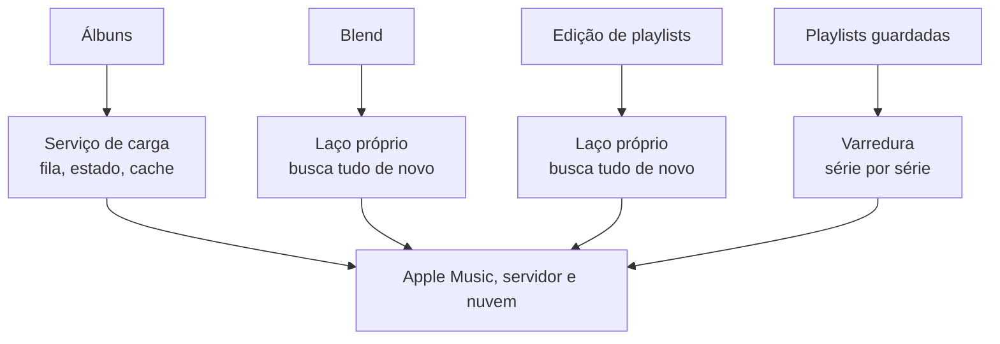
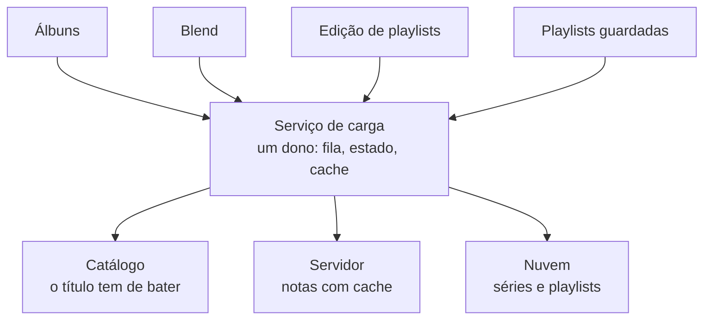

# Carga de álbuns: o desenho de hoje e o proposto (2026-11-19)

## Resumo

Quatro telas mostram álbuns. Uma delas, a tela de álbuns, já pede os álbuns a um serviço dono da carga. As outras três carregam cada uma do seu jeito. O desenho proposto leva as quatro para o mesmo dono. Ele é melhor porque dá uma resposta só às mesmas decisões; ele **não** reduz a complexidade total do código, e uma função do serviço está hoje acima do limite que este relatório defende.

## 1. O desenho de hoje

| Tela | Como carrega | Onde está no código |
|---|---|---|
| Álbuns | `AlbumLoadService`: fila com limite e prazo, estado por álbum, cache por álbum | `public/js/services/albums/`, `public/js/stores/albumLoad.js` |
| Blend | laço próprio dentro do controlador | `public/js/controllers/BlendingController.js` (`generateFromSeries`), `public/js/api/client.js` (`fetchAlbum`) |
| Edição de playlists | laço próprio dentro do controlador | `public/js/controllers/PlaylistsController.js`, `public/js/api/client.js` |
| Playlists guardadas | varre as séries atrás de playlists | `public/js/views/SavedPlaylistsView.js` (não lido a fundo) |

## 2. O desenho proposto

O que muda:

- **Blend e edição de playlists** deixam de buscar os álbuns por conta própria e pedem ao serviço, que já tem os álbuns da tela anterior.
- **Salvar uma série** recarrega só o que mudou, porque o serviço compara o que tem com o que foi pedido.
- **Playlists guardadas** deixa de varrer série por série. O desenho exato depende de ler essa tela, o que ainda não foi feito.
- **Catálogo:** a regra «é este o álbum pedido?» fica num lugar só, com o título tendo de bater por conta própria. Sem álbum que bata, a série avisa em vez de mostrar outro (UAT-184).
- **Servidor:** guarda as notas já buscadas e responde com um erro que o app sabe ler (F52, UAT-181).

Fora da carga, a mesma lógica vale para a tela: uma peça só de «escolher álbuns de um artista», usada pela Home e pela janela de edição da série, no lugar das duas de hoje (UAT-185, UAT-193).

## 3. Por que o de hoje é pior

Cada um dos quatro caminhos responde sozinho às mesmas perguntas: quantos pedidos de uma vez, quanto esperar, o que fazer quando falha, quando confiar no guardado, quem escreve o resultado. São quatro respostas diferentes.

- **O comportamento muda de tela para tela.** A tela de álbuns avisa quando um álbum falha; o blend não.
- **Conserto num caminho não chega aos outros.** A nova tentativa e o cache por álbum da F45 e da F48 não valem para o blend nem para a edição.
- **Trabalho repetido.** O blend busca de novo álbuns que a tela anterior acabou de carregar: de 8 a 18 segundos para 2 álbuns, medido na regressão de 2026-11-19 (UAT-189).

## 4. Padrões de um e de outro

| | Hoje, nos três caminhos antigos | Proposto, já usado na tela de álbuns |
|---|---|---|
| Quem carrega | o controlador da tela, num laço | um serviço dono da carga (DP-12) |
| Rede e banco | chamados direto pelo controlador | atrás de portas e adaptadores: catálogo, fontes, cache (DP-07, DP-14) |
| Limite e prazo | nenhum, ou o do laço | fila com limite, prazo e cancelamento (`TaskQueue`, DP-20, DP-22) |
| Estado | um booleano de «carregando» por tela | uma loja só, com o estado de cada álbum e o da série derivado deles |
| Teste sem rede | difícil: tela, rede e regra no mesmo lugar | direto: as portas são trocadas por dublês |

Os caminhos antigos misturam tela com entrada e saída, o que a constituição do projeto proíbe e a issue UAT-19 já registra.

## 5. O desenho proposto pode virar gargalo?

É um risco real, com três faces.

- **Limite externo.** A Apple Music respondeu 429 com 6 buscas simultâneas (medido em 2026-11-19); por isso o serviço limita a 3. Esse teto existe nos dois desenhos. Hoje os caminhos soltos podem estourá-lo juntos, sem saber um do outro.
- **Fila de espera.** O blend poderia ficar atrás da carga da tela. O serviço já tem prioridade por grupo; o blend entraria com prioridade alta. Isso precisa de teste próprio antes de ser dado por resolvido.
- **Notas lentas.** A fila das notas (4 por vez, servidor sem cache) é o gargalo de hoje. Se o blend precisar das notas, ele espera por elas em qualquer desenho; só o cache no servidor resolve.

Há também o ponto único de falha: um defeito no serviço atinge todas as telas. A defesa são os testes (56 só da carga em 2026-11-19) e as regras de arquitetura escritas como teste (`test/architecture/albumLoadBoundaries.test.js`).

## 6. Complexidade ciclomática, medida

Medida em 2026-11-19 com a regra `complexity` do ESLint, função por função. «Soma» é a soma da complexidade de todas as funções do arquivo.

| Arquivo | Funções | Maior | Acima de 10 | Soma |
|---|---|---|---|---|
| Controlador de álbuns, antes da F45 (`ec96a13`) | 33 | 23 (`loadScope`) | 3 | 138 |
| Controlador de álbuns, hoje | 53 | 20 | 1 | 138 |
| `AlbumLoadService` | 45 | 21 (`_enrichOne`) | 1 | 111 |
| `TaskQueue` | 25 | 5 | 0 | 46 |
| Loja da carga (`stores/albumLoad.js`) | 30 | 4 | 0 | 44 |
| Adaptador do catálogo | 20 | 12 (`find`) | 1 | 59 |
| Fontes (`enrichers.js`) | 12 | 10 | 0 | 38 |
| `api/client.js` (laço antigo, ainda usado) | 37 | 18 (`fetchAlbum`) | 4 | 170 |
| Controlador do blend | 10 | 13 (`generateFromSeries`) | 1 | 34 |
| Controlador de playlists | 21 | 27 (`handleSave`) | 2 | 92 |
| `AlbumIdentity` (regra de identidade) | 9 | 11 (`matchConfidence`) | 2 | 47 |

Leitura dos números:

- **A soma não caiu, subiu.** O código novo faz coisas que não existiam: estado por álbum, nova tentativa, cache, paginação.
- **O que mudou foi a distribuição.** Antes as decisões ficavam em poucas funções grandes misturadas com a tela; agora a fila e a loja têm funções de no máximo 5.
- **`_enrichOne` está em 21.** Chegou aí em 2026-11-19, com a mudança que faz o ranking salvo aparecer na hora (`arch.md`, seção 19). Está acima do limite de 10 e precisa ser dividida.
- **O ganho esperado do desenho proposto** viria de aposentar o laço antigo (`fetchAlbum`, 18) e o do blend (13). Não há número prometido antes do desenho de cada parte.

## 7. O que este relatório recomenda

1. Dividir `_enrichOne` e a busca do adaptador do catálogo, e pôr o limite de 10 como regra de teste na pasta do serviço de carga. Hoje a regra reprovaria as duas.
2. Para cada uma das quatro mudanças (álbum certo, telas pelo serviço de carga, peça única de escolher álbuns, contrato de erros e cache no servidor), uma proposta com riscos e alternativas antes do código, julgada em passagem separada.
3. Registrar a decisão da carga como ADR.

## 8. Limites desta análise

- Quem escreveu é quem desenhou a carga; não houve crítica separada deste texto.
- A tela de playlists guardadas e o caminho de edição de playlists não foram lidos a fundo.
- A complexidade ciclomática mede decisões por função; não mede acoplamento entre arquivos, que não foi medido.
- O risco de fila de espera do blend é raciocínio, não medição.
