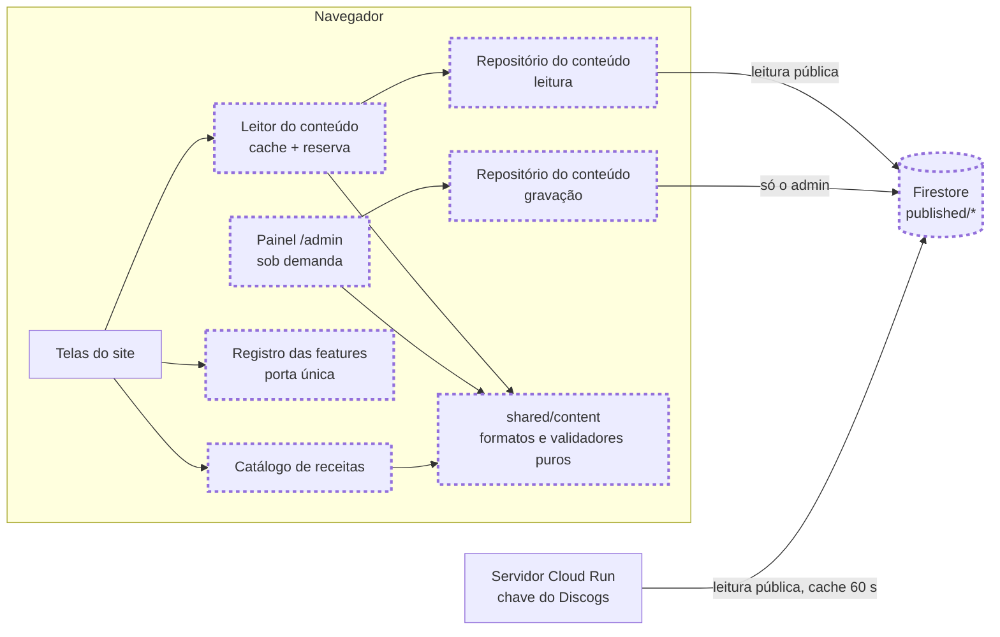
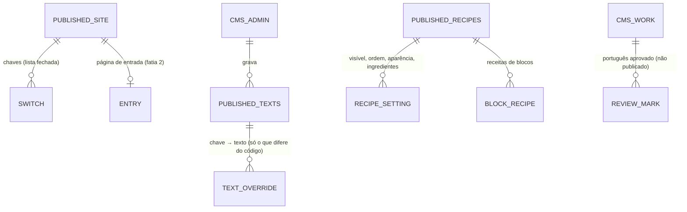
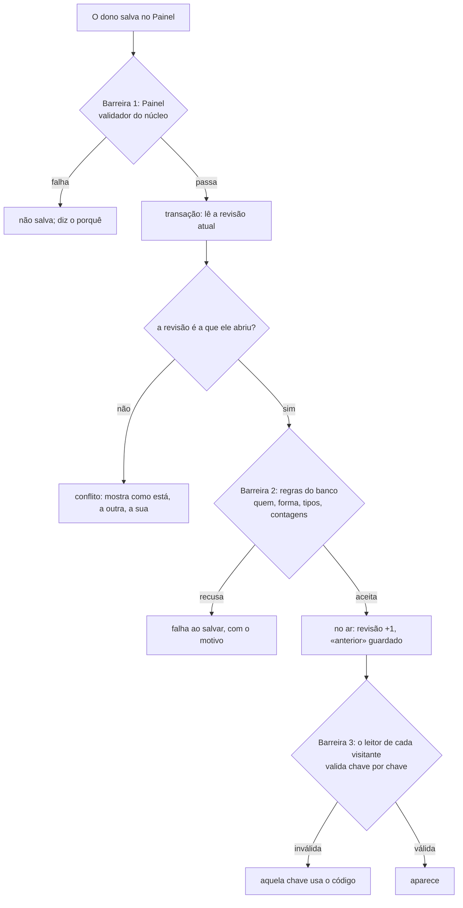
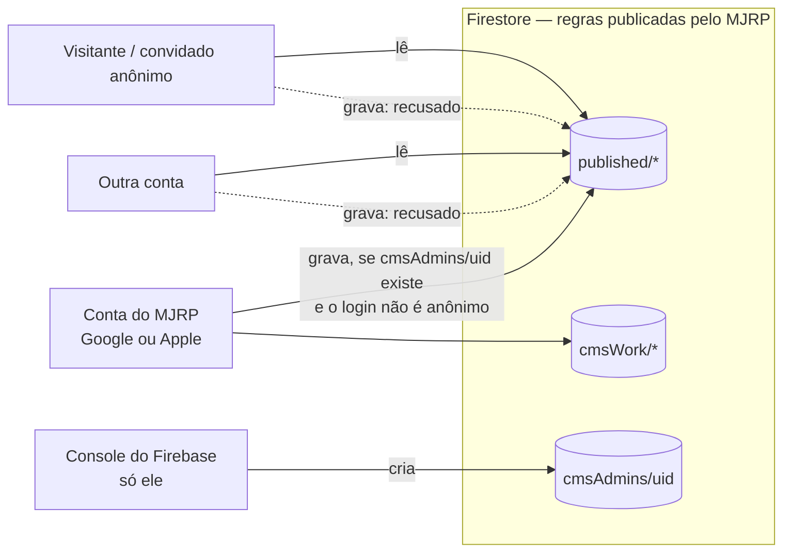
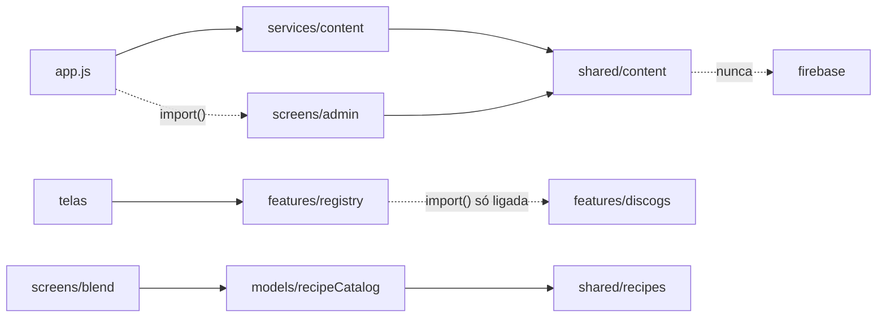

# O conteúdo publicado do CMS — proposta de arquitetura

> **Profundidade:** completa — o risco mais alto é de segurança e de dados: **salvar publica**, sem rascunho nem desfazer (decisão do MJRP, «1. Mantém»), então um texto quebrado ou uma gravação de um convidado vai ao ar para todos na hora; e a escolha de onde o conteúdo mora é cara de desfazer depois que três features (F82, F92, F93) se apoiarem nela.
> **Crítica:** ainda não (vem do `mjrp-critiquing-architecture`, numa passada separada) · **Página para ler:** ainda não publicada · **Estado:** proposta, sem ADR.
> **Seções usadas:** 1–4 sempre; 5 fluxos (prazo e falha da leitura); 6 dados; 7 falhas e prazos; 8 segurança; 9 relação com o que existe; 11 complexidade e funções de aptidão; 12 opções (uma tabela por ponto); 13 decisões do humano. **Fora:** 10 custo com número — o volume é uma leitura pequena por visita e algumas gravações por semana; o único custo novo que muda a conta está na decisão 2.
> **Vistas:** blocos (onde a mudança fica), sequência (a leitura ao abrir), fronteira de confiança (quem grava), dados (os documentos), fluxograma (as três barreiras de uma gravação), dependências (o admin e as features sob demanda).
> **Base:** o enquadramento [`2026-11-22-mjrpalbumblender-v0-cms-framing.md`](2026-11-22-mjrpalbumblender-v0-cms-framing.md) (riscos R1–R8), o protótipo [`design/proposals/f82-cms/`](../../design/proposals/f82-cms/proposal.md), as specs F82, F92, F93, e a linha do React lida em `integrate/staging-2026-11-21` com `git show`.

## 1. O que muda e por quê

O dono passa a mudar, de uma área só dele (o **Painel**), o que o site diz e mostra, sem pedir a um agente nem publicar código: os textos em inglês e português (F82), as chaves de ligar e desligar features, a começar pelo Discogs (F93), e as receitas da mistura, inclusive receitas novas montadas por blocos (F92). Quem é afetado: **o dono** (quer mudar rápido e não quebrar nada), **o visitante** (não pode ver tela vazia, lenta ou quebrada), **o agente** (precisa de uma fonte só da verdade para cada texto, chave e receita). O que esta proposta decide é **o conteúdo publicado**: onde mora, quem grava, o que é conferido, e como o site e o servidor o leem. As telas do Painel são do kit (F332 do harness) e não são decididas aqui.

## 2. Os direcionadores

**Decisões do dono, que esta proposta não reabre:** Painel primeiro, edição na própria tela depois; salvar publica, sem rascunho, publicar ou desfazer na v1; admin = só a conta dele, nunca convidado, garantido no banco e no servidor; papéis (RBAC) depois, ele superadministrador; chaves no CMS, a do Discogs primeiro; receitas no CMS e receitas novas por blocos, «Deep cuts» e «As menos ouvidas» com as regras do protótipo; começar já o que não depende do kit.

**Restrições:** o site sai só da `main` local (constituição V.1), então o conteúdo **é lido quando o site abre**, nunca publicado por um build pedido pelo CMS; a interface fala inglês (I.2); o Firestore só atrás dos repositórios (III.3); nenhuma falha calada (I.1); `firestore.rules` é dele e só ele publica (V.5); os documentos só crescem e `_schemaVersion` nunca desce (V.6); o servidor não acessa o Firestore hoje; o orçamento de peso do pacote (`scripts/bundle-budget.json` na linha do React: script principal ≤ 194.791 B gzip, tela ≤ 30.000 B).

| Requisito de qualidade | Cenário (estímulo → resposta) | Medida |
|---|---|---|
| A primeira tela não espera o conteúdo | visitante abre o site com o banco lento ou fora → a primeira tela desenha com o texto guardado ou o do código | tempo até a primeira tela igual (±50 ms) com a leitura bloqueada ou liberada; prazo da leitura 3 s |
| Peso | o leitor do conteúdo entra no script principal | ≤ 2.000 B gzip a mais no script principal; o admin, 0 B nele |
| Gravação ruim não chega ao visitante | o dono salva um texto sem o `{count}` ou vazio → o visitante vê o texto do código naquela chave, o resto publicado | 100% das chaves inválidas trocadas pela reserva; nenhuma tela com a chave crua |
| Só o dono grava | um convidado ou outra conta tenta gravar → recusa | 0 gravações aceitas no teste das regras |
| Desligar uma feature | o dono desliga o Discogs → visitante novo não vê nada dele e não baixa o código dele | efeito em visitas novas ≤ 60 s (servidor) e na próxima abertura (site); 0 pedido do arquivo da feature |
| Receita determinística | a mesma receita de blocos sobre os mesmos álbuns → as mesmas faixas | teste com amostra fixa, saída igual byte a byte |

**O que só o dono sabe (perguntado na seção 13, não presumido):** quanto tempo um erro publicado pode ficar no ar até ele notar; se paga pela recuperação do banco a um ponto no tempo.

## 3. Os riscos

| # | Risco (o que pode dar errado, por quê) | Tipo | Prob. | Impacto | Custo de desfazer | Seção que o reduz | Estado |
|---|---|---|---|---|---|---|---|
| R1 | a leitura do conteúdo falha e o site abre sem texto | técnico | média | alto | baixo | 4, 5, 7 | reduzido |
| R2 | o site espera o conteúdo e a primeira tela demora | técnico | alta se bloqueante | alto | médio | 5, 11 (F-1) | reduzido |
| R3 | um convidado (login anônimo) ou outra conta grava no conteúdo, e vai ao ar para todos | segurança | média | muito alto | — | 8, 11 (F-4) | reduzido; depende de ele publicar as regras |
| R4 | o dono salva um erro (marcador faltando, texto vazio, receita fora dos limites) e ele vai ao ar na hora, sem desfazer | dados | alta | alto | baixo | 6.3, 7 | reduzido; a volta é manual (decisão 2) |
| R5 | uma feature desligada continua no pacote ou deixa um buraco na tela | complexidade | alta | médio | médio | 6.4, 11 (F-5, F-6) | reduzido por feature; o Discogs é o caro |
| R6 | uma receita criada no CMS executa algo que ninguém testou | segurança | baixa com blocos | alto | alto | 6.5 | reduzido |
| R7 | o código do admin vaza para o pacote de todo mundo | técnico | média | médio | baixo | 6.6, 11 (F-3) | reduzido |
| R8 | duas fontes da verdade para o mesmo texto, chave ou receita discordam (código × banco, site × servidor) | dados | alta | médio | alto | 4, 6.1, 6.4 | reduzido |
| R9 | o formato do documento muda e um site antigo aberto num navegador lê errado | dados | média | médio | alto | 6.1 | reduzido |
| R10 | o dono salva de dois aparelhos e um apaga o outro sem saber | dados | baixa | médio | baixo | 6.3 | reduzido |
| R11 | um convidado grava popularidade falsa em `spotify_enrichment/` e «As menos ouvidas» escolhe por ela | segurança / dados | média | médio | médio | 8, decisão 4 | **aberto** |
| R12 | a página de entrada (texto escrito no HTML pelo build) mostra o texto antigo a quem lê sem script | técnico | certa | baixo | baixo | 6.2 | aceito (dito) |

## 4. O desenho



- **`shared/content/` (núcleo, puro):** o formato de cada documento, a versão do formato, e os validadores (texto contra a sua reserva; chave da lista fechada; receita de blocos dentro dos limites). Sem Firebase, sem navegador: o Painel, o leitor do site e o servidor usam **a mesma regra** (R8; constituição III.4 «uma regra, um lugar»).
- **Repositório do conteúdo** (`shared/data/PublishedContentRepository` + o lado do site em `public/js/repositories/`): sabe os caminhos `published/*`; lê por uma chamada de leitura simples e grava pela store do Firebase que os repositórios já recebem. O único lugar que fala com `published/*` (III.3).
- **Leitor do conteúdo** (`public/js/services/content/`): aplica o guardado no navegador antes da primeira tela, pede o novo em segundo plano, valida chave por chave contra a reserva do código e avisa quem ouve. Dono do estado «de onde veio o que está na tela: publicado, guardado, código».
- **Registro das features** (`public/js/features/registry.js`): a lista fechada das chaves, com o padrão de cada uma quando o conteúdo não pode ser lido e o `import()` do módulo da feature. A única porta para carregar código de uma feature com chave.
- **Catálogo de receitas** (`public/js/models/recipeCatalog.js`): junta as receitas do código e o documento publicado num modelo só, que a tela de Blend e o painel de gerar de novo desenham.
- **Painel** (`/admin`): rota do mesmo app, carregada sob demanda, só para o admin; as telas vêm do kit.

**O que muda pouco e o que muda muito:** os motores das receitas, os validadores e o formato dos documentos mudam raramente (código, com teste); os textos, as chaves e a configuração das receitas mudam toda semana (dados). A fronteira entre os dois é o validador do núcleo.

## 5. Os fluxos — a leitura ao abrir

```mermaid
sequenceDiagram
  participant App as app.js (arranque)
  participant L as Leitor do conteúdo
  participant N as Guardado no navegador
  participant F as Firestore published/*
  App->>L: start() — não espera
  L->>N: lê a última cópia válida (síncrono, ~1 ms)
  L-->>App: textos e chaves já aplicados (ou só o código)
  App->>App: desenha a primeira tela
  L->>F: um pedido: published/site + texts_<idioma> (prazo 3 s)
  alt chegou e é válido
    L->>L: valida chave por chave; o inválido volta ao código
    L->>N: guarda a cópia
    L-->>App: avisa «mudou» → as telas abertas redesenham
  else falhou, demorou ou veio inválido
    L-->>L: fica com o guardado ou o código; estado «código» ou «guardado», com o motivo no log
  end
```

- **Guardar e reaproveitar, nunca bloquear** (stale-while-revalidate): a primeira visita depois de uma mudança mostra o texto anterior por um instante (o «piscar» do enquadramento). Aceito, porque a outra opção (esperar) é o R2.
- **Sem rede:** o guardado, ou o código. **Veio algo que não é o formato:** o documento inteiro é ignorado, o guardado continua (seção 6.1).
- **O idioma:** o documento de textos de um idioma só é pedido por quem fala esse idioma, como o dicionário português hoje.
- **A peça que falta na linha do React:** `registerTexts` em `public/js/i18n/t.js` acrescenta textos mas **não avisa quem ouve**; o leitor precisa de um aviso («os textos mudaram») que as telas já ouvem pelo idioma. É uma mudança pequena num arquivo da migração: espera a migração chegar à `main`.

## 6. Os dados

### 6.1 Onde mora e com que forma



| Documento | Onde mora | Quem escreve | Quem lê | Tamanho máximo | Vida |
|---|---|---|---|---|---|
| `published/site` — chaves, página de entrada | Firestore | admin | todos, sem login; servidor | 16 KB | sobrescrito a cada salvar |
| `published/texts_en`, `published/texts_pt` — **só as chaves que diferem do código** | Firestore | admin | quem fala o idioma | 900 KB (limite do Firestore 1 MiB) | idem |
| `published/recipes` — configuração das receitas e as de blocos | Firestore | admin | as telas de Blend e de playlists, sob demanda | 64 KB | idem |
| `cmsAdmins/{uid}` — quem é admin e o papel | Firestore | **ninguém pelo app** (só o console) na v1 | a própria pessoa | — | criado por ele, uma vez |
| `cmsWork/review_pt` — quais textos em português ele já aprovou | Firestore | admin | admin | — | trabalho do Painel, nunca lido pelo site |

- **Por que só o que difere:** o código continua a reserva completa; o documento fica pequeno; uma chave que o código renomeou deixa um texto órfão que o leitor simplesmente não usa (e o Painel mostra como «órfão»).
- **Versão do formato, não do conteúdo:** cada documento leva `_schemaVersion` (a regra de `shared/data/schemaVersion.js`, que nunca desce). O leitor conhece as versões até N; um documento com versão maior é lido **só nos campos que ele conhece**, e o que não conhece é ignorado; um campo é tirado por *expand and contract* (V.6). Sem histórico de conteúdo (decisão dele).
- **Ignorar chave por chave:** cada valor passa pelo validador do núcleo; o que falha volta à reserva do código **só naquela chave**, e o resto do documento vale. Um documento que não é um objeto, ou maior que o limite, é ignorado inteiro.

### 6.2 A página de entrada (fatia 2)

O texto dela é escrito no HTML pelo build (`public/splash/copy.js`), para ser lido sem script. **Na fatia 2:** a página ganha um script pequeno, depois do `load`, que lê `published/site` pela mesma leitura simples (sem o SDK, porque a página não carrega o app), guarda a cópia e troca os textos e as capas marcados com a sua chave. **O que muda:** o visitante com script vê o publicado; quem lê sem script (buscadores) vê o texto do último build até a próxima publicação do site (R12, aceito). **Na fatia 1** ela não muda.

### 6.3 Gravar quando salvar publica



- **O que é conferido antes de aceitar:** texto — os mesmos `{marcadores}` da reserva inglesa, não vazio, sem `<` nem `>`, até 3× o tamanho da reserva (o Painel avisa a partir de 1,5×, como o protótipo); chave — só ids da lista fechada, só `true`/`false`; receita — só os blocos do vocabulário, cada número dentro do limite (6.5), aparência de uma lista fechada.
- **Onde:** no Painel (para ele saber na hora), **nas regras do banco** (quem grava, os campos permitidos, os tipos, as contagens: as regras não percorrem um mapa de tamanho livre, então não conferem o marcador de cada texto) e **no leitor de cada visitante** (a barreira que não depende de quem gravou: é a que torna a regra uma regra). Para as chaves e as receitas, cujos campos são fixos, as regras conferem tipo e limite de cada um.
- **A rede mínima, sem construir «desfazer»:** cada gravação leva, no mesmo documento, `previous` com o valor anterior **só das chaves que ela mudou**, mais `rev`, `updatedAt` e `updatedBy`. Custo: alguns bytes por gravação e uma linha no repositório. Uma versão futura pode oferecer «voltar a anterior» lendo esse campo; a v1 não mostra nada disso. **Não é histórico:** a gravação seguinte sobrescreve o `previous`.
- **Dois aparelhos:** a revisão (`rev`) na transação faz da segunda gravação um conflito visível, não uma perda calada (R10; o estado «conflito» do protótipo).

### 6.4 As chaves de features

| Chave | O que esconde | Código que deixa de carregar | Se o conteúdo não pode ser lido |
|---|---|---|---|
| `discogsValues` | valor, botão, aviso e atribuição do Discogs no inventário | o módulo de valores do inventário | **fechada** (desligada) no site; no servidor, a última lida, e nunca lida = desligada |
| `usageMeasurement` | nada visível | o adaptador do PostHog (já assim, F77) | **fechada** (privacidade) |
| `portugueseForAll` | o seletor de idioma | o dicionário português para quem não pediu | **fechada** (o site fala inglês) |

- **Um modelo para «esconder» e «não carregar»:** o registro em código declara, por chave, o padrão quando desconhecida e o `import()` do módulo. A tela pergunta ao registro; com a chave desligada o registro devolve «nada» e **nunca chama o `import()`**, então o arquivo da feature não é pedido. O lugar da feature na tela é um encaixe que, desligado, não desenha nada (nem a caixa vazia).
- **Desconhecida não é desligada** (constituição I.1): o leitor guarda o estado «desconhecida» com o motivo, e é o padrão declarado que decide; o Painel mostra «não foi possível ler».
- **O Discogs tem duas travas e uma autoridade:** o servidor liga só com a variável do serviço **e** a chave do CMS ligadas; o site **não lê a chave do Discogs**, pergunta ao servidor como já pergunta (`GET /api/value-sources`). Uma fonte da verdade (R8), e a variável continua o corte de emergência. «Para quem» (as pessoas nomeadas) **fica na variável do serviço** (`DISCOGS_VALUES_FOR`): o documento publicado é público e não pode carregar ids de pessoas.
- **O servidor lê o documento público** pela leitura REST do Firestore, sem login nem credencial nova (as regras deixam `published/site` aberto à leitura), com prazo de 1,5 s e cópia de 60 s em memória. Não ganha o Admin SDK.
- **Custo por feature, não do CMS:** separar o código do Discogs em um módulo atrás do registro mexe em cerca de 8 arquivos do inventário da linha do React; até lá a chave **esconde** o Discogs, e o teste F-5 lista o Discogs como exceção que só encolhe.

### 6.5 Receitas como dados

| É dado (no `published/recipes`) | Fica código |
|---|---|
| visível ou escondida; a ordem; qual é a recomendada; a aparência (de uma lista fechada de ícones e cores, a de `recipeLooks.js`); quais ingredientes a pessoa vê e o valor de partida de cada um (só valores das listas de `recipeIngredients.js`); o nome e a descrição (as chaves do dicionário para as receitas do código; `{en, pt}` dentro da receita de blocos, que não tem reserva no código); as receitas de blocos | os motores: a equilibrada do MJRP e um motor de seleção por ranking (a família «Top N» generalizada); o validador e o intérprete dos blocos; o selo «recomendada» como um texto único da tela (não o selo de cada receita — achado do protótipo) |

**O vocabulário dos blocos** (o intérprete recusa o resto; nada de código digitado):

| Bloco | Valores | Partida |
|---|---|---|
| fonte do ranking | `spotify`, `bea`, `combined`, `user` | `spotify` |
| sentido | `top` (do mais para o menos) ou `bottom` | `top` |
| pular K por álbum | 0 a 10 | 0 |
| pegar N por álbum | 1 a 10, com K + N ≤ 15 | 3 |
| exclusões | faixa mais curta que S segundos (0 a 300) | 0 |
| faixa sem dado | **sempre fora** (nunca é «a menos ouvida»; constituição I.1) — não é configurável | — |
| desempate | a ordem da faixa no álbum — fixo | — |
| agrupamento | as listas de hoje, **menos `shuffle`** (não é determinístico) | `by_album` |

«Deep cuts» = `spotify, top, pular 3, pegar 3`; «As menos ouvidas» = `spotify, bottom, pular 0, pegar 3`. O intérprete é uma função pura no núcleo (`shared/recipes/`), testada com uma amostra fixa: mesma entrada, mesma saída. A receita de blocos nasce escondida.

- **Uma playlist guardada que lembra o id de uma receita:** as faixas guardadas nunca mudam. Ids nunca são reaproveitados nem apagados (só escondidos). Gerar de novo com uma receita **escondida**: o painel abre na recomendada e diz por quê; com uma receita **redefinida**: usa a definição de hoje (o id nomeia a receita, não a versão), e o painel mostra a definição atual.
- **A tela de Blend configurável sem um segundo caminho:** a tela desenha **sempre** o catálogo, com documento publicado ou sem ele (sem ele, o catálogo é o código). As tabelas fixas por id (`algorithms/index.js`, `recipeLooks.js`, `recipeIngredients.js`) passam a ser a reserva do catálogo; a tela não importa mais o registro de algoritmos (teste F-7).

### 6.6 O admin

- **Mesmo app, rota `/admin`, sob demanda:** `loadScreen(() => import('./screens/admin/index.ts'))` em `app.js`, como as outras telas (o teste `lazyOnlyAtTheRoute` já cobra o lugar do `import()`). Antes de importar, a rota pergunta se a pessoa é admin (lê o próprio `cmsAdmins/{uid}`): quem não é vê «não encontrado» e **o arquivo do admin não é baixado**.
- **Os textos do admin no dicionário,** numa área própria (`admin.*`) que **não** entra no dicionário inglês do script principal: o arquivo do admin a registra ao abrir. Os textos padrão do kit, em português, passam pelo adaptador e pelo `t()`, então o teste da interface em inglês continua valendo.
- **O adaptador entre os formatos:** o kit espera pares `{pt, en}` por campo; o V0 tem um arquivo por idioma e área. O adaptador (puro, no projeto) monta as áreas do kit a partir das chaves (`area.peca.nome`: a área é o primeiro pedaço), junta inglês, português, o publicado e as marcas de revisão, e devolve, ao salvar, as diferenças por idioma no formato do `published/texts_*`.
- **Antes do kit:** o núcleo `shared/content/` (formatos e validadores), o repositório, o rascunho das regras com os testes delas, o intérprete dos blocos e o catálogo como modelo puro, o registro das features como modelo puro, o adaptador, e a leitura do servidor para o Discogs. **Espera o kit:** as telas do Painel. **Espera a migração na `main`:** tudo o que toca `t.js`, `app.js`, as telas, `algorithms/` e o inventário.

## 7. Falhas e prazos

| Chamada ou etapa | Prazo | Retentativa | Se falhar, quem usa vê | Erro distinto de vazio? |
|---|---|---|---|---|
| leitura do site ao abrir | 3 s | nenhuma; a próxima abertura | o guardado ou o código, sem aviso ao visitante | sim: estado «código» ou «guardado» com o motivo no log e no Painel |
| leitura do documento de receitas (Blend) | 3 s | nenhuma | as receitas do código | sim, idem |
| leitura do servidor (Discogs) | 1,5 s | na próxima pergunta depois de 60 s | o último lido; nunca lido = Discogs desligado | sim: o log diz «chave desconhecida», diferente de «desligada» |
| gravação do Painel | 10 s | o dono, pelo botão | «falha ao salvar», com o motivo; nada vai ao ar pela metade (transação) | sim |
| documento grande demais ou que não é objeto | — | — | o documento inteiro ignorado | sim, no log |

## 8. Segurança



**Quem pode gravar — três caminhos comparados:**

| Opção | A favor | Contra | Custo de mudar depois | Reversível? |
|---|---|---|---|---|
| A. o uid dele escrito nas regras | o mais simples; sem leitura extra | o uid fica no repositório (as regras são versionadas); um segundo editor = editar e publicar regras; o servidor teria outro lugar com o mesmo uid | alto para papéis: reescrita | sim |
| B. atributo no login (custom claim `role`) | as regras e o servidor leem do próprio login, sem leitura extra; o servidor já confere o login à mão | dar o atributo pede o Admin SDK com credencial; papéis criados no Painel pedem uma rota privilegiada no servidor; o atributo só muda no próximo login | médio | sim |
| **C. documento de admins** (`cmsAdmins/{uid}` com `role: 'super'`), criado por ele no console | nenhum uid no repositório; nenhuma credencial nova; vira papéis sem reescrita (o documento já tem `role`; depois, o super grava papéis pelas regras) | uma leitura a mais por gravação (centavos); a coleção precisa ser fechada a gravações do app (teste) | baixo | sim |

**Recomendação: C** (decisão 1). A regra: grava em `published/*` e `cmsWork/*` quem tem login **não anônimo** (`sign_in_provider != 'anonymous'`) **e** um `cmsAdmins/{uid}` com `role == 'super'`; ninguém grava `cmsAdmins/*` pelo app na v1. **Do servidor:** na v1 nenhuma rota do servidor grava conteúdo (o Painel grava direto, sob as regras), então «garantido no servidor» quer dizer: o servidor só **lê** o documento público e não aceita nenhuma mudança de conteúdo; uma rota de admin que surgir depois confere o mesmo documento com o login de quem pede. **Papéis depois:** `role` ganha outros valores, uma coleção `cmsRoles/{roleId}` diz o que cada papel muda por seção (a ideia do protótipo), e o super passa a gravar `cmsAdmins/*` pelas regras. Sem reescrita.

**As duas coleções que convidados gravam:** o CMS **não depende delas** (o conteúdo é uma coleção nova, com regra própria). `albums/` não tem quem grave desde a F65 e pode fechar na mesma publicação de regras. `spotify_enrichment/` alimenta a popularidade, e a popularidade é a fonte de «As menos ouvidas» e «Deep cuts» (R11, aberto): decisão 4.

## 9. Relação com o que já existe

- **Mantém:** o `t()` e os dicionários (a reserva), o carregamento das telas sob demanda, a porta da medição (F77), o interruptor do Discogs no servidor (F75), `shared/data/schemaVersion.js`, os repositórios como único adaptador do Firestore.
- **Muda (na linha do React, depois da migração):** `t.js` ganha o aviso de textos mudados; `app.js` chama o leitor no arranque, sem esperar, e registra `/admin`; a tela de Blend e o painel de gerar de novo leem o catálogo; o inventário pergunta ao registro pelo módulo do Discogs.
- **Muda (agora, arquivos novos):** `shared/content/`, `shared/recipes/`, o repositório do conteúdo, o rascunho das regras e os testes de segurança; no servidor, a leitura da chave do Discogs ao lado de `valueSwitch.js`.
- **`firestore.rules`:** blocos novos para `published/*`, `cmsAdmins/*`, `cmsWork/*`; publicados por ele. Até ele publicar, o Painel não grava (falha ao salvar, com o motivo) e o site lê o código.
- **Política de conteúdo (CSP):** `connect-src` já libera `https://*.googleapis.com`; a leitura simples não muda a política.

## 11. Complexidade e funções de aptidão



| Característica que mantém | Risco | Checagem | Limite | Onde roda |
|---|---|---|---|---|
| F-1 a primeira tela não espera o conteúdo | R2 | teste de arquitetura: `app.js` não espera (`await`) o leitor antes de desenhar; no navegador, com a leitura bloqueada, a primeira tela no mesmo tempo | 0 `await`; ±50 ms | suíte; verificação no navegador da fatia 1 |
| F-2 o peso do leitor | R2 | `scripts/bundle-budget.json` | +2.000 B no script principal, declarado na linha do orçamento | publicação, como hoje |
| F-3 o admin fora do pacote | R7 | nenhum arquivo além de `app.js` importa `screens/admin`, e só por `import()`; o script principal não contém `admin.` | 0 | suíte; orçamento |
| F-4 só o admin grava | R3 | casos novos em `test/security/firestoreRules.test.js`: convidado, outra conta e admin anônimo recusados; ninguém grava `cmsAdmins/*` | 0 aceitos | suíte |
| F-5 feature desligada não carrega código (NFR-03, proposta) | R5 | como `usageBehindThePort.test.js`: o módulo de cada feature com chave só é alcançado pelo `import()` do registro; lista de exceções que só encolhe (o Discogs, até ser separado) | lista só encolhe | suíte |
| F-6 feature desligada não deixa rastro | R5 | teste de tela: com a chave desligada, nenhum elemento `data-feature=<id>` e nenhum pedido do arquivo da feature | 0 | suíte; navegador |
| F-7 um caminho para a tela de Blend | R8 | a tela e o painel de gerar de novo não importam `algorithms/index.js`; só o catálogo | 0 | suíte |
| F-8 o leitor ignora chave por chave | R1, R4 | amostras ruins (marcador faltando, vazio, HTML, tipo errado, versão maior, documento grande) → a chave volta ao código, o resto vale | 100% | suíte |
| F-9 o núcleo do conteúdo é portátil | VT-06 | `coreStaysPortable.test.js` cobre `shared/content` e `shared/recipes` | sem exceção | suíte |
| F-10 receita determinística e limitada | R6 | intérprete com amostra fixa, saída guardada; blocos fora do limite recusados; complexidade ≤ 10 por função | igual byte a byte | suíte |
| F-11 a leitura de `published/*` só no repositório | R8, III.3 | `firestoreBehindRepositories.test.js` passa a procurar também o endereço `firestore.googleapis.com` | 0 fora | suíte |

## 12. As opções (onde o conteúdo mora e como é lido)

| Opção | A favor | Contra | Custo de mudar depois | Reversível? |
|---|---|---|---|---|
| **A. Firestore, lido ao abrir sem esperar, guardado no navegador, código como reserva** | sem build; uma leitura pequena; o servidor lê o mesmo documento | um piscar na primeira visita depois de uma mudança; o leitor no script principal | baixo | sim |
| B. arquivos gerados no build | zero custo ao abrir | cada salvar vira build e publicação: **proibido** (V.1) | — | — |
| C. Firebase Remote Config | feito para chaves | não serve a 2.300 textos; guarda por horas; uma segunda pilha e uma ADR | alto | sim |
| D. o servidor entrega o conteúdo (`/api/published`, com cache na borda do Hosting) | mesma origem; o servidor valida uma vez | a partida a frio do Cloud Run no caminho de abrir; o conteúdo depende do servidor | médio | sim |

**Recomendação: A.** É o único caminho que respeita a entrega só da `main` sem pôr o servidor no caminho de abrir; o piscar é medido na fatia 1. **Esperar a leitura** (bloquear) foi descartado pelo R2; **ler só pelo SDK** foi descartado porque a página de entrada e o servidor não carregam o SDK — a leitura simples (REST) serve aos três, dentro do repositório.

## 13. As decisões do humano

1. **Como as regras reconhecem você como admin?** Opções: o uid nas regras (A); um atributo no login (B); um documento de admins que você cria no console (C).
   *Ganha com C:* nenhum identificador seu no repositório, nenhuma credencial nova, e vira papéis sem reescrever. *Paga:* criar um documento no console uma vez, e publicar as regras. **Recomendo C.**
2. **A rede de segurança sem desfazer.** O valor anterior de cada texto mudado fica guardado na mesma gravação (grátis, já recomendado); **além disso**, ligar a recuperação do banco a um ponto no tempo do Firestore (guarda 7 dias; volta o banco inteiro, por comando, por você)?
   *Ganha:* um caminho de volta para um erro grande (apagar muita coisa de uma vez). *Paga:* um valor por mês na conta do Google Cloud proporcional ao tamanho do banco (pequeno hoje; conferir no console antes), e a volta não é um botão. **Recomendo:** o anterior na mesma gravação agora; a recuperação ligada só se o valor no console for baixo.
3. **O que uma chave faz quando o conteúdo não pode ser lido?** Proposta: Discogs, medição e «Português para todos» **desligadas**; uma feature central futura (por exemplo, exportar) **ligada**, declarada no código.
   *Ganha:* nada de dado licenciado, medição ou idioma aberto por acidente. *Paga:* com o banco fora, o valor do Discogs some do inventário até voltar. **Recomendo** como proposto.
4. **Fechar a gravação de convidados em `spotify_enrichment/` antes das receitas de blocos?** Hoje um convidado pode gravar popularidade, e «As menos ouvidas» escolhe por ela.
   *Ganha:* receitas que ninguém de fora consegue enviesar; cumpre a constituição V.13. *Paga:* a gravação da popularidade muda de dono (o servidor, ou só contas), um trabalho próprio antes da fatia 4. **Recomendo:** sim, como condição da fatia 4.

## 14. As fatias, em ordem (cada uma publicável sozinha e reversível)

| Fatia | Contém | Precisa da migração em produção? | Precisa do kit? | O que ele faz |
|---|---|---|---|---|
| 0 · Alicerce (sem tela) | `shared/content`, `shared/recipes` (validador e intérprete), o repositório, o catálogo e o registro como modelos puros, o adaptador, o rascunho das regras e os testes F-4, F-8, F-9, F-10, F-11; o servidor lê a chave do Discogs (duas travas) | não (arquivos novos; o servidor sai sozinho) | não | publica as regras; cria o `cmsAdmins/{uid}` |
| 1 · Textos | o leitor no arranque, o aviso em `t.js`, `/admin` com o Painel de textos e a revisão do português; F-1, F-2, F-3 | sim | sim | revisa e aprova o português |
| 2 · Chaves e página de entrada | a seção de chaves (medição, Discogs, português para todos), o registro ligado às telas, F-5 e F-6; o script da página de entrada | sim | sim | aceita o NFR-03 |
| 3 · Receitas: aparecer e configurar | o catálogo na tela de Blend e no painel de gerar de novo, F-7 | sim | sim | — |
| 4 · Receitas por blocos | o construtor de blocos, «Deep cuts» e «As menos ouvidas», a prévia num álbum | sim | sim | decisão 4 antes |

Voltar atrás: cada fatia de código pelo histórico do Hosting; o conteúdo, apagando o documento `published/*` (o site volta ao código); as regras, pela versão anterior no console.

## 15. Vetos do cânone, respondidos antes da crítica

- **VT-01 Banco compartilhado:** passa — `published/*`, `cmsAdmins/*` e `cmsWork/*` têm um dono de escrita só (o conteúdo, pelo repositório); nenhum outro módulo grava neles.
- **VT-02 Cadeia síncrona sem prazo e reserva:** passa — a leitura do site tem prazo de 3 s e o código como reserva, e não está no caminho síncrono da primeira tela; a do servidor, 1,5 s e o último valor lido.
- **VT-03 Mensageria:** não se aplica (não há fila).
- **VT-04 Correlação de traces:** o sistema já é distribuído (navegador → servidor); esta proposta acrescenta o salto servidor → Firestore para a chave, fora do caminho a cada pedido (cópia de 60 s). Não conferido se o servidor propaga um id de rastreio hoje: fica para a crítica.
- **VT-05 Mutação destrutiva de formato:** passa — `_schemaVersion` que não desce, leitor que ignora o desconhecido, tirar campo só por *expand and contract*.
- **VT-06 SDK no domínio:** passa — `shared/content` e `shared/recipes` não importam Firebase (F-9); o SDK e a leitura REST ficam no repositório.

## 16. O que vai para o ADR (depois da crítica e da aprovação)

- **Decisão:** o conteúdo publicado mora em `published/*` no Firestore, só com o que difere do código, lido ao abrir sem esperar, guardado no navegador e validado chave por chave contra a reserva do código; gravado só por quem está em `cmsAdmins/*`, com login não anônimo, sob as regras. · **Como saber que funcionou:** F-1 a F-11 verdes, e a primeira tela no mesmo tempo com a leitura bloqueada.
- **B (build):** proibido pela constituição V.1. · **C (Remote Config):** feito para chaves, não para textos. · **D (servidor entrega):** põe a partida a frio no caminho de abrir.

## 17. O que acrescentar às specs (não editadas aqui)

- **F82:** REQ-01 = editar e salvar os textos pt e en (salvar publica), validados nas três barreiras; o estado de «de onde veio o texto» no Painel; o `previous` na mesma gravação; o admin por `cmsAdmins/{uid}`; a página de entrada na fatia 2 com o R12 dito.
- **F92:** o vocabulário dos blocos e os limites (6.5); `shuffle` fora das receitas de blocos; ids nunca reaproveitados; o comportamento das playlists guardadas; a decisão 4 como condição da fatia 4.
- **F93:** o registro das features com o padrão por chave quando desconhecida; o Discogs com duas travas e o servidor como autoridade; «para quem» fica na variável do serviço; os testes F-5 e F-6 como o NFR-03.
